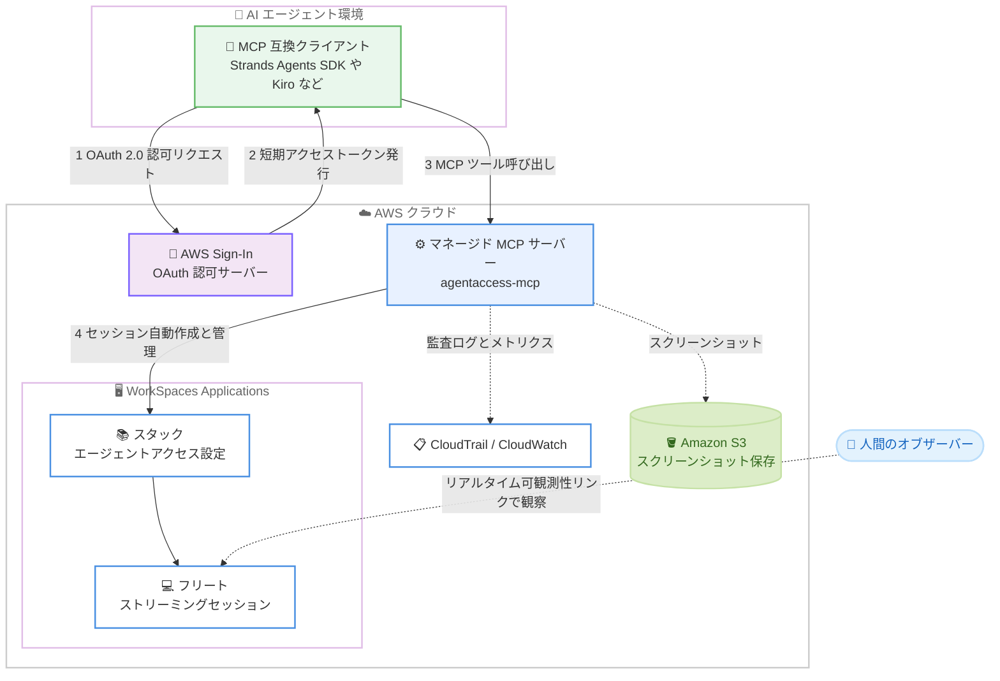

# Amazon WorkSpaces - AI エージェント向けセキュアアクセスの簡素化 (OAuth 2.0 認証と接続ライフサイクル管理)

**リリース日**: 2026 年 10 月 20 日
**サービス**: Amazon WorkSpaces (WorkSpaces Applications)
**機能**: WorkSpaces for AI agents - マネージド MCP サービスによる認証と接続管理

📊 [このアップデートのインフォグラフィックを見る](https://takech9203.github.io/aws-news-summary/20261020-workspaces-ai-agents-oauth-connection-management.html)

## 概要

Amazon WorkSpaces は、AI エージェントがエンタープライズのクラウドデスクトップへセキュアにアクセスするための仕組みを強化しました。WorkSpaces for AI agents のマネージド MCP (Model Context Protocol) サービスが認証とデスクトップ接続を一括して処理するようになり、カスタムコードを書くことなく、任意の MCP 互換クライアントからガバナンスの効いたクラウドデスクトップへエージェントを接続できるようになりました。

今回のアップデートでは、OAuth 2.0 による既存 AWS 認証情報を使ったセッション作成、サービス側での接続ライフサイクル管理、セッション状態のクエリとリアルタイム可観測性リンクの生成、そしてアプリケーションカタログ MCP ツールによるアプリケーションのプログラマティックな発見・起動・切替が可能になりました。エージェントセッションは人間のワークフォースと同じ VPC 制御、DLP ポリシー、セッションレベルセキュリティを継承するため、既存のセキュリティ境界を維持したままエージェントを運用できます。

さらに、South America (São Paulo)、Europe (Milan)、Europe (Spain)、Asia Pacific (Malaysia) の 4 リージョンが新たに利用可能になりました。

**アップデート前の課題**

- エージェントをデスクトップに接続するには、ストリーミング URL の生成・呼び出し・ローテーションといったプリセッション要件を自前で管理する必要があった
- セッションの有効期限が切れるたびに URL を再生成する仕組みをカスタムコードとして実装・運用する必要があり、インフラ管理の負担が大きかった
- エージェントがデスクトップ上のアプリケーションを起動するには、スタートメニューやタスクバーをスクリーンショットとクリック操作で辿る必要があり、精度の低下とトークンコストの増加を招いていた
- エージェントがどのデスクトップスタック・フリート・セッションに接続しているかを確認する統一的な手段が不足していた

**アップデート後の改善**

- OAuth 2.0 により既存の AWS 認証情報を使ってセッションを作成でき、接続ライフサイクルはサービスが管理するため、ストリーミング URL の管理コードが不要になった
- デスクトップスタックを一度設定すれば、エージェントは基盤のストリーミング接続を意識せずに適切なデスクトップへ到達できるようになった
- 管理者はエージェントごとのセッション状態 (デスクトップスタック / フリート / セッション) をクエリし、リアルタイム可観測性リンクを生成してエージェントの活動を監査できるようになった
- アプリケーションカタログ MCP ツールにより、アプリケーションの一覧取得・起動 (単一または複数)・切替をプログラマティックかつ決定論的に実行でき、精度向上とトークンコスト削減を実現した

## アーキテクチャ図



AI エージェントは OAuth 2.0 で AWS Sign-In から短期アクセストークンを取得し、マネージド MCP サーバー経由で WorkSpaces のストリーミングセッションに接続します。セッションの作成からクリーンアップまでのライフサイクルはサービスが管理し、活動は CloudTrail や可観測性リンクで監査できます。

## サービスアップデートの詳細

### 主要機能

1. **OAuth 2.0 による認証とマネージド接続ライフサイクル**
   - 既存の AWS 認証情報 (IAM アイデンティティ) を使って OAuth 2.0 でセッションを作成可能
   - AWS Sign-In が認可サーバーとして機能し、短期かつスコープ限定のアクセストークンを発行
   - ブラウザを開けるエージェント向けのインタラクティブ認可と、ヘッドレス環境向けの非インタラクティブ認可 (クライアントクレデンシャルグラント) の両方をサポート
   - ストリーミング URL の生成・ローテーションが不要になり、サービスが接続ライフサイクルを管理
   - 従来どおり SigV4 署名 (サービス名 `agentaccess-mcp`) による接続も選択可能

2. **セッション状態のクエリと可観測性**
   - `get_session_info` ツールで、エージェントが接続しているデスクトップスタック、フリート、セッション (`mcpSessionId`、`stack`、`userId`、`workSpacesSessionId`、`fleet`) を確認可能
   - エージェントの活動をリアルタイムに観察できる可観測性リンクを生成でき、監査の可視性を確保
   - ユーザーコントロールモード (`VIEW_ONLY` / `VIEW_STOP` / `DISABLED`) により、人間のオブザーバーがエージェントセッションをブラウザで観察し、必要に応じて停止可能

3. **アプリケーションカタログ MCP ツール**
   - `launch_application` ツールでフリートイメージのカタログに登録されたアプリケーションを ID 指定で起動 (複数アプリケーションの同時起動も可能)
   - `toggle_app_switcher` ツールでアプリケーション間の切替を実行
   - スタートメニューやタスクバーをスクリーンショットで辿るナビゲーションを置き換え、プログラマティックで決定論的な操作パスを提供
   - 操作精度の向上とトークンコストの削減を実現

4. **エンタープライズセキュリティの継承**
   - エージェントセッションは人間のユーザーと同じネットワーク分離とコンプライアンス境界の中で実行
   - 既存の VPC 制御、DLP ポリシー、セッションレベルのセキュリティ設定をそのまま継承
   - CloudTrail によるツール呼び出しの監査ログ (データイベント)、CloudWatch メトリクス、S3 へのスクリーンショット保存に対応

5. **リージョン拡大**
   - South America (São Paulo)、Europe (Milan)、Europe (Spain)、Asia Pacific (Malaysia) の 4 リージョンを新規追加

## 技術仕様

### マネージド MCP サーバーの仕様

| 項目 | 詳細 |
|------|------|
| エンドポイント | `https://agentaccess-mcp.{region}.api.aws/mcp` |
| トランスポート | Streamable HTTP (サーバーコンポーネントのインストール不要) |
| 認証方式 | SigV4 署名、または AWS Sign-In 経由の OAuth (インタラクティブ / 非インタラクティブ) |
| セッション識別 | スタック + ユーザー ID のヘッダー指定、またはストリーミング URL のヘッダー指定 (非ドメイン参加フリート)。ドメイン参加フリートは SAML アサーション |
| 接続モード | `BLOCKING` (デフォルト、接続確立まで待機) / `POLLING` (即時応答し `connection_status` でポーリング) |
| 対応 OS イメージ | Windows Server イメージのみ |
| 同時接続 | 1 セッションにつき 1 エージェント接続のみ |
| 画面解像度 | 1280x720 (スクリーンショット形式は PNG または JPEG) |
| 対応フレームワーク | Strands Agents SDK、mcp-proxy-for-aws、Kiro、Claude Code、Cursor などの MCP 互換クライアント |

### 主な MCP ツール

| カテゴリ | ツール例 | 説明 |
|------|------|------|
| マウス | `left_click`、`double_click`、`scroll`、`left_click_drag` など | 座標指定によるデスクトップ操作 |
| キーボード | `type_text`、`key`、`hold_key` | テキスト入力 (最大 10,000 文字)、キー操作 |
| スクリーン | `screenshot` | デスクトップのスクリーンショット取得 |
| アプリケーション | `launch_application`、`toggle_app_switcher` | カタログ登録アプリの起動と切替 |
| セッション | `get_session_info` | スタック / フリート / セッション情報の取得 |

### IAM によるアクセス制御の例

スタック単位でエージェントのアクセスを制限する IAM ポリシーの例です。

```json
{
  "Action": "agentaccess-mcp:*",
  "Resource": "*",
  "Condition": {
    "ArnLike": {
      "agentaccess-mcp:StackArn": "arn:aws:appstream:{region}:{account-id}:stack/{stack-name}"
    }
  }
}
```

## 設定方法

### 前提条件

1. アクティブな WorkSpaces Applications フリート (Always-On または On-Demand)。マルチセッションフリートと Elastic フリートは非対応
2. フリートに関連付けられたスタック (スタック作成時にエージェントアクセスを有効化)
3. WorkSpaces Applications のスタックを作成・管理できる権限を持つ AWS アカウント
4. 最新の WorkSpaces Applications Agent が稼働するフリート
5. スクリーンショット保存を使う場合は S3 バケット (エージェントに `s3:PutObject` 権限が必要)

### 手順

#### ステップ 1: エージェントアクセスを有効にしたスタックを作成

```bash
# コンソール、AWS CLI、または API でスタック作成時にエージェントアクセスを有効化
# AgentAccessConfig でコンピュータ入力・ビジョン、ユーザーコントロールモードなどを設定
```

スタック作成時にエージェントアクセスを有効化すると、人間のユーザー向け設定の代わりにエージェント固有の設定 (コンピュータ入力 / ビジョン、スクリーンショット保存、ユーザーコントロールモードなど) が適用されます。

#### ステップ 2: エージェントから MCP サーバーに接続

```python
from mcp_proxy_for_aws import aws_iam_streamablehttp_client

# スタックとユーザー ID をヘッダーで渡すと MCP サーバーがセッションを自動作成する
async with aws_iam_streamablehttp_client(
    endpoint="https://agentaccess-mcp.{region}.api.aws/mcp",
    aws_service="agentaccess-mcp",
    aws_region="{region}",
    headers={
        "x-amzn-agentaccess-workspaces-applications-stack": "{stack-name-or-arn}",
        "x-amzn-agentaccess-workspaces-applications-user-id": "{user-id}",
    },
) as (read, write, _):
    ...
```

スタック名とユーザー ID をヘッダーで指定するだけで、MCP サーバーがストリーミングセッションを作成します。ストリーミング URL の生成やローテーションのコードは不要です。なお、ユーザー ID ヘッダーを省略した場合は、認証済みセッションの `SourceIdentity` または IAM プリンシパルからユーザー ID が導出されます。OAuth 互換の MCP クライアント (Kiro、Claude Code、Cursor など) であれば、ローカルプロキシなしでエンドポイントに直接接続し、AWS Sign-In の OAuth フローで認可できます。

#### ステップ 3: セッション情報の確認と可観測性リンクの生成

```python
# セッション情報を取得
result = await session.call_tool("get_session_info", {})
# 返却値: mcpSessionId, stack, userId, workSpacesSessionId, fleet

# 取得した stack / fleet / userId を使って CreateStreamingURL を呼び出し、
# オブザーバー用のリアルタイム観察リンクを生成する
```

`get_session_info` で取得した情報をもとに `CreateStreamingURL` API を呼び出すと、人間のオブザーバーがブラウザでエージェントの操作をリアルタイムに観察できるリンクを生成できます。このリンクはセッションへのアクセスを許可するため、モデルのコンテキストには含めず、エージェントのコード側で処理することが推奨されています。

## メリット

### ビジネス面

- **運用負担の削減**: ストリーミング URL の生成・ローテーションを行うカスタムインフラが不要になり、エージェント接続基盤の構築・保守コストを削減できる
- **ガバナンスの一貫性**: 人間のワークフォースと同じ VPC 制御、DLP ポリシー、セッションセキュリティをエージェントにも適用でき、コンプライアンス要件を満たしたままエージェント活用を推進できる
- **監査性と安心感**: セッション状態のクエリとリアルタイム可観測性リンクにより、エージェントの行動を可視化し、必要に応じて人間が介入・停止できる

### 技術面

- **標準プロトコルによる統合**: MCP 互換クライアントであれば、Strands Agents SDK、Kiro、Claude Code などから追加のサーバーコンポーネントなしで接続できる
- **OAuth 2.0 の柔軟な認可モデル**: ブラウザベースのインタラクティブ認可と、ヘッドレスエージェント向けの非インタラクティブ認可の両方に対応し、既存 IAM ポリシーによるチェックが常に適用される
- **決定論的なアプリケーション操作**: カタログ MCP ツールにより、スクリーンショットとクリックの試行錯誤を減らし、操作精度の向上とトークンコストの削減を両立できる

## デメリット・制約事項

### 制限事項

- Windows Server イメージのみサポート (Linux イメージは非対応)
- VPC エンドポイント経由の MCP サーバー接続は非対応
- マルチセッションフリートと Elastic フリートは非対応
- 1 つのセッションに接続できるエージェントは 1 つのみ。同一ユーザー ID はフリートごとに 1 アクティブセッションまでのため、複数エージェントの並行実行には個別のセッションが必要
- エージェント向けの画面解像度は 1280x720 に固定

### 考慮すべき点

- コンピュータ入力を使うにはコンピュータビジョンの有効化が必須 (ツール転送のみを使う場合は両方オフでも可)
- ドメイン参加フリートでは SAML フェデレーションと証明書ベース認証が必要で、接続方式が非ドメイン参加フリートと異なる
- 接続前にフリートが稼働中でキャパシティに空きがある必要があるため、フリートの Auto Scaling 設計が重要
- CloudTrail でツール呼び出しを記録するには、データイベントを記録する証跡の設定が別途必要

## ユースケース

### ユースケース 1: 業務アプリケーションの定型作業の自動化

**シナリオ**: Web 化されていない Windows デスクトップ専用の業務アプリケーション (ERP クライアントなど) へのデータ入力作業を AI エージェントに委任したい。

**実装例**:
```
1. 業務アプリケーションを含むイメージでフリートとスタックを構築し、エージェントアクセスを有効化
2. エージェントは OAuth 2.0 で認可を取得し、スタック名をヘッダーに指定して MCP サーバーへ接続
3. launch_application で業務アプリケーションを起動し、screenshot / left_click / type_text で入力作業を実行
```

**効果**: ストリーミング URL 管理のカスタムコードなしで、既存のセキュリティ境界内で定型作業を自動化できる。

### ユースケース 2: 人間による監督付きのエージェント運用

**シナリオ**: 金融機関などの規制業種で、AI エージェントの操作を人間がリアルタイムに監視し、問題があれば即座に停止できる体制が求められている。

**実装例**:
```
1. スタックの AgentAccessConfig で UserControlMode を VIEW_STOP に設定
2. get_session_info で取得した情報から可観測性リンクを生成し、監督者に共有
3. 監督者はブラウザでエージェントの操作を観察し、必要に応じて停止ボタンでエージェントを停止
```

**効果**: エージェントの自律動作と人間によるガバナンスを両立し、監査要件を満たした運用が可能になる。

### ユースケース 3: 複数アプリケーションを横断するワークフロー

**シナリオ**: エージェントが表計算ソフトからデータを読み取り、別の社内ツールへ転記するなど、複数アプリケーションを行き来する処理を実行したい。

**実装例**:
```
1. フリートイメージのカタログに対象アプリケーションを登録
2. launch_application で複数アプリケーションを起動
3. toggle_app_switcher と left_click でアプリケーションを切り替えながら処理を実行
```

**効果**: スタートメニュー操作をスクリーンショットで辿る必要がなくなり、決定論的な切替により精度向上とトークンコスト削減を実現できる。

## 料金

今回の発表では、この機能に固有の追加料金は明示されていません。WorkSpaces Applications のフリート稼働時間に基づく既存の料金体系が適用されます。詳細は [Amazon WorkSpaces Applications の料金ページ](https://aws.amazon.com/workspaces-family/applications/pricing/) を参照してください。

## 利用可能リージョン

今回のアップデートで以下の 4 リージョンが新たに追加されました。

- South America (São Paulo)
- Europe (Milan)
- Europe (Spain)
- Asia Pacific (Malaysia)

既存の対応リージョンを含む最新のエンドポイント一覧は、[WorkSpaces Applications MCP エンドポイントのドキュメント](https://docs.aws.amazon.com/appstream2/latest/developerguide/allowed-domains.html)を参照してください。

## 関連サービス・機能

- **Amazon WorkSpaces Applications (旧 AppStream 2.0)**: 本機能の基盤となるアプリケーションストリーミングサービス。スタック、フリート、イメージの概念をそのまま利用する
- **AWS Sign-In**: OAuth 2.0 認可サーバーとして機能し、短期かつスコープ限定のアクセストークンを発行する
- **Agent Toolkit for AWS / AWS MCP Server**: エージェント開発を支援するツールキット。OAuth 認可の仕組みは AWS MCP Server と共通
- **Strands Agents SDK / mcp-proxy-for-aws**: MCP サーバーへの接続が検証済みのエージェントフレームワークと SigV4 署名対応トランスポート
- **AWS CloudTrail / Amazon CloudWatch**: エージェントのツール呼び出しの監査ログ記録と、`Invocations` や `McpSessionDuration` などの運用メトリクス監視

## 参考リンク

- 📊 [インフォグラフィック](https://takech9203.github.io/aws-news-summary/20261020-workspaces-ai-agents-oauth-connection-management.html)
- [公式発表 (What's New)](https://aws.amazon.com/about-aws/whats-new/2026/10/workspaces-ai-agents-oauth-connection-management)
- [ドキュメント: Provide agents access to WorkSpaces](https://docs.aws.amazon.com/appstream2/latest/developerguide/agent-access.html)
- [ドキュメント: WorkSpaces Applications MCP server](https://docs.aws.amazon.com/appstream2/latest/developerguide/agent-access-mcp-server.html)
- [サンプルコード (GitHub)](https://github.com/aws-samples/sample-code-for-workspaces-agent-access)
- [料金ページ](https://aws.amazon.com/workspaces-family/applications/pricing/)

## まとめ

今回のアップデートにより、AI エージェントを WorkSpaces のクラウドデスクトップへ接続する際の最大の運用負担であったストリーミング URL の管理が不要になり、OAuth 2.0 と既存 IAM による統制の効いた接続が実現しました。デスクトップ上の業務アプリケーションをエージェントに操作させるユースケースを検討している場合は、まず検証用のフリートとスタックでエージェントアクセスを有効化し、カタログ MCP ツールとユーザーコントロールモードを組み合わせた運用を試すことを推奨します。
