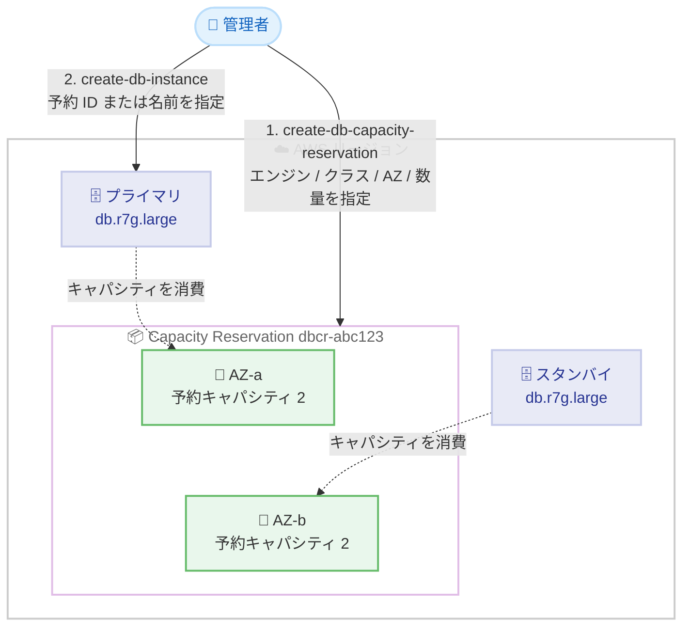

# Amazon Aurora / Amazon RDS - On-Demand Capacity Reservations

**リリース日**: 2026 年 10 月 21 日
**サービス**: Amazon Aurora、Amazon RDS
**機能**: On-Demand Capacity Reservations (オンデマンドキャパシティ予約)

📊 [このアップデートのインフォグラフィックを見る](https://takech9203.github.io/aws-news-summary/20261021-amazon-aurora-rds-on-demand-capacity-reservations.html)

## 概要

Amazon Aurora および Amazon RDS が On-Demand Capacity Reservations (ODCR) をサポートしました。リージョン内の 1 つ以上のアベイラビリティーゾーン (AZ) で、DB インスタンス用のコンピュートキャパシティを必要な期間だけ予約できるようになります。これにより、DB インスタンスの作成 (create)、復元 (restore)、コンピュートスケーリング (scale-compute)、起動 (start) の各操作が InsufficientCapacity エラーで失敗することを防げます。

予約の作成時には、DB インスタンスクラス、データベースエンジン、AZ、AZ ごとの予約キャパシティ数を指定します。複数の AZ に同じキャパシティを予約することで、Multi-AZ 配置にも対応できます。予約は「即時利用」(コミットメント不要、いつでもキャンセル可能) と「将来日付のスケジュール」(5〜120 日先に開始、最低コミットメント期間あり) の 2 つの方式から選択できます。

移行、製品ローンチ、季節的なピーク (年末商戦など)、高可用性構成、災害対策 (DR) といったビジネスクリティカルなイベントの前に、確実にコンピュートキャパシティを確保しておきたいユーザーに有用なアップデートです。

**アップデート前の課題**

- 以前は Aurora / RDS にはキャパシティ予約の仕組みがなく、DB インスタンスの作成・復元・スケーリング・起動時に AZ のキャパシティ不足 (InsufficientCapacity) で操作が失敗するリスクがあった
- 大規模移行やセール期間などのピークイベント前に、必要なキャパシティを事前に確保する手段がなかった
- DR 戦略において、フェイルオーバー先やリストア先のリージョン / AZ でキャパシティが確保できる保証がなかった
- Reserved DB Instances や Database Savings Plans は料金割引を提供するが、物理的なキャパシティは予約されない

**アップデート後の改善**

- 今回のアップデートにより、特定の DB インスタンスクラス・エンジン・AZ の組み合わせでコンピュートキャパシティを事前に予約し、create / restore / scale-compute / start 操作の失敗を防止できるようになった
- 即時利用の予約はコミットメント不要で、不要になったらいつでもキャンセルできるようになった
- 将来のイベントに備えて 5〜120 日先に開始する予約をスケジュールできるようになった
- 既存の Reserved DB Instances / Database Savings Plans の割引が、予約キャパシティ上で稼働するインスタンスにも自動適用されるため、キャパシティ確保と料金割引を組み合わせられるようになった

## アーキテクチャ図



管理者が複数 AZ にキャパシティ予約を作成し、DB インスタンス作成時に予約 ID (`dbcr-`) または予約名を指定して予約キャパシティへ配置する流れを示しています。Multi-AZ 構成では、プライマリとスタンバイがそれぞれの AZ の予約キャパシティを消費します。

## サービスアップデートの詳細

### 主要機能

1. **コンピュートキャパシティの予約**
   - DB インスタンスクラス (例: db.r7g.large)、データベースエンジン (例: RDS for PostgreSQL)、1 つ以上の AZ、AZ ごとの予約数の組み合わせでキャパシティを保持する
   - 複数のライセンスモデルを持つエンジン (Oracle など) では、`license-included` / `bring-your-own-license` のいずれかを指定する
   - 予約は `dbcr-` プレフィックス付きの ID と、作成時に付与する名前で識別される
   - 予約により、create / restore / scale-compute / start 操作がキャパシティ不足で失敗することを防ぐ

2. **ターゲット型の予約消費**
   - Aurora / RDS のキャパシティ予約は「ターゲット型」であり、DB インスタンスの作成・復元・変更・起動時に予約の ID または名前を明示的に指定した場合のみ予約を消費する
   - 予約を作成しただけでは、予約を指定しない他の DB インスタンスの配置には影響しない
   - DB インスタンスのエンジン、インスタンスクラス、ライセンスモデル、AZ が予約と一致し、その AZ に空きキャパシティがある必要がある

3. **Multi-AZ 配置のサポート**
   - 2 つ以上の AZ を指定すると、各 AZ に同じキャパシティが予約される
   - Multi-AZ DB インスタンスでは、プライマリとスタンバイの両方の AZ に空きキャパシティが必要

4. **2 つの予約方式**
   - **即時利用**: 作成と同時にキャパシティが予約され課金が開始される。コミットメント不要で、いつでもキャンセル可能
   - **将来日付のスケジュール**: 開始日を 5〜120 日先に設定し、最低コミットメント期間 (14 日、X ファミリーは 12 週間) を指定する。開始日までは課金されない

## 技術仕様

### 予約の構成要素

| 項目 | 詳細 |
|------|------|
| DB インスタンスクラス | 予約対象のクラス (例: db.r7g.large)。1 予約につき 1 クラス |
| データベースエンジン | 予約対象のエンジン (例: postgres)。1 予約につき 1 エンジン |
| アベイラビリティーゾーン | 単一リージョン内の 1 つ以上の AZ。予約は指定した AZ でのみ利用可能 |
| AZ ごとの予約キャパシティ | 各 AZ に予約する DB インスタンス数。全 AZ で同数 |
| ライセンスモデル | 複数のライセンスオプションを持つエンジンのみ指定 (例: bring-your-own-license) |
| 終了日 | 任意。指定しない場合はキャンセルするまで有効 |

### 予約のライフサイクル (状態)

| 状態 | 説明 |
|------|------|
| `pending` | 予約キャパシティのプロビジョニング中 |
| `active` | キャパシティが予約済みで利用可能。課金が発生 |
| `expired` | 終了日に到達し、キャパシティが解放された |
| `cancelled` | ユーザーがキャンセルし、キャパシティが解放された |
| `failed` | 予約のプロビジョニングに失敗した |
| `assessing` | (将来日付) 要求されたキャパシティを提供可能か評価中 |
| `scheduled` | (将来日付) 要求が受理され、開始日にキャパシティが提供される。課金はまだ発生しない |
| `delayed` | (将来日付) 開始日にキャパシティを提供できず、引き続き調達中。コミットメントは一部免除される |
| `unsupported` | (将来日付) 要求された構成を指定日にスケジュールできない |

### 将来日付の予約の要件

| 項目 | 要件 |
|------|------|
| 開始日 | 現在から 5〜120 日先 |
| 最低コミットメント期間 | 14 日 (X ファミリーは 12 週間) |
| 対応インスタンスファミリー | C、M、R、T、X ファミリーのみ |
| 世代要件 | M / R ファミリーは第 7 世代以降 (db.m7g、db.r7g など。db.m6g、db.r6i は不可) |
| 最低規模 | 各 AZ で合計 32 vCPU 以上 (例: db.r7g.large は 2 vCPU のため、AZ あたり 16 ユニット以上) |

### Capacity Reservations と既存の割引オプションの比較

| 項目 | Capacity Reservations | Reserved DB Instances | Database Savings Plans |
|------|----------------------|----------------------|------------------------|
| コミットメント | 即時利用は不要 (将来日付は最低期間あり) | 1 年または 3 年 | 1 年 |
| キャパシティ確保 | 特定 AZ でキャパシティを予約 | なし | なし |
| 料金割引 | なし (RI / Savings Plans と併用可能) | あり | あり |

### API 変更履歴

| 日付 | サービス | 変更内容 |
|------|----------|----------|
| 2026/10/20 | [rds](https://awsapichanges.com/archive/changes/c13b91-rds.html) | 4 new 13 updated api methods - `CreateDBCapacityReservation`、`DescribeDBCapacityReservations`、`ModifyDBCapacityReservation`、`CancelDBCapacityReservation` の 4 API が新規追加。`CreateDBInstance`、`RestoreDBInstance*`、`ModifyDBInstance`、`StartDBInstance` などに `DBCapacityReservationIdentifier` パラメータが追加 |

## 設定方法

### 前提条件

1. Amazon Aurora または Amazon RDS を利用できる AWS アカウント
2. 予約キャパシティは On-Demand DB インスタンスのアカウントクォータの範囲内であること (既存インスタンス数 + 未使用予約キャパシティがクォータにカウントされる)
3. AWS CLI を使用する場合は、ODCR 対応バージョンへの更新

### 手順

#### ステップ 1: キャパシティ予約の作成 (即時利用)

```bash
aws rds create-db-capacity-reservation \
    --db-capacity-reservation-name my-multi-az-reservation \
    --engine postgres \
    --db-instance-class db.r7g.large \
    --availability-zones us-east-1a us-east-1b \
    --capacity-per-availability-zone 2
```

RDS for PostgreSQL の db.r7g.large 用に、us-east-1a と us-east-1b の 2 つの AZ にそれぞれ 2 インスタンス分のキャパシティを即時予約しています。レスポンスで `dbcr-` プレフィックス付きの予約 ID が返され、状態が `active` になると利用可能です。課金は作成と同時に開始されます。

#### ステップ 2: 将来日付の予約の作成 (スケジュール)

```bash
aws rds create-db-capacity-reservation \
    --db-capacity-reservation-name peak-reservation \
    --engine postgres \
    --db-instance-class db.r7g.large \
    --availability-zones us-east-1a \
    --capacity-per-availability-zone 16 \
    --start-date 2026-11-01T00:00:00Z \
    --commitment-duration 1209600
```

`--start-date` で開始日 (5〜120 日先)、`--commitment-duration` でコミットメント期間を秒単位 (1209600 秒 = 14 日) で指定しています。予約は `assessing` 状態で作成され、受理されると `scheduled` になり、開始日に `active` へ移行します。開始日までは課金されません。

#### ステップ 3: 予約を指定して DB インスタンスを作成

```bash
aws rds create-db-instance \
    --db-instance-identifier my-db-instance \
    --engine postgres \
    --db-instance-class db.r7g.large \
    --availability-zone us-east-1a \
    --allocated-storage 100 \
    --master-username admin \
    --manage-master-user-password \
    --db-capacity-reservation-identifier my-multi-az-reservation
```

`--db-capacity-reservation-identifier` に予約名または `dbcr-` ID を指定して、予約キャパシティ内に DB インスタンスを作成しています。同じパラメータは `restore-db-instance-from-db-snapshot`、`restore-db-instance-to-point-in-time`、`restore-db-instance-from-s3`、`create-db-instance-read-replica`、`modify-db-instance`、`start-db-instance` でも使用できます。

#### ステップ 4: 予約の利用状況の確認

```bash
aws rds describe-db-capacity-reservations
```

予約の状態、AZ ごとの空きキャパシティ (`AvailableCapacityPerAvailabilityZoneList`)、コミットメント情報などを確認しています。DB インスタンスが予約に配置されると、該当 AZ の `AvailableCapacity` が減少します。

## メリット

### ビジネス面

- **ビジネスクリティカルなイベントの確実な実行**: 移行、製品ローンチ、年末商戦などのピークイベント前にキャパシティを確保し、当日のキャパシティ不足リスクを排除できる
- **柔軟なコミットメント**: 即時利用の予約はコミットメント不要でいつでもキャンセルでき、必要な期間だけキャパシティを確保できる
- **既存割引との併用**: Reserved DB Instances や Database Savings Plans の割引が自動適用されるため、キャパシティ確保のために割引を諦める必要がない

### 技術面

- **運用操作の失敗防止**: create / restore / scale-compute / start 操作が InsufficientCapacity で失敗しなくなり、DR のリストアやフェイルオーバー計画の信頼性が向上する
- **Multi-AZ 対応**: 複数 AZ に同一キャパシティを予約でき、プライマリとスタンバイの両方の配置を保証できる
- **ターゲット型による影響の局所化**: 予約を明示的に指定したインスタンスのみが予約を消費するため、既存ワークロードの配置に影響を与えない

## デメリット・制約事項

### 制限事項

- 1 つの予約は 1 つの DB インスタンスクラス、1 つのエンジン、(複数ある場合は) 1 つのライセンスモデルのみをカバーする。異なる組み合わせには複数の予約が必要
- 予約は単一リージョン内の指定した AZ に限定され、他の AZ のインスタンスは予約を利用できない
- RDS Custom (`custom-oracle-*`、`custom-sqlserver-*` エンジン) はサポート対象外
- コンピュートキャパシティのみが予約対象で、ストレージ、I/O などは予約されない
- 将来日付の予約には、インスタンスファミリー (C / M / T / R / X)、世代 (M / R は第 7 世代以降)、最低規模 (AZ あたり 32 vCPU 以上)、最低コミットメント期間 (14 日、X ファミリーは 12 週間) の制約がある
- 予約キャパシティは同一アカウント内のマッチングする DB インスタンスにのみ適用される

### 考慮すべき点

- 予約中はインスタンスの稼働有無にかかわらず、未使用分もオンデマンド料金相当で課金される。不要になった予約は速やかにキャンセルしないとコストが発生し続ける
- 予約キャパシティは AZ あたりのキャパシティ x AZ 数でアカウントの On-Demand DB インスタンスクォータを消費する (例: 3 AZ x 3 インスタンスで 9 クォータ)
- DB インスタンスを停止しても予約のコストは変わらず、停止したインスタンス分は未使用予約として課金される
- 既存インスタンスを設定変更なしで予約に移すには、インスタンス変更 (クラス / Multi-AZ / ライセンスモデルの変更を伴う) または停止後に予約を指定して起動する操作が必要
- 将来日付の予約が `delayed` 状態になった場合、AWS は改訂された提供日を提示しない

## ユースケース

### ユースケース 1: オンプレミスから Aurora / RDS への大規模移行

**シナリオ**: 数十台の Oracle / PostgreSQL データベースを計画的に RDS へ移行する。移行当日にターゲットの AZ でキャパシティ不足が発生すると、移行ウィンドウを逃してしまう。

**実装例**:
```bash
# 移行の 2 週間前に、移行先 AZ のキャパシティをスケジュール予約
aws rds create-db-capacity-reservation \
    --db-capacity-reservation-name migration-wave1 \
    --engine oracle-se2 \
    --db-instance-class db.r7i.large \
    --availability-zones ap-northeast-1a \
    --capacity-per-availability-zone 20 \
    --license-model bring-your-own-license \
    --start-date 2026-11-10T00:00:00Z \
    --commitment-duration 1209600
```

**効果**: 移行当日に必要なキャパシティが保証され、移行プロジェクトのスケジュールリスクを低減できる。

### ユースケース 2: 年末商戦などの季節的ピークへの備え

**シナリオ**: EC サイトが第 4 四半期のセールイベントに向けて、リードレプリカの追加やインスタンスクラスのスケールアップを計画している。ピーク直前のスケール操作がキャパシティ不足で失敗する事態を避けたい。

**実装例**:
```bash
# ピーク前にスケールアップ先クラスのキャパシティを予約
aws rds create-db-capacity-reservation \
    --db-capacity-reservation-name q4-peak \
    --engine postgres \
    --db-instance-class db.r7g.4xlarge \
    --availability-zones us-east-1a us-east-1b \
    --capacity-per-availability-zone 4

# ピーク時に予約を指定してスケールアップ
aws rds modify-db-instance \
    --db-instance-identifier prod-db \
    --db-instance-class db.r7g.4xlarge \
    --db-capacity-reservation-identifier q4-peak \
    --apply-immediately
```

**効果**: ピーク時のスケール操作が確実に成功し、イベント終了後は予約をキャンセルして余分なコストを抑えられる。

### ユースケース 3: 災害対策 (DR) のリストア先キャパシティ確保

**シナリオ**: DR 計画として、障害発生時にスナップショットからのリストアやポイントインタイムリカバリを想定している。大規模障害時には同一 AZ への需要が集中し、リストアがキャパシティ不足で失敗する可能性がある。

**実装例**:
```bash
# DR 用の予約を常時保持 (Multi-AZ 用に 2 AZ)
aws rds create-db-capacity-reservation \
    --db-capacity-reservation-name dr-reservation \
    --engine postgres \
    --db-instance-class db.r7g.2xlarge \
    --availability-zones us-west-2a us-west-2b \
    --capacity-per-availability-zone 2

# 障害時に予約を指定してリストア
aws rds restore-db-instance-from-db-snapshot \
    --db-instance-identifier dr-restored \
    --db-snapshot-identifier prod-snapshot \
    --db-instance-class db.r7g.2xlarge \
    --availability-zone us-west-2a \
    --db-capacity-reservation-identifier dr-reservation
```

**効果**: 障害時のリストアが確実に成功し、RTO (目標復旧時間) の達成確度が向上する。Reserved DB Instances の割引を組み合わせれば、予約の維持コストも軽減できる。

## 料金

キャパシティ予約は、予約期間中、DB インスタンスの稼働有無にかかわらず該当 DB インスタンスクラスのオンデマンド料金相当で課金されます。前払い料金はありません。

- 予約にマッチする DB インスタンスが稼働している間は、インスタンスの料金のみが課金され、その分の予約には追加料金が発生しない
- 未使用の予約キャパシティは「未使用予約」として請求書に表示される
- 課金は秒単位 (最低 60 秒) で計算される
- 予約はコンピュートキャパシティのみが対象で、ストレージ、I/O、バックアップストレージは通常どおり課金される
- Reserved DB Instances / Database Savings Plans の割引は、マッチする使用分に自動適用される

### 料金例

米国東部 (オハイオ) リージョンで db.m7g.large (オンデマンド料金 $0.168/時間と仮定) を 1 ユニット予約した場合の例です。

| 時間帯 | 予約と DB インスタンスの状態 | 課金 (概算) |
|--------|------------------------------|------------------|
| 1 時間目 | 予約はアクティブ、未使用 | 未使用予約として $0.168 |
| 2〜5 時間目 | DB インスタンスが予約内で稼働 | DB インスタンス料金 $0.168/時間のみ (予約の追加料金なし) |
| 6 時間目 | 予約をキャンセル、インスタンスは予約外で稼働 | オンデマンドの DB インスタンス料金 $0.168 |

詳細は [Amazon RDS の料金ページ](https://aws.amazon.com/rds/pricing/) を参照してください。

## 利用可能リージョン

すべての AWS 商用リージョンで、Amazon Aurora と Amazon RDS の両方に対して利用可能です。

## 関連サービス・機能

- **Reserved DB Instances**: 1 年 / 3 年コミットメントによる料金割引。キャパシティ予約と併用すると、割引とキャパシティ確保の両方を実現できる
- **Database Savings Plans**: 1 年コミットメントによる柔軟な料金割引。キャパシティ予約上の使用分にも自動適用される
- **Amazon EC2 On-Demand Capacity Reservations**: EC2 で先行して提供されている同種の機能。今回のアップデートで同様の概念が Aurora / RDS にも拡張された
- **Amazon RDS Multi-AZ 配置**: 複数 AZ への予約により、プライマリとスタンバイの両方の配置を保証できる

## 参考リンク

- 📊 [インフォグラフィック](https://takech9203.github.io/aws-news-summary/20261021-amazon-aurora-rds-on-demand-capacity-reservations.html)
- [公式発表 (What's New)](https://aws.amazon.com/about-aws/whats-new/2026/10/amazon-aurora-rds-on-demand-capacity-reservations/)
- [ドキュメント (Amazon RDS)](https://docs.aws.amazon.com/AmazonRDS/latest/UserGuide/capacity-reservations.html)
- [ドキュメント (Amazon Aurora)](https://docs.aws.amazon.com/AmazonRDS/latest/AuroraUserGuide/capacity-reservations.html)
- [API リファレンス (CreateDBCapacityReservation)](https://docs.aws.amazon.com/AmazonRDS/latest/APIReference/API_CreateDBCapacityReservation.html)
- [料金ページ (Amazon RDS)](https://aws.amazon.com/rds/pricing/)

## まとめ

Aurora / RDS の On-Demand Capacity Reservations により、移行・ローンチ・季節ピーク・DR といった重要イベントで DB インスタンス操作がキャパシティ不足で失敗するリスクを排除できるようになりました。即時利用はコミットメント不要で手軽に始められるため、まずは DR のリストア先やピークイベント前のスケールアップ先など、キャパシティ不足の影響が大きいシナリオでの活用を検討することを推奨します。未使用分もオンデマンド料金相当で課金されるため、Reserved DB Instances / Database Savings Plans との併用と、不要になった予約の速やかなキャンセルを運用に組み込むことが重要です。
