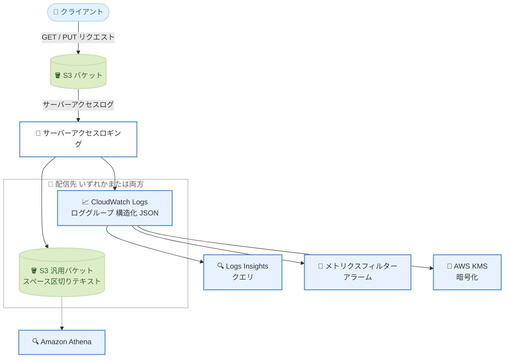

# Amazon S3 - サーバーアクセスログの CloudWatch Logs 配信が全 AWS リージョンで利用可能に

**リリース日**: 2026 年 10 月 21 日
**サービス**: Amazon S3, Amazon CloudWatch Logs
**機能**: Amazon S3 server access log delivery to Amazon CloudWatch Logs (リージョン拡大)

📊 [このアップデートのインフォグラフィックを見る](https://takech9203.github.io/aws-news-summary/20261021-amazon-s3-server-access-logs-cloudwatch-logs-regions.html)

## 概要

Amazon S3 サーバーアクセスログの Amazon CloudWatch Logs への配信が、新たに 5 つの AWS リージョン (AWS GovCloud (US) リージョン、AWS European Sovereign Cloud、AWS China リージョン) で利用可能になりました。今回の拡大により、本機能は**すべての AWS リージョンで利用可能**になりました。

S3 サーバーアクセスログは、バケットに対するリクエストの詳細な記録を提供する機能です。従来の S3 汎用バケットへの配信に加えて CloudWatch Logs へ配信すると、ログの到着と同時に CloudWatch Logs Insights でクエリを実行したり、エラー率などに対するアラームを設定したり、AWS KMS キーでログを暗号化したりできます。トラフィックパターンのモニタリング、アクセスインシデントの調査、S3 のアクセスアクティビティと他の運用データとの相関分析といった用途に活用できます。

今回のアップデートは、規制要件の厳しい公共部門 (GovCloud)、欧州のデータ主権要件を持つ組織 (European Sovereign Cloud)、中国国内でワークロードを運用する組織にとって、商用リージョンと同一のログ分析体験を利用できるようになる点で重要です。

**アップデート前の課題**

- AWS GovCloud (US)、AWS European Sovereign Cloud、AWS China の各リージョンでは、S3 サーバーアクセスログの配信先として S3 汎用バケットしか選択できなかった
- これらのリージョンでは、ログをほぼリアルタイムにクエリするために Athena のセットアップや独自の ETL パイプラインが必要だった
- サーバーアクセスログに対する AWS KMS キーによる暗号化 (S3 バケット配信は SSE-S3 のみ) やアラーム設定が困難だった

**アップデート後の改善**

- 全 AWS リージョンで S3 サーバーアクセスログを CloudWatch Logs へ配信可能になった
- ログ到着と同時に CloudWatch Logs Insights によるクエリ、メトリクスフィルターとアラームの設定が可能になった
- AWS KMS キーによるログの暗号化が可能になった
- 規制の厳しい環境でも、商用リージョンと一貫したログモニタリング構成を適用できるようになった

## アーキテクチャ図



S3 バケットへのリクエスト記録は、CloudWatch Logs のロググループと S3 汎用バケットのいずれか、または両方に配信できます。CloudWatch Logs に配信すると、クエリ、アラーム、KMS 暗号化をすぐに利用できます。

## サービスアップデートの詳細

### 主要機能

1. **リージョン拡大による全リージョン対応**
   - 新たに AWS GovCloud (US) リージョン、AWS European Sovereign Cloud、AWS China リージョンの計 5 リージョンで利用可能になった
   - これにより、S3 サーバーアクセスログの CloudWatch Logs 配信がすべての AWS リージョンで利用可能になった

2. **CloudWatch Logs 配信で利用できる機能 (既存機能の概要)**
   - 構造化 JSON 形式でロググループに配信され、CloudWatch Logs Insights で到着と同時にクエリ可能
   - メトリクスフィルターとアラームにより、エラー率の上昇などを検知可能
   - AWS KMS キーによるログの暗号化に対応
   - ロググループから Amazon S3 (JSON または Apache Parquet 形式) や Amazon Data Firehose への配信、S3 Tables (Apache Iceberg 形式) へのミラーリングにも拡張可能

3. **S3 汎用バケット配信との併用**
   - 既存の S3 汎用バケットへの配信 (スペース区切りテキスト形式) を補完するもので、両方の配信先を同時に利用することも可能
   - データへのアクセスをモニタリング・分析する方法の柔軟性が向上

## 技術仕様

### 配信オプションの比較

| 項目 | CloudWatch Logs | S3 汎用バケット |
|------|-----------------|-----------------|
| ログ形式 | 構造化 JSON (ロググループ)、JSON / Apache Parquet (S3 配信時)、Apache Iceberg (S3 Tables) | スペース区切りテキスト |
| クエリ | CloudWatch Logs Insights、Athena / Spark (S3 Tables 経由) | Amazon Athena |
| クロスアカウント集約 | 可能 (S3 / Firehose 配信先) | 不可 (同一アカウントのみ) |
| クロスリージョン集約 | 可能 (S3 / Firehose 配信先) | 不可 (同一リージョンのみ) |
| AWS KMS 暗号化 | 対応 | 非対応 (SSE-S3 のみ) |
| 設定方法 | CloudWatch Logs API または S3 コンソール | S3 API (PutBucketLogging) またはコンソール |
| 配信遅延 | 数時間以内 | 数時間以内 |
| 料金 | CloudWatch vended logs の取り込み料金 | 配信は無料、ログの保存料金のみ |

### ログ配信の特性

| 項目 | 詳細 |
|------|------|
| 配信方式 | ベストエフォート配信 (完全性・適時性は保証されない) |
| 配信タイミング | 多くの場合、リクエスト記録から数時間以内 |
| 設定変更の反映 | ロギング設定の変更が完全に反映されるまで時間差がある |

## 設定方法

### 前提条件

1. ログを取得したい S3 汎用バケット (ソースバケット) が存在すること
2. 配信先の CloudWatch Logs ロググループを作成できる権限があること
3. CloudWatch Logs のログ配信 (vended logs delivery) を設定する IAM 権限があること

### 手順

#### ステップ1: 配信先のロググループを作成

```bash
aws logs create-log-group \
  --log-group-name /aws/s3/access-logs/my-source-bucket
```

S3 サーバーアクセスログの配信先となる CloudWatch Logs ロググループを作成します。

#### ステップ2: S3 コンソールからサーバーアクセスロギングを有効化

S3 コンソールでソースバケットの [プロパティ] タブを開き、[サーバーアクセスのログ記録] を編集します。配信先として CloudWatch Logs を選択し、ステップ 1 で作成したロググループを指定します。CloudWatch Logs API (ログ配信 API) を使用して設定することも可能です。

#### ステップ3: Logs Insights でクエリを実行

```sql
fields @timestamp, @message
| filter httpStatus >= 400
| stats count() by httpStatus
| sort httpStatus
```

CloudWatch Logs Insights で、HTTP ステータスコードが 400 以上のエラーリクエストを集計するクエリの例です。メトリクスフィルターと組み合わせることで、エラー率に対するアラームも設定できます。

## メリット

### ビジネス面

- **全リージョンでの一貫性**: GovCloud、European Sovereign Cloud、China リージョンを含むすべてのリージョンで同一のログモニタリング構成を適用でき、マルチリージョンでのガバナンスが簡素化される
- **コンプライアンス対応**: 規制要件の厳しい環境でも AWS KMS キーによるログ暗号化が利用可能になり、セキュリティ要件を満たしやすくなる
- **運用の迅速化**: ログ到着と同時のクエリとアラームにより、アクセスインシデントの検知と調査を迅速化できる

### 技術面

- **即時クエリ**: Athena のテーブル定義や ETL なしで、CloudWatch Logs Insights によりログをすぐにクエリできる
- **アラーム連携**: メトリクスフィルターを使用してエラー率などの指標でアラームを設定できる
- **相関分析**: S3 のアクセスアクティビティをアプリケーションログなど他の運用データと同一基盤で相関分析できる

## デメリット・制約事項

### 制限事項

- CloudWatch Logs への配信には vended logs の取り込み料金が発生する (S3 汎用バケット配信は配信自体が無料)
- サーバーアクセスログはベストエフォート配信であり、完全性と適時性は保証されない (完全な監査証跡が必要な場合は AWS CloudTrail データイベントを検討)
- ロギング設定の変更が完全に反映されるまで時間差がある

### 考慮すべき点

- 大量のリクエストを受けるバケットでは取り込み料金が増加するため、S3 汎用バケット配信とのコスト比較を行うことが望ましい
- 既存の S3 バケット配信ベースの分析パイプラインがある場合、両方の配信先を併用して段階的に移行できる

## ユースケース

### ユースケース1: エラー率の監視とアラーム

**シナリオ**: 公共部門のシステムが GovCloud (US) 上の S3 バケットで静的コンテンツを配信しており、4xx / 5xx エラーの増加を早期に検知したい。

**実装例**:
```
サーバーアクセスログを CloudWatch Logs に配信
→ メトリクスフィルターで httpStatus >= 400 を抽出
→ エラー率のしきい値超過で CloudWatch アラームを発報し SNS 経由で通知
```

**効果**: エラー増加をほぼリアルタイムに検知し、障害対応を迅速化できる。

### ユースケース2: アクセスインシデントの調査

**シナリオ**: European Sovereign Cloud 上のバケットで意図しないアクセスの疑いがあり、特定の期間のアクセス元やリクエスト内容を調査したい。

**実装例**:
```
CloudWatch Logs Insights で期間を指定し、
リクエスタ、送信元 IP、オペレーション別にログを集計・フィルタリング
```

**効果**: Athena のセットアップなしで即座に調査を開始でき、インシデント対応時間を短縮できる。

### ユースケース3: 運用データとの相関分析

**シナリオ**: 中国リージョンで運用するアプリケーションのレイテンシー劣化の原因を、S3 アクセスパターンとアプリケーションログを突き合わせて分析したい。

**実装例**:
```
S3 サーバーアクセスログとアプリケーションログを CloudWatch Logs に集約
→ Logs Insights のクロスロググループクエリで時間帯別に相関分析
```

**効果**: S3 アクセスアクティビティと運用データを単一の基盤で分析し、原因特定を効率化できる。

## 料金

CloudWatch Logs への配信には、CloudWatch Logs の vended logs 取り込み料金 (ボリュームベースの段階制) が適用されます。CloudWatch Logs はログを圧縮して保存するため、保存ボリュームは取り込みボリュームより大幅に小さくなります。

S3 汎用バケットへの配信は引き続き配信自体は無料で、ログファイルの保存料金のみが発生します。

最新の料金は [CloudWatch 料金ページ](https://aws.amazon.com/cloudwatch/pricing/) を参照してください。

## 利用可能リージョン

今回、以下の 5 リージョンが追加されました。

- AWS GovCloud (US) リージョン
- AWS European Sovereign Cloud
- AWS China リージョン

これにより、S3 サーバーアクセスログの CloudWatch Logs 配信は**すべての AWS リージョン**で利用可能になりました。

## 関連サービス・機能

- **Amazon CloudWatch Logs**: ログの配信先。Logs Insights によるクエリ、メトリクスフィルター、アラーム、KMS 暗号化を提供
- **AWS KMS**: CloudWatch Logs に配信されたサーバーアクセスログの暗号化に使用
- **Amazon S3 Tables**: ロググループから Apache Iceberg 形式でミラーリングし、Athena や Spark による SQL 分析が可能
- **AWS CloudTrail**: S3 のデータイベントを記録する代替手段。完全な監査証跡が必要な場合に検討

## 参考リンク

- 📊 [インフォグラフィック](https://takech9203.github.io/aws-news-summary/20261021-amazon-s3-server-access-logs-cloudwatch-logs-regions.html)
- [公式発表 (What's New)](https://aws.amazon.com/about-aws/whats-new/2026/10/amazon-s3-server-access-logs-cloudwatch-logs-regions/)
- [ドキュメント: Logging requests with server access logging (Amazon S3 User Guide)](https://docs.aws.amazon.com/AmazonS3/latest/userguide/ServerLogs.html)
- [料金ページ (Amazon CloudWatch)](https://aws.amazon.com/cloudwatch/pricing/)

## まとめ

S3 サーバーアクセスログの CloudWatch Logs 配信が全 AWS リージョンで利用可能になり、GovCloud、European Sovereign Cloud、China リージョンでも商用リージョンと同等のログ分析・アラーム・暗号化機能を利用できるようになりました。これらのリージョンで S3 を運用している場合は、既存の S3 バケット配信と併用しながら、エラー率アラームやアクセスインシデント調査の迅速化のために CloudWatch Logs 配信の導入を検討することを推奨します。
