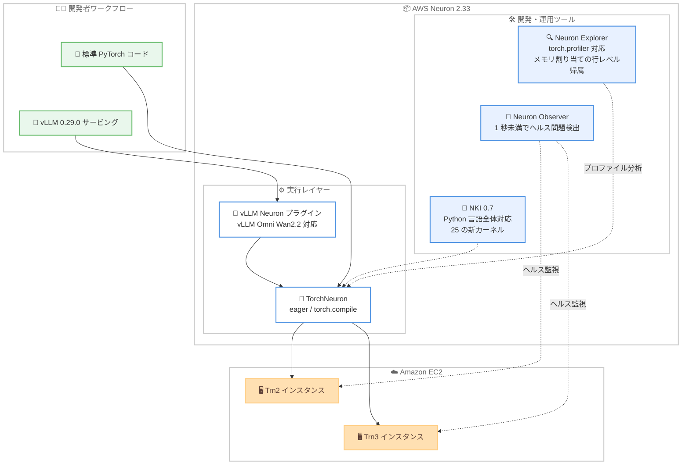

# AWS Neuron - Neuron 2.33 リリース (ネイティブ PyTorch サポート、Neuron Observer ほか)

**リリース日**: 2026 年 10 月 21 日
**サービス**: AWS Neuron (AWS Trainium / Inferentia 向け SDK)
**機能**: Neuron 2.33.0 リリース (TorchNeuron パブリックベータ、Neuron Observer パブリックベータ、vLLM プラグイン更新、Neuron Explorer 強化、NKI 拡張)

📊 [このアップデートのインフォグラフィックを見る](https://takech9203.github.io/aws-news-summary/20261021-aws-announce-neuron-2-33-0.html)

## 概要

AWS は、AWS Trainium / Inferentia 向け SDK である AWS Neuron のバージョン 2.33 を発表しました。本リリースは、ネイティブ PyTorch バックエンド「TorchNeuron」のパブリックベータ、Trainium のヘルス問題を 1 秒未満で検出する「Neuron Observer」のパブリックベータを柱とし、vLLM プラグインの更新、新しい Neuron DLAMI / DLC、プロファイリングツール「Neuron Explorer」の強化、Neuron Kernel Interface (NKI) の大幅な拡張を含む、開発者体験と運用性の両面にわたる包括的なアップデートです。

TorchNeuron により、標準の PyTorch API で書かれたモデルを Amazon EC2 Trn2 / Trn3 インスタンス上で eager モードまたは `torch.compile` で実行できるようになります (詳細は [個別レポート](./2026-10-20-aws-announce-native-pytorch-support-trainium.md) を参照)。また、vLLM Neuron プラグインは vLLM 0.29.0 に更新され、Wan2.2 動画生成向けの vLLM Omni Neuron プラグインが新たに Neuron リリースに追加されました。NKI では Python 言語全体 (ジェネレータ、クラス継承など) がカーネル記述に利用可能になり、NKI Library には DeepSeek-V3.2、Qwen3.5、Kimi Delta Attention 向けを含む 25 の新しい実験的カーネルが追加されています。

対象ユーザーは、Trainium / Inferentia 上でトレーニングや推論を行う ML エンジニア、AI 研究者、および大規模な Trainium クラスターを運用するインフラチームです。

**アップデート前の課題**

- 以前は、Trainium 上で標準の PyTorch API を使ったネイティブな eager 実行が利用できず、GPU と同等の開発体験を得にくかった
- Trainium デバイスのヘルス問題の検出と、影響を受けたノード / デバイスの特定に時間がかかり、大規模クラスターの運用負荷が高かった
- eager モードでのメモリ不足 (OOM) エラーの原因調査において、メモリ割り当てを Python ソースコードの行レベルで追跡する手段が限られていた
- NKI カーネルの記述には Python 言語機能の制約があり、ジェネレータやクラス継承を使ったメタプログラミングができなかった

**アップデート後の改善**

- TorchNeuron (パブリックベータ) により、標準 PyTorch API で書かれたモデルを Trn2 / Trn3 インスタンス上で eager モードまたは `torch.compile` で実行できるようになった
- Neuron Observer (パブリックベータ) により、Trainium のヘルス問題を 1 秒未満で検出し、影響を受けたノードやデバイスを特定できるようになった
- Neuron Explorer が `torch.profiler` のプロファイルを開けるようになり、PyTorch メモリスナップショットの割り当てを Python ソース行に帰属させて OOM デバッグを行えるようになった
- NKI カーネルで Python 言語全体が利用可能になり、NKI Library に 25 の新しい実験的カーネルが追加された

## アーキテクチャ図



Neuron 2.33 では、標準 PyTorch コードや vLLM サービングが TorchNeuron バックエンドを経由して Trn2 / Trn3 インスタンス上で実行されます。Neuron Observer がデバイスのヘルスを監視し、Neuron Explorer と NKI が開発・最適化を支援します。

## サービスアップデートの詳細

### 主要機能

1. **TorchNeuron (パブリックベータ)**
   - AWS Trainium 向けのネイティブ PyTorch バックエンド
   - 標準 PyTorch API で書かれたモデルを Trn2 / Trn3 インスタンス上で eager モードまたは `torch.compile` で実行可能
   - 詳細は個別レポート「[AWS Trainium - TorchNeuron: ネイティブ PyTorch サポート](./2026-10-20-aws-announce-native-pytorch-support-trainium.md)」を参照

2. **Neuron Observer (パブリックベータ)**
   - Trainium のヘルス問題を 1 秒未満で検出するモニタリングツール
   - 影響を受けたノードやデバイスを特定し、大規模クラスターでの障害切り分けを迅速化
   - バージョン 0.2.0 として Neuron 2.33 に同梱

3. **vLLM プラグインの更新**
   - vLLM Neuron プラグインを vLLM 0.29.0 に更新
   - Wan2.2 動画生成向けの vLLM Omni Neuron プラグインを Neuron リリースに新規追加
   - 両プラグインとも TorchNeuron 経由のネイティブ PyTorch コンパイルをサポート

4. **新しい Neuron DLAMI / DLC**
   - TorchNeuron、PyTorch 2.14、TorchTitan をバンドルした PyTorch トレーニング向けの新しい Deep Learning AMI と Deep Learning Container を提供
   - 環境構築の手間なく TorchNeuron ベースの開発を開始可能

5. **Neuron Explorer の強化**
   - `torch.profiler` でキャプチャしたプロファイルを開けるように
   - PyTorch メモリスナップショットのメモリ割り当てを、割り当てを行った Python ソース行に帰属可能
   - eager モードでの OOM (メモリ不足) エラーのデバッグを支援

6. **NKI (Neuron Kernel Interface) の拡張**
   - カーネルのメタプログラミングに Python 言語全体 (ジェネレータ、クラス継承を含む) が利用可能に
   - NKI Library に 25 の新しい実験的カーネルを追加 (DeepSeek-V3.2、Qwen3.5、Kimi Delta Attention 向けなど)

## 技術仕様

### Neuron 2.33.0 の主要コンポーネントバージョン

| コンポーネント | バージョン |
|------|------|
| TorchNeuron (ベータ) | 2.14.3.0 / 2.13.3.0 |
| TorchTitan Neuron (ベータ) | 0.2.2+neuron.1 |
| PyTorch NeuronX | 2.9.0.2.15.32035 |
| JAX NeuronX | 0.10.0.1.0.14198 |
| vLLM Neuron (ベータ) | 0.29.0.1.2.0 |
| vLLM Omni Neuron (ベータ) | 0.29.0.0.2.0 |
| NKI | 0.7.0 |
| NKI Library | 2.33.0 |
| Neuron Compiler | 2.28.7631.0 |
| Neuron Runtime Library | 2.35.30.0 |
| Neuron Driver | 2.31.7.0 |
| Neuron Observer (ベータ) | 0.2.0 |
| Neuron DLAMI / DLC | 2.33.0 |

### 対応インスタンス

| 項目 | 詳細 |
|------|------|
| Neuron SDK 2.33 全体 | Inf1、Inf2、Trn1、Trn2、Trn3 |
| TorchNeuron | Trn2、Trn3 |

## 設定方法

### 前提条件

1. AWS アカウントを保有していること
2. Amazon EC2 Trn2 / Trn3 (TorchNeuron 利用時) など、Neuron 対応インスタンスを利用できること
3. 既存環境を更新する場合は、Neuron 2.33 のリリースノートで変更点を確認していること

### 手順

#### ステップ 1: 新しい Neuron DLAMI でインスタンスを起動

```bash
# Neuron DLAMI 2.33 の AMI ID を SSM パラメータから取得する例
aws ssm get-parameter \
  --name /aws/service/neuron/dlami/pytorch/latest/image_id \
  --query "Parameter.Value" --output text
```

SSM パラメータから最新の Neuron DLAMI の AMI ID を取得します。取得した AMI を指定して Trn2 / Trn3 インスタンスを起動すると、TorchNeuron、PyTorch 2.14、TorchTitan がセットアップ済みの環境を利用できます。

#### ステップ 2: 既存環境の Neuron SDK を 2.33 に更新

```bash
# 例: pip で Neuron 関連パッケージを更新 (Ubuntu の場合は Neuron リポジトリ設定済みが前提)
python -m pip install --upgrade --extra-index-url https://pip.repos.neuron.amazonaws.com \
  neuronx-cc torch-neuronx
```

既存の開発環境の Neuron パッケージを 2.33 系に更新します。コンポーネントごとの正確なインストール手順は公式セットアップガイドを参照してください。

#### ステップ 3: 新機能の利用

TorchNeuron による eager / `torch.compile` 実行、Neuron Observer によるヘルス監視、Neuron Explorer での `torch.profiler` プロファイル分析など、各機能のドキュメントに従って利用を開始します。vLLM で推論サービングを行う場合は、vLLM 0.29.0 対応の vLLM Neuron プラグインを使用します。

## メリット

### ビジネス面

- **移行障壁の低減**: 標準 PyTorch API がそのまま動作することで、GPU から Trainium への移行コストが下がり、コスト効率の高い AI 基盤を採用しやすくなる
- **クラスター運用コストの削減**: Neuron Observer による 1 秒未満のヘルス問題検出で、大規模トレーニングの停止時間と障害調査の工数を削減できる
- **最新モデルへの迅速な対応**: DeepSeek-V3.2 や Qwen3.5 向けカーネル、Wan2.2 動画生成対応など、最新のオープンモデルを Trainium 上で活用しやすくなる

### 技術面

- **ネイティブな PyTorch 開発体験**: eager モードと `torch.compile` の両方をサポートし、GPU と同様の開発・デバッグフローを Trainium 上で実現できる
- **デバッグ能力の向上**: Neuron Explorer がメモリ割り当てを Python ソース行に帰属させることで、eager モードの OOM エラーの原因特定が容易になる
- **カーネル開発の柔軟性**: NKI で Python 言語全体が使えるようになり、ジェネレータやクラス継承を活用した再利用性の高いカーネル実装が可能になる

## デメリット・制約事項

### 制限事項

- TorchNeuron と Neuron Observer はパブリックベータであり、本番環境での利用には慎重な検証が必要
- TorchNeuron の対応インスタンスは Trn2 / Trn3 に限定される
- NKI Library の 25 の新カーネルは実験的 (experimental) な位置付けであり、仕様変更の可能性がある

### 考慮すべき点

- SDK の更新時は、Neuron Compiler / Runtime / Driver などコンポーネント間のバージョン整合性をリリースノートで確認する必要がある
- 既存の PyTorch NeuronX (XLA ベース) ワークフローと TorchNeuron (ネイティブバックエンド) は実行方式が異なるため、移行時には性能と互換性の検証を推奨
- ベータ期間中は API や挙動が変更される可能性があるため、リリースノートと GitHub の更新を継続的に確認することを推奨

## ユースケース

### ユースケース 1: 大規模 Trainium クラスターの運用監視

**シナリオ**: 数百ノード規模の Trn2 クラスターで基盤モデルをトレーニングしており、デバイス障害時の切り分けに時間がかかりジョブの再開が遅れている。

**実装例**:
```
Neuron Observer (パブリックベータ) をクラスターに導入し、
Trainium デバイスのヘルス問題を 1 秒未満で検出。
影響を受けたノード / デバイスを特定し、該当ノードを交換してジョブを再開。
```

**効果**: 障害の検出と切り分けが高速化され、大規模トレーニングジョブの停止時間を最小化できる。

### ユースケース 2: vLLM による最新モデルの推論サービング

**シナリオ**: vLLM で LLM 推論基盤を運用しており、推論コスト削減のために Trainium への移行を検討している。あわせて Wan2.2 による動画生成ワークロードも計画している。

**実装例**:
```
vLLM Neuron プラグイン (vLLM 0.29.0 対応) を使用して
Trn2 / Trn3 インスタンス上で LLM をサービング。
動画生成には vLLM Omni Neuron プラグインで Wan2.2 を実行。
いずれも TorchNeuron 経由のネイティブ PyTorch コンパイルを利用。
```

**効果**: 使い慣れた vLLM のインターフェースのまま、テキスト生成と動画生成の両方を Trainium 上でコスト効率よく運用できる。

### ユースケース 3: eager モードでのメモリ問題のデバッグ

**シナリオ**: TorchNeuron の eager モードで新しいモデルを開発中に OOM エラーが発生し、どのコードがメモリを消費しているか特定できない。

**実装例**:
```
1. torch.profiler でプロファイルを取得し、PyTorch メモリスナップショットを記録
2. Neuron Explorer でプロファイルとスナップショットを開く
3. メモリ割り当てを Python ソース行に帰属させ、メモリを大量消費している箇所を特定
```

**効果**: メモリ消費の原因となるコード行を直接特定でき、OOM エラーの解決までの時間を大幅に短縮できる。

## 料金

AWS Neuron SDK 自体は追加料金なしで利用できます。利用時は、実行基盤となる Amazon EC2 Trn / Inf インスタンスの利用料金が適用されます。詳細は [Amazon EC2 の料金ページ](https://aws.amazon.com/ec2/pricing/) を参照してください。

## 利用可能リージョン

発表内に利用可能リージョンの明記はありません。Amazon EC2 Trn2 / Trn3 など、Neuron 対応インスタンスが利用可能なリージョンでの利用が前提となります。

## 関連サービス・機能

- **TorchNeuron**: 本リリースの柱となる Trainium 向けネイティブ PyTorch バックエンド。[個別レポート](./2026-10-20-aws-announce-native-pytorch-support-trainium.md) で詳細を解説
- **Amazon EC2 Trn / Inf インスタンス**: Trainium / Inferentia アクセラレータを搭載した EC2 インスタンスファミリー。Neuron SDK の実行基盤
- **vLLM**: オープンソースの LLM 推論サービングエンジン。vLLM Neuron プラグインにより Trainium 上で利用可能
- **AWS Deep Learning AMI / Deep Learning Containers**: Neuron 2.33 対応の新しい DLAMI / DLC が提供され、環境構築を簡素化

## 参考リンク

- 📊 [インフォグラフィック](https://takech9203.github.io/aws-news-summary/20261021-aws-announce-neuron-2-33-0.html)
- [公式発表 (What's New)](https://aws.amazon.com/about-aws/whats-new/2026/10/aws-announce-neuron-2-33-0)
- [AWS Neuron 2.33.0 リリースノート](https://awsdocs-neuron.readthedocs-hosted.com/en/latest/release-notes/index.html)
- [TorchNeuron ドキュメント](https://awsdocs-neuron.readthedocs-hosted.com/en/latest/torch/index.html)
- [Neuron Observer ドキュメント](https://awsdocs-neuron.readthedocs-hosted.com/en/latest/tools/neuron-observer/index.html)
- [NKI ドキュメント](https://awsdocs-neuron.readthedocs-hosted.com/en/latest/nki/index.html)
- [AWS Neuron 製品ページ](https://aws.amazon.com/ai/machine-learning/neuron/)

## まとめ

AWS Neuron 2.33 は、TorchNeuron によるネイティブ PyTorch サポートと Neuron Observer による高速なヘルス監視を中心に、vLLM プラグイン、Neuron Explorer、NKI まで幅広く強化した大型リリースです。開発体験の GPU パリティと大規模クラスターの運用性の両面で Trainium の実用性が大きく向上しています。Trainium の採用や PoC を検討しているチームは、新しい Neuron DLAMI / DLC を使って TorchNeuron ベースの検証を開始し、クラスター運用チームは Neuron Observer の導入を評価することを推奨します。
