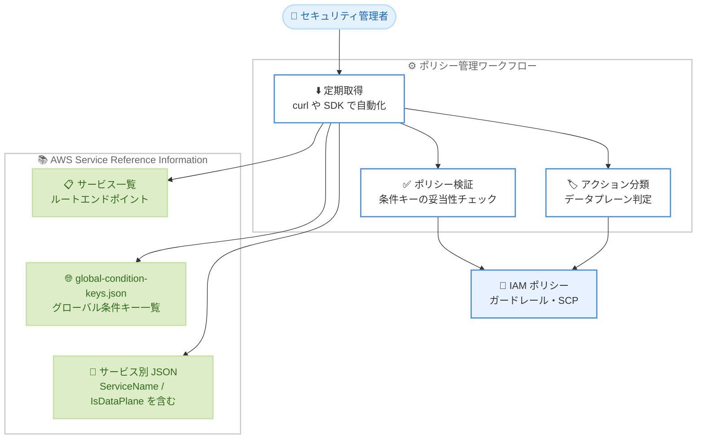

# AWS Identity and Access Management - サービスリファレンス情報のグローバル条件キー・サービス名・データプレーン分類サポート

**リリース日**: 2026 年 10 月 21 日
**サービス**: AWS Identity and Access Management (IAM) / AWS Service Reference Information
**機能**: グローバル条件キー一覧、ServiceName フィールド、IsDataPlane プロパティの追加

📊 [このアップデートのインフォグラフィックを見る](https://takech9203.github.io/aws-news-summary/20261021-aws-service-reference-information-global-condition-keys-service-names-data-plane.html)

## 概要

AWS は、IAM ポリシー管理の自動化を支援する機械可読な JSON 形式の「サービスリファレンス情報 (Service Reference Information)」を拡張し、3 つの新しい情報を提供開始しました。具体的には、(1) `aws:` プレフィックスのグローバル条件キーを単一ファイルで提供、(2) サービス識別子を人間が読みやすい名称にマッピングする `ServiceName` フィールド、(3) アクションがデータプレーン操作かどうかを示す `IsDataPlane` プロパティです。

サービスリファレンス情報は、各 AWS サービスのアクション、リソース、条件キーを機械可読ファイルとして提供する仕組みで、セキュリティ管理者がガードレールを設定したり、開発者がアプリケーションに適切なアクセス権限を付与したりする際に活用できます。今回の拡張により、これらのメタデータを既存のポリシー管理ツールやワークフローに直接組み込み、手作業を削減しながらポリシーをサービスの更新に追従させることが容易になります。

**アップデート前の課題**

このアップデート以前は、以下の課題がありました。

- グローバル条件キー (`aws:PrincipalOrgID` や `aws:SourceIp` など) の一覧は IAM ユーザーガイドのドキュメントページにのみ記載されており、ツールから機械的に取得・検証することが困難だった
- サービスリファレンス情報にはサービスプレフィックス (例: `s3`) しか含まれず、人間が読みやすいサービス名を表示するには別途マッピングを自前で管理する必要があった
- アクションがデータプレーン操作 (データの読み書き) かコントロールプレーン操作 (リソースの作成・設定・管理) かを機械的に判別する手段がなく、権限の分析や分類を手作業で行う必要があった

**アップデート後の改善**

今回のアップデートにより、以下が可能になりました。

- `global-condition-keys.json` という単一の機械可読ファイルから、すべての `aws:` プレフィックスのグローバル条件キー (名前、説明、ドキュメントページ、型) を取得できるようになった
- 各サービスの JSON ファイルに `ServiceName` フィールドが追加され、サービス識別子 (例: `s3`) から人間が読みやすい名称 (例: `S3`) への変換が自動化できるようになった
- 各アクションの `Annotations.Properties` に `IsDataPlane` プロパティが追加され、データプレーン操作とコントロールプレーン操作をプログラムで分類できるようになった

## アーキテクチャ図



ポリシー管理ツールがサービスリファレンス情報の各エンドポイントから JSON を定期取得し、グローバル条件キーの検証やデータプレーン操作の分類を自動化して IAM ポリシーやガードレールの作成・維持に活用する流れを示しています。

## サービスアップデートの詳細

### 主要機能

1. **グローバル条件キーの機械可読ファイル提供**
   - `https://servicereference.us-east-1.amazonaws.com/v1/global-condition-keys.json` から、すべての `aws:` プレフィックスのグローバル条件キーを単一ファイルで取得可能
   - 各キーには `Name` (キー名)、`Description` (説明)、`DocPage` (ドキュメントページのパス)、`Types` (値の型、例: `Bool`、`Date`、`ArrayOfString`) が含まれる
   - 従来はドキュメントページでのみ提供されていた情報を、ツールから直接参照・検証できる

2. **ServiceName フィールドの追加**
   - 各サービスの JSON ファイルのトップレベル、`Name` フィールドの直後に `ServiceName` フィールドが追加
   - サービス識別子 (例: `s3`) に対応する人間が読みやすい名称 (例: `S3`) を提供
   - レポート生成やダッシュボード表示など、ユーザー向け出力でのサービス名表記を自動化できる

3. **IsDataPlane プロパティによるデータプレーン分類**
   - 各アクションの `Annotations.Properties` 配下に `IsDataPlane` プロパティが追加
   - リソース内のデータやコンテンツを操作するアクション (例: S3 の `GetObject` は `true`) と、リソース自体を作成・設定・管理するコントロールプレーン操作 (例: S3 の `CreateBucket` は `false`) を区別できる
   - この分類は、アクションを認可するオペレーションの AWS CloudTrail イベントカテゴリに基づいて導出される
   - 既存の `IsList`、`IsPermissionManagement`、`IsTaggingOnly`、`IsWrite` プロパティと組み合わせて利用可能

## 技術仕様

### 提供されるエンドポイント

| エンドポイント | 内容 |
|------|------|
| `https://servicereference.us-east-1.amazonaws.com/` | リファレンス情報が利用可能な AWS サービスの一覧と各 JSON の URL |
| `https://servicereference.us-east-1.amazonaws.com/v1/global-condition-keys.json` | グローバル条件キーの一覧 (今回追加) |
| `https://servicereference.us-east-1.amazonaws.com/v1/mapping.json` | SDK サービス名からサービスリファレンスへのマッピング |
| `https://servicereference.us-east-1.amazonaws.com/v1/{service}/{service}.json` | サービスごとのアクション、リソース、条件キー、オペレーション情報 |

### アクションプロパティ (Annotations.Properties)

| プロパティ | 意味 |
|------|------|
| `IsDataPlane` | リソース内のデータやコンテンツを操作するアクション (今回追加) |
| `IsList` | リソースの一覧や基本メタデータを取得するアクション |
| `IsPermissionManagement` | IAM 権限やアクセス認証情報を変更できるアクション |
| `IsTaggingOnly` | タグのみを変更するアクション |
| `IsWrite` | リソースを変更できるアクション |

**注意**: これらのプロパティは相互排他ではなく、複数が `true` になる場合があります。また、`IsDataPlane` は、アクションを認可するオペレーションのうち少なくとも 1 つに CloudTrail イベントカテゴリが存在する場合にのみ付与されます。プロパティが存在しない場合、そのアクションはまだ分類されていないことを意味します。

### グローバル条件キーファイルの形式例

```json
[ {
  "Name" : "aws:AssumedRoot",
  "Description" : "Filters access based on whether the request was made using temporary security credentials for AssumeRoot",
  "DocPage" : "/IAM/latest/UserGuide/reference_policies_condition-keys.html",
  "Types" : [ "Bool" ]
}, {
  "Name" : "aws:CalledVia",
  "Description" : "Filters access by the services that make the request on behalf of the IAM principal",
  "DocPage" : "/IAM/latest/UserGuide/reference_policies_condition-keys.html#condition-keys-calledvia",
  "Types" : [ "ArrayOfString" ]
} ]
```

## 設定方法

### 前提条件

1. インターネットに接続できる環境 (エンドポイントはパブリックアクセス可能で、認証は不要)
2. JSON を処理できるツール (`curl`、`jq`、各種プログラミング言語など)
3. 事前の AWS アカウント設定やリソース作成は不要

### 手順

#### ステップ 1: グローバル条件キーの一覧を取得する

```bash
curl -s "https://servicereference.us-east-1.amazonaws.com/v1/global-condition-keys.json" | \
    jq '.[] | {Name, Types}'
```

グローバル条件キーの単一ファイルを取得し、キー名と値の型を抽出しています。ポリシーで使用している条件キーの妥当性チェックや、ポリシー作成支援ツールの補完候補の生成に活用できます。

#### ステップ 2: ServiceName フィールドを確認する

```bash
curl -s "https://servicereference.us-east-1.amazonaws.com/v1/s3/s3.json" | \
    jq '{Name, ServiceName}'
```

Amazon S3 のサービスリファレンス情報を取得し、サービス識別子 `s3` と人間が読みやすい名称を取得しています。レポートやダッシュボードでのサービス名表示に利用できます。

#### ステップ 3: データプレーン操作のアクションを抽出する

```bash
curl -s "https://servicereference.us-east-1.amazonaws.com/v1/s3/s3.json" | \
    jq '.Actions[] | select(.Annotations.Properties.IsDataPlane == true) | .Name'
```

S3 のアクションのうち、サービス設定ではなくデータそのものへのアクセスを許可するアクション (`GetObject`、`DeleteObject` など) を抽出しています。データアクセス権限の棚卸しや、データプレーン操作を制限するガードレール設計に活用できます。

## メリット

### ビジネス面

- **ポリシー管理の運用コスト削減**: グローバル条件キーやサービス名のマッピングを自前で管理・更新する必要がなくなり、手作業によるメンテナンス工数を削減できる
- **セキュリティガバナンスの強化**: データプレーン操作とコントロールプレーン操作を機械的に分類できるため、データアクセス権限の棚卸しや最小権限の徹底が組織的に進めやすくなる
- **追加コスト不要**: サービスリファレンス情報は追加料金なしで利用できる

### 技術面

- **機械可読な単一ソース**: ドキュメントページのスクレイピングや手動転記に頼らず、公式の JSON ファイルから正確な情報を自動取得できる
- **既存ワークフローへの統合が容易**: CI/CD パイプラインやポリシー検証ツール (ポリシーリンター、ガードレール生成ツールなど) に `curl` と `jq` だけで組み込める
- **権限分類の精度向上**: `IsDataPlane` は CloudTrail イベントカテゴリに基づいて導出されるため、独自のヒューリスティックより信頼性の高い分類が可能

## デメリット・制約事項

### 制限事項

- サービスリファレンス情報への変更が反映されるまで最大 24 時間かかる場合がある
- `IsDataPlane` プロパティは、アクションを認可するオペレーションに CloudTrail イベントカテゴリが存在する場合にのみ付与され、存在しないアクションは未分類となる
- オペレーションからアクションへのマッピング (`AuthorizedActions`) はすべてのサービスでサポートされているわけではなく、未対応サービスではこのプロパティが省略される

### 考慮すべき点

- オペレーションの認可アクション情報には、Forward Access Sessions によってユーザーに代わって呼び出されるオペレーションに必要な権限は含まれない
- Service Authorization Reference (ドキュメントページ) とサービスリファレンス情報では、表示形式やメタデータが異なる場合がある
- アクションプロパティは相互排他ではないため、分類ロジックを実装する際は複数プロパティが `true` になるケースを考慮する必要がある

## ユースケース

### ユースケース 1: ポリシーリンターでのグローバル条件キー検証

**シナリオ**: 社内の IAM ポリシー検証パイプラインで、ポリシーに記述された条件キーのタイプミスや廃止されたキーを検出したい。

**実装例**:
```bash
# グローバル条件キーの一覧をキャッシュし、ポリシー内の aws: キーを照合
curl -s "https://servicereference.us-east-1.amazonaws.com/v1/global-condition-keys.json" \
    -o /tmp/global-condition-keys.json
jq -r '.[].Name' /tmp/global-condition-keys.json > /tmp/valid-global-keys.txt
```

**効果**: ポリシーのデプロイ前に無効な条件キーを自動検出でき、意図しない権限許可 (条件が評価されず常に不一致になるケースなど) を未然に防止できます。

### ユースケース 2: データアクセス権限の棚卸しレポート

**シナリオ**: セキュリティチームが、各ロールに付与されたアクションのうちデータプレーン操作 (顧客データへの直接アクセス) に該当するものを定期的にレポートしたい。

**実装例**:
```bash
# サービスごとにデータプレーンアクションの一覧を生成
for svc in s3 dynamodb; do
  curl -s "https://servicereference.us-east-1.amazonaws.com/v1/${svc}/${svc}.json" | \
    jq -r '.Actions[] | select(.Annotations.Properties.IsDataPlane == true) | "\(input_filename) \(.Name)"'
done
```

**効果**: データアクセスに関わる権限を機械的に抽出でき、最小権限の監査やコンプライアンスレポート作成の工数を大幅に削減できます。

### ユースケース 3: ダッシュボードでのサービス名表示の自動化

**シナリオ**: IAM Access Analyzer や独自の権限分析ツールの結果を表示するダッシュボードで、サービスプレフィックス (例: `aps`) ではなくわかりやすいサービス名を表示したい。

**実装例**:
```bash
# サービス識別子から表示名を取得
curl -s "https://servicereference.us-east-1.amazonaws.com/v1/s3/s3.json" | \
    jq -r '.ServiceName'
```

**効果**: サービス名マッピングテーブルの自前管理が不要になり、新サービス追加時もダッシュボードが自動的に正しい表示名を取得できます。

## 料金

サービスリファレンス情報は追加料金なしで利用できます。エンドポイントはパブリックに公開されており、AWS アカウントや認証情報も不要です。

## 利用可能リージョン

エンドポイントは `servicereference.us-east-1.amazonaws.com` でホストされており、インターネット経由でどこからでもアクセス可能です。提供される情報は特定リージョンに依存しないグローバルなメタデータです。

## 関連サービス・機能

- **AWS Identity and Access Management (IAM)**: サービスリファレンス情報は IAM ポリシーの作成・検証・管理の自動化を支援するメタデータを提供する
- **IAM Access Analyzer**: 各アクションの `SupportedBy` フィールドで、Access Analyzer のポリシー生成が対応しているかを確認できる
- **AWS CloudTrail**: `IsDataPlane` の分類は CloudTrail のイベントカテゴリに基づいて導出される
- **AWS Organizations / SCP**: データプレーン操作の分類やグローバル条件キーの一覧は、組織全体のガードレール (サービスコントロールポリシー) 設計にも活用できる

## 参考リンク

- 📊 [インフォグラフィック](https://takech9203.github.io/aws-news-summary/20261021-aws-service-reference-information-global-condition-keys-service-names-data-plane.html)
- [公式発表 (What's New)](https://aws.amazon.com/about-aws/whats-new/2026/10/aws-service-reference-information-global-condition-keys-service-names-data-plane/)
- [ドキュメント: Simplified AWS service information for programmatic access](https://docs.aws.amazon.com/service-authorization/latest/reference/service-reference.html)
- [Service Authorization Reference](https://docs.aws.amazon.com/service-authorization/latest/reference/reference_policies_actions-resources-contextkeys.html)
- [IAM グローバル条件コンテキストキー](https://docs.aws.amazon.com/IAM/latest/UserGuide/reference_policies_condition-keys.html)

## まとめ

今回のアップデートにより、IAM ポリシー管理の自動化に必要なグローバル条件キー、サービス名、データプレーン分類という 3 つの重要なメタデータが機械可読な形式で取得できるようになりました。ポリシー検証ツールや権限監査の仕組みを運用している組織は、自前で管理していたマッピングやヒューリスティックをこの公式データソースに置き換えることを推奨します。まずは `global-condition-keys.json` と関心のあるサービスの JSON を取得し、既存のポリシー管理ワークフローへの統合を検討してください。
