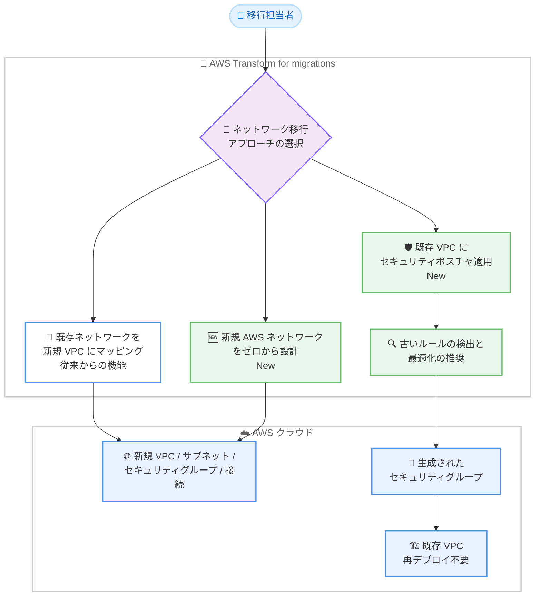

# AWS Transform - 新規ネットワーク構築とセキュリティグループのモダナイズ

**リリース日**: 2026 年 10 月 21 日
**サービス**: AWS Transform
**機能**: 新規 AWS ネットワークの設計・構築、および既存 VPC へのセキュリティポスチャ適用

📊 [このアップデートのインフォグラフィックを見る](https://takech9203.github.io/aws-news-summary/20261021-aws-transform-new-networks.html)

## 概要

AWS Transform for migrations が、ネットワークを AWS に移行するための 2 つの新しいアプローチを追加しました。従来の「既存ネットワークの移行とモダナイズ」に加えて、「新規 AWS ネットワークをゼロから設計・構築する」アプローチと、「オンプレミスのアクセスルールをセキュリティグループに変換して既存 VPC に適用する」アプローチが利用可能になりました。

新規ネットワーク構築では、長年蓄積されたネットワーク定義やアクセスルールを持ち込まず、AWS のベストプラクティスに沿ったクリーンなネットワーク基盤を短時間で構築できます。セキュリティグループ変換では、変換の過程で古くなったルール (stale rules) を検出し、最適化を推奨することでセキュリティポスチャをモダナイズします。生成されたセキュリティグループは、ネットワークスタックの再デプロイなしで既存の VPC にそのままデプロイできます。

いずれのアプローチを選択しても、セキュアでスケーラブルなネットワーク基盤の上で AWS への移行を開始できます。VMware 環境などからの大規模移行を計画している組織や、既にランディングゾーンを構築済みでセキュリティルールのみを移行したい組織が主な対象です。

**アップデート前の課題**

このアップデート以前に存在していた課題や制限は以下のとおりです。

- AWS Transform のネットワーク移行は、既存のソースネットワーク構成を AWS に変換する方式のみで、ソース構成ファイルを前提としないネットワーク設計はできなかった
- オンプレミスの複雑化・陳腐化したネットワーク定義やアクセスルールをそのまま持ち込むか、AWS ネットワークを手動で設計する必要があった
- 既に VPC を構築済みの環境では、オンプレミスのファイアウォールルールをセキュリティグループとして手動で再作成する必要があり、時間がかかり設定ミスのリスクもあった

**アップデート後の改善**

今回のアップデートにより、以下が可能になりました。

- ソース構成ファイルなしで、AWS ベストプラクティスに沿った新規ネットワークを対話形式で設計・構築できるようになった
- オンプレミスのアクセスルールをセキュリティグループへ変換する際に、古いルールの検出と最適化の推奨によりセキュリティポスチャをモダナイズできるようになった
- 既存 VPC に対して、ネットワークスタックを再デプロイすることなくセキュリティグループのみを追加デプロイできるようになった

## アーキテクチャ図



AWS Transform が提供する 3 つのネットワーク移行アプローチの全体像です。今回のアップデートで、新規ネットワーク設計 (中央) と既存 VPC へのセキュリティポスチャ適用 (右) が追加されました。

## サービスアップデートの詳細

### 主要機能

1. **新規 AWS ネットワークの設計 (Design a new AWS network)**
   - ソース構成ファイルを使わず、移行するアプリケーションの情報からネットワークを設計
   - AI エージェントとの対話形式で、トポロジー選択、ネットワーク定義、レビュー、タグ設定、デプロイまでをガイド
   - アプリケーション名、環境 (本番・ステージング・開発など)、サーバー台数を伝えると、環境ごとに VPC を自動設計
   - CIDR 範囲は指定可能で、未指定の場合は重複しない範囲を自動割り当て
   - VPC サイズは Small (最大 250 アドレス)、Medium (最大 1,000)、Large (最大 4,000)、XL (最大 16,000) から選択
   - 生成されたネットワークはビジュアルとチャットのインターフェースでレビューし、自然言語の Direct Edits で変更可能。変更は検証され、競合が事前に検出される

2. **既存 VPC へのセキュリティポスチャ適用 (Apply security posture to existing VPCs)**
   - ソースのファイアウォールルールからセキュリティグループを生成し、既存 VPC に関連付け
   - 対応ソースファイル: VMware NSX、Cisco ACI (SDN)、Palo Alto Networks、Fortinet FortiGate (ファイアウォール)、modelizeIT、AWS Transform discovery tool (ハイブリッド)。その他の形式は自動変換を試行
   - 対象 VPC はタグ (`CreatedFor: AWSTransform` など) で指定し、タグ付けした VPC のみが移行スコープに含まれる
   - ソースサブネットと既存 VPC を CIDR でマッチングするカバレッジ分析を実行。Re-IP (IP アドレス変更) の場合は CIDR マッピングを対話形式で指定可能
   - VPC トポロジー (Isolated / Connected) に応じて、CIDR ベースまたはセキュリティグループ参照ベースのルールを生成
   - セキュリティグループのみをデプロイするため、既存のネットワークスタックの再デプロイは不要

3. **古いルールの検出とモダナイズ**
   - アクセスルールの変換時に、古くなったルール (stale rules) を検出し、最適化を推奨
   - CIDR マッピング指定時は、影響を受けるルールを複製し、オンプレミス側を指すルールには説明に `[ONPREM]` プレフィックスを付与。移行中はオンプレミスと AWS の双方のワークロードと通信可能
   - カットオーバー完了後に `[ONPREM]` プレフィックス付きルールを削除することで、クリーンなセキュリティポスチャに移行

## 技術仕様

### 新規ネットワーク設計のトポロジー

| トポロジー | 説明 |
|------|------|
| Hub and Spoke | アプリケーション間で通信が必要な場合に選択。AWS Transit Gateway が VPC を接続し、VPC 間トラフィックを中央ハブ経由でルーティング |
| Isolated VPCs | アプリケーションが独立して動作し、相互接続が不要な場合に選択 |

### セキュリティポスチャ適用のルール生成方式

| VPC トポロジー | ルール生成方式 |
|------|------|
| Isolated | CIDR 範囲ベースのルールを生成 |
| Connected | セキュリティグループ参照ベースのルールを生成 (Transit Gateway 利用時は `SecurityGroupReferencingSupport` の有効化が必要) |

### デプロイ方式

| 方式 | 詳細 |
|------|------|
| AWS Transform マネージドデプロイ | 承認後、AWS Transform が代理でデプロイを実行 |
| セルフデプロイ | IaC として出力し、自身でデプロイ。出力形式は CloudFormation、AWS CDK、HashiCorp Terraform、Landing Zone Accelerator (LZA) に対応 |

## 設定方法

### 前提条件

1. AWS Transform のワークスペースが設定済みであること
2. マルチアカウント構成の場合、ネットワーク移行を開始する前にクロスアカウントアクセスの設定が完了していること
3. セキュリティポスチャ適用の場合、ファイアウォールルールを含むソースネットワークファイルが必要 (RVTools はファイアウォールルールを含まないため、このフローでは非対応)

### 手順 (既存 VPC へのセキュリティポスチャ適用の例)

#### ステップ 1: ソースネットワークファイルのアップロード

User Uploads からファイル名を指定するか、チャット内でファイルを直接アップロードします。VMware NSX、Cisco ACI、Palo Alto Networks、Fortinet FortiGate などのエクスポートファイルに対応しています。

#### ステップ 2: 既存 VPC のタグ付け

AWS Transform が提供するタグ付けページで対象 VPC を選択します。選択した VPC には以下のタグが適用され、移行スコープに含まれます。

```text
Key: CreatedFor   Value: AWSTransform
Key: ATWorkspace  Value: {workspace-id}
```

タグ付けした VPC のみがセキュリティグループ生成の対象となり、それ以外のリソースは変更されません。

#### ステップ 3: ソースサブネットと既存 VPC のマッチング

カバレッジ分析の結果を確認し、未カバーのサブネットがあれば CIDR マッピングをチャットで指定します。

```text
Map 10.68.0.0/16 to 172.31.0.0/16
```

可能な限り広い範囲 (/16 など) でマッピングすると、範囲内のすべてのサブネットとルール CIDR が一括でカバーされます。マッピングは同じプレフィックス長同士 (/16 から /16 など) である必要があります。

#### ステップ 4: トポロジー指定、レビュー、デプロイ

既存 VPC が Isolated か Connected かを指定し、生成されたセキュリティグループを Human-in-the-loop レビューで確認します。確認後、マネージドデプロイまたはセルフデプロイ (CloudFormation / CDK / Terraform / LZA) でセキュリティグループをデプロイします。カットオーバー完了後は `[ONPREM]` プレフィックス付きルールを削除します。

## メリット

### ビジネス面

- **移行期間の短縮**: 手動でのネットワーク設計・構築と比較して、大幅に短い時間で本番利用可能なネットワーク基盤を準備できる
- **技術的負債の解消**: 長年蓄積されたネットワーク定義やアクセスルールを持ち込まず、クリーンな状態で AWS への移行を開始できる
- **専門知識への依存低減**: 深いネットワーク専門知識がなくても、AWS ベストプラクティスに沿ったネットワークを設計できる

### 技術面

- **セキュリティポスチャのモダナイズ**: 古いルールの検出と最適化の推奨により、不要なルールを引き継がないセキュアな構成を実現できる
- **既存環境への非破壊的な適用**: セキュリティグループのみを追加デプロイするため、構築済みのネットワークスタックに影響を与えない
- **IaC 出力による統制**: CloudFormation、CDK、Terraform、LZA 形式での出力に対応し、既存の IaC 運用・変更管理プロセスに組み込める
- **移行期間中の接続性確保**: `[ONPREM]` プレフィックス付きの複製ルールにより、移行済みワークロードと未移行ワークロードの双方と通信を維持できる

## デメリット・制約事項

### 制限事項

- セキュリティポスチャ適用フローでは RVTools ファイルは利用できない (ファイアウォールルールを含まないため)
- CIDR マッピングは同じプレフィックス長同士のみ対応 (/24 から /20 のような異なる長さのマッピングは不可)
- マッピングされた CIDR 範囲外のルール CIDR は移行されない
- セキュリティポスチャ適用フローでは、新規ネットワークインフラを作成しないため Reachability Analyzer は実行されず、デプロイ済みリソースの自動ロールバックもない
- Connected トポロジーを選択した場合、実際に VPC 間の接続性がないとセキュリティグループ参照ルールのデプロイが失敗する

### 考慮すべき点

- Transit Gateway 経由で接続された VPC でセキュリティグループ参照を使用するには、Transit Gateway と各 VPC アタッチメントで `SecurityGroupReferencingSupport` を有効にする必要がある
- マルチアカウント移行では、各ターゲットアカウントにサインインして VPC のタグ付けを個別に行う必要がある
- カットオーバー後の `[ONPREM]` ルール削除は手動のクリーンアップ作業として計画に含める必要がある

## ユースケース

### ユースケース 1: クリーンスタートでの VMware 移行

**シナリオ**: 長年運用してきた VMware 環境のネットワーク定義が複雑化しており、移行を機に AWS ベストプラクティスに沿ったネットワークを再設計したい。

**実装例**:
```text
1. AWS Transform で「Design a new AWS network」を選択
2. アプリケーション名、環境、サーバー台数をチャットで入力
3. Hub and Spoke トポロジーを選択し、Transit Gateway 経由の接続構成を生成
4. ビジュアルレビューで CIDR や構成を確認し、マネージドデプロイで構築
```

**効果**: レガシー設計を持ち込まず、ベストプラクティスに沿ったネットワークを短時間で構築し、技術的負債をリセットできる。

### ユースケース 2: ランディングゾーン構築済み環境へのファイアウォールルール移行

**シナリオ**: Landing Zone Accelerator で VPC やサブネットは構築済みだが、オンプレミスの Palo Alto Networks ファイアウォールのルールをセキュリティグループとして再現する作業が残っている。

**実装例**:
```text
1. 「Apply security posture to existing VPCs」を選択
2. Palo Alto Networks のエクスポートファイルをアップロード
3. 対象 VPC にタグを付与し、CIDR カバレッジ分析を確認
4. 生成されたセキュリティグループをレビューし、LZA 形式で出力して既存パイプラインでデプロイ
```

**効果**: 手動でのルール再作成と比較して時間を短縮し、変換時の古いルール検出により精度と一貫性も向上する。

### ユースケース 3: Re-IP を伴う段階的移行での接続性維持

**シナリオ**: 移行に合わせてサーバーの IP アドレス体系を変更 (Re-IP) するが、移行期間中はオンプレミスに残るワークロードとの通信も維持したい。

**実装例**:
```text
1. セキュリティポスチャ適用フローで CIDR マッピングを指定
   例: Map 10.68.0.0/16 to 172.31.0.0/16
2. AWS Transform が各ルールを複製し、[ONPREM] プレフィックス付きルールで
   オンプレミス側アドレス空間への通信も許可
3. カットオーバー完了後、[ONPREM] ルールを削除
```

**効果**: 移行済み・未移行ワークロードの双方と通信を維持しながら段階的に移行し、完了後はクリーンなルールセットに収束できる。

## 利用可能リージョン

AWS のすべての商用リージョンおよび AWS GovCloud (US) リージョンへの移行がサポートされています。サポート対象リージョンの一覧は [AWS Transform ユーザーガイド](https://docs.aws.amazon.com/transform/latest/userguide/transform-vmware-connect-target-account.html#transform-vmware-cta-supported-regions)を参照してください。

## 関連サービス・機能

- **AWS Transit Gateway**: Hub and Spoke トポロジーでの VPC 間接続、およびセキュリティグループ参照 (`SecurityGroupReferencingSupport`) の基盤
- **Amazon VPC**: 生成されるネットワークリソース (VPC、サブネット、セキュリティグループ) の基盤サービス
- **AWS CloudFormation / AWS CDK / Terraform / Landing Zone Accelerator**: セルフデプロイ時の IaC 出力形式
- **AWS Transform for migrations (ランディングゾーン対応)**: 2026 年 10 月 20 日発表のランディングゾーン構築機能と組み合わせることで、ネットワークを含む移行基盤全体を AWS Transform で整備可能

## 参考リンク

- 📊 [インフォグラフィック](https://takech9203.github.io/aws-news-summary/20261021-aws-transform-new-networks.html)
- [公式発表 (What's New)](https://aws.amazon.com/about-aws/whats-new/2026/10/aws-transform-new-networks/)
- [ドキュメント: Migrate network](https://docs.aws.amazon.com/transform/latest/userguide/transform-vmware-migrate-network.html)
- [ドキュメント: Design a new AWS network](https://docs.aws.amazon.com/transform/latest/userguide/transform-vmware-design-network.html)
- [ドキュメント: Apply security posture to existing VPCs](https://docs.aws.amazon.com/transform/latest/userguide/transform-vmware-apply-security-posture.html)
- [AWS Transform for migrations 製品ページ](https://aws.amazon.com/transform/migrations/)

## まとめ

AWS Transform for migrations に、新規 AWS ネットワークのゼロからの設計・構築と、既存 VPC へのセキュリティポスチャ適用という 2 つのアプローチが追加されました。レガシーなネットワーク定義を持ち込まないクリーンスタートと、古いルールの検出・最適化によるセキュリティグループのモダナイズが可能になり、移行の初期段階におけるネットワーク設計の負担が大きく軽減されます。VMware 環境などからの移行を計画している場合は、既存ネットワークの移行・新規設計・セキュリティポスチャ適用のどのアプローチが自社の状況に適しているかを検討することを推奨します。
