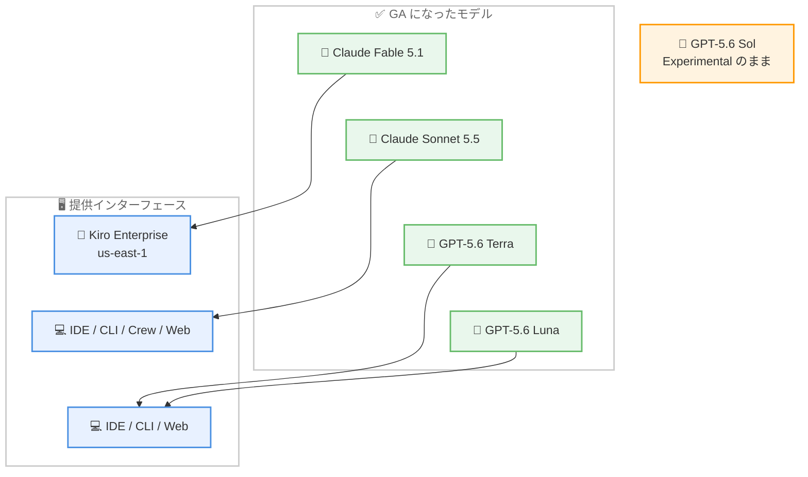
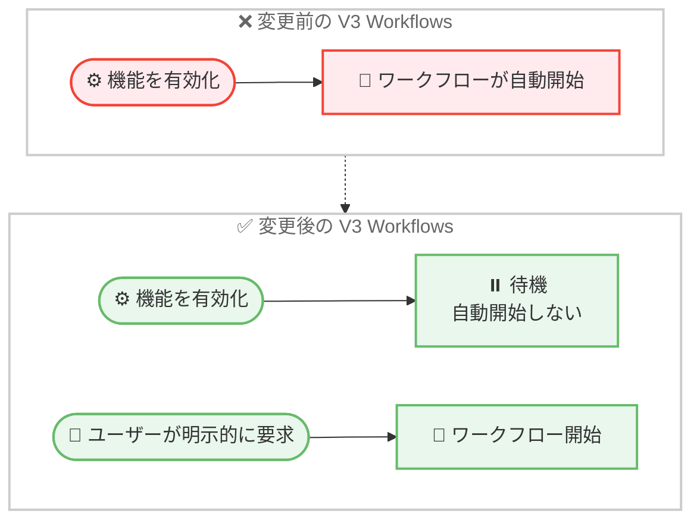

# Kiro - 4 モデルの GA 化と V3 Workflows 開始動作の変更

**リリース日**: 2026 年 10 月 21 日
**サービス**: Kiro
**機能**: Claude Fable 5.1 / Claude Sonnet 5.5 / GPT-5.6 Terra / GPT-5.6 Luna の一般提供開始、および V3 Workflows の開始動作変更 (CLI 2.33.1)

📊 [このアップデートのインフォグラフィックを見る](https://takech9203.github.io/aws-news-summary/20261021-kiro-changelog-2026-10-21.html)

## 概要

2026 年 10 月 21 日、Kiro の Changelog に 2 件のアップデートが公開されました。本レポートでは両方をまとめて解説します。

1 件目は、**Claude Fable 5.1、Claude Sonnet 5.5、GPT-5.6 Terra、GPT-5.6 Luna の 4 モデルが Kiro フルサポートで一般提供 (GA) になった**アップデートです。キャパシティの拡大により、本番ワークロード向けのより安定したアクセスが提供されます。これまで Fable 5.1 に付与されていた Preview ラベル、Sonnet 5.5 / Terra / Luna に付与されていた Experimental ラベルは撤廃され、「Kiro Excluded Models」の補償 (indemnity) 例外もこれらのモデルには適用されなくなりました。なお、GPT-5.6 Sol は引き続き Experimental のままです。

2 件目は、**Kiro CLI 2.33.1 における V3 Workflows の開始動作の変更**です。これまでは Workflows 機能を有効化しただけでワークフローが自動的に開始されていましたが、このリリース以降は、ユーザーが明示的に要求した場合のみワークフローが実行されるようになりました。あわせて、スクリーンリーダー出力、MCP セットアップ、V2 から V3 へのセッション再開など多数の修正が含まれています。

**アップデート前の課題**

- Fable 5.1 は Preview、Sonnet 5.5 / GPT-5.6 Terra / GPT-5.6 Luna は Experimental ラベル付きの提供であり、本番ワークロードでの利用には安定性や提供継続性の面で不確実性があった
- Preview / Experimental モデルは「Kiro Excluded Models」の補償例外の対象であり、エンタープライズ利用時の法的リスク評価が必要だった
- V3 Workflows は機能を有効化しただけでワークフローが自動開始されてしまい、ユーザーの意図しないタイミングで実行が始まることがあった
- スクリーンリーダー使用時に `/tools` の出力が 1 行にまとまって読み上げられるなど、アクセシビリティ上の問題があった
- V2 セッションを V3 で再開した際に、保存済みのツール承認が引き継がれないことがユーザーに通知されなかった

**アップデート後の改善**

- 4 モデルが GA となり、キャパシティ拡大により本番ワークロード向けの安定したアクセスが可能になった
- Preview / Experimental ラベルと補償例外が撤廃され、エンタープライズでも安心して採用できるようになった
- V3 Workflows はユーザーが明示的に要求した場合のみ開始されるようになり、意図しない実行がなくなった
- スクリーンリーダーが各ツールの Source、Status、Description をフィールドごとに読み上げられるようになるなど、アクセシビリティが向上した
- MCP セットアップやセッション再開に関する多数の不具合が修正された

## アーキテクチャ図



GA となった 4 モデルと、それぞれが利用できる Kiro のインターフェースの対応関係を示しています。GPT-5.6 Sol のみ Experimental のままです。



V3 Workflows の開始動作の Before / After 比較です。変更後は、機能の有効化とワークフローの開始が分離され、ユーザーの明示的な要求がトリガーになります。

## サービスアップデートの詳細

### 主要機能

1. **4 モデルの一般提供開始 (GA)**
   - Claude Fable 5.1、Claude Sonnet 5.5、GPT-5.6 Terra、GPT-5.6 Luna が Kiro フルサポートで GA
   - キャパシティ拡大により、本番ワークロード向けのより安定したアクセスを提供
   - Fable 5.1 の Preview ラベル、Sonnet 5.5 / Terra / Luna の Experimental ラベルは撤廃
   - 「Kiro Excluded Models」の補償例外もこれらのモデルには適用されなくなり、契約上の位置付けが通常モデルと同等に
   - GPT-5.6 Sol は引き続き Experimental のまま

2. **モデルごとの提供範囲**
   - Claude Fable 5.1: Kiro Enterprise 組織向けに米国東部 (バージニア北部) リージョン (us-east-1) で提供
   - Claude Sonnet 5.5: Kiro IDE、CLI、Crew、Web のすべてで利用可能
   - GPT-5.6 Terra / Luna: Kiro IDE、CLI、Web で利用可能
   - Sonnet 5.5、Terra、Luna は US / EU ジオグラフィーの Pro、Pro+、Pro Max、Power プラン顧客向け

3. **V3 Workflows の開始動作変更 (CLI 2.33.1)**
   - Workflows 機能を有効化しても、ワークフローは自動開始されない
   - V3 セッションで Workflows を有効にした状態で、ユーザーが明示的に要求した場合のみワークフローが実行される
   - 機能の有効化と実行開始が分離され、ユーザーが実行タイミングを制御できる

4. **CLI 2.33.1 の修正 (アクセシビリティ / MCP / セッション再開など)**
   - スクリーンリーダー使用時、`/tools` が各ツールをフィールドごとにラベル付きの行で表示し、ツールの Source、Status、Description を個別に読み上げ可能に
   - `kiro-cli mcp add --agent` が、`tools` リストに新サーバーを含まないエージェントにも権限を付与し、`chat.enableAutoAgentUpgrade` 有効時にはエージェントファイルを V3 用にアップグレード
   - V2 セッションを V3 で再開した際、保存済みのツール承認が引き継がれないことと、V3 で承認を維持する方法を通知
   - V3 のコンパクションが、履歴内の画像をモデルが拒否した場合でも失敗せず、画像を除外して再試行
   - MCP サインイン後に OAuth コールバックポートが占有されたままにならないように修正
   - 利用できないオプションの Power MCP サーバーが V3 のプロンプトターンをブロックしないように修正
   - 画像を多く含む長い V3 セッションがリクエスト上限で失敗せず、古い画像を省略して上限内に収まるように修正
   - V3 ワークフロープランの承認画面で最初の選択肢がハイライトされ、Enter キーで選択可能に
   - コードプレビュー内の HTML doctype とタグ括弧が、読みやすいコントラストのテーマカラーで表示されるように修正
   - サブエージェントとして動作するカスタム V3 エージェントが、自身のナレッジベースを再び検索可能に
   - V3 レジストリから追加した MCP サーバーが、カタログのパッケージバージョンで起動し再び動作するように修正
   - V3 のスペックタスク実行後に送信したメッセージで、タスクを継続して更新可能に
   - `@builtin` を使用する V3 エージェントに、V2 と同様に Web 検索が含まれるように修正
   - ディスパッチされた V3 サブエージェントが、親エージェントのスキルではなく自身のスキルを読み込むように修正
   - ホームフォルダで V3 セッションを開始しても、ユーザーエージェントのファイル許可 / 拒否ルールが失われないように修正

## 技術仕様

### モデル提供状況

| モデル | ステータス | 提供インターフェース | 対象 |
|--------|-----------|---------------------|------|
| Claude Fable 5.1 | GA (Preview ラベル撤廃) | Kiro Enterprise | Enterprise 組織、us-east-1 |
| Claude Sonnet 5.5 | GA (Experimental ラベル撤廃) | IDE、CLI、Crew、Web | US / EU の Pro、Pro+、Pro Max、Power |
| GPT-5.6 Terra | GA (Experimental ラベル撤廃) | IDE、CLI、Web | US / EU の Pro、Pro+、Pro Max、Power |
| GPT-5.6 Luna | GA (Experimental ラベル撤廃) | IDE、CLI、Web | US / EU の Pro、Pro+、Pro Max、Power |
| GPT-5.6 Sol | Experimental (変更なし) | - | - |

### CLI 2.33.1 の変更点サマリー

| 分類 | 内容 |
|------|------|
| Improvements | V3 Workflows はユーザーが明示的に要求した場合のみ開始 |
| Fixes | スクリーンリーダー出力、MCP セットアップ、V2 から V3 へのセッション再開、画像を含むセッションのコンパクション、サブエージェントのスキル読み込みなど 15 件 |

## 設定方法

### 前提条件

1. Kiro のアカウントを保有していること (新モデルの利用には US / EU ジオグラフィーの Pro 以上のプラン、Fable 5.1 は Kiro Enterprise 組織が必要)
2. Kiro IDE、CLI、Crew、Web のいずれかを利用していること
3. V3 Workflows の変更を利用する場合は Kiro CLI 2.33.1 以降

### 手順

#### ステップ 1: 最新のモデルリストを読み込む

```bash
# CLI の場合: CLI を再起動する
kiro-cli

# Crew の場合: Crew を再起動する
kirocrew restart
```

IDE または CLI を再起動すると、最新のモデルリストが読み込まれます。Crew の場合は `kirocrew restart` コマンドを実行し、Web の場合はブラウザでページを更新します。

#### ステップ 2: GA になったモデルを選択する

モデルセレクターから Claude Fable 5.1 (Enterprise)、Claude Sonnet 5.5、GPT-5.6 Terra、GPT-5.6 Luna を選択します。Preview / Experimental ラベルは表示されなくなっています。

#### ステップ 3: V3 Workflows を明示的に開始する

CLI 2.33.1 以降では、Workflows 機能を有効化しただけではワークフローは開始されません。V3 セッション内でエージェントに対してワークフローの実行を明示的に依頼することで開始します。詳細は [Workflows ドキュメント](https://kiro.dev/docs/workflows/#start-from-the-agent) を参照してください。

## メリット

### ビジネス面

- **本番利用の安心感**: GA 化とキャパシティ拡大により、本番ワークロードでの安定したモデルアクセスが期待できる
- **法的リスクの低減**: 「Kiro Excluded Models」補償例外の撤廃により、エンタープライズでのコンプライアンス評価が簡素化される
- **プラン内で最新モデルを利用可能**: Pro 以上のプランで追加契約なしに最新世代のモデルを利用できる

### 技術面

- **モデル選択肢の拡大**: Anthropic (Claude) と OpenAI (GPT) の最新世代モデルを同一の開発環境で使い分けられる
- **ワークフロー実行の制御性向上**: V3 Workflows が明示的な要求でのみ開始されるため、意図しない実行やコスト発生を防げる
- **アクセシビリティと安定性の向上**: スクリーンリーダー対応の改善、MCP 関連の修正、セッション再開時の挙動改善により日常の開発体験が向上する

## デメリット・制約事項

### 制限事項

- Claude Fable 5.1 は Kiro Enterprise 組織向けで、us-east-1 のみでの提供
- Sonnet 5.5、GPT-5.6 Terra / Luna の対象は US / EU ジオグラフィーの Pro、Pro+、Pro Max、Power プラン顧客に限定される
- GPT-5.6 Terra / Luna は Crew では利用できない (IDE、CLI、Web のみ)
- GPT-5.6 Sol は引き続き Experimental であり、本番利用には適さない

### 考慮すべき点

- 最新のモデルリストを反映するには、IDE / CLI の再起動、`kirocrew restart`、または Web のブラウザ更新が必要
- V2 セッションを V3 で再開した場合、保存済みのツール承認は引き継がれない (CLI が通知と対処方法を表示する)
- V3 Workflows の自動開始に依存した運用をしていた場合は、明示的な開始手順への移行が必要

## ユースケース

### ユースケース 1: エンタープライズでの最新モデル標準化

**シナリオ**: Kiro Enterprise を導入している組織が、コンプライアンス上の理由で Preview / Experimental モデルの利用を禁止していたが、最新モデルを開発標準として採用したい。

**実装例**:
```text
1. Fable 5.1 の GA 化と補償例外の撤廃を社内のリスク評価に反映
2. us-east-1 の Kiro Enterprise 環境で Fable 5.1 を有効化
3. 開発チームのモデル標準を Fable 5.1 / Sonnet 5.5 に更新
```

**効果**: Experimental モデル禁止ポリシーを維持したまま、最新世代モデルを本番開発に採用できる。

### ユースケース 2: モデル使い分けによる開発効率化

**シナリオ**: Pro Max プランの開発者が、タスクの性質に応じて Claude 系と GPT 系のモデルを使い分けたい。

**実装例**:
```text
1. IDE / CLI を再起動して最新のモデルリストを読み込む
2. 大規模なリファクタリングには Sonnet 5.5 を選択
3. 別アプローチの比較検討には GPT-5.6 Terra / Luna を選択
```

**効果**: 単一の開発環境内で複数ベンダーの GA モデルを切り替え、タスクに最適なモデルで作業できる。

### ユースケース 3: ワークフロー実行タイミングの統制

**シナリオ**: チームで V3 Workflows を評価したいが、機能を有効化した瞬間にワークフローが走り出すのを避けたい。

**実装例**:
```text
1. Kiro CLI を 2.33.1 以降に更新
2. V3 セッションで Workflows 機能を有効化 (この時点では何も実行されない)
3. 実行したいタイミングでエージェントにワークフローの開始を明示的に依頼
```

**効果**: 機能評価や段階的導入の際に、意図しないワークフロー実行とそれに伴うクレジット消費を防止できる。

## 料金

今回の GA 化による追加料金はありません。新モデルは既存プランのクレジット体系の中で利用できます。Sonnet 5.5、GPT-5.6 Terra、GPT-5.6 Luna は US / EU ジオグラフィーの以下のプランで利用可能です。

| プラン | 月額 | クレジット | 新 GA モデルの利用 |
|--------|------|-----------|-------------------|
| Free | $0 | 50 | 対象外 |
| Pro | $20 | 1,000 | 利用可能 |
| Pro+ | $40 | 2,000 | 利用可能 |
| Pro Max | $100 | 5,000 | 利用可能 |
| Power | $200 | 10,000 | 利用可能 |

追加クレジットは $0.04/クレジットで購入できます。Claude Fable 5.1 は Kiro Enterprise 組織向けの提供です。最新の料金は [料金ページ](https://kiro.dev/pricing/) を参照してください。

## 利用可能リージョン

グローバル (Kiro はグローバルサービス)。ただし、Claude Fable 5.1 は Kiro Enterprise 組織向けに米国東部 (バージニア北部) リージョン (us-east-1) での提供となります。また、Sonnet 5.5 / Terra / Luna の対象は US / EU ジオグラフィーの顧客です。

## 関連サービス・機能

- **Kiro IDE / CLI / Crew / Web**: 今回 GA となったモデルを利用できる Kiro の各インターフェース
- **Kiro V3 Workflows**: エージェントによる複数ステップの自動実行機能。今回の CLI 2.33.1 で開始動作が変更された
- **MCP (Model Context Protocol)**: Kiro のエージェントに外部ツールを統合する仕組み。CLI 2.33.1 でセットアップ関連の修正が含まれた
- **Amazon Bedrock**: AWS 上で基盤モデルを利用するためのサービス。Kiro は AWS が提供する AI エージェント開発環境

## 参考リンク

- 📊 [インフォグラフィック](https://takech9203.github.io/aws-news-summary/20261021-kiro-changelog-2026-10-21.html)
- [Kiro Changelog](https://kiro.dev/changelog/)
- [Changelog: Generally Available: Claude Fable 5.1, Claude Sonnet 5.5, GPT-5.6 Terra, and GPT-5.6 Luna](https://kiro.dev/changelog/models/fable-5-1-and-gpt-5-6-generally-available/)
- [Changelog: Workflows Start Only When You Ask (CLI 2.33.1)](https://kiro.dev/changelog/cli/2-33-1/)
- [ドキュメント: Available Models](https://kiro.dev/docs/models/available-models/)
- [ドキュメント: Workflows - Start from the Agent](https://kiro.dev/docs/workflows/#start-from-the-agent)
- [ドキュメント: MCP Configuration](https://kiro.dev/docs/mcp/configuration/#adding-servers-to-a-specific-agent)
- [料金ページ](https://kiro.dev/pricing/)

## まとめ

Claude Fable 5.1、Claude Sonnet 5.5、GPT-5.6 Terra、GPT-5.6 Luna の GA 化により、Preview / Experimental ラベルと補償例外が撤廃され、Kiro の最新世代モデルを本番ワークロードで安心して利用できるようになりました。あわせて CLI 2.33.1 では V3 Workflows が明示的な要求でのみ開始されるようになり、実行タイミングの制御性が向上しています。IDE / CLI の再起動や `kirocrew restart` で最新のモデルリストを読み込み、新モデルと新しいワークフロー開始動作を確認することを推奨します。
