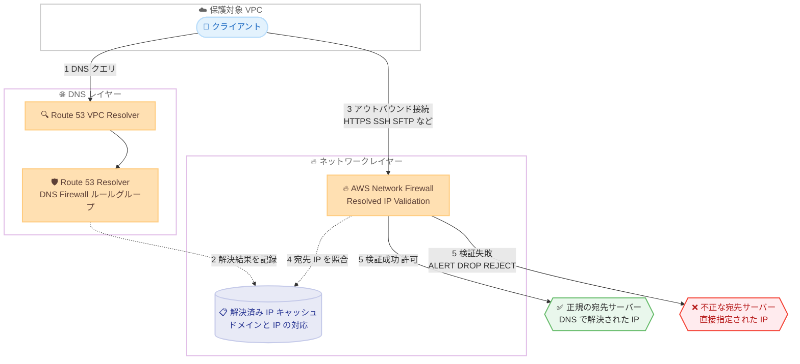

# AWS Network Firewall - Route 53 Resolved IP Validation のサポート

**リリース日**: 2026 年 10 月 21 日
**サービス**: AWS Network Firewall、Amazon Route 53
**機能**: Route 53 Resolved IP Validation (解決済み IP 検証)

📊 [このアップデートのインフォグラフィックを見る](https://takech9203.github.io/aws-news-summary/20261021-network-firewall-route-53-ip-validation.html)

## 概要

AWS Network Firewall が、接続先 IP アドレスの「出所」を検証する新機能 Route 53 Resolved IP Validation (解決済み IP 検証) をサポートしました。この機能は、接続の宛先 IP アドレスが VPC の Amazon Route 53 VPC Resolver を通じて正規に DNS 解決されたものであることを検証します。これにより、従来 HTTP/HTTPS に限定されていたドメインベースのトラフィックフィルタリングが、SFTP や SSH などの HTTP/HTTPS 以外のプロトコルを含むすべてのアウトバウンドトラフィックに拡張されます。

従来のドメインリストルールは、クライアントが「主張する」ホスト名、すなわち TLS の Server Name Indication (SNI) や HTTP の Host ヘッダーに基づいてトラフィックを照合していました。このため、クライアントが許可済みドメインを SNI に設定しつつ、実際には無関係な IP アドレスへ接続する SNI スプーフィングや、DNS 解決を経由せず IP アドレスを直接指定してドメインルールをバイパスする手法に対して、セキュリティギャップが存在していました。今回のアップデートは、Route 53 VPC Resolver が解決した IP アドレスと実際の接続先を照合することで、このギャップを解消します。

本機能は Route 53 Resolver DNS Firewall のルールグループと連携して動作し、DNS レイヤーのセキュリティ対策とネットワークレイヤーのファイアウォールを組み合わせた多層防御を実現します。アウトバウンド通信の厳格な制御が求められる金融、ヘルスケア、公共部門などのセキュリティ要件が高い環境や、データ漏洩対策 (DLP)、C2 通信対策に取り組むすべてのユーザーにとって重要なアップデートです。

**アップデート前の課題**

- ドメインベースフィルタリングは SNI や HTTP Host ヘッダーに依存しており、HTTP/HTTPS 以外のプロトコル (SSH、SFTP など) ではドメイン名による制御ができなかった
- クライアントが許可済みドメインを SNI や Host ヘッダーに偽装し、実際には別の IP アドレスへ接続する SNI スプーフィングを防げなかった
- DNS 解決を行わずに IP アドレスを直接指定する通信は、ドメインの許可リストをバイパスできてしまい、マルウェアの C2 通信やデータ持ち出しのリスクが残っていた

**アップデート後の改善**

- 宛先 IP アドレスが Route 53 VPC Resolver で解決されたものかをファイアウォールポリシーレベルで検証し、DNS 解決を経ない直接 IP 接続を ALERT / DROP / REJECT で制御できるようになった
- `AWS_ROUTE_53_RESOLVED_DOMAIN` ターゲットタイプや `aws_route_53_resolved_domain` Suricata キーワードにより、「その IP がどのドメインとして解決されたか」に基づく特定ドメインの許可 / 拒否ルールを記述できるようになった
- 検証は IP レイヤーで行われるため、SSH や SFTP を含む全プロトコルにドメインベースの制御が拡張され、SNI スプーフィング対策として SNI と解決済み IP の両方が一致する場合のみ許可する構成も可能になった

## アーキテクチャ図



クライアントの DNS クエリは Route 53 VPC Resolver と DNS Firewall ルールグループを経由して解決され、その解決結果 (ドメインと IP の対応) が記録されます。その後のアウトバウンド接続時に、Network Firewall が宛先 IP アドレスを解決済み IP と照合し、DNS 解決を経ていない宛先への接続を設定したアクション (ALERT / DROP / REJECT) で制御します。

## サービスアップデートの詳細

### 主要機能

1. **ポリシーレベルの Resolved IP Validation**
   - ファイアウォールポリシーの設定として有効化し、接続の宛先 IP アドレスが「いずれかのドメイン」として Route 53 VPC Resolver で解決されたものかを検証する (ドメイン非依存のチェック)
   - 検証に失敗した接続に対するアクションとして `ALERT` (ログに記録して通過)、`DROP` (サイレントにブロック)、`REJECT` (ブロックして TCP リセットを返送、TCP のみ) を選択可能
   - 検証対象とするクライアントの送信元 IP 範囲 (`SourceIPRanges`) や、検証を免除する宛先 IP 範囲 (`BypassDestinationValidationIPRanges`) をそれぞれ最大 100 エントリまで指定可能

2. **ルールレベルの resolved-domain ルール**
   - ポリシーレベルの検証を前提として、「特定のドメイン」として解決された IP への接続を許可 / 拒否するルールを記述可能
   - ドメインリストルールグループのターゲットタイプに `AWS_ROUTE_53_RESOLVED_DOMAIN` を追加する方法、Suricata 互換ルールで `aws_route_53_resolved_domain` キーワードを使用する方法、標準ステートフルルールのルールオプションに同キーワードを追加する方法の 3 通りで設定できる
   - 検証は IP レイヤーで行われるため、プロトコルを問わず全アウトバウンドトラフィックに適用される

3. **SNI スプーフィング対策**
   - 許可リストで `AWS_ROUTE_53_RESOLVED_DOMAIN` を `TLS_SNI` や `HTTP_HOST` と併用すると、「SNI / Host ヘッダーがドメインに一致する」かつ「宛先 IP がそのドメインとして解決されている」の両条件を満たす場合のみトラフィックが許可される
   - クライアントが Host ヘッダーに許可済みドメインを設定しても、そのドメインとして解決されていない IP へ接続した場合は検証に失敗し、接続は許可されない

4. **DNS 解決キャッシュと TTL の扱い**
   - Network Firewall は DNS レコードの TTL より長く解決結果をキャッシュに保持するため、短い TTL だけが原因で接続が失敗することはない
   - キャッシュから解決結果が期限切れになった後もその IP へのトラフィックが続く場合の動作を、`DNSExpiryExceptionPolicy` (`CONTINUE` / `DROP` / `REJECT`) で制御できる

5. **Route 53 Resolver DNS Firewall との連携**
   - 検証に使用する DNS 解決情報は、ファイアウォールポリシーに指定した Route 53 Resolver DNS Firewall ルールグループに関連付けられた VPC の解決結果に基づく
   - DNS Firewall によるドメインクエリのフィルタリングと組み合わせることで、DNS レイヤーからネットワークレイヤーまでの一貫したドメインベースセキュリティを実現できる

## 技術仕様

### ポリシーレベル設定 (Route53ResolvedIPValidation)

| 設定項目 | 必須 | 詳細 |
|------|------|------|
| `Action` | 必須 | 検証失敗時のアクション。`ALERT` / `DROP` / `REJECT`。`ALERT` はロギングの有効化が必要。`REJECT` は TCP のみで、非 TCP トラフィックは DROP される |
| `DNSFirewallRuleGroupId` | 必須 | 検証に使用する Route 53 Resolver DNS Firewall ルールグループの ID (`rslvr-frg-` で始まる形式)。このルールグループに関連付けられた VPC の DNS 解決結果が検証に使用される |
| `DNSExpiryExceptionPolicy` | 必須 | キャッシュ内の解決結果が期限切れになった IP へのトラフィックの扱い。`CONTINUE` (有効とみなす) / `DROP` / `REJECT` |
| `SourceIPRanges` | 任意 | 検証対象とする送信元 IP アドレス / CIDR 範囲 (最大 100 エントリ)。未指定時はファイアウォールの VPC CIDR 範囲が対象 |
| `BypassDestinationValidationIPRanges` | 任意 | ポリシーレベル検証を免除する宛先 IP アドレス / CIDR 範囲 (最大 100 エントリ) |

### ルールレベルの記述方法

| 方法 | 記述内容 |
|------|------|
| ドメインリスト | ターゲットタイプに `AWS_ROUTE_53_RESOLVED_DOMAIN` を追加 (`TLS_SNI` / `HTTP_HOST` と併用可) |
| Suricata 互換ルール | `aws_route_53_resolved_domain:"example.com";` キーワードを使用。ワイルドカードは先頭ドット (`.example.com`) で表現し、カンマ区切りで複数ドメインを指定可能 |
| 標準ステートフルルール | ルールオプションにキーワード `aws_route_53_resolved_domain` とドメイン名を追加 |

### Suricata ルールの例

```text
# example.com として解決された IP へのトラフィックを全プロトコルでドロップ
drop ip $HOME_NET any -> $EXTERNAL_NET any (aws_route_53_resolved_domain:"example.com"; flow:to_server, established; sid:1;)

# example.com とそのサブドメインとして解決された IP への通信を許可
pass ip $HOME_NET any -> $EXTERNAL_NET any (aws_route_53_resolved_domain:".example.com"; flow:to_server, established; sid:2;)

# SNI と解決済み IP の両方が一致する場合のみ許可 (SNI スプーフィング対策)
pass tls $HOME_NET any -> $EXTERNAL_NET any (tls.sni; content:"example.com"; nocase; startswith; endswith; aws_route_53_resolved_domain:"example.com"; flow:to_server, established; sid:5;)
```

### API 変更履歴

| 日付 | サービス | 変更内容 |
|------|----------|----------|
| 2026/10/21 | [network-firewall](https://awsapichanges.com/archive/changes/ece305-network-firewall.html) | 17 updated api methods - Resolved IP validation のサポート追加。`CreateFirewallPolicy` / `UpdateFirewallPolicy` に `Route53ResolvedIPValidation` 構造体、`CreateRuleGroup` のターゲットタイプに `AWS_ROUTE_53_RESOLVED_DOMAIN` 列挙値、各リソースステータスに `UPDATING` 値などを追加 |

### ファイアウォールポリシー設定例

```json
{
  "Route53ResolvedIPValidation": {
    "Action": "DROP",
    "DNSFirewallRuleGroupId": "rslvr-frg-0123456789abcdef0",
    "DNSExpiryExceptionPolicy": "CONTINUE",
    "SourceIPRanges": [
      "10.0.0.0/16"
    ],
    "BypassDestinationValidationIPRanges": [
      "203.0.113.0/24"
    ]
  }
}
```

## 設定方法

### 前提条件

1. AWS Network Firewall がデプロイされ、アウトバウンドトラフィックがファイアウォールエンドポイントを経由するようにルートテーブルが構成されていること
2. Route 53 Resolver DNS Firewall ルールグループが作成され、保護対象の VPC に関連付けられていること
3. VPC 内のクライアントが DNS 解決に Route 53 VPC Resolver (AmazonProvidedDNS) を使用していること
4. `ALERT` アクションを使用する場合は、ファイアウォールのロギングが有効化されていること

### 手順

#### ステップ 1: DNS Firewall ルールグループの作成と VPC への関連付け

```bash
# DNS Firewall ルールグループを作成
aws route53resolver create-firewall-rule-group \
  --name "nfw-resolved-ip-validation" \
  --region ap-northeast-1

# ルールグループを保護対象 VPC に関連付け
aws route53resolver associate-firewall-rule-group \
  --firewall-rule-group-id rslvr-frg-0123456789abcdef0 \
  --vpc-id vpc-0123456789abcdef0 \
  --priority 101 \
  --name "nfw-validation-association" \
  --region ap-northeast-1
```

Route 53 Resolver DNS Firewall ルールグループを作成し、Network Firewall で保護する VPC に関連付けます。このルールグループに関連付けられた VPC の DNS 解決結果が、Resolved IP Validation の照合に使用されます。

#### ステップ 2: ファイアウォールポリシーで Resolved IP Validation を有効化

```bash
# 既存のファイアウォールポリシーを更新して Resolved IP Validation を追加
aws network-firewall update-firewall-policy \
  --update-token <update-token> \
  --firewall-policy-name my-firewall-policy \
  --firewall-policy '{
    "StatelessDefaultActions": ["aws:forward_to_sfe"],
    "StatelessFragmentDefaultActions": ["aws:forward_to_sfe"],
    "Route53ResolvedIPValidation": {
      "Action": "DROP",
      "DNSFirewallRuleGroupId": "rslvr-frg-0123456789abcdef0",
      "DNSExpiryExceptionPolicy": "CONTINUE"
    }
  }' \
  --region ap-northeast-1
```

ファイアウォールポリシーに `Route53ResolvedIPValidation` 設定を追加します。この例では、Route 53 VPC Resolver で解決されていない宛先 IP への接続をサイレントにドロップし、キャッシュ期限切れの解決結果は有効として扱います。DNS Firewall ルールグループの関連付けは非同期で処理されるため、ポリシーが `ACTIVE` 状態に戻るまで追加の変更はできません。

#### ステップ 3: 特定ドメインを対象とする resolved-domain ルールの追加

```bash
# AWS_ROUTE_53_RESOLVED_DOMAIN ターゲットタイプを使用したドメインリストルールグループを作成
aws network-firewall create-rule-group \
  --rule-group-name allowed-domains-all-protocols \
  --type STATEFUL \
  --capacity 100 \
  --rule-group '{
    "RulesSource": {
      "RulesSourceList": {
        "Targets": [".example.com", "sftp.example.org"],
        "TargetTypes": ["TLS_SNI", "HTTP_HOST", "AWS_ROUTE_53_RESOLVED_DOMAIN"],
        "GeneratedRulesType": "ALLOWLIST"
      }
    }
  }' \
  --region ap-northeast-1
```

ドメインリストルールグループのターゲットタイプに `AWS_ROUTE_53_RESOLVED_DOMAIN` を追加して作成します。許可リストで `TLS_SNI` / `HTTP_HOST` と併用した場合、SNI / Host ヘッダーの一致と解決済み IP の一致の両方を満たすトラフィックのみが許可され、SNI スプーフィングを防止できます。作成したルールグループは、ステップ 2 のファイアウォールポリシーに関連付けて使用します。

## メリット

### ビジネス面

- **追加コストなしのセキュリティ強化**: 追加料金なしで利用でき、既存の Network Firewall と Route 53 Resolver DNS Firewall の構成にセキュリティレイヤーを追加できる
- **コンプライアンス対応の強化**: アウトバウンド通信の宛先を「DNS で正規に解決されたドメイン」に限定する統制を実装でき、金融や公共部門などの厳格なエグレス制御要件に対応しやすくなる
- **サードパーティプロキシの削減**: SSH / SFTP などの非 Web プロトコルに対するドメインベース制御のために別途プロキシ製品を導入する必要性が減り、運用コストを削減できる

### 技術面

- **全プロトコルへのドメインフィルタリング拡張**: 検証が IP レイヤーで行われるため、SNI や Host ヘッダーを持たないプロトコルを含む全アウトバウンドトラフィックにドメインベースの制御を適用できる
- **SNI スプーフィングの防止**: クライアントが主張するドメイン名と、宛先 IP が実際に解決されたドメインの両方を照合することで、ヘッダー偽装によるルールバイパスを防止できる
- **柔軟な適用範囲の制御**: 送信元 IP 範囲による検証対象の絞り込みや、バイパス宛先 IP 範囲による例外設定により、段階的な導入や特定ワークロードへの限定適用が可能
- **段階的な導入が可能**: まず `ALERT` アクションで影響を可視化し、問題がないことを確認してから `DROP` / `REJECT` に切り替える運用ができる

## デメリット・制約事項

### 制限事項

- ルールレベルの resolved-domain ルール (`AWS_ROUTE_53_RESOLVED_DOMAIN` / `aws_route_53_resolved_domain`) は、ポリシーレベルの Resolved IP Validation 設定が有効な場合にのみ機能する
- `REJECT` アクションの TCP リセットは TCP トラフィックにのみ適用され、非 TCP トラフィックはドロップされる。ドメインリストで `Reject` と `AWS_ROUTE_53_RESOLVED_DOMAIN` を併用すると生成ルールが TCP のみに限定されるため、全プロトコルをブロックするには `Deny` を使用する必要がある
- `SourceIPRanges` と `BypassDestinationValidationIPRanges` はそれぞれ最大 100 エントリまで
- `AWS_ROUTE_53_RESOLVED_DOMAIN` のみをターゲットタイプとする許可リストは加算的に動作し、一致しないトラフィックをドロップするデフォルトルールは追加されない。非一致トラフィックもドロップするには `TLS_SNI` / `HTTP_HOST` を併用する必要がある
- Suricata キーワード `aws_route_53_resolved_domain` は 1 ルールにつき 1 回のみ使用でき、ワイルドカードはアスタリスクではなく先頭ドットで記述する

### 考慮すべき点

- クライアントが Route 53 VPC Resolver 以外の DNS サーバー (外部 DNS、独自 DNS) を使用している場合、解決結果が記録されないため正規の通信でも検証に失敗する。導入前に VPC 内の DNS 構成の確認が必要
- IP アドレスを直接指定して接続する正規のワークロード (ヘルスチェック、レガシーアプリケーションなど) がある場合は、`BypassDestinationValidationIPRanges` への登録が必要
- DNS Firewall ルールグループの変更は非同期で処理され、処理中はポリシーの Resolved IP Validation 設定に対する追加変更が拒否される
- ポリシーから Resolved IP Validation を削除すると DNS Firewall ルールグループとの関連付けが解除され、resolved-domain ルールを含めて機能全体が停止する

## ユースケース

### ユースケース 1: SSH / SFTP を含む全プロトコルのエグレス制御

**シナリオ**: データ分析基盤の VPC から、外部パートナーの SFTP サーバー `sftp.partner.example` へのファイル転送のみを許可し、それ以外の外部宛先へのアウトバウンド通信をすべてブロックしたい。従来の SNI ベースのドメインフィルタリングでは SFTP を制御できなかった。

**実装例**:
```text
# ポリシーレベル: DNS 解決を経ない宛先への接続を DROP
# ルールレベル: 許可対象ドメインとして解決された IP への通信のみ許可
pass ip $HOME_NET any -> $EXTERNAL_NET any (aws_route_53_resolved_domain:"sftp.partner.example"; flow:to_server, established; sid:100;)
drop ip $HOME_NET any -> $EXTERNAL_NET any (flow:to_server, established; sid:999;)
```

**効果**: SFTP のようなドメイン名をトラフィックに含まないプロトコルでも、DNS 解決に基づくドメイン単位の許可制御が可能になり、許可していない宛先へのファイル持ち出し経路を遮断できる。

### ユースケース 2: SNI スプーフィングによるデータ漏洩の防止

**シナリオ**: アウトバウンド HTTPS を許可リスト方式で制御しているが、侵害されたインスタンスが SNI に許可済みドメインを偽装して攻撃者のサーバーへデータを送信するリスクに対処したい。

**実装例**:
```json
{
  "RulesSource": {
    "RulesSourceList": {
      "Targets": [".example.com"],
      "TargetTypes": ["TLS_SNI", "AWS_ROUTE_53_RESOLVED_DOMAIN"],
      "GeneratedRulesType": "ALLOWLIST"
    }
  }
}
```

**効果**: SNI が許可ドメインに一致していても、宛先 IP がそのドメインとして Route 53 VPC Resolver で解決されたものでなければ接続が許可されず、SNI 偽装によるデータ漏洩を防止できる。

### ユースケース 3: マルウェアの C2 通信対策としての直接 IP 接続の検出

**シナリオ**: マルウェアの多くは DNS 解決を行わずにハードコードされた IP アドレスへ C2 通信を行う。まず影響を可視化してから、段階的にブロックへ移行したい。

**実装例**:
```json
{
  "Route53ResolvedIPValidation": {
    "Action": "ALERT",
    "DNSFirewallRuleGroupId": "rslvr-frg-0123456789abcdef0",
    "DNSExpiryExceptionPolicy": "CONTINUE"
  }
}
```

**効果**: DNS 解決を経ていない宛先への接続がフローログに記録され、不審な直接 IP 通信を検出できる。影響範囲を確認した後に `Action` を `DROP` へ変更することで、C2 通信経路を安全に遮断できる。

## 料金

Route 53 Resolved IP Validation は追加料金なしで利用できます。AWS Network Firewall 本体 (エンドポイント時間料金と処理データ量に基づく料金) および Route 53 Resolver DNS Firewall の標準料金は別途適用されます。ロギングを有効にする場合は、ログ配信先 (CloudWatch Logs、S3、Kinesis Data Firehose) に応じた料金が発生します。

## 利用可能リージョン

AWS Network Firewall と Route 53 Resolver DNS Firewall の両方が利用可能なすべての AWS 商用リージョンで利用できます (東京・大阪リージョンを含む)。最新のリージョン一覧は [AWS Capabilities by Region](https://builder.aws.com/explore/capabilities-by-region) を参照してください。

## 関連サービス・機能

- **Amazon Route 53 Resolver DNS Firewall**: 本機能の前提となるサービス。DNS クエリ自体のフィルタリングを担い、本機能で使用する解決済み IP 情報の基盤となる。併用により DNS レイヤーとネットワークレイヤーの一貫した防御を実現
- **Amazon Route 53 Resolver (VPC Resolver)**: VPC 内の DNS 解決を担うリゾルバー。クライアントがこのリゾルバーを使用していることが検証の前提条件
- **AWS Network Firewall TLS インスペクション**: SNI 検査を超えた TLS トラフィックの復号検査が必要な場合の補完機能
- **AWS Firewall Manager**: AWS Organizations 配下の複数アカウントに対して、本機能を含むファイアウォールポリシーを一元的に展開・管理可能

## 参考リンク

- 📊 [インフォグラフィック](https://takech9203.github.io/aws-news-summary/20261021-network-firewall-route-53-ip-validation.html)
- [公式発表 (What's New)](https://aws.amazon.com/about-aws/whats-new/2026/10/network-firewall-route-53-ip-validation/)
- [ドキュメント: Resolved IP validation in AWS Network Firewall](https://docs.aws.amazon.com/network-firewall/latest/developerguide/route53-resolved-ip-validation.html)
- [ドキュメント: Configuring resolved IP validation on the firewall policy](https://docs.aws.amazon.com/network-firewall/latest/developerguide/route53-resolved-ip-validation-policy-setting.html)
- [ドキュメント: Matching specific domains with resolved-domain rules](https://docs.aws.amazon.com/network-firewall/latest/developerguide/route53-resolved-ip-validation-rules.html)
- [ドキュメント: Stateful domain list rule groups](https://docs.aws.amazon.com/network-firewall/latest/developerguide/stateful-rule-groups-domain-names.html)
- [API リファレンス: Route53ResolvedIPValidation](https://docs.aws.amazon.com/network-firewall/latest/APIReference/API_Route53ResolvedIPValidation.html)
- [製品ページ: AWS Network Firewall](https://aws.amazon.com/network-firewall/)
- [料金ページ: AWS Network Firewall Pricing](https://aws.amazon.com/network-firewall/pricing/)

## まとめ

Route 53 Resolved IP Validation により、AWS Network Firewall のドメインベースフィルタリングが SNI / Host ヘッダー依存の制約を脱し、SSH や SFTP を含む全プロトコルに拡張されるとともに、SNI スプーフィングや直接 IP 接続によるルールバイパスという長年のセキュリティギャップが解消されました。追加料金なしで利用できるため、Network Firewall でエグレス制御を行っている環境では、まず `ALERT` アクションで影響を可視化したうえで、`DROP` / `REJECT` による強制への段階的な移行を検討することを推奨します。
