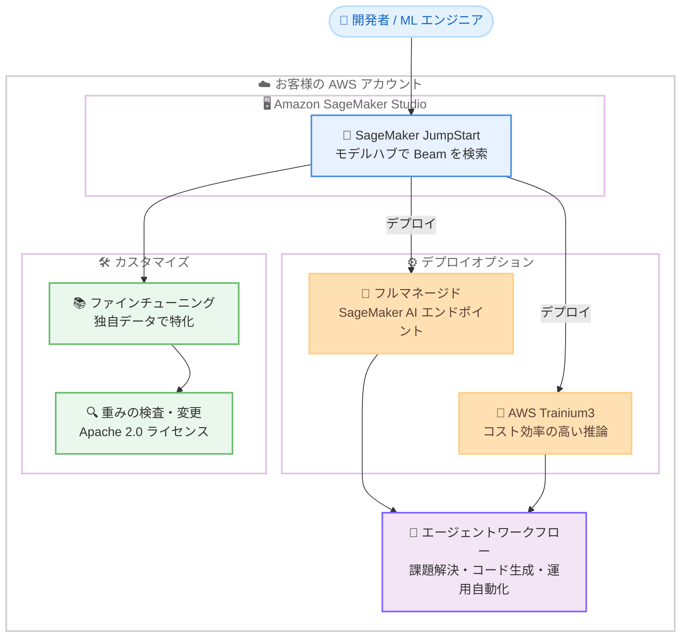

# Amazon SageMaker JumpStart - Reflection 社の Beam モデルが利用可能に (AWS Trainium 対応)

**リリース日**: 2026 年 10 月 21 日
**サービス**: Amazon SageMaker AI (SageMaker JumpStart) / AWS Trainium
**機能**: Reflection 社のオープンウェイトモデル Beam の提供開始

📊 [このアップデートのインフォグラフィックを見る](https://takech9203.github.io/aws-news-summary/20261021-reflection-beam-on-sagemaker-jumpstart-and-aws-trainium.html)

## 概要

米国の AI 企業 Reflection 社初のオープンウェイトモデル「Beam」が、Amazon SageMaker JumpStart (SageMaker AI 内のモデルハブ) で利用可能になりました。Beam は同クラスのオープンウェイトモデルにおけるフロンティア性能を主張しており、推論 (reasoning)、コーディング、エージェント系のベンチマークで高いパフォーマンスを示すとされています。Apache 2.0 ライセンスで公開されているため、重みの検査・変更やファインチューニングを含む完全なカスタマイズが可能です。

本モデルは AWS Trainium3 向けに移植・最適化されており、提供初日からコスト効率と高パフォーマンスを両立したデプロイオプションを選択できます。モデルはお客様自身の AWS アカウント内で実行されるため、データを外部に出すことなく、既存の AWS のセキュリティ・コンプライアンス機能によって保護された状態でフロンティアモデルを活用できます。

Reflection 社の共同創業者兼 CEO である Misha Laskin 氏は「開発者が API を通じて借りるのではなく、実際にコントロールできるフロンティア AI を提供する」と述べており、API 経由の利用に留まらないモデルの完全なコントロールを重視する組織が主な対象ユーザーです。

**アップデート前の課題**

このアップデート以前には、以下の課題がありました。

- フロンティア級の性能を持つモデルの多くはプロプライエタリであり、API 経由での利用に限定され、重みの検査・変更やファインチューニングができなかった
- 機密性の高いコードやデータを扱う組織では、外部 API にデータを送信すること自体が制約となり、フロンティアモデルの採用が困難だった
- オープンウェイトモデルを自前でホストする場合、推論基盤の構築・最適化や運用管理の負担が大きかった

**アップデート後の改善**

今回のアップデートにより、以下が可能になりました。

- SageMaker JumpStart から数クリックで Beam をフルマネージドエンドポイントとしてデプロイし、すぐに推論を開始できるようになった
- 独自のコードやデータでファインチューニングし、自組織のドメインに特化したモデルを構築できるようになった
- AWS Trainium3 に最適化されたデプロイオプションにより、コスト効率の高い推論を初日から利用できるようになった
- お客様自身の AWS アカウント内でモデルが実行されるため、データの完全なコントロールを維持しながら、SageMaker AI 標準のアクセス制御、監査証跡、モニタリングを活用できるようになった

## アーキテクチャ図



SageMaker JumpStart から Beam をデプロイし、フルマネージドエンドポイントまたは AWS Trainium3 で推論を実行する構成です。すべての処理がお客様の AWS アカウント内で完結し、ファインチューニングやエージェントワークフローへの組み込みも同一環境内で行えます。

## サービスアップデートの詳細

### 主要機能

1. **SageMaker JumpStart でのワンストップデプロイ**
   - Amazon SageMaker Studio 内の SageMaker JumpStart で「Beam」を検索し、数クリックでデプロイ可能
   - フルマネージドな SageMaker AI エンドポイントとして推論を提供
   - SageMaker AI のすべてのデプロイと同様のアクセス制御、監査証跡、モニタリングでスケール可能

2. **完全なカスタマイズ性 (オープンウェイト)**
   - Apache 2.0 ライセンスで公開され、重みの検査・変更が可能
   - 独自のコードやデータによるファインチューニングで、自組織のドメインに特化したモデルを構築可能
   - BF16、FP8、NVFP4 の 3 種類のチェックポイントバリアントを提供

3. **AWS Trainium3 への最適化**
   - Beam は AWS Trainium3 向けに移植・最適化済み
   - 提供初日からコスト効率と高パフォーマンスを両立したデプロイオプションとして選択可能

4. **エージェントワークフローへの組み込み**
   - ソフトウェアの課題解決、コードの生成・レビュー、運用の自動化、高度な数学・科学推論などのユースケースに対応
   - マルチステップのエージェントワークフローに組み込み可能

5. **データの完全なコントロール**
   - モデルはお客様自身の AWS アカウント内で実行され、データが外部に送信されない
   - 既存の AWS のセキュリティ・コンプライアンス機能でデータを保護

## 技術仕様

### モデルの提供形態

| 項目 | 詳細 |
|------|------|
| モデル名 | Beam (Reflection 社初のオープンウェイトモデル) |
| ライセンス | Apache 2.0 |
| チェックポイントバリアント | BF16、FP8、NVFP4 |
| 得意分野 | 推論 (reasoning)、コーディング、エージェントタスク |
| 提供チャネル | Amazon SageMaker JumpStart (SageMaker AI のモデルハブ) |
| アクセラレータ | AWS Trainium3 に最適化 (GPU インスタンスも利用可能) |
| カスタマイズ | ファインチューニング、重みの検査・変更に対応 |

## 設定方法

### 前提条件

1. AWS アカウントと Amazon SageMaker AI を利用できる IAM 権限があること
2. Amazon SageMaker Studio のドメインとユーザープロファイルがセットアップ済みであること
3. 利用可能リージョン (米国東部リージョン) でセットアップしていること

### 手順

#### ステップ 1: SageMaker Studio で JumpStart を開く

Amazon SageMaker Studio を起動し、ナビゲーションから SageMaker JumpStart を開きます。検索ボックスに「Beam」と入力してモデルを検索します。

#### ステップ 2: モデルをデプロイする

モデルカードから Beam を選択し、デプロイ設定 (インスタンスタイプ、エンドポイント名など) を確認してデプロイを実行します。AWS Trainium3 ベースのインスタンスを選択することで、コスト効率の高い推論構成にできます。デプロイが完了すると、フルマネージドな SageMaker AI エンドポイントが作成されます。

#### ステップ 3: 推論を実行する

```python
import boto3
import json

runtime = boto3.client("sagemaker-runtime")

response = runtime.invoke_endpoint(
    EndpointName="<your-beam-endpoint>",
    ContentType="application/json",
    Body=json.dumps({
        "inputs": "Explain the trade-offs of eventual consistency.",
        "parameters": {"max_new_tokens": 512}
    })
)
print(response["Body"].read().decode())
```

SageMaker Runtime の `invoke_endpoint` API でデプロイ済みの Beam エンドポイントを呼び出し、推論結果を取得しています。エンドポイント名は実際にデプロイしたものに置き換えてください。

#### ステップ 4: 必要に応じてファインチューニングする

SageMaker JumpStart のファインチューニング機能、または SageMaker AI のトレーニングジョブを使用して、独自のコードやデータで Beam を特化させることができます。

## メリット

### ビジネス面

- **データ主権の確保**: モデルがお客様の AWS アカウント内で実行されるため、機密データを外部 API に送信することなくフロンティア級のモデルを活用できる。政府機関や規制業界での採用ハードルが下がる
- **ベンダーロックインの回避**: Apache 2.0 ライセンスのオープンウェイトモデルであり、API 経由の「借用」ではなくモデル自体をコントロールできる
- **コスト効率**: AWS Trainium3 最適化により、推論コストを抑えたデプロイオプションを初日から選択できる

### 技術面

- **フルマネージド運用**: 推論基盤の構築・最適化を SageMaker AI に任せられるため、オープンウェイトモデルの自前ホスティングに伴う運用負担が軽減される
- **柔軟な精度選択**: BF16、FP8、NVFP4 のチェックポイントバリアントにより、精度とコスト・レイテンシのバランスを選択できる
- **エンタープライズ機能の継承**: SageMaker AI 標準のアクセス制御、監査証跡、モニタリングをそのまま利用できる

## デメリット・制約事項

### 制限事項

- 提供リージョンは現時点で米国東部 (バージニア北部) と米国東部 (オハイオ) の 2 リージョンに限定される
- 東京リージョンを含む他リージョンでの提供時期は発表されていない

### 考慮すべき点

- 「同クラスのオープンウェイトモデルのフロンティア性能」はベンダーの主張であり、実際の採用にあたっては自組織のユースケースでのベンチマーク評価が推奨される
- Trainium3 での推論を利用する場合、対象リージョンでのインスタンスの利用可否とキャパシティを事前に確認する必要がある
- ファインチューニングやエンドポイントの常時稼働にはインスタンス利用料金が発生するため、ワークロードに応じたインスタンス選定とスケーリング設計が必要

## ユースケース

### ユースケース 1: 機密コードベースに特化したコーディング支援

**シナリオ**: 金融機関や政府機関など、ソースコードを外部 API に送信できない組織が、社内コードベースに特化したコーディング支援モデルを構築したい。

**実装例**:
```
1. SageMaker JumpStart から Beam をデプロイ
2. 社内リポジトリのコードでファインチューニング
3. 社内開発ツールからエンドポイントを呼び出し、
   コード生成・レビューを支援
```

**効果**: データを AWS アカウント外に出すことなく、自組織のコーディング規約やライブラリに精通した支援モデルを運用できます。

### ユースケース 2: 運用自動化エージェントの構築

**シナリオ**: ソフトウェアの障害対応や定型運用作業を、マルチステップのエージェントワークフローで自動化したい。

**実装例**:
```
1. Beam エンドポイントを推論バックエンドとして構成
2. エージェントフレームワークからツール呼び出しと
   組み合わせてワークフローを定義
3. チケット起票から原因調査、修正案の提示までを自動化
```

**効果**: 推論・コーディング・エージェントタスクに強いモデルを基盤として、運用の自動化レベルを高められます。

### ユースケース 3: Trainium3 によるコスト効率の高い大規模推論

**シナリオ**: 大量の推論リクエストを処理するサービスで、GPU インスタンスのコストが課題になっている。

**実装例**:
```
1. Beam の Trainium3 最適化版をデプロイ
2. FP8 や NVFP4 のチェックポイントで
   精度とスループットのバランスを調整
3. 負荷に応じたオートスケーリングを設定
```

**効果**: Trainium3 への最適化と低精度チェックポイントの組み合わせにより、推論コストを抑えながら大規模なワークロードに対応できます。

## 料金

Beam モデル自体は Apache 2.0 ライセンスのオープンウェイトモデルです。SageMaker JumpStart からのデプロイでは、推論エンドポイントが使用するインスタンスの稼働時間に基づく SageMaker AI の料金が発生します。ファインチューニングを行う場合は、トレーニングジョブのインスタンス利用料金が別途発生します。

詳細は [Amazon SageMaker AI の料金ページ](https://aws.amazon.com/sagemaker/pricing/) を参照してください。

## 利用可能リージョン

提供開始時点では以下のリージョンで利用可能です。

- 米国東部 (バージニア北部)
- 米国東部 (オハイオ)

## 関連サービス・機能

- **Amazon SageMaker JumpStart**: 事前学習済みモデルのハブ。Beam のデプロイとファインチューニングの入り口となる
- **Amazon SageMaker AI**: フルマネージドな機械学習プラットフォーム。エンドポイントのホスティング、アクセス制御、監査、モニタリングを提供する
- **AWS Trainium**: AWS が設計した機械学習アクセラレータ。Beam は Trainium3 に最適化されており、コスト効率の高い推論を実現する
- **Amazon SageMaker Studio**: 統合開発環境。JumpStart でのモデル検索からデプロイまでを GUI で操作できる

## 参考リンク

- 📊 [インフォグラフィック](https://takech9203.github.io/aws-news-summary/20261021-reflection-beam-on-sagemaker-jumpstart-and-aws-trainium.html)
- [公式発表 (What's New)](https://aws.amazon.com/about-aws/whats-new/2026/01/reflection-beam-on-sagemaker-jumpstart-and-aws-trainium/)
- [Amazon SageMaker AI](https://aws.amazon.com/sagemaker/ai/)
- [Amazon SageMaker AI ドキュメント](https://docs.aws.amazon.com/sagemaker/)
- [SageMaker JumpStart ドキュメント](https://docs.aws.amazon.com/sagemaker/latest/dg/studio-jumpstart.html)
- [料金ページ](https://aws.amazon.com/sagemaker/pricing/)

## まとめ

Reflection 社初のオープンウェイトモデル Beam が SageMaker JumpStart で利用可能になり、フロンティア級の性能を持つモデルをお客様自身の AWS アカウント内で完全にコントロールしながら運用できるようになりました。AWS Trainium3 への最適化により、コスト効率の高い推論オプションも初日から選択できます。データ主権やモデルのカスタマイズ性を重視する組織は、まず米国東部リージョンで Beam をデプロイし、自組織のユースケースでの性能評価から始めることを推奨します。
