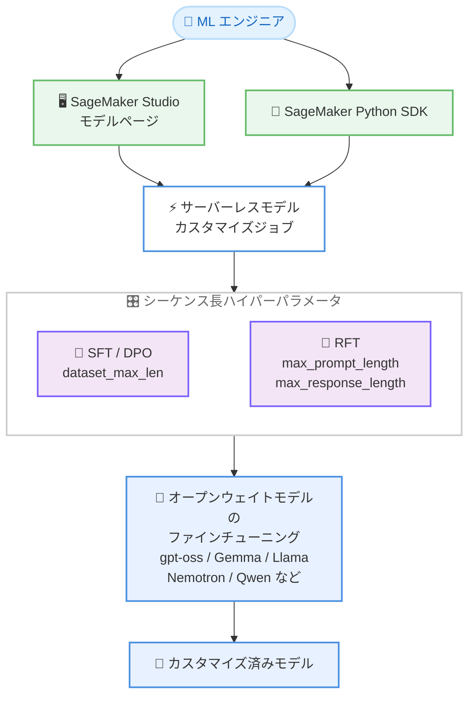

# Amazon SageMaker AI - サーバーレスモデルカスタマイズジョブでのカスタムシーケンス長サポート

**リリース日**: 2026 年 10 月 21 日
**サービス**: Amazon SageMaker AI
**機能**: サーバーレスモデルカスタマイズジョブにおけるシーケンス長のカスタム設定

📊 [このアップデートのインフォグラフィックを見る](https://takech9203.github.io/aws-news-summary/20261021-sagemaker-custom-sequence-lengths.html)

## 概要

Amazon SageMaker AI のサーバーレスモデルカスタマイズジョブで、シーケンス長をハイパーパラメータとして設定できるようになりました。サーバーレスモデルカスタマイズは、インフラストラクチャのプロビジョニングや管理を行わずに、gpt-oss、Gemma、Llama、Nemotron、Qwen などのオープンウェイトモデルをファインチューニングできる機能です。

今回のアップデートにより、SFT (教師ありファインチューニング) および DPO (直接選好最適化) ジョブでは `dataset_max_len`、RFT (強化学習ファインチューニング) ジョブでは `max_prompt_length` と `max_response_length` を、モデルと手法ごとに公開されている最大値まで自由に設定できます。多くのモデルで最大 16K トークン、一部のモデルと手法では 32K トークンまで対応します。

短い Q&A ペアから複数ページにわたる長文ドキュメントまで、学習データの特性に合わせてシーケンス長を調整できるため、長文データの切り捨てによる品質低下を防ぎつつ、効率的なファインチューニングが可能になります。本機能は東京リージョンを含む 4 リージョンで利用可能です。

**アップデート前の課題**

- 以前は各ファインチューニングレシピが固定のシーケンス長で実行され、ユーザーが変更できなかった
- 固定長を超える長文の学習データは切り捨てられ、長いコンテキストを必要とするユースケースで学習品質に影響があった
- コーディングや数学的推論など、長い出力を必要とするタスクで応答長の割り当てを調整できなかった

**アップデート後の改善**

- シーケンス長をハイパーパラメータとして、モデル / 手法ごとの公開最大値まで設定可能になった
- SFT / DPO では `dataset_max_len` でプロンプトと補完を合わせた全体長を制御できるようになった
- RFT では `max_prompt_length` (入力の予算) と `max_response_length` (生成の予算) を個別に設定できるようになった
- 多くのモデルで最大 16K トークン、一部では 32K トークンまでの長文学習データに対応した

## アーキテクチャ図



SageMaker Studio のモデルページまたは Python SDK からサーバーレスカスタマイズジョブを起動し、ファインチューニング手法に応じたシーケンス長ハイパーパラメータを指定してオープンウェイトモデルを学習する流れを示しています。

## サービスアップデートの詳細

### 主要機能

1. **シーケンス長のカスタム設定**
   - 従来は各レシピで固定だったシーケンス長を、ハイパーパラメータとして設定可能
   - モデルと手法ごとに公開されている最大値まで任意の値を指定できる
   - 多くのモデルで最大 16K トークン、一部のモデル / 手法では 32K トークンまで対応

2. **手法ごとのパラメータ体系**
   - SFT / DPO ジョブ: `dataset_max_len` でプロンプトと補完を合わせた全体の最大長を設定
   - RFT ジョブ (RLVR / RLAIF): `max_prompt_length` と `max_response_length` を個別に設定し、合計がモデルの最大値以内に収まるようにする
   - 入力と出力の予算を分けて管理できるため、長い生成を必要とするタスクに柔軟に対応できる

3. **幅広いオープンウェイトモデルに対応**
   - gpt-oss、Gemma、Llama、Nemotron、Qwen、Ministral、DeepSeek R1 Distill などのモデルファミリーをサポート
   - LoRA とフルファインチューニング (FFT) の両方の学習タイプに対応 (モデルにより異なる)
   - SageMaker Studio のモデルページ、SageMaker Python SDK、エージェントスキル経由で利用可能

## 技術仕様

### シーケンス長ハイパーパラメータ

| 手法 | パラメータ | 説明 |
|------|-----------|------|
| SFT / DPO | `dataset_max_len` | プロンプトと補完を合わせた全体の最大トークン長 |
| RFT (RLVR / RLAIF) | `max_prompt_length` | 入力プロンプトに割り当てる最大トークン長 |
| RFT (RLVR / RLAIF) | `max_response_length` | モデルの生成に割り当てる最大トークン長 |

RFT では `max_prompt_length` と `max_response_length` の合計が、モデルごとの最大シーケンス長以内である必要があります。

### 最大シーケンス長の例

ドキュメントに公開されている最大シーケンス長の一部を以下に示します (トークン数)。

| モデル | SFT (LoRA) | DPO (LoRA) | RLVR (LoRA) | RLAIF (LoRA) |
|--------|-----------|-----------|------------|-------------|
| Qwen3.8 27B | 16K | 16K | 16K | 16K |
| Qwen3.5 9B | 16K | 16K | 32K | 32K |
| Gemma 4 31B | 32K | 32K | 16K | 16K |
| Ministral 3 Instruct 2512 BF16 8B | 16K | 16K | 32K | 32K |
| Nemotron 3 Nano 30B (A3B) | 32K | 8K | 16K | 16K |
| GPT OSS 120B | 4K (固定) | 4K (固定) | 32K | 32K |
| GPT OSS 20B | 4K (固定) | 4K (固定) | 16K | 16K |
| Llama 3.3 Instruct 70B | 4K (固定) | 4K (固定) | 16K | 16K |

**注**: 一部のモデルと手法の組み合わせでは、シーケンス長が 4K に固定されており変更できません。モデルごとの最新の上限値は [公式ドキュメントの一覧表](https://docs.aws.amazon.com/sagemaker/latest/dg/customizing-models-sequence-lengths.html) を参照してください。

## 設定方法

### 前提条件

1. AWS アカウントと Amazon SageMaker AI (SageMaker Studio) のセットアップが完了していること
2. 学習データセットが Amazon S3 に用意されていること
3. 利用可能リージョン (バージニア北部、オレゴン、東京、アイルランド) のいずれかを使用していること

### 手順

#### ステップ1: ジョブの起動方法を選択する

SageMaker Studio のモデルページから対象のオープンウェイトモデルを選択してカスタマイズジョブを作成するか、SageMaker Python SDK を使用してジョブを定義します。

#### ステップ2: シーケンス長ハイパーパラメータを設定する

SFT / DPO ジョブの場合は、学習データの長さに合わせて `dataset_max_len` を設定します。

```python
# SFT / DPO ジョブのハイパーパラメータ設定例
hyperparameters = {
    "dataset_max_len": 16384,  # プロンプト + 補完の最大トークン長
    # その他のハイパーパラメータ
}
```

`dataset_max_len` に、プロンプトと補完を合わせた最大トークン長を指定しています。モデルと手法ごとの公開最大値までの任意の値を設定できます。

RFT ジョブの場合は、入力と生成の予算を個別に設定します。

```python
# RFT ジョブのハイパーパラメータ設定例
hyperparameters = {
    "max_prompt_length": 8192,    # 入力プロンプトの最大トークン長
    "max_response_length": 8192,  # 生成の最大トークン長
    # その他のハイパーパラメータ
}
```

`max_prompt_length` と `max_response_length` の合計がモデルの最大シーケンス長以内になるように設定しています。長い推論出力が必要なタスクでは `max_response_length` を大きめに確保します。

#### ステップ3: ジョブを実行して結果を確認する

サーバーレスカスタマイズジョブを送信します。インフラストラクチャの管理は不要で、ジョブの進捗とメトリクスは SageMaker Studio で確認できます。学習完了後、カスタマイズ済みモデルを評価してデプロイします。

## メリット

### ビジネス面

- **学習品質の向上**: 長文ドキュメントを切り捨てずに学習できるため、長いコンテキストを扱うユースケースでのモデル品質が向上する
- **ユースケース適合性の拡大**: 短い Q&A から複数ページのドキュメントまで、業務データの特性に合わせたファインチューニングが可能になる
- **インフラ管理コストの削減**: サーバーレスのため、GPU クラスターの構築や管理なしで長いシーケンス長の学習を実行できる

### 技術面

- **データに合わせた柔軟な設定**: レシピの固定値に縛られず、学習データの実際の長さ分布に合わせてシーケンス長を最適化できる
- **入力と出力の予算を分離**: RFT では `max_prompt_length` と `max_response_length` を独立して設定でき、コーディングや数学的推論など長い生成が必要なタスクに対応できる
- **幅広いモデルと手法に対応**: gpt-oss、Gemma、Llama、Nemotron、Qwen などの主要なオープンウェイトモデルで、SFT / DPO / RFT の各手法に利用できる

## デメリット・制約事項

### 制限事項

- 設定可能な最大値はモデルと手法 (SFT / DPO / RLVR / RLAIF、LoRA / FFT) の組み合わせごとに異なる
- 一部のモデルと手法の組み合わせでは、シーケンス長が 4K に固定されており変更できない (例: Llama 3.x や GPT OSS の SFT / DPO)
- 利用可能リージョンは現時点で 4 リージョン (バージニア北部、オレゴン、東京、アイルランド) に限定される

### 考慮すべき点

- シーケンス長を長くすると、サンプルあたりのメモリと計算リソースの要件が増加し、学習時間とコストに影響する可能性がある
- 実際の学習時間とコストは、バッチ処理、パッキング、ハードウェア使用率、学習設定などの要因に依存する
- RFT では応答長がタスク品質に影響するため、期待される出力に十分な `max_response_length` を確保しつつ、入力用の `max_prompt_length` とのバランスを取る必要がある

## ユースケース

### ユースケース1: 長文ドキュメントを扱う社内ナレッジモデルの構築

**シナリオ**: 複数ページにわたる技術文書や契約書の要約・質問応答に特化したモデルをファインチューニングしたい。従来の固定シーケンス長では長文データが切り捨てられ、文書全体の文脈を学習できなかった。

**実装例**:
```python
hyperparameters = {
    "dataset_max_len": 16384,  # 長文ドキュメントに対応
}
```

**効果**: 文書全体を切り捨てなしで学習でき、長文コンテキストを踏まえた高品質な応答が可能なモデルを構築できる。

### ユースケース2: コーディングタスク向けモデルの RFT

**シナリオ**: コード生成タスクでは、短い指示に対して長いコードを出力する必要がある。従来は生成長を調整できず、長い出力を必要とするタスクで品質が制限されていた。

**実装例**:
```python
hyperparameters = {
    "max_prompt_length": 4096,     # 指示とコンテキスト用
    "max_response_length": 12288,  # 長いコード生成用
}
```

**効果**: 生成側に多くのトークン予算を割り当てることで、長いコードや数学的推論の学習品質が向上する。

### ユースケース3: 短い Q&A データでの効率的なファインチューニング

**シナリオ**: カスタマーサポート向けの短い Q&A ペアでモデルをカスタマイズしたい。データの実際の長さに合わせてシーケンス長を適切に設定し、効率的に学習したい。

**実装例**:
```python
hyperparameters = {
    "dataset_max_len": 2048,  # 短い Q&A ペアに最適化
}
```

**効果**: 学習データの長さ分布に合わせた設定により、メモリと計算リソースを有効活用し、効率的にファインチューニングできる。

## 料金

シーケンス長の設定機能自体に追加料金はありません。サーバーレスモデルカスタマイズジョブの料金体系に従って課金されます。

なお、シーケンス長を長くするとサンプルあたりのメモリと計算リソースの要件が増加し、実際の学習時間とコストはバッチ処理、パッキング、ハードウェア使用率、学習設定などの要因に依存する点に注意してください。詳細は [Amazon SageMaker AI の料金ページ](https://aws.amazon.com/sagemaker-ai/pricing/) を参照してください。

## 利用可能リージョン

以下の 4 リージョンで利用可能です。

- 米国東部 (バージニア北部)
- 米国西部 (オレゴン)
- アジアパシフィック (東京)
- 欧州 (アイルランド)

**東京リージョンで利用可能**なため、日本国内のデータレジデンシー要件があるワークロードでも、低レイテンシーで本機能を活用できます。

## 関連サービス・機能

- **Amazon SageMaker Studio**: モデルページからサーバーレスカスタマイズジョブを GUI で起動できる統合開発環境
- **SageMaker Python SDK**: コードベースでカスタマイズジョブを定義・実行するための SDK
- **SageMaker JumpStart / オープンウェイトモデル**: ファインチューニング対象となる gpt-oss、Gemma、Llama、Nemotron、Qwen などのモデルを提供
- **Amazon S3**: 学習データセットの格納先として使用

## 参考リンク

- 📊 [インフォグラフィック](https://takech9203.github.io/aws-news-summary/20261021-sagemaker-custom-sequence-lengths.html)
- [公式発表 (What's New)](https://aws.amazon.com/about-aws/whats-new/2026/10/sagemaker-custom-sequence-lengths/)
- [ドキュメント: Supported sequence lengths for open weight model serverless customization](https://docs.aws.amazon.com/sagemaker/latest/dg/customizing-models-sequence-lengths.html)
- [ドキュメント: Open weight model customization](https://docs.aws.amazon.com/sagemaker/latest/dg/model-customize-open-weight.html)
- [ドキュメント: Agent skills for model customization](https://docs.aws.amazon.com/sagemaker/latest/dg/model-customize-agent-skills.html)
- [SageMaker Python SDK: Model Customization](https://sagemaker.readthedocs.io/en/stable/model_customization/index.html)
- [料金ページ](https://aws.amazon.com/sagemaker-ai/pricing/)

## まとめ

SageMaker AI のサーバーレスモデルカスタマイズジョブでシーケンス長が設定可能になり、短い Q&A から長文ドキュメントまで学習データの特性に合わせたファインチューニングが可能になりました。東京リージョンでも利用できるため、オープンウェイトモデルのカスタマイズを検討している場合は、まず公式ドキュメントでモデルと手法ごとの最大シーケンス長を確認し、学習データの長さ分布に合わせた設定から始めることを推奨します。
