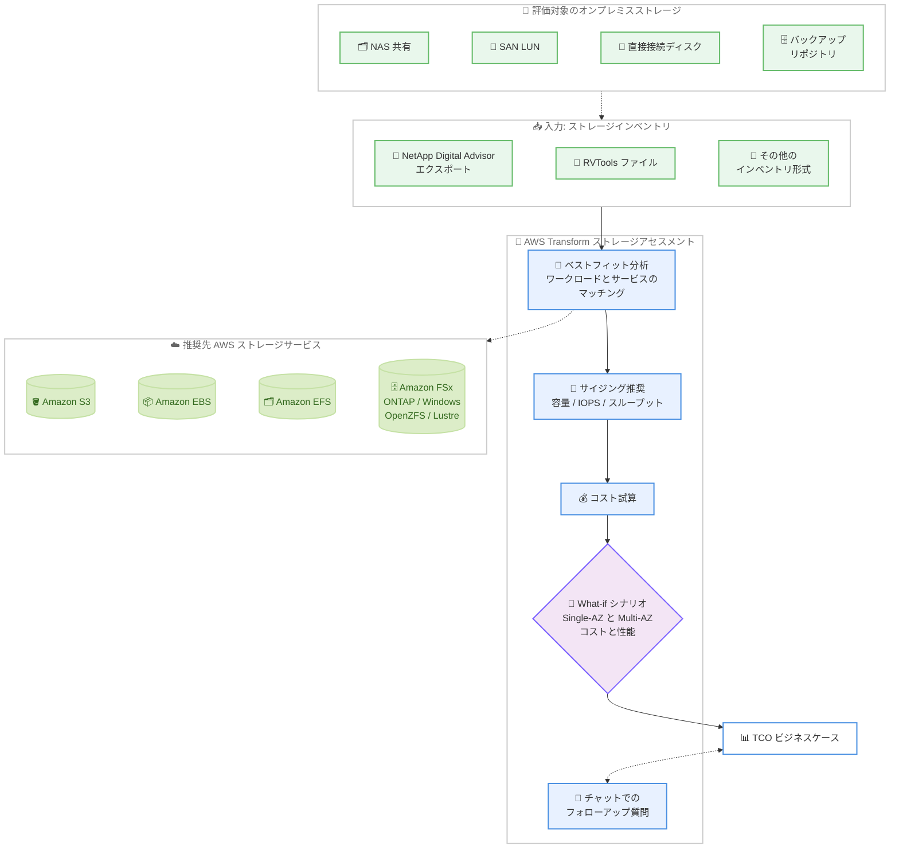

# AWS Transform - Amazon S3 / EBS / EFS / FSx 向けストレージ移行アセスメント

**リリース日**: 2026 年 10 月 21 日
**サービス**: AWS Transform / Amazon S3 / Amazon EBS / Amazon EFS / Amazon FSx
**機能**: オンプレミスストレージの移行アセスメント

📊 [このアップデートのインフォグラフィックを見る](https://takech9203.github.io/aws-news-summary/20261021-transform-assess-s3-ebs-efs-fsx.html)

## 概要

AWS Transform の移行アセスメントが、オンプレミスストレージの AWS への移行評価に対応しました。NetApp Digital Advisor のエクスポートや RVTools ファイルなどのストレージインベントリをアップロードするだけで、AWS Transform が各ワークロードを最適な AWS ストレージサービス (Amazon S3、Amazon EBS、Amazon EFS、Amazon FSx for NetApp ONTAP / Windows File Server / OpenZFS / Lustre) にマッチングし、サイジング推奨とコスト試算を行い、TCO (総所有コスト) ベースのビジネスケースを生成します。

これまで、NAS 共有、SAN LUN、直接接続ディスク、バックアップリポジトリといった多数のボリュームを、プロトコル、容量、性能特性の観点から手作業で分析し、適切な AWS サービスへマッピングする作業には多くの時間と専門知識が必要でした。今回のアップデートにより、インベントリのアップロードからビジネスケース作成までが自動化され、Single-AZ と Multi-AZ の比較やコスト重視と性能重視の比較といった What-if シナリオの実行、チャットでのフォローアップ質問も可能になります。

オンプレミスのストレージ基盤 (ファイルサーバー、ストレージアレイ、バックアップ基盤など) の AWS 移行を検討しているインフラエンジニア、ストレージ管理者、および移行計画の意思決定を行うステークホルダーに向けたアップデートです。

**アップデート前の課題**

このアップデート以前は、オンプレミスストレージの移行評価に多くの手作業が必要でした。

- 数百から数千のボリュームについて、プロトコル、容量、IOPS、スループットなどの特性を手作業で分析する必要があった
- ブロック、ファイル、オブジェクトといったストレージ種別ごとに、最適な AWS サービスの選定とサイジングを個別に検討する必要があった
- Single-AZ と Multi-AZ、コスト最適化と性能最適化といった構成の比較試算に時間がかかり、ビジネスケースの作成が困難だった

**アップデート後の改善**

今回のアップデートにより、以下が可能になりました。

- ストレージインベントリ (NetApp Digital Advisor エクスポート、RVTools ファイルなど) をアップロードするだけで、各ワークロードを最適な AWS ストレージサービスに自動マッチングできる
- 容量、IOPS、スループットに基づくサイジング推奨とコスト試算を自動で取得し、TCO ビジネスケースを短時間で作成できる
- Single-AZ と Multi-AZ の比較、コスト重視と性能重視の比較などの What-if シナリオを実行し、チャットでアセスメント結果に関するフォローアップ質問ができる

## アーキテクチャ図



オンプレミスストレージのインベントリをアップロードすると、AWS Transform が各ワークロードを最適な AWS ストレージサービスにマッチングし、サイジングとコスト試算を経て TCO ビジネスケースを生成する流れを示しています。

## サービスアップデートの詳細

### 主要機能

1. **ストレージインベントリの自動取り込み**
   - NAS 共有、SAN LUN、直接接続ディスク、バックアップリポジトリを評価対象にできる
   - NetApp Digital Advisor エクスポート、RVTools ファイル (Excel または CSV の ZIP)、NetApp Data Infrastructure Insights (DII) クエリエクスポート、AWS Transform Assessment Data テンプレートなど、既存の資産管理データをそのまま利用できる
   - 認識できない形式は柔軟なパーサーでベストエフォートの取り込みを行い、不足データはチャットで補完できる

2. **ベストフィットなサービスマッチングとサイジング**
   - 各ワークロードをストレージ種別に応じて最適なサービスにマッピング (ファイルストレージは Amazon FSx、ブロックストレージは Amazon EBS、オブジェクトやバックアップは Amazon S3 など)
   - 現在の容量、IOPS、スループット要件に基づいて推奨構成をサイジング
   - Amazon EBS では gp3、io2 Block Express、sc1、st1 からボリュームタイプを選定し、「コスト最適化」と「1 ボリュームを複数の gp3 に分割する 1-2-many」の 2 つの戦略を比較提示

3. **TCO ビジネスケースの自動生成**
   - サイジング結果に基づきコストを試算し、TCO ベースのビジネスケースを生成
   - 除外したストレージ、デフォルト値で補完した項目、アイドルボリュームをレポートし、試算の信頼度を判断できる
   - PPTX、XLSX、PDF 形式での成果物出力に対応 (移行アセスメント共通機能)

4. **What-if シナリオとチャットによる対話**
   - Single-AZ と Multi-AZ の比較、コスト最適化構成と性能最適化構成の比較などのシナリオを実行できる
   - 「gp3 から io2 に移行した場合の影響は?」のようなフォローアップ質問をチャットで実行し、前提を変えた再試算が可能

## 技術仕様

### ストレージ種別と推奨先サービスのマッピング

| オンプレミスのストレージ種別 | 推奨先 AWS サービス |
|------|------|
| ファイルストレージ (ファイルサーバー、NAS アレイ) | Amazon FSx (NetApp ONTAP / Windows File Server / OpenZFS / Lustre)、Amazon EFS |
| ブロックストレージ (サーバー / VM 接続ボリューム) | Amazon EBS (gp3 / io2 Block Express / sc1 / st1) |
| オブジェクト / バックアップストレージ | Amazon S3 (Standard / Standard-IA / Glacier Instant Retrieval に配分) |
| SAN ボリューム | NetApp DII 由来は Amazon EBS、その他のソース由来は Amazon FSx for NetApp ONTAP |

### アセスメントの主な仕様 (ユーザーガイドより)

| 項目 | 詳細 |
|------|------|
| 入力データ | RVTools エクスポート、NetApp DII クエリエクスポート、AWS Transform Assessment Data テンプレートなど |
| 性能データの収集期間 | 最低 7 日間、ピーク (バッチや月末処理) を捉えるには最大 30 日間を推奨 |
| Amazon EBS の試算 | 容量、プロビジョンド IOPS、スループットを考慮。VM の各ボリュームにデフォルト 30 GiB の gp3 ブートボリュームを追加 |
| Amazon S3 のデフォルト配分 | S3 Standard 20%、S3 Standard-IA 30%、S3 Glacier Instant Retrieval 50% (変更可能)。メタデータ / バージョニング用に容量を 20% 上乗せ |
| FSx for NetApp ONTAP の試算 | SSD 層と容量プール層への配分、追加 IOPS、スループット階層、データ削減効果 (NetApp 以外のソースはデフォルト 45%) を考慮。Single-AZ と Multi-AZ の両方を試算 |
| リージョン指定 | 1 つのアセスメントで 1 リージョンを試算。リージョン比較はシナリオを分けて実行 |

## 設定方法

### 前提条件

1. AWS Transform ワークスペースへのアクセス権限
2. サポートされている形式のストレージインベントリデータ (RVTools、NetApp Digital Advisor / DII エクスポートなど)
3. 性能ピークを反映するため、7 日間以上 (推奨は最大 30 日間) の性能データ

### 手順

#### ステップ 1: インベントリデータの準備とアップロード

評価対象のストレージに応じてインベントリを準備します。たとえば NetApp DII の場合、NAS ボリュームには Disk、Internal Volumes、Storage、Share クエリ、SAN ボリュームには Virtual Machines、Volumes クエリを実行し、結果を ZIP ファイルとしてエクスポートします。AWS Transform ワークスペースで移行アセスメントジョブを作成し、ファイルをアップロードします。

#### ステップ 2: ディスカバリー結果の確認とアセスメント実行

AWS Transform が生成したディスカバリーサマリー (ストレージサマリー、データ品質警告など) を確認し、対象スコープや前提条件 (ターゲットリージョン、EBS ボリュームタイプの指定など) を設定してアセスメントを実行します。各ワークロードのマッチング結果、サイジング推奨、コスト試算が提示されます。

#### ステップ 3: What-if シナリオの実行とビジネスケースの作成

チャットで次のようなプロンプトを実行し、前提を変えた比較や再試算を行います。

```text
- "Estimate storage costs for my file servers on Amazon FSx for NetApp ONTAP"
- "What is the impact of moving from gp3 to io2 volumes?"
- "Model my backup and archive data on Amazon S3"
- "Use gp3 for all of my application volumes"
```

Single-AZ と Multi-AZ、コスト重視と性能重視などのシナリオを比較し、最終的な TCO ビジネスケースを PPTX / XLSX / PDF 形式で出力してステークホルダーとの合意形成に活用します。

## メリット

### ビジネス面

- **評価期間の大幅な短縮**: 多数のボリュームの手作業分析が不要になり、ストレージ移行のビジネスケース作成を短時間で完了できる
- **データドリブンな意思決定**: 実際のインベントリと性能データに基づく TCO 試算により、移行判断の根拠を定量的に示せる
- **既存データの再利用**: NetApp Digital Advisor や RVTools など、すでに手元にあるエクスポートをそのまま入力に使えるため、新たなデータ収集の負担が小さい

### 技術面

- **ベストフィットなサービス選定**: プロトコル、容量、性能特性に基づき、S3 / EBS / EFS / FSx の中から最適なサービスを自動で選定できる
- **性能要件を考慮したサイジング**: 容量だけでなく IOPS とスループットを考慮した推奨構成が得られ、過剰または過小なプロビジョニングを回避できる
- **構成比較の容易さ**: Single-AZ と Multi-AZ、EBS ボリュームタイプの変更などの What-if シナリオをチャットで即座に比較できる

## デメリット・制約事項

### 制限事項

- 1 つのストレージアセスメントで試算できるのは単一リージョンのみ。リージョンを指定しない、または複数指定した場合はエラーになる (リージョン比較はシナリオを分けて実行する)
- 容量データがないボリュームや、サポートされるボリュームタイプの上限を超える要件を持つストレージはマッピングできず、コスト試算から除外される
- AWS Transform が利用可能なリージョンでのみ利用できる

### 考慮すべき点

- 使用容量やピーク性能などの欠損フィールドはドキュメント化されたデフォルト値で補完されるため、入力データの品質が試算精度に直結する (例: 使用容量が不明な場合はプロビジョンド容量の 50% を使用中と仮定)
- アイドルボリュームはコスト試算に含まれたうえでフラグ付けされるため、アーカイブや廃止の候補として別途精査することを推奨
- アセスメント結果はあくまで試算であり、実際の移行時には PoC などによる検証を推奨。データ移行の実行自体 (AWS DataSync や AWS Transfer Family などの利用) は本機能の範囲外

## ユースケース

### ユースケース 1: NetApp ストレージアレイの AWS 移行評価

**シナリオ**: オンプレミスで NetApp ストレージアレイを運用しており、ハードウェア更改を機に AWS への移行を検討しているが、FSx for NetApp ONTAP への移行コストが見通せない。

**実装例**:
```text
1. NetApp Digital Advisor のエクスポート、または NetApp DII の
   クエリ結果 (7〜30 日間の性能データ) を ZIP で用意
2. AWS Transform にアップロードしてアセスメントを実行
3. SSD 層と容量プール層の配分、Single-AZ と Multi-AZ の
   試算結果を比較して移行計画に反映
```

**効果**: アレイが報告する重複排除・圧縮の削減効果を反映した現実的なサイジングとコスト試算が得られ、移行可否の判断を迅速化できる。

### ユースケース 2: VMware 環境のストレージを含む全体移行の試算

**シナリオ**: VMware 環境の AWS 移行を計画しており、VM に接続されたボリュームと共有ファイルサーバーを含めた全体のストレージコストを把握したい。

**実装例**:
```text
1. RVTools のフルエクスポート (Excel または ZIP/CSV) を取得
2. AWS Transform の移行アセスメントにアップロード
3. VM 接続ボリュームは EBS (コスト最適化と 1-2-many の
   2 戦略)、ファイルサーバーは FSx の試算結果を確認
4. "What is the impact of moving from gp3 to io2 volumes?" の
   ような What-if シナリオで構成を比較
```

**効果**: コンピューティングとストレージを一体で評価した TCO ビジネスケースを作成でき、移行スコープの検討を効率化できる。

### ユースケース 3: バックアップ / アーカイブデータの S3 移行試算

**シナリオ**: オンプレミスのバックアップリポジトリの維持コストが課題となっており、Amazon S3 への移行によるコスト削減効果を経営層に提示したい。

**実装例**:
```text
1. バックアップリポジトリを含むストレージインベントリを
   アップロード
2. "Model my backup and archive data on Amazon S3" を実行
3. デフォルトのストレージクラス配分 (Standard 20% /
   Standard-IA 30% / Glacier Instant Retrieval 50%) を
   アクセスパターンに合わせて調整
4. 生成された TCO ビジネスケースを提案資料として活用
```

**効果**: アクセスパターンに応じたストレージクラス配分を反映したコスト削減効果を定量的に示し、予算承認を得やすくなる。

## 料金

本アセスメント機能自体の追加料金は公式発表には記載されていません。アセスメントの出力として、移行後の Amazon S3、EBS、EFS、FSx の想定コストが提示されます。詳細は AWS Transform の料金ページを確認してください。

## 利用可能リージョン

AWS Transform が提供されているすべての AWS リージョンで利用可能です。対象リージョンの一覧は [AWS Transform ユーザーガイドのリージョン一覧](https://docs.aws.amazon.com/transform/latest/userguide/regions.html) を参照してください。

## 関連サービス・機能

- **Amazon S3**: オブジェクトストレージとバックアップ / アーカイブデータの移行先。Standard、Standard-IA、Glacier Instant Retrieval への配分を試算
- **Amazon EBS**: サーバー / VM 接続のブロックストレージの移行先。gp3、io2 Block Express、sc1、st1 を対象にサイジング
- **Amazon EFS**: ファイルストレージの移行先候補の 1 つ
- **Amazon FSx**: NAS / ファイルサーバーの移行先。NetApp ONTAP、Windows File Server、OpenZFS、Lustre の各タイプに対応
- **AWS Transform 移行アセスメント**: コンピューティング、データベース (SQL Server)、分析 (Apache Kafka) のアセスメントに続き、今回ストレージが追加された
- **AWS DataSync / AWS Transfer Family**: アセスメント後の実際のデータ移行に利用できるサービス

## 参考リンク

- 📊 [インフォグラフィック](https://takech9203.github.io/aws-news-summary/20261021-transform-assess-s3-ebs-efs-fsx.html)
- [公式発表 (What's New)](https://aws.amazon.com/about-aws/whats-new/2026/10/transform-assess-s3-ebs-efs-fsx/)
- [AWS Transform 製品ページ](https://aws.amazon.com/transform/)
- [AWS Transform 移行アセスメント ドキュメント](https://docs.aws.amazon.com/transform/latest/userguide/transform-app-assessments.html)
- [ストレージアセスメント ドキュメント](https://docs.aws.amazon.com/transform/latest/userguide/transform-app-assessments-storage.html)
- [移行アセスメント クイックスタートガイド](https://docs.aws.amazon.com/transform/latest/userguide/transform-app-assessments-quick-start.html)

## まとめ

AWS Transform の移行アセスメントがオンプレミスストレージの評価に対応し、インベントリをアップロードするだけで S3 / EBS / EFS / FSx へのベストフィットなマッチング、サイジング、TCO ビジネスケースの作成までを自動化できるようになりました。ストレージ基盤の AWS 移行を検討している場合は、まず NetApp Digital Advisor や RVTools などの既存エクスポートを用意して AWS Transform でアセスメントを実行し、Single-AZ と Multi-AZ などの What-if シナリオを比較しながら移行計画の検討を開始することを推奨します。
