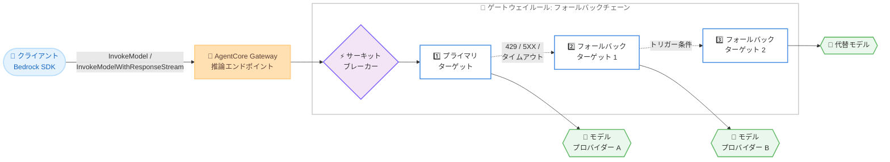

# Amazon Bedrock AgentCore Gateway - Bedrock InvokeModel API サポートとモデルフォールバック

**リリース日**: 2026 年 10 月 22 日
**サービス**: Amazon Bedrock AgentCore (Gateway)
**機能**: Bedrock InvokeModel / InvokeModelWithResponseStream API サポートおよびモデルフォールバックルーティング

📊 [このアップデートのインフォグラフィックを見る](https://takech9203.github.io/aws-news-summary/20261022-agentcore-gateway-invokemodel-fallback.html)

## 概要

Amazon Bedrock AgentCore Gateway の推論エンドポイントに 2 つの新機能が追加されました。1 つ目は Bedrock の InvokeModel API と InvokeModelWithResponseStream API のサポートです。既存の Bedrock SDK インテグレーションの接続先を AgentCore Gateway に向けるだけで、プロバイダーごとにクライアントコードを書き換えることなく、単一のガバナンス付きエンドポイント経由で任意のモデルプロバイダーにアクセスできます。

2 つ目はモデルフォールバックルーティングです。プライマリのモデルやプロバイダーがスロットリング、キャパシティ不足、接続不能などの状態になった場合、ゲートウェイがリクエストを代替のモデルやプロバイダーへ自動的に振り替えます。フォールバックはゲートウェイルールとして「順序付きの代替デスティネーションのチェーン」とトリガー条件 (スロットリング、サーバーエラー、応答タイムアウト) で構成します。組み込みのサーキットブレーカーが、障害中のデスティネーションをスキップして失敗試行による遅延を低減します。クライアントから見るとフォールバックは透過的で、1 つのリクエストを送信し 1 つのレスポンスを受け取るだけです。

エージェントや生成 AI アプリケーションを運用するチームにとって、クライアント側のリトライロジックを実装せずに可用性を高められる重要なアップデートです。

**アップデート前の課題**

- 以前は Bedrock SDK (InvokeModel) を使用する既存アプリケーションをゲートウェイ経由にするには、クライアントコードの書き換えが必要だった
- プライマリモデルがスロットリングや障害で利用できない場合、各クライアントが独自にリトライやフォールバックロジックを実装する必要があった
- 障害中のモデルへの失敗試行により、レイテンシーとコストが増加していた

**アップデート後の改善**

- 既存の Bedrock SDK インテグレーションをそのまま AgentCore Gateway に向けるだけで、単一エンドポイントから複数のモデルプロバイダーを利用可能になった
- ゲートウェイルールでフォールバックチェーンを宣言的に定義でき、クライアント側のリトライロジックが不要になった
- サーキットブレーカーが障害中のデスティネーションを自動的にスキップし、障害時のレイテンシーとコストを低減できるようになった

## アーキテクチャ図



クライアントは単一のゲートウェイエンドポイントにリクエストを送信し、ゲートウェイがフォールバックチェーンを順に試行して、最初に成功したデスティネーションのレスポンスを返します。サーキットブレーカーは障害中のデスティネーションをスキップします。

## サービスアップデートの詳細

### 主要機能

1. **InvokeModel / InvokeModelWithResponseStream API サポート**
   - ゲートウェイの推論エンドポイントが InvokeModel と InvokeModelWithResponseStream の両 API を受け付ける
   - 既存の Bedrock SDK インテグレーションの接続先を変更するだけで利用可能
   - 単一のガバナンス付きエンドポイント経由で任意のモデルプロバイダーにアクセスできる

2. **モデルフォールバックルーティング**
   - `routeToTarget` アクションの `fallback` ブロックで、1〜2 件の代替デスティネーション (`targetFallback`) を順序付きで定義
   - 各デスティネーションはターゲット名と、オプションでモデルを指定可能 (別モデルへのダウングレードも可能)
   - `triggerOn` でフォールバック条件を指定: HTTP ステータスコード (`429`、`503`、`5XX` など 4xx / 5xx の範囲) と接続レベルの条件 (`CONNECTION_ERROR`、`FIRST_BYTE_TIMEOUT`、`UNROUTABLE`)
   - `firstByteTimeoutMilliseconds` で最初のレスポンスバイトの待機時間を設定し、プロバイダーがエラーを返さずに停止した場合でもフォールバック可能

3. **サーキットブレーカー**
   - デフォルトで有効 (`ENABLED`)。障害中のデスティネーションをスキップし、正常なデスティネーションへ直接ルーティング
   - Closed (正常) / Open (障害中) / Half-open (回復確認中) の 3 状態を自動遷移
   - Half-open 状態では一部のリクエストのみプライマリに通して回復を確認し、成功すれば全トラフィックをプライマリに戻す
   - 無効化も可能 (例: 高コストなセカンダリへの即時フェイルを避け、安価なプライマリを使い続けたい場合)

4. **加重ルーティングとの組み合わせ**
   - プライマリが `weightedRoute` の場合、トラフィック分割の各レッグに個別の `fallback` ブロックを設定
   - サーキットブレーカーはデスティネーション単位で独立して動作し、重み付けの影響を受けない

## 技術仕様

### フォールバック設定の構成要素

| 項目 | 詳細 |
|------|------|
| プライマリ | `staticRoute` または各 `weightedRoute` レッグ。オプションでモデルを固定可能 |
| `targetFallback` | 1〜2 件の順序付き代替デスティネーション。各エントリにターゲット名と任意のモデル、個別のトリガー条件を設定可能 |
| `triggerOn.statusCodes` | 1〜10 件の HTTP エラーステータスコードまたはクラスパターン (`429`、`503`、`5XX` など)。4xx / 5xx の範囲のみ |
| `triggerOn.errors` | 1〜3 件の接続レベル条件: `CONNECTION_ERROR`、`FIRST_BYTE_TIMEOUT`、`UNROUTABLE` |
| `firstByteTimeoutMilliseconds` | 最初のレスポンスバイトを待つ時間。超過すると次のデスティネーションへ移行 |
| `circuitBreaker.mode` | `ENABLED` (デフォルト) または `DISABLED` |

### バリデーションルール

- ルール内のすべてのデスティネーションは一意である必要がある (ターゲットとモデルの組み合わせの重複は不可)
- `fallback` ブロックには少なくとも 1 件の `targetFallback` エントリが必要
- `matchModels` 条件には少なくとも 1 件のエントリが必要で、各エントリの `value` は空にできない
- フォールバックは推論ターゲットに適用される

### フォールバック設定例

```bash
aws bedrock-agentcore-control create-gateway-rule \
    --gateway-identifier my-gateway-abc1234567 \
    --priority 100 \
    --description "Prefer gpt-5.5 on bedrock-mantle, fall back to OpenAI, then degrade to gpt-5.4" \
    --conditions '[
        {
            "matchModels": {
                "anyOf": [
                    {"value": "gpt-5.5"}
                ]
            }
        }
    ]' \
    --actions '[
        {
            "routeToTarget": {
                "staticRoute": {
                    "targetName": "bedrock-mantle",
                    "model": "gpt-5.5",
                    "fallback": {
                        "circuitBreaker": {"mode": "ENABLED"},
                        "triggerOn": {
                            "statusCodes": ["5XX", "429"],
                            "errors": ["CONNECTION_ERROR", "FIRST_BYTE_TIMEOUT", "UNROUTABLE"]
                        },
                        "firstByteTimeoutMilliseconds": 5000,
                        "targetFallback": [
                            {"targetName": "openai"},
                            {"targetName": "bedrock-mantle", "model": "gpt-5.4"}
                        ]
                    }
                }
            }
        }
    ]'
```

この例では、`gpt-5.5` へのリクエストをまず `bedrock-mantle` ターゲットにルーティングし、`429` / `5XX` レスポンス、接続エラー、5 秒のファーストバイトタイムアウトなどが発生した場合に `openai` ターゲットへフォールバックし、それも失敗した場合は `bedrock-mantle` 上の `gpt-5.4` にダウングレードします (ターゲット名とモデル名は例示用)。

## 設定方法

### 前提条件

1. Amazon Bedrock AgentCore Gateway が作成済みであること
2. ルールから参照する推論ターゲット (inference target) がゲートウェイに構成済みであること
3. ゲートウェイルールを作成・管理する IAM 権限 (`bedrock-agentcore-control` の操作権限) があること

### 手順

#### ステップ 1: モデルを特定のターゲットにルーティングするルールを作成

```bash
aws bedrock-agentcore-control create-gateway-rule \
    --gateway-identifier my-gateway-abc1234567 \
    --priority 100 \
    --description "Route gpt-5.5 to bedrock-mantle" \
    --conditions '[{"matchModels": {"anyOf": [{"value": "gpt-5.5"}]}}]' \
    --actions '[{"routeToTarget": {"staticRoute": {"targetName": "bedrock-mantle"}}}]'
```

`matchModels` 条件に一致するリクエストを、デフォルトのモデルベースルーティングを上書きして、指定した 1 つのターゲットに固定 (ピン留め) するルールを作成します。

#### ステップ 2: フォールバックチェーンを追加

`routeToTarget` アクションの `staticRoute` に `fallback` ブロックを追加し、`targetFallback` (順序付き代替デスティネーション)、`triggerOn` (フォールバック条件)、`firstByteTimeoutMilliseconds` (ファーストバイトタイムアウト) を設定します。設定例は「技術仕様」セクションの CLI 例を参照してください。

#### ステップ 3: 既存クライアントの接続先をゲートウェイに変更

既存の Bedrock SDK (InvokeModel / InvokeModelWithResponseStream) を使用するアプリケーションのエンドポイントをゲートウェイの推論エンドポイントに向けます。クライアントコードの書き換えは不要で、フォールバックはクライアントに対して透過的に動作します。

#### ステップ 4: ルーティングログで動作を確認

ゲートウェイが出力するルーティングログで、実際にリクエストを処理したデスティネーションと、サーキットブレーカーがデスティネーションをスキップした履歴を確認します。

## メリット

### ビジネス面

- **可用性の向上**: プライマリモデルの障害やスロットリング時にも自動フォールバックによりエージェントの稼働を継続できる
- **コスト制御**: フォールバックチェーンの順序により、優先的に使用するモデルとコストのバランスを宣言的に制御できる。サーキットブレーカーが障害中デスティネーションへの課金対象の失敗試行を削減する
- **移行の容易さ**: 既存の Bedrock SDK アプリケーションをコード書き換えなしでゲートウェイ配下に移行できる

### 技術面

- **クライアントロジックの簡素化**: リトライ・フォールバックロジックを各クライアントで実装する必要がなく、ゲートウェイルールで一元管理できる
- **柔軟なトリガー条件**: HTTP ステータスコードに加え、接続エラーやファーストバイトタイムアウトなど、プロバイダーがエラーを返さず停止するケースにも対応できる
- **自動回復**: サーキットブレーカーの Half-open 状態により、プライマリの回復を自動的に検知してトラフィックを戻せる
- **観測可能性**: ルーティングログで、どのデスティネーションがリクエストを処理したか、なぜスキップされたかを追跡できる

## デメリット・制約事項

### 制限事項

- `targetFallback` に定義できる代替デスティネーションは 1〜2 件まで
- `triggerOn.statusCodes` は 1〜10 件、`triggerOn.errors` は 1〜3 件まで
- フォールバックはエラーレスポンスのみが対象で、2xx / 3xx レスポンスはフォールバック対象外
- ストリーミングレスポンスの送信が開始された後はフォールバックできない (クライアントは部分レスポンスとエラーを受け取り、再試行が必要)
- ルール内のデスティネーション (ターゲットとモデルの組み合わせ) は重複不可
- 中国リージョンでは利用不可

### 考慮すべき点

- ゲートウェイが行う各アウトバウンド試行は 1 回のゲートウェイ呼び出しとして課金されるため、複数デスティネーションにフォールバックしたリクエストは試行回数分課金される
- 各試行のモデル推論コストは、Amazon Bedrock または各モデルプロバイダー側で別途課金される
- フォールバックはクライアントに透過的で、どのデスティネーションが応答したかを示すクライアント向けのインジケーターはない (確認はルーティングログで行う)
- フォールバック先に別モデルを指定する場合、モデルごとの応答品質や出力形式の違いをアプリケーション側で許容できるか検証が必要

## ユースケース

### ユースケース 1: 本番エージェントのスロットリング対策

**シナリオ**: 本番環境のエージェントがピーク時間帯にプライマリモデルのスロットリング (429) で失敗し、ユーザー体験が劣化している。

**実装例**:
```json
"fallback": {
    "triggerOn": {"statusCodes": ["429", "5XX"]},
    "targetFallback": [{"targetName": "secondary-provider"}]
}
```

**効果**: スロットリング発生時に別プロバイダーの同一モデルへ自動的に振り替わり、クライアント側の変更なしでエージェントの可用性を維持できる。

### ユースケース 2: 障害時のモデルダウングレード

**シナリオ**: 最新の高性能モデルを優先的に使用しつつ、プロバイダー障害時には旧世代モデルで機能を縮退して継続したい。

**実装例**:
```json
"targetFallback": [
    {"targetName": "primary-provider"},
    {"targetName": "primary-provider", "model": "previous-generation-model"}
]
```

**効果**: 完全な停止ではなく旧モデルへの段階的な縮退 (グレースフルデグラデーション) を実現し、サービス継続性を確保できる。

### ユースケース 3: 既存 Bedrock アプリケーションのマルチプロバイダー化

**シナリオ**: InvokeModel API を使用する既存アプリケーションが多数あり、コード変更なしでガバナンスとマルチプロバイダー対応を導入したい。

**実装例**:
```python
# エンドポイントをゲートウェイに向けるだけで、既存の InvokeModel 呼び出しがそのまま動作
response = client.invoke_model(
    modelId="gpt-5.5",
    body=json.dumps(payload)
)
```

**効果**: クライアントコードを書き換えることなく、単一のガバナンス付きエンドポイント経由で複数のモデルプロバイダーとフォールバックを利用できる。

## 料金

ゲートウェイが行う各アウトバウンド試行は、1 回のゲートウェイ呼び出しとしてゲートウェイ料金で課金されます。複数のデスティネーションにフォールバックしたリクエストは、試行ごとに 1 回のゲートウェイ呼び出しとしてカウントされます。サーキットブレーカーは、すでに障害中のデスティネーションをスキップすることでこのコストを削減します。

各試行のモデル・推論コストは、ゲートウェイではなく Amazon Bedrock または各モデルプロバイダーによって別途課金されます。

詳細は [Amazon Bedrock AgentCore 料金ページ](https://aws.amazon.com/bedrock/agentcore/pricing/) を参照してください。

## 利用可能リージョン

Amazon Bedrock AgentCore Gateway が利用可能なすべての AWS リージョンで利用できます (中国リージョンを除く)。

## 関連サービス・機能

- **Amazon Bedrock**: InvokeModel / InvokeModelWithResponseStream API の提供元。ゲートウェイ経由でモデル推論を実行する際の基盤サービス
- **Amazon Bedrock AgentCore Runtime**: エージェントの実行環境。ゲートウェイと組み合わせてエージェントのモデルアクセスを一元管理できる
- **AgentCore Gateway ルール / 加重ルーティング**: 今回のフォールバックはゲートウェイルールの `routeToTarget` アクションに追加される機能で、`weightedRoute` によるトラフィック分割とも組み合わせ可能

## 参考リンク

- 📊 [インフォグラフィック](https://takech9203.github.io/aws-news-summary/20261022-agentcore-gateway-invokemodel-fallback.html)
- [公式発表 (What's New)](https://aws.amazon.com/about-aws/whats-new/2026/10/agentcore-gateway-invokemodel-fallback/)
- [ドキュメント: Model routing and fallback](https://docs.aws.amazon.com/bedrock-agentcore/latest/devguide/gateway-rules-fallback.html)
- [料金ページ](https://aws.amazon.com/bedrock/agentcore/pricing/)

## まとめ

AgentCore Gateway が Bedrock InvokeModel API をサポートしたことで、既存の Bedrock SDK アプリケーションをコード変更なしで単一のガバナンス付きエンドポイントに集約できるようになりました。さらにモデルフォールバックとサーキットブレーカーにより、クライアント側の実装なしでエージェントの可用性を大幅に高められます。本番環境でエージェントや生成 AI アプリケーションを運用しているチームは、まずプライマリモデルのスロットリング対策としてフォールバックルールの導入を検討することを推奨します。
