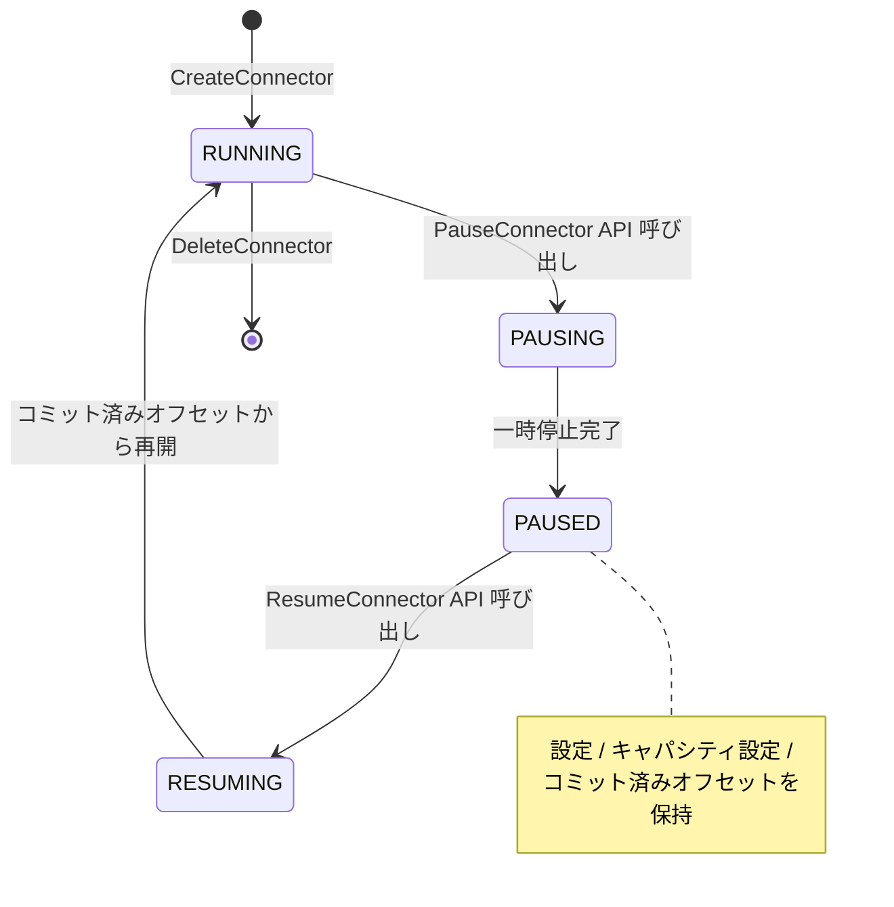
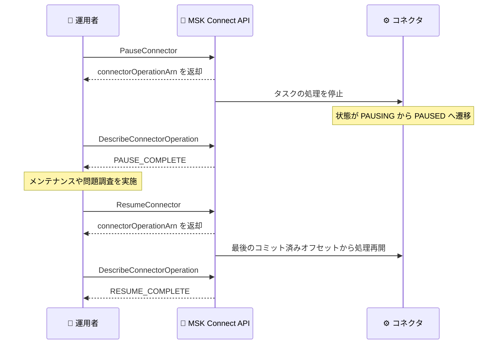

# Amazon MSK Connect - コネクタの一時停止と再開のサポート

**リリース日**: 2026 年 10 月 22 日
**サービス**: Amazon MSK Connect (Amazon Managed Streaming for Apache Kafka Connect)
**機能**: コネクタの一時停止 (Pause) と再開 (Resume)

📊 [このアップデートのインフォグラフィックを見る](https://takech9203.github.io/aws-news-summary/20261022-amazon-msk-connect-pause-resume.html)

## 概要

Amazon MSK Connect が、コネクタのレコード処理を一時的に停止し、後から再開する機能をサポートしました。一時停止中のコネクタは、設定、キャパシティ設定、コミット済みオフセットを保持します。再開すると、コネクタのタスクは最後にコミットされたオフセットから処理を再開するため、データの重複や欠落を気にせず安全に処理を中断できます。

この機能は、ソースデータベースやシンクターゲットのメンテナンス中にデータフローを停止したい場合や、上流・下流システムの問題を調査する間に処理を一時停止したい場合に有用です。MSK Connect を利用してストリーミングデータパイプラインを運用するすべてのユーザーが対象です。

**アップデート前の課題**

このアップデート以前は、コネクタの処理を一時的に止める公式な手段がありませんでした。

- 以前はコネクタの処理を止めるには、コネクタを削除し、後から再作成する必要があった
- 削除と再作成は破壊的な操作であり、設定ミスやオフセット管理の面でリスクと運用負荷が大きかった
- メンテナンスや障害調査のたびに、コネクタのライフサイクル全体を管理し直す必要があった

**アップデート後の改善**

今回のアップデートにより、コネクタのライフサイクル管理が大幅に簡素化されました。

- 今回のアップデートにより、コネクタを削除せずに処理の一時停止と再開が可能になった
- 一時停止中も設定、キャパシティ設定、コミット済みオフセットが保持され、再開時は最後のコミット済みオフセットから処理を継続できるようになった
- MSK コンソール、AWS CLI、AWS SDK、AWS CDK のいずれからも操作できるようになった

## アーキテクチャ図



今回のアップデートで追加されたコネクタの状態遷移を示しています。`PAUSING`、`PAUSED`、`RESUMING` の 3 つの状態が新たに追加されました。



一時停止と再開は非同期オペレーションとして実行されます。API のレスポンスで返されるオペレーション ARN を `DescribeConnectorOperation` に渡すことで、進行状況を追跡できます。

## サービスアップデートの詳細

### 主要機能

1. **コネクタの一時停止 (PauseConnector)**
   - 実行中のコネクタのレコード処理を一時的に停止する
   - 一時停止中も、コネクタの設定、キャパシティ設定、コミット済みオフセットは保持される
   - 非同期オペレーションとして実行され、レスポンスの `connectorOperationArn` で進行状況を追跡できる

2. **コネクタの再開 (ResumeConnector)**
   - 一時停止中のコネクタの処理を再開する
   - コネクタのタスクは、最後にコミットされたオフセットから処理を再開する
   - 削除・再作成と異なり、設定の再投入やプラグインの再指定が不要

3. **新しいコネクタ状態とオペレーション追跡**
   - コネクタ状態に `PAUSING`、`PAUSED`、`RESUMING` が追加された
   - オペレーションタイプに `PAUSE_CONNECTOR`、`RESUME_CONNECTOR` が追加された
   - `DescribeConnectorOperation` と `ListConnectorOperations` で、`PAUSE_IN_PROGRESS`、`PAUSE_COMPLETE`、`PAUSE_FAILED`、`RESUME_IN_PROGRESS`、`RESUME_COMPLETE`、`RESUME_FAILED` といったオペレーション状態を確認できる

## 技術仕様

### 新しい API と状態

| 項目 | 詳細 |
|------|------|
| 新規 API | `PauseConnector`、`ResumeConnector` |
| リクエストパラメータ | `connectorArn` のみ (リクエストボディなし) |
| レスポンス | `connectorArn`、`connectorOperationArn` |
| 実行方式 | 非同期 (オペレーション ARN で追跡) |
| 追加されたコネクタ状態 | `PAUSING`、`PAUSED`、`RESUMING` |
| 追加されたオペレーションタイプ | `PAUSE_CONNECTOR`、`RESUME_CONNECTOR` |
| 追加されたオペレーション状態 | `PAUSE_IN_PROGRESS`、`PAUSE_COMPLETE`、`PAUSE_FAILED`、`RESUME_IN_PROGRESS`、`RESUME_COMPLETE`、`RESUME_FAILED` |
| 操作インターフェース | Amazon MSK コンソール、AWS CLI、AWS SDK、AWS CDK |

### API変更履歴

| 日付 | サービス | 変更内容 |
|------|----------|----------|
| 2026/10/22 | [kafkaconnect](https://awsapichanges.com/archive/changes/444e17-kafkaconnect.html) | 2 new 7 updated api methods - `PauseConnector` と `ResumeConnector` が新規追加。`CreateConnector`、`DeleteConnector`、`DescribeConnector`、`DescribeConnectorOperation`、`ListConnectorOperations`、`ListConnectors`、`UpdateConnector` に新しいコネクタ状態とオペレーションタイプが追加 |

なお、同日の API 更新では `UpdateConnector` に `skipHealthValidation` パラメータ (boolean) も追加されています。

### PauseConnector API のリクエスト例

```
PUT /v1/connectors/{connectorArn}/pause HTTP/1.1
```

レスポンス例は以下のとおりです。

```json
{
   "connectorArn": "string",
   "connectorOperationArn": "string"
}
```

## 設定方法

### 前提条件

1. Amazon MSK Connect でコネクタが作成済みであること
2. AWS CLI または AWS SDK が最新バージョンに更新されていること
3. `kafkaconnect:PauseConnector`、`kafkaconnect:ResumeConnector` などの操作を許可する IAM 権限があること

### 手順

#### ステップ 1: コネクタを一時停止する

```bash
aws kafkaconnect pause-connector \
  --connector-arn "arn:aws:kafkaconnect:ap-northeast-1:123456789012:connector/my-connector/xxxx"
```

指定した ARN のコネクタを一時停止します。レスポンスとして `connectorOperationArn` が返却されるため、次のステップで進行状況の追跡に使用します。

#### ステップ 2: オペレーションの進行状況を確認する

```bash
aws kafkaconnect describe-connector-operation \
  --connector-operation-arn "arn:aws:kafkaconnect:ap-northeast-1:123456789012:connector-operation/..."
```

一時停止オペレーションの状態を確認します。`connectorOperationState` が `PAUSE_COMPLETE` になれば、一時停止が完了しています。コネクタ自体の状態は `describe-connector` で確認でき、`PAUSED` と表示されます。

#### ステップ 3: コネクタを再開する

```bash
aws kafkaconnect resume-connector \
  --connector-arn "arn:aws:kafkaconnect:ap-northeast-1:123456789012:connector/my-connector/xxxx"
```

一時停止中のコネクタを再開します。タスクは最後にコミットされたオフセットから処理を再開します。`describe-connector-operation` で `RESUME_COMPLETE` になったことを確認してください。

## メリット

### ビジネス面

- **運用リスクの低減**: コネクタの削除・再作成という破壊的な操作が不要になり、設定ミスやデータ欠落のリスクを削減できる
- **メンテナンス作業の効率化**: ソースやシンクのメンテナンス時に、数コマンドでデータフローを安全に停止・再開でき、計画メンテナンスの所要時間を短縮できる
- **追加コストなし**: 本機能は追加料金なしで利用できる

### 技術面

- **オフセットの保持**: コミット済みオフセットが保持されるため、再開時に最後の処理位置から正確に継続できる
- **設定の保持**: コネクタ設定とキャパシティ設定がそのまま維持され、再作成時の設定再投入が不要
- **非同期オペレーションの追跡**: `DescribeConnectorOperation` や `ListConnectorOperations` により、一時停止・再開の進行状況と履歴をプログラムから確認できる

## デメリット・制約事項

### 制限事項

- 一時停止・再開は非同期オペレーションであり、API 呼び出し後すぐに状態が切り替わるわけではない (完了確認が必要)
- 一時停止中はレコード処理が行われないため、ソース側のデータは消費されずに滞留する

### 考慮すべき点

- 一時停止中のコネクタに対する MCU キャパシティ課金の扱いは What's New では明示されていないため、料金の詳細は公式の料金ページおよびドキュメントで確認することを推奨
- 長時間の一時停止では、Kafka トピックの保持期間 (retention) を超えると未処理データが失われる可能性があるため、保持期間の設定と停止期間のバランスに注意が必要

## ユースケース

### ユースケース 1: ソースデータベースの計画メンテナンス

**シナリオ**: CDC (変更データキャプチャ) コネクタのソースである RDS データベースに対して、計画メンテナンスやバージョンアップグレードを実施する。

**実装例**:
```bash
# メンテナンス開始前にコネクタを一時停止
aws kafkaconnect pause-connector --connector-arn <CONNECTOR_ARN>

# メンテナンス完了後にコネクタを再開
aws kafkaconnect resume-connector --connector-arn <CONNECTOR_ARN>
```

**効果**: メンテナンス中の接続エラーやコネクタの `FAILED` 状態への遷移を回避し、メンテナンス完了後は最後のオフセットから安全に処理を再開できる。

### ユースケース 2: シンクターゲット障害時の調査

**シナリオ**: シンクコネクタの書き込み先である OpenSearch や S3 などで問題が発生し、原因を調査する間、下流への書き込みを停止したい。

**実装例**:
```bash
# 問題検知後にコネクタを一時停止
aws kafkaconnect pause-connector --connector-arn <CONNECTOR_ARN>

# オペレーションの完了を確認
aws kafkaconnect describe-connector-operation \
  --connector-operation-arn <OPERATION_ARN>
```

**効果**: 障害中の無駄なリトライやエラーログの大量発生を防ぎ、調査完了後に処理を途中から再開できる。コネクタを削除する必要がないため、復旧作業が大幅に簡素化される。

### ユースケース 3: 上流データ品質問題への対応

**シナリオ**: 上流システムから不正なデータが流入していることが判明し、修正が完了するまでパイプラインの処理を止めたい。

**実装例**:
```bash
# コネクタ一覧から対象コネクタの状態を確認
aws kafkaconnect list-connectors --connector-name-prefix "my-pipeline"

# 対象コネクタを一時停止
aws kafkaconnect pause-connector --connector-arn <CONNECTOR_ARN>

# 過去のオペレーション履歴を確認
aws kafkaconnect list-connector-operations --connector-arn <CONNECTOR_ARN>
```

**効果**: 不正データの下流への伝播を防止し、上流の修正後にオフセットを保持したまま処理を再開できる。オペレーション履歴により監査対応も容易になる。

## 料金

本機能は追加料金なしで利用できます。Amazon MSK Connect 自体の料金は、コネクタが使用する MSK Connect Unit (MCU) の時間単位の課金です。一時停止中の課金の扱いについては、公式の料金ページで最新情報を確認してください。

## 利用可能リージョン

Amazon MSK Connect が利用可能なすべての AWS リージョンで利用できます (東京リージョンを含む)。

## 関連サービス・機能

- **Amazon MSK (Managed Streaming for Apache Kafka)**: MSK Connect が接続する Kafka クラスターのマネージドサービス。コネクタの一時停止中もクラスター側のデータ保持設定が重要になる
- **Apache Kafka Connect**: MSK Connect の基盤となるオープンソースフレームワーク。オープンソース版の Kafka Connect にも PAUSE / RESUME の概念があり、本アップデートでマネージド環境でも同等の運用が可能になった
- **AWS CDK / AWS CLI / AWS SDK**: 本機能の操作に利用できるツール群。Infrastructure as Code による運用自動化に組み込める

## 参考リンク

- 📊 [インフォグラフィック](https://takech9203.github.io/aws-news-summary/20261022-amazon-msk-connect-pause-resume.html)
- [公式発表 (What's New)](https://aws.amazon.com/about-aws/whats-new/2026/10/amazon-msk-connect-pause-resume)
- [Amazon MSK Connect ドキュメント](https://docs.aws.amazon.com/msk/latest/developerguide/mskconnect.html)
- [PauseConnector API リファレンス](https://docs.aws.amazon.com/MSKC/latest/mskc/API_PauseConnector.html)
- [Amazon MSK Connect 機能ページ](https://aws.amazon.com/msk/features/msk-connect/)
- [Amazon MSK 料金ページ](https://aws.amazon.com/msk/pricing/)

## まとめ

Amazon MSK Connect のコネクタ一時停止・再開機能は、これまで削除・再作成でしか実現できなかった処理の中断を、オフセットと設定を保持したまま安全に行えるようにする実用性の高いアップデートです。ストリーミングパイプラインを運用しているチームは、メンテナンス手順書や障害対応ランブックに `PauseConnector` / `ResumeConnector` を組み込むことを推奨します。
