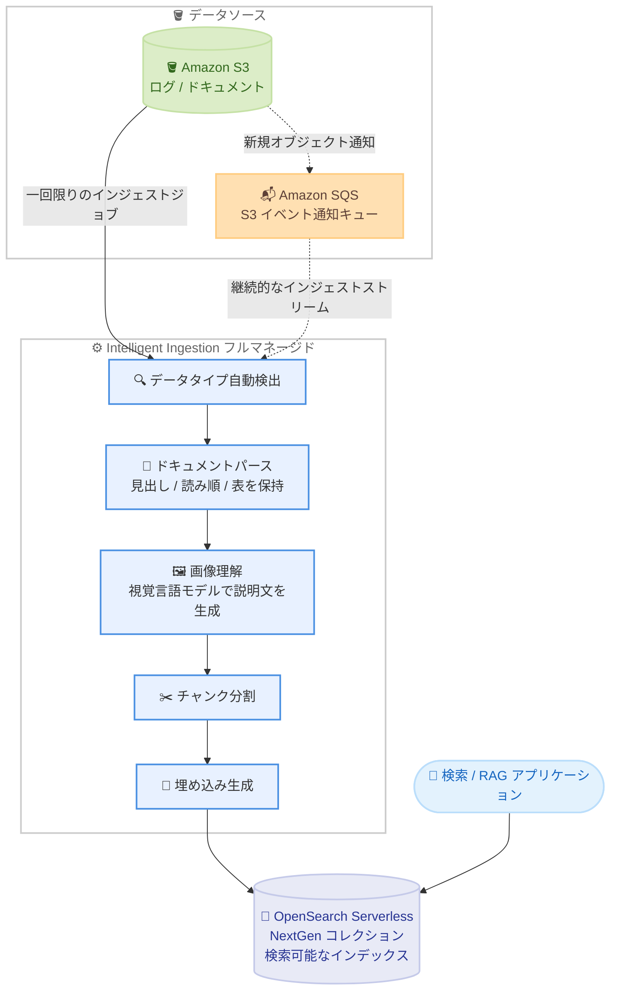

# Amazon OpenSearch Service - S3 のログとドキュメント向け intelligent ingestion

**リリース日**: 2026 年 10 月 22 日
**サービス**: Amazon OpenSearch Service (Amazon OpenSearch Serverless)
**機能**: Amazon OpenSearch intelligent ingestion (Amazon S3 ソース対応)

📊 [このアップデートのインフォグラフィックを見る](https://takech9203.github.io/aws-news-summary/20261022-amazon-opensearch-intelligent-ingestion-logs-documents-s3.html)

## 概要

Amazon OpenSearch Serverless に intelligent ingestion が登場しました。Amazon S3 に保存されたログやドキュメントを、インジェスト基盤を管理することなく OpenSearch Serverless (NextGen) コレクションの検索可能なコンテンツに変換するフルマネージド機能です。AWS Management Console での数クリック、または単一の API 呼び出しだけでセットアップでき、サービスがデータタイプの自動検出、ドキュメントのパース、画像のテキスト化、チャンク分割、ベクトル埋め込みの生成、インデックス登録までを自動で実行します。

構造化データとしては JSON / NDJSON / JSON 配列形式の観測性ログや業務データを、非構造化ファイルとしては PDF / Word / プレーンテキスト / Markdown をサポートします。非構造化ドキュメントのパースでは見出し、読み順、表といった文書構造を保持し、セマンティック検索やハイブリッド検索にそのまま使える状態に変換します。ドキュメント内のチャート、図、スクリーンショット、写真などの視覚コンテンツは、視覚言語モデルがテキスト説明を生成し、周囲のコンテンツとともにインデックスされます。

一回限りのロードに適した「インジェストジョブ」と、S3 に新しいオブジェクトが到着するたびにインデックスを継続的に同期する「インジェストストリーム」の 2 つのパターンを提供します。処理キャパシティはコレクションの OCU (OpenSearch Compute Unit) 上限までワークロードに応じて自動スケールし、アクティブな処理に対してのみ料金が発生します。RAG (検索拡張生成) 向けのナレッジベース構築やログ分析基盤の構築を、パイプラインコードなしで実現したいユーザーに適した機能です。

**アップデート前の課題**

- S3 のデータを OpenSearch で検索可能にするには、Amazon OpenSearch Ingestion のパイプライン (Data Prepper) や独自のインジェスト基盤を構築・管理する必要があった
- PDF や Word などの非構造化ドキュメントを検索可能にするには、パース、チャンク分割、埋め込み生成の処理を外部サービスや自前のコードで組み合わせる必要があった
- ドキュメント内の図やスクリーンショットなどの視覚情報は、別途画像理解の仕組みを構築しない限り検索対象にできなかった
- インジェスト用のキャパシティ管理 (最小 / 最大 OCU の設定など) をユーザー自身が行う必要があった

**アップデート後の改善**

- コレクションの「Ingestion」タブから数クリック、または単一の API 呼び出しで S3 からのインジェストを開始できるようになった
- パース、画像理解、チャンク分割、埋め込み生成がマネージドで提供され、パイプラインコードが不要になった
- 一回限りのジョブと継続的なストリームを用途に応じて選択でき、既存データのバックフィル後にストリーミングへ移行するパターンにも対応した
- キャパシティはワークロードに応じて自動スケールし、ジョブ完了後は課金が停止するため、アクティブな処理に対してのみ支払う形になった

## アーキテクチャ図



S3 のオブジェクトは、一回限りのジョブ (実線) では直接スキャンされ、継続的なストリーム (点線) では S3 イベント通知を受け取る SQS キュー経由で処理されます。intelligent ingestion がデータタイプの検出からパース、画像理解、チャンク分割、埋め込み生成までを自動で実行し、結果を NextGen コレクションのインデックスに書き込みます。構造化データ (JSON / NDJSON / JSON 配列) の場合はパースと画像理解をスキップし、変換と埋め込み生成 (オプション) が適用されます。

## サービスアップデートの詳細

### 主要機能

1. **インジェスト基盤の管理が不要なフルマネージドインジェスト**
   - OpenSearch Serverless NextGen コレクションから直接インジェストを作成・管理でき、別途パイプラインリソースや文書処理インフラのプロビジョニングが不要
   - コンソールのコレクション画面にある「Ingestion」タブから数クリック、または単一の API 呼び出しでセットアップ可能
   - 処理キャパシティはワークロードに応じて、コレクションの最大 OCU 上限まで自動スケール

2. **構造化データ (ログ) の処理**
   - JSON、NDJSON (改行区切り JSON)、JSON 配列形式のオブジェクトからレコードを読み取り
   - サポートされるフィールド / ドキュメント変換を適用し、パイプラインコードなしでインデックス登録
   - 設定したテキストフィールドに対するベクトル埋め込み生成をオプションで実行可能

3. **非構造化ドキュメントのインテリジェントな処理**
   - PDF、Word、プレーンテキスト、Markdown からテキストを抽出
   - 見出し、読み順、表などの文書構造を保持したままパースし、セマンティック検索・ハイブリッド検索に対応できる形に変換
   - 抽出したコンテンツを検索に適したサイズのチャンクに分割し、スパース埋め込みを生成してベクトルインデックス向けのドキュメントを作成
   - 元の S3 オブジェクトを特定できるソースメタデータ (`s3_uri`、`s3_bucket`) を保持

4. **視覚コンテンツの検索可能化**
   - ドキュメントに含まれるチャート、図、スクリーンショット、写真に対して、視覚言語モデルがテキスト説明を生成
   - 生成された説明文は周囲の文書コンテンツとともにインデックスされ、画像にしか含まれない情報も検索・取得可能になる

5. **2 つのインジェストパターン**
   - **インジェストジョブ (一回限り)**: 既存データセットのロードや再ロードに使用。移行、バックフィル、PoC に適しており、定期的な繰り返し実行のスケジュールも可能
   - **インジェストストリーム (継続)**: S3 イベント通知 (SQS 経由) を受けて新規オブジェクトを継続的に処理。「Continuous streaming」(新規のみ) と「Backfill then stream」(既存オブジェクトの処理後にストリーミング継続) を選択可能

6. **クロスアカウントソース対応**
   - ソースの S3 バケットはコレクションと同一アカウントでも別アカウントでも指定可能
   - クロスアカウントの場合は IAM ロールとリソースポリシーによるアクセス許可の設定が必要

## 技術仕様

### 機能概要

| 項目 | 詳細 |
|------|------|
| 対象コレクション | OpenSearch Serverless NextGen コレクションのみ (Classic コレクション、マネージドドメインは対象外) |
| データソース | Amazon S3 (同一アカウントまたはクロスアカウント) |
| 構造化データ形式 | JSON、NDJSON、JSON 配列 |
| 非構造化ドキュメント形式 | PDF、Word、プレーンテキスト、Markdown |
| 圧縮オブジェクト | 非対応 (非圧縮オブジェクトのみ) |
| ベクトル埋め込み生成の対象サイズ | 非構造化オブジェクト 1 件あたり最大 60 MB かつ 150 ページまで |
| インジェストパターン | 一回限りのジョブ / 継続ストリーミング / バックフィル後ストリーミング |
| ストリームのイベント連携 | S3 イベント通知を Amazon SQS キューへ送信 |
| キャパシティ | コレクションの最大 OCU 上限まで自動スケール |
| アカウントあたりの上限 | インジェストジョブ 100 件、インジェストストリーム 20 件 (ソフトリミット、Service Quotas で引き上げ可能) |
| 失敗ドキュメントの扱い | `{index-name}-ingestion-failures` という失敗インデックスに書き込み |

### ドキュメント抽出時のインデックスフィールド

非構造化ドキュメントはチャンクごとに個別のドキュメントとしてインデックスされ、以下のフィールドを含みます。

| フィールド | 内容 |
|------|------|
| `text` | チャンクから抽出されたテキストコンテンツ |
| `text_embedding` | automatic semantic enrichment が生成するスパース埋め込み (拡張された語と重みのマップ) |
| `headings` | チャンクが属する文書内の見出し (文書構造上の位置を保持) |
| `ingestionSource` | 元の S3 オブジェクトを示すメタデータ (`s3_uri`、`s3_bucket`) |

同一ソースオブジェクト由来のチャンクが近くに格納されるよう、ソースバケットとオブジェクトキーに基づいてルーティング値 (`_routing`) が設定されます。

### API 変更履歴

| 日付 | サービス | 変更内容 |
|------|----------|----------|
| 2026/10/22 | [OpenSearch Service Serverless](https://awsapichanges.com/archive/changes/444e17-aoss.html) | 8 new 1 updated api methods - インジェストジョブの作成・取得・一覧・キャンセル (`CreateIngestionJob` / `GetIngestionJob` / `ListIngestionJobs` / `CancelIngestionJob`)、およびインジェストストリームの作成・取得・一覧・削除 (`CreateIngestionStream` / `GetIngestionStream` / `ListIngestionStreams` / `DeleteIngestionStream`) の API を追加 |

### IAM 権限 (インジェストジョブの呼び出し元)

インジェストジョブは専用のインジェストロールを使用せず、ジョブを作成する IAM アイデンティティの権限でソースバケットとターゲットインデックスにアクセスします。以下はジョブの呼び出し元に必要な権限ポリシーの例です。

```json
{
  "Version": "2012-10-17",
  "Statement": [
    {
      "Sid": "IngestionJobApis",
      "Effect": "Allow",
      "Action": [
        "aoss:CreateIngestionJob",
        "aoss:GetIngestionJob",
        "aoss:ListIngestionJobs",
        "aoss:CancelIngestionJob"
      ],
      "Resource": [
        "arn:aws:aoss:<リージョン>:<アカウント ID>:collection/<コレクション ID>",
        "arn:aws:aoss:<リージョン>:<アカウント ID>:collection/<コレクション ID>/*"
      ]
    },
    {
      "Sid": "CollectionDataPlane",
      "Effect": "Allow",
      "Action": "aoss:APIAccessAll",
      "Resource": "arn:aws:aoss:<リージョン>:<アカウント ID>:collection/<コレクション ID>"
    },
    {
      "Sid": "ReadSourceBucket",
      "Effect": "Allow",
      "Action": ["s3:GetObject", "s3:ListBucket"],
      "Resource": [
        "arn:aws:s3:::<ソースバケット名>",
        "arn:aws:s3:::<ソースバケット名>/*"
      ]
    }
  ]
}
```

このほか、呼び出し元をコレクションのデータアクセスポリシーのプリンシパルとして登録し、ターゲットインデックスと失敗インデックス (`{index-name}-ingestion-failures`) の両方をカバーするインデックス権限 (`aoss:CreateIndex` / `aoss:DescribeIndex` / `aoss:UpdateIndex` / `aoss:WriteDocument`) を付与する必要があります。

インジェストストリームの場合は、サービス (`aoss.amazonaws.com`) が引き受ける専用のインジェストロールを作成し、SQS キューの読み取り、S3 バケットの読み取り、コレクションのデータプレーンアクセスを許可します。あわせて、呼び出し元にはストリーム API (`aoss:CreateIngestionStream` など) と `iam:PassRole` の権限が必要です。

## 設定方法

### 前提条件

1. OpenSearch Serverless NextGen コレクションが作成済みであること
2. インジェスト対象のデータまたはドキュメントを含む S3 バケットが準備されていること
3. インジェスト API の呼び出しとソース / ターゲットへのアクセスを許可する IAM 権限およびデータアクセスポリシーが設定されていること
4. (継続ストリームの場合) S3 イベント通知を SQS キューへ送信する設定と、サービスが引き受けるインジェストロールが構成されていること

### 手順

#### ステップ 1: ドキュメント抽出用インデックスの事前作成 (ドキュメントの場合)

```bash
aws opensearchserverless create-index \
    --id <コレクション ID> \
    --index-name <インデックス名> \
    --index-schema '{
      "mappings": {
        "properties": {
          "text": {
            "type": "text",
            "semantic_enrichment": {
              "status": "ENABLED",
              "language_options": "english"
            }
          }
        }
      }
    }' \
    --region <リージョン>
```

`text` フィールドに automatic semantic enrichment を有効化したインデックスを作成します。ドキュメント抽出のスパース埋め込み生成には、このフィールド設定が必須です。インジェスト開始時にインデックスが存在しない場合、semantic enrichment なしでインデックスが自動作成され、スパース埋め込みは生成されません。日本語などの英語以外のコンテンツでは `language_options` に `multi-lingual` を指定します。

#### ステップ 2: インジェストジョブの作成

```bash
aws opensearchserverless create-ingestion-job \
    --collection-id <コレクション ID> \
    --ingestion-job-name <ジョブ名> \
    --index-name <インデックス名> \
    --source '{"s3":{"bucket":"arn:aws:s3:::<ソースバケット名>","bucketOwnerAccountId":"<バケット所有者アカウント ID>","keyPrefix":"<キープレフィックス>"}}' \
    --region <リージョン>
```

ソースの S3 バケット (ARN 指定)、スキャン対象を絞るキープレフィックス (オプション)、ターゲットインデックスを指定して一回限りのインジェストジョブを作成します。ジョブは即座に開始され、対象オブジェクトの処理が完了すると終了します。コンソールの場合は、コレクションの「Ingestion」タブから「Create ingestion job」を選択し、「One-time job」を設定します。

#### ステップ 3: ジョブの監視と結果の確認

```bash
aws opensearchserverless get-ingestion-job \
    --collection-id <コレクション ID> \
    --ingestion-job-id <ジョブ ID> \
    --region <リージョン>
```

作成時のレスポンスに含まれる `ingestionJobId` を指定してジョブの進捗を確認します。ステータスが `COMPLETED` になったら、ターゲットインデックスにクエリを実行して結果を検証します。スキャン済み・インデックス済み・失敗したオブジェクト数はコンソールからも監視できます。

#### ステップ 4: 継続同期が必要な場合はインジェストストリームを作成

```bash
aws opensearchserverless create-ingestion-stream \
    --collection-id <コレクション ID> \
    --ingestion-stream-name <ストリーム名> \
    --index-name <インデックス名> \
    --role-arn arn:aws:iam::<アカウント ID>:role/<インジェストロール名> \
    --source '{"s3":{"sqsArn":"arn:aws:sqs:<リージョン>:<アカウント ID>:<キュー名>"}}' \
    --region <リージョン>
```

S3 イベント通知を受信する SQS キューと、サービスが引き受けるインジェストロールを指定してストリームを作成します。ストリームはアクティブになると、キューに届く新規オブジェクトの通知を継続的に処理します。既存オブジェクトも含めて処理する場合は、コンソールで「Backfill then stream」を選択します。

## メリット

### ビジネス面

- **構築期間の大幅短縮**: パイプラインコードや文書処理インフラの開発なしで、S3 のデータを数クリックで検索可能にできるため、ログ分析基盤や RAG ナレッジベースの立ち上げを加速できる
- **運用コストの削減**: インジェスト基盤のプロビジョニング、スケーリング、保守が不要になり、運用チームの負担を軽減できる
- **従量課金によるコスト効率**: アクティブな処理に対してのみ課金され、ジョブ完了後はインジェスト処理の課金が停止するため、一時的なロードやバックフィルを低コストで実行できる

### 技術面

- **文書構造を保持した高品質なパース**: 見出し、読み順、表を保持してチャンク分割するため、セマンティック検索や RAG での回答品質向上が期待できる
- **視覚情報の検索可能化**: チャートやスクリーンショットにしか存在しない情報も、視覚言語モデルによる説明文生成でテキスト検索の対象にできる
- **柔軟なインジェストパターン**: 一回限りのジョブ、継続ストリーミング、バックフィル後ストリーミングを用途に応じて使い分けられる
- **自動スケーリング**: コレクションの最大 OCU 上限までワークロードに応じて自動でスケールし、キャパシティの事前設計が不要

## デメリット・制約事項

### 制限事項

- 対象は OpenSearch Serverless NextGen コレクションのみで、Classic コレクションおよび OpenSearch Service マネージドドメインは宛先として利用できない
- 非構造化ドキュメントは PDF、Word、プレーンテキスト、Markdown のみ、構造化データは JSON、NDJSON、JSON 配列のみをサポート
- 圧縮されたオブジェクト (gzip など) は非対応
- ベクトル埋め込み生成の対象となる非構造化オブジェクトは 1 件あたり 60 MB、150 ページまで
- アカウントあたりインジェストジョブ 100 件、インジェストストリーム 20 件までのソフトリミットがある (Service Quotas で引き上げ可能)
- 利用可能リージョンは OpenSearch Service 提供リージョンの一部に限られ、サポートされるコンテンツタイプや処理オプションはリージョンにより異なる場合がある

### 考慮すべき点

- ドキュメント抽出でスパース埋め込みを生成するには、`text` フィールドに automatic semantic enrichment を有効化したインデックスを事前に作成しておく必要がある (インデックスが存在しない場合は埋め込みなしで自動作成される)
- 継続ストリームでは S3 イベント通知と SQS キュー、サービスが引き受けるインジェストロールの構成が必要で、ジョブよりセットアップ項目が多い
- 画像理解にはモデル推論料金が、埋め込み生成には埋め込みモデルの推論料金が別途発生するため、大量の画像を含むドキュメントではコストを事前に見積もることが望ましい
- より細かいパイプライン制御 (Data Prepper のプロセッサ構成など) や、ログ・メトリクス・トレースのストリーミング変換が必要な場合は、引き続き Amazon OpenSearch Ingestion の利用が適している

## ユースケース

### ユースケース 1: S3 上のドキュメントから RAG 用ナレッジベースを構築

**シナリオ**: 社内規程、製品マニュアル、技術レポートなどの PDF / Word ファイルが S3 に蓄積されており、生成 AI アプリケーションの RAG 用に検索可能なベクトルインデックスを構築したい。

**実装例**:
```
1. NextGen コレクションに semantic enrichment を有効化したインデックスを作成
2. ドキュメント格納バケットを指定して「Backfill then stream」のストリームを作成
3. 既存ドキュメントがバックフィルされ、以降の新規アップロードも自動で同期
4. アプリケーションから text / text_embedding / headings を使った
   ハイブリッド検索で関連チャンクを取得し、LLM のコンテキストに利用
```

**効果**: パース、チャンク分割、埋め込み生成のコードを一切書かずに、常に最新のドキュメントと同期した RAG ナレッジベースを運用できる。図表やスクリーンショットの情報も検索対象になる。

### ユースケース 2: S3 に出力された観測性ログの検索・分析

**シナリオ**: アプリケーションや各種サービスのログが NDJSON 形式で S3 に集約されており、障害調査のために OpenSearch で全文検索・分析できるようにしたい。

**実装例**:
```
1. ログバケットに S3 イベント通知を設定し、SQS キューへ送信
2. インジェストロールを作成し、SQS / S3 / コレクションへのアクセスを許可
3. create-ingestion-stream でログ用インデックスへの継続ストリームを作成
4. 新しいログオブジェクトが到着するたびに自動で変換・インデックス登録
```

**効果**: Data Prepper パイプラインの構築・チューニングなしで、S3 着信からの継続的なログインジェストを実現できる。キャパシティは自動スケールするため、ログ量の変動にも追従できる。

### ユースケース 3: 既存データセットの移行・バックフィル

**シナリオ**: 過去数年分の JSON データや文書アーカイブが S3 に保存されており、新規に構築した OpenSearch Serverless コレクションへ一括ロードしたい。

**実装例**:
```
1. create-ingestion-job でバケットとキープレフィックスを指定した
   一回限りのジョブを作成
2. get-ingestion-job でステータスが COMPLETED になるまで進捗を監視
3. 失敗したオブジェクトは <インデックス名>-ingestion-failures
   インデックスで内容を確認し、必要に応じて再実行
```

**効果**: ジョブは処理完了後にインジェスト課金が停止するため、一時的な大量ロードをコスト効率よく実行できる。定期的な繰り返しロードのスケジュール実行にも対応する。

## 料金

intelligent ingestion は、ワークロードが消費した処理に対して課金されます。構成とコンテンツに応じて、以下の料金が発生します。

- データの読み取り・変換・インデックス登録に使用するインジェストコンピューティング
- ドキュメントのパースとチャンク分割に使用する追加の文書処理コンピューティング
- 画像理解に使用するモデルの入出力トークン
- 構成に応じた埋め込みモデルの推論

インジェストジョブは完了後にインジェストキャパシティの消費が停止し、インジェストストリームは処理すべきデータがあるときにリソースを消費します。宛先となる NextGen コレクションのインデックス登録・検索・ストレージの料金は、intelligent ingestion の料金とは別に発生します。

詳細は [Amazon OpenSearch Service 料金ページ](https://aws.amazon.com/opensearch-service/pricing/) および (モデル料金について) [Amazon Bedrock 料金ページ](https://aws.amazon.com/bedrock/pricing/) を参照してください。

## 利用可能リージョン

開発者ガイドには以下のリージョンが記載されています。

- 米国東部 (バージニア北部) (us-east-1)
- 米国東部 (オハイオ) (us-east-2)
- 米国西部 (オレゴン) (us-west-2)
- 欧州 (アイルランド) (eu-west-1)
- 欧州 (フランクフルト) (eu-central-1)
- アジアパシフィック (東京) (ap-northeast-1)

サポートされるコンテンツタイプ、処理オプション、宛先タイプはリージョンにより異なる場合があります。最新の提供状況は公式ドキュメントを確認してください。

## 関連サービス・機能

- **Amazon OpenSearch Serverless (NextGen コレクション)**: intelligent ingestion の宛先となるサーバーレス検索基盤。automatic semantic enrichment によるスパース埋め込み生成も NextGen コレクションの機能
- **Amazon OpenSearch Ingestion**: Data Prepper ベースのマネージドインジェストパイプライン。ログ・メトリクス・トレースのストリーミング変換や細かいパイプライン制御が必要な場合はこちらを利用 (両者は補完関係)
- **Amazon S3**: ソースとなるオブジェクトストレージ。同一アカウントまたはクロスアカウントのバケットを指定可能
- **Amazon SQS**: 継続ストリームで S3 イベント通知を受信するキューとして使用
- **Amazon Bedrock**: 画像理解や埋め込み生成に使用されるモデルの料金体系の参照先

## 参考リンク

- 📊 [インフォグラフィック](https://takech9203.github.io/aws-news-summary/20261022-amazon-opensearch-intelligent-ingestion-logs-documents-s3.html)
- [公式発表 (What's New)](https://aws.amazon.com/about-aws/whats-new/2026/10/amazon-opensearch-intelligent-ingestion-logs-documents-s3)
- [AWS Blog: Build RAG-ready indexes from Amazon S3 with Amazon OpenSearch intelligent ingestion](https://aws.amazon.com/blogs/big-data/build-rag-ready-indexes-from-amazon-s3-with-amazon-opensearch-intelligent-ingestion/)
- [ドキュメント: Overview of Amazon OpenSearch intelligent ingestion](https://docs.aws.amazon.com/opensearch-service/latest/developerguide/serverless-intelligent-ingestion.html)
- [ドキュメント: Ingesting from Amazon S3](https://docs.aws.amazon.com/opensearch-service/latest/developerguide/serverless-intelligent-ingestion-s3.html)
- [料金ページ](https://aws.amazon.com/opensearch-service/pricing/)

## まとめ

Amazon OpenSearch Serverless の intelligent ingestion により、S3 上のログやドキュメントを、パイプラインコードやインジェスト基盤の管理なしで検索可能なインデックスに変換できるようになりました。文書構造の保持、画像のテキスト化、チャンク分割、埋め込み生成までマネージドで提供されるため、RAG ナレッジベースやログ検索基盤の構築ハードルが大きく下がります。S3 にデータを蓄積している NextGen コレクション利用者は、まず一回限りのインジェストジョブで小規模なデータセットを試し、semantic enrichment 付きインデックスとの組み合わせによる検索品質を評価することを推奨します。
