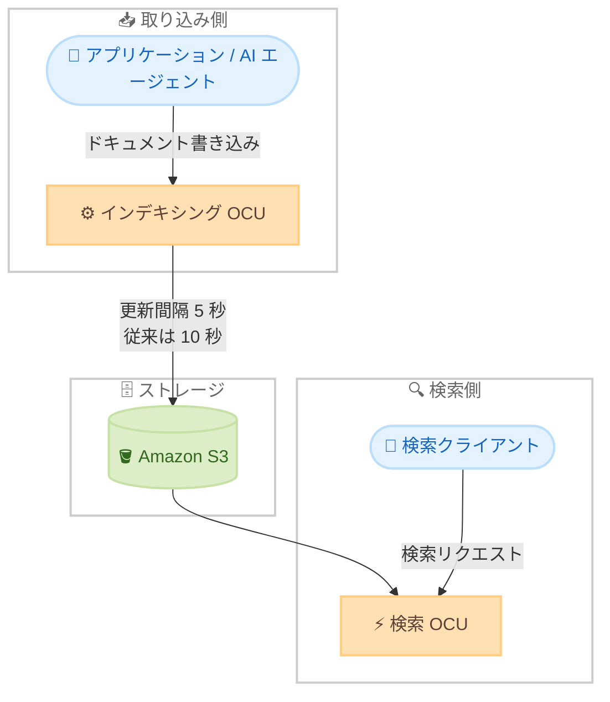

# Amazon OpenSearch Serverless - デフォルト更新間隔 5 秒のサポート

**リリース日**: 2026 年 10 月 22 日
**サービス**: Amazon OpenSearch Serverless
**機能**: 5 秒のデフォルト更新間隔 (refresh interval)

📊 [このアップデートのインフォグラフィックを見る](https://takech9203.github.io/aws-news-summary/20261022-amazon-opensearch-serverless-supports-5-second-refresh-interval.html)

## 概要

Amazon OpenSearch Serverless のデフォルト更新間隔 (refresh interval) が、従来の 10 秒から 5 秒に短縮されました。更新間隔は、新しく取り込まれたドキュメントが検索結果に反映されるまでの時間を決定する設定であり、今回の変更により書き込み後の読み取り可視性 (read-after-write visibility) が従来の 2 倍の速さで実現されます。

この改善は次世代 (next generation) の OpenSearch Serverless における検索 (Search) コレクションとベクトル (Vector search) コレクションにデフォルトで適用されます。設定変更や利用者側の対応は一切不要で、既存のワークロードが自動的にこの改善の恩恵を受けられます。

継続的にデータを取り込みながらほぼリアルタイムの検索を必要とするワークロード、特に頻繁に更新されるコンテンツに対する全文検索や、RAG (検索拡張生成)、セマンティック検索、レコメンデーション / パーソナライゼーションといったベクトル検索のユースケースにおいて、アプリケーションや AI エージェントが最新のデータをより早く取得して活用できるようになります。

**アップデート前の課題**

- 以前はデフォルトの更新間隔が約 10 秒であり、ドキュメントの取り込みから検索可能になるまで最大 10 秒程度の遅延が発生していた
- OpenSearch Serverless では更新間隔はサービス側で管理されており、ユーザーが変更できないため、遅延を短縮する手段がなかった
- RAG や AI エージェントのように最新データへの即時アクセスが重要なユースケースでは、取り込み直後のデータが回答に反映されず、鮮度や精度に影響する可能性があった

**アップデート後の改善**

- デフォルトの更新間隔が 5 秒に短縮され、新規取り込みデータが従来の 2 倍の速さで検索可能になった
- 設定変更や追加作業は不要で、対象コレクションに自動的に適用される
- アプリケーションや AI エージェントが最新の取り込みデータをより早く取得でき、頻繁に変化するデータセットに対する検索の関連性と回答の正確性が向上した

## アーキテクチャ図



OpenSearch Serverless はインデキシングと検索のコンピュートが分離されたアーキテクチャを採用しており、今回のアップデートにより、書き込まれたドキュメントが検索可能になるまでのデフォルト更新間隔が 10 秒から 5 秒に短縮されました。

## サービスアップデートの詳細

### 主要機能

1. **デフォルト更新間隔の 5 秒への短縮**
   - 新しく取り込まれたドキュメントが検索結果に反映されるまでの間隔が、従来の 10 秒から 5 秒に短縮
   - 書き込み後の読み取り可視性が 2 倍高速化
   - 更新間隔は引き続きサービス側で管理されるため、ユーザーによる調整は不要

2. **設定変更不要の自動適用**
   - 既存および新規のコレクションに自動的に適用され、設定変更やアクションは一切不要
   - 次世代の OpenSearch Serverless の検索コレクションとベクトルコレクションでデフォルトで有効

3. **ほぼリアルタイムのデータ鮮度**
   - 継続的なデータ取り込みとほぼリアルタイムの検索を必要とするワークロードに有効
   - RAG、セマンティック検索、レコメンデーションなどの AI / ベクトル検索ユースケースで最新データの活用が高速化

## 技術仕様

### 更新間隔の比較

| 項目 | アップデート前 | アップデート後 |
|------|----------------|----------------|
| デフォルト更新間隔 | 約 10 秒 | 5 秒 |
| 対象コレクションタイプ | - | 検索 (Search)、ベクトル (Vector search) |
| 適用世代 | - | 次世代 OpenSearch Serverless |
| ユーザー側の設定変更 | 不可 (サービス管理) | 不要 (自動適用) |

### 更新間隔 (refresh interval) とは

| 項目 | 詳細 |
|------|------|
| 役割 | 取り込まれたドキュメントが検索可能になるまでの間隔を決定する |
| 管理方法 | OpenSearch Serverless がサービス側で管理し、ユーザーは変更不可 |
| 影響 | 間隔が短いほど、書き込み後に検索結果へ反映されるまでの遅延が小さくなる |

## 設定方法

### 前提条件

1. 次世代の Amazon OpenSearch Serverless を利用していること
2. コレクションタイプが検索 (Search) またはベクトル (Vector search) であること

### 手順

本アップデートは自動的に適用されるため、ユーザー側での設定作業は不要です。以下は、動作を確認する際の参考手順です。

#### ステップ 1: ドキュメントの取り込み

```bash
curl -XPOST "https://<collection-endpoint>/my-index/_doc" \
  -H "Content-Type: application/json" \
  -d '{"title": "最新ドキュメント", "updated_at": "2026-10-22T12:00:00Z"}' \
  --aws-sigv4 "aws:amz:<region>:aoss"
```

OpenSearch Serverless コレクションのエンドポイントに対してドキュメントを書き込みます。SigV4 署名を使用して認証します。

#### ステップ 2: 検索による反映確認

```bash
curl -XGET "https://<collection-endpoint>/my-index/_search" \
  -H "Content-Type: application/json" \
  -d '{"query": {"match": {"title": "最新ドキュメント"}}}' \
  --aws-sigv4 "aws:amz:<region>:aoss"
```

書き込みから約 5 秒後に検索を実行し、取り込んだドキュメントが検索結果に反映されていることを確認します。

## メリット

### ビジネス面

- **ユーザー体験の向上**: 新着コンテンツや在庫情報などの更新が検索結果へ素早く反映され、E コマースやコンテンツ検索での機会損失を低減できる
- **AI 回答品質の向上**: RAG を利用するチャットボットや AI エージェントが最新情報に基づいて回答できるため、回答の正確性と信頼性が向上する
- **追加コスト・作業なし**: 設定変更や移行作業なしで自動的に適用されるため、導入コストがかからない

### 技術面

- **書き込み後の読み取り可視性が 2 倍に高速化**: デフォルト更新間隔が 10 秒から 5 秒に短縮され、データの鮮度が向上する
- **運用負荷ゼロ**: 更新間隔はサービス側で管理されるため、チューニングや監視の追加作業が不要
- **検索・ベクトル両コレクションに対応**: 全文検索とベクトル検索の両方のワークロードで一貫した改善が得られる

## デメリット・制約事項

### 制限事項

- 対象は次世代 OpenSearch Serverless の検索 (Search) コレクションとベクトル (Vector search) コレクションであり、時系列 (Time series) コレクションは対象として言及されていない
- 更新間隔は引き続きユーザーが変更できず、5 秒未満への短縮や任意の値への変更はできない
- 更新間隔はほぼリアルタイムの可視性を提供するものであり、書き込み直後の完全な即時検索 (ミリ秒単位) を保証するものではない

### 考慮すべき点

- 厳密なトランザクション的読み取り一貫性が必要な場合は、アプリケーション側での設計 (書き込み確認後の待機など) を引き続き検討する必要がある
- 時系列コレクションを利用している場合、本アップデートの対象外である点に注意が必要

## ユースケース

### ユースケース 1: RAG を利用した AI チャットボット

**シナリオ**: 社内ナレッジベースを OpenSearch Serverless のベクトルコレクションに取り込み、RAG 構成のチャットボットで回答を生成している。ドキュメントの更新が頻繁に発生するため、最新情報が回答に反映されるまでの遅延を最小化したい。

**実装例**:
```
1. ドキュメント更新をトリガーに埋め込みを生成し、ベクトルコレクションへ書き込み
2. 約 5 秒後にはベクトル検索で最新ドキュメントが取得可能
3. チャットボットが最新情報に基づいた回答を生成
```

**効果**: 更新されたナレッジが従来の 2 倍の速さで検索可能になり、AI の回答精度と情報鮮度が向上する。

### ユースケース 2: E コマースの商品検索

**シナリオ**: 商品情報や在庫状況が頻繁に変わる E コマースサイトで、検索コレクションを利用した全文検索を提供している。新商品や価格変更をできるだけ早く検索結果に反映したい。

**実装例**:
```
1. 商品情報の更新イベントを検索コレクションへ継続的に取り込み
2. 約 5 秒後には検索結果に最新の商品情報が反映
3. ユーザーは常に新しい商品情報を検索可能
```

**効果**: 新商品や価格変更が迅速に検索結果へ反映され、機会損失の低減と顧客体験の向上につながる。

### ユースケース 3: レコメンデーション / パーソナライゼーション

**シナリオ**: ユーザーの行動データをもとにベクトル埋め込みを生成し、セマンティック検索でパーソナライズされたコンテンツを推薦している。直近の行動を即座に推薦結果へ反映したい。

**実装例**:
```
1. ユーザー行動イベントから埋め込みを生成しベクトルコレクションへ書き込み
2. 約 5 秒後には最新の行動を反映したベクトル検索が可能
3. 直近の興味関心に基づいた推薦を提示
```

**効果**: 直近のユーザー行動がほぼリアルタイムで推薦に反映され、推薦の関連性とエンゲージメントが向上する。

## 料金

本アップデートによる追加料金はありません。OpenSearch Serverless の料金は、インデキシングと検索に使用される OpenSearch Compute Unit (OCU) とストレージ使用量に基づく従量課金です。詳細は [Amazon OpenSearch Service の料金ページ](https://aws.amazon.com/opensearch-service/pricing/) を参照してください。

## 利用可能リージョン

Amazon OpenSearch Serverless が利用可能なすべての 24 の AWS リージョンで利用できます。リージョンの一覧は [AWS General Reference](https://docs.aws.amazon.com/general/latest/gr/opensearch-service.html) を参照してください。

## 関連サービス・機能

- **Amazon OpenSearch Service**: マネージド型の OpenSearch クラスターを提供するサービス。Serverless はそのオンデマンドなサーバーレスオプション
- **Amazon Bedrock Knowledge Bases**: RAG 構成のベクトルストアとして OpenSearch Serverless を利用可能であり、データ鮮度向上の恩恵を受けられる
- **Amazon S3**: OpenSearch Serverless のインデックスのプライマリストレージとして利用されており、インデキシングと検索の分離アーキテクチャを支える

## 参考リンク

- 📊 [インフォグラフィック](https://takech9203.github.io/aws-news-summary/20261022-amazon-opensearch-serverless-supports-5-second-refresh-interval.html)
- [公式発表 (What's New)](https://aws.amazon.com/about-aws/whats-new/2026/10/amazon-opensearch-serverless-supports-5-second-refresh-interval/)
- [ドキュメント (Amazon OpenSearch Serverless 開発者ガイド)](https://docs.aws.amazon.com/opensearch-service/latest/developerguide/serverless.html)
- [料金ページ](https://aws.amazon.com/opensearch-service/pricing/)

## まとめ

Amazon OpenSearch Serverless のデフォルト更新間隔が 10 秒から 5 秒に短縮され、設定変更不要で書き込み後の読み取り可視性が 2 倍に高速化されました。RAG やセマンティック検索など、データ鮮度が重要なワークロードを OpenSearch Serverless で運用している場合、自動的に恩恵を受けられます。時系列コレクションは対象として言及されていないため、対象コレクションタイプ (検索・ベクトル) の確認をおすすめします。
