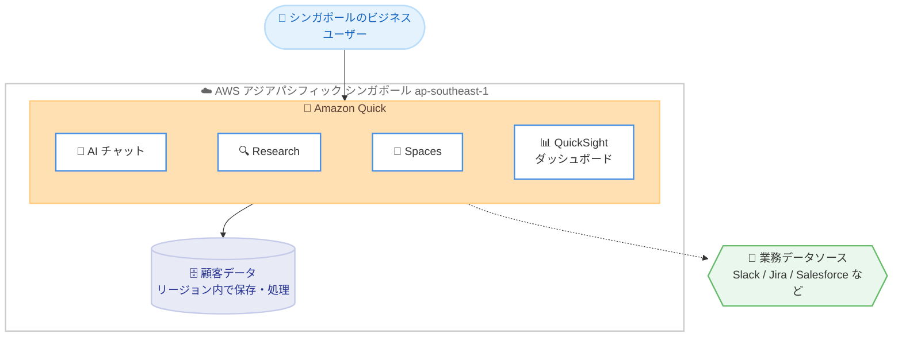

# Amazon Quick - アジアパシフィック (シンガポール) リージョンでの提供開始

**リリース日**: 2026 年 10 月 22 日
**サービス**: Amazon Quick
**機能**: アジアパシフィック (シンガポール) リージョン (ap-southeast-1) での提供開始

📊 [このアップデートのインフォグラフィックを見る](https://takech9203.github.io/aws-news-summary/20261022-amazon-quick-now-available-in-the-aws-singapore-region.html)

## 概要

Amazon Quick がアジアパシフィック (シンガポール) リージョン (ap-southeast-1) で利用可能になりました。Amazon Quick は、ビジネスユーザー向けの「エージェント型のチームメイト」として、業務上の質問に迅速に回答し、その回答をアクションにつなげる AI サービスです。アプリケーションを切り替えることなく、信頼性の高い AI を活用して、より速く、より良い意思決定とアクションの実行を支援します。

今回のリージョン拡大により、シンガポールのお客様は AI チャット、Research、Spaces、QuickSight ダッシュボードといった Amazon Quick の全機能を利用しながら、データ主権 (データソブリンティ) に関するローカル要件を満たすことができます。顧客データはシンガポールリージョン内で保存・処理されます。

金融、公共、医療など、データの国外持ち出しに厳しい規制があるシンガポールおよび東南アジアの組織にとって、エージェント型 AI を本格導入するための重要なアップデートです。

**アップデート前の課題**

- 以前はシンガポールのお客様が Amazon Quick を利用する場合、他リージョン (米国、欧州、東京、シドニーなど) でデータを保存・処理する必要があった
- データレジデンシー要件やデータ主権に関する規制を持つ組織は、Amazon Quick の導入が困難だった
- 地理的に離れたリージョンを利用する場合、レイテンシー面での懸念があった

**アップデート後の改善**

- 顧客データをシンガポールリージョン内で保存・処理できるようになり、データ主権のローカル要件を満たせるようになった
- AI チャット、Research、Spaces、QuickSight ダッシュボードを含む Amazon Quick の全機能をシンガポールリージョンで利用できるようになった
- 東南アジアのユーザーに近いリージョンで利用することで、レイテンシーの改善が期待できるようになった

## アーキテクチャ図



シンガポールのユーザーが Amazon Quick の各機能を利用し、顧客データが ap-southeast-1 リージョン内で保存・処理される構成を示しています。

## サービスアップデートの詳細

### 主要機能

1. **シンガポールリージョンでのフル機能提供**
   - AI チャット、Research、Spaces、QuickSight ダッシュボードを含む Amazon Quick の全機能が利用可能
   - ドキュメントのリージョン一覧では、シンガポールリージョンはエージェント機能 (Agentic Features) 対応リージョンとして記載されている
   - ユーザーアクセス用 Web サイト: `https://ap-southeast-1.quicksight.aws.amazon.com`

2. **データレジデンシーへの対応**
   - 顧客データはシンガポールリージョン内で保存・処理される
   - データ主権に関するローカル要件を満たすことが可能
   - Web 検索機能 (Chat、Agents、Research で使用) についても、シンガポールリージョン発のリクエストはシンガポールリージョン内で処理される

3. **Amazon Q in Quick の Generative BI 機能**
   - シンガポールリージョンはシナリオ機能を含む Amazon Q in Quick の Generative BI 機能にも対応している

## 技術仕様

### シンガポールリージョンのエンドポイント情報

| 項目 | 詳細 |
|------|------|
| リージョン名 | アジアパシフィック (シンガポール) |
| リージョンコード | ap-southeast-1 |
| エージェント機能 | 対応 |
| ユーザーアクセス用 Web サイト | https://ap-southeast-1.quicksight.aws.amazon.com |
| API エンドポイント | quicksight.ap-southeast-1.amazonaws.com |
| データソース接続用 IP アドレス範囲 | 13.229.254.0/27 |
| Web 検索の処理リージョン | ap-southeast-1 (リージョン内で処理) |

### クロスリージョン推論に関する記載

AWS ドキュメントのクロスリージョン推論の対応表では、シンガポールの推論リージョンは「Global CRIS」と記載されています。クロスリージョン推論ではデータは主要リージョンにのみ保存されますが、入力プロンプトと出力結果は推論処理の際にリージョン外へ移動する場合があります。すべてのデータは暗号化されて転送されます。厳格なデータレジデンシー要件がある場合は、最新のドキュメントで推論処理の対象リージョンを確認してください。

## 設定方法

### 前提条件

1. AWS アカウントを保有していること
2. Amazon Quick のサブスクリプション作成権限 (管理者権限) があること
3. IAM Identity Center を利用する場合は、インスタンスが利用可能であること (マルチリージョンレプリケーション構成では、アクティブな追加リージョンにサブスクリプションを作成可能)

### 手順

#### ステップ 1: リージョンの選択

AWS マネジメントコンソールで、リージョンとしてアジアパシフィック (シンガポール) ap-southeast-1 を選択します。

#### ステップ 2: Amazon Quick のセットアップ

Amazon Quick のコンソールからサブスクリプションを作成し、認証方法 (IAM Identity Center など) とユーザーを設定します。

#### ステップ 3: ユーザーアクセスの開始

ユーザーは以下の URL からシンガポールリージョンの Amazon Quick にアクセスします。

```text
https://ap-southeast-1.quicksight.aws.amazon.com
```

データソース接続でファイアウォールの許可設定が必要な場合は、シンガポールリージョンの IP アドレス範囲 `13.229.254.0/27` を許可します。

## メリット

### ビジネス面

- **データ主権要件への適合**: 顧客データがシンガポールリージョン内で保存・処理されるため、データレジデンシー規制のある業界 (金融、公共、医療など) でも導入しやすくなる
- **東南アジア市場での AI 活用促進**: シンガポールを拠点とする組織が、規制要件を満たしながらエージェント型 AI による業務効率化を実現できる
- **意思決定の高速化**: 業務上の質問への回答とアクション実行を 1 つのサービスで完結でき、アプリケーション間の切り替えが不要になる

### 技術面

- **レイテンシーの改善**: 東南アジアのユーザーに地理的に近いリージョンで処理することで、応答性能の向上が期待できる
- **フル機能の利用**: エージェント機能対応リージョンとして、AI チャット、Research、Spaces、QuickSight ダッシュボードの全機能を利用可能
- **Web 検索のリージョン内処理**: Chat、Agents、Research の Web 検索リクエストがシンガポールリージョン内で処理される

## デメリット・制約事項

### 制限事項

- クロスリージョン推論の対応表では、シンガポールの推論リージョンは「Global CRIS」と記載されており、推論処理時に入力プロンプトと出力結果がリージョン外で処理される可能性がある
- クロスリージョン推論のルーティングは Amazon Quick が管理しており、ユーザーは設定できない (SCP や IAM 推論プロファイル権限による制御も不可)
- CloudWatch および CloudTrail のログには、推論が実行されたリージョンは記録されない

### 考慮すべき点

- 厳格なデータレジデンシー要件がある場合は、保存データ (リージョン内) と推論処理 (クロスリージョンの可能性) の違いを理解した上で、最新の公式ドキュメントを確認すること
- 既存の Amazon Quick サブスクリプションを他リージョンで運用している場合、リージョンごとのサブスクリプション設計を検討する必要がある

## ユースケース

### ユースケース 1: シンガポールの金融機関におけるデータ主権準拠の AI 活用

**シナリオ**: シンガポールの金融機関が、データの国内保存を求める規制要件を満たしながら、社内ナレッジ検索やレポート作成に AI を活用したい。

**実装例**: ap-southeast-1 リージョンに Amazon Quick サブスクリプションを作成し、IAM Identity Center と連携してユーザーを管理。社内データソースを接続し、AI チャットと Research を活用する。

**効果**: 顧客データをシンガポールリージョン内に保持しながら、調査・分析業務の時間を大幅に短縮できる。

### ユースケース 2: 東南アジア拠点のチームコラボレーション

**シナリオ**: シンガポールを拠点とする多国籍企業の地域本部が、チームのナレッジ、エージェント、自動化を一元管理したい。

**実装例**: Amazon Quick の Spaces を利用して、チーム共有のナレッジベースとエージェントを構築。Slack や Jira などのコネクタで業務ツールと連携する。

**効果**: 地理的に近いリージョンでの低レイテンシーなアクセスと、チーム全体での AI 活用の標準化を実現できる。

### ユースケース 3: BI ダッシュボードと AI 分析の統合

**シナリオ**: シンガポールの小売企業が、売上データの可視化と自然言語によるデータ分析を 1 つの環境で実現したい。

**実装例**: QuickSight ダッシュボードで売上データを可視化し、Amazon Q in Quick の Generative BI 機能 (シナリオ機能を含む) で自然言語による分析を行う。

**効果**: BI とエージェント型 AI を統合した環境により、データドリブンな意思決定を加速できる。

## 料金

Amazon Quick はユーザー単位のサブスクリプション料金で提供されます。製品ページに記載されている主な料金プランは以下のとおりです (最新の料金は料金ページを確認してください)。

### 料金プラン

| プラン | 料金 (概算) | 主な内容 |
|--------|------------|----------|
| Free | $0/ユーザー/月 | チャット、Research、成果物生成、Flows、アプリ、コネクタ |
| Plus | $20/ユーザー/月 (年契約) | 共有 Spaces、ブラウザ/M365 拡張機能、最大 300 ユーザー |
| Max | $100/ユーザー/月 (年契約) | 使用量とインデックスストレージが 5 倍 |
| Professional | $20/ユーザー/月 + $250/アカウント/月 | 無制限ユーザー、RBAC/SSO、ダッシュボード、24/7 サポート |
| Enterprise | $40/ユーザー/月 + $250/アカウント/月 | カスタムダッシュボード作成、複雑なオーケストレーション |

## 利用可能リージョン

今回の発表により、Amazon Quick はアジアパシフィック (シンガポール) ap-southeast-1 で利用可能になりました。

エージェント機能に対応する主なリージョンは以下のとおりです (2026 年 10 月時点のドキュメントに基づく)。

- 米国東部 (バージニア北部) us-east-1
- 米国西部 (オレゴン) us-west-2
- アジアパシフィック (シンガポール) ap-southeast-1 ← 今回追加
- アジアパシフィック (シドニー) ap-southeast-2
- アジアパシフィック (東京) ap-northeast-1
- 欧州 (フランクフルト) eu-central-1
- 欧州 (アイルランド) eu-west-1
- 欧州 (ロンドン) eu-west-2
- AWS GovCloud (米国西部) us-gov-west-1

最新のリージョン対応状況は [公式ドキュメント](https://docs.aws.amazon.com/quick/latest/userguide/regions.html) を参照してください。

## 関連サービス・機能

- **Amazon QuickSight**: Amazon Quick に統合された BI ダッシュボード機能の基盤。ダッシュボードの作成・共有が可能
- **Amazon Q in Quick**: シナリオ機能を含む Generative BI 機能。シンガポールリージョンでも利用可能
- **AWS IAM Identity Center**: Amazon Quick のユーザー認証・管理に利用。マルチリージョンレプリケーション構成にも対応
- **Amazon Bedrock**: Amazon Quick のクロスリージョン推論は Amazon Bedrock の地理的推論プロファイルに準拠

## 参考リンク

- 📊 [インフォグラフィック](https://takech9203.github.io/aws-news-summary/20261022-amazon-quick-now-available-in-the-aws-singapore-region.html)
- [公式発表 (What's New)](https://aws.amazon.com/about-aws/whats-new/2026/10/amazon-quick-now-available-in-the-aws-singapore-region/)
- [Amazon Quick 製品ページ](https://aws.amazon.com/quick/)
- [ドキュメント](https://docs.aws.amazon.com/quick/)
- [リージョン対応状況](https://docs.aws.amazon.com/quick/latest/userguide/regions.html)

## まとめ

Amazon Quick のシンガポールリージョン対応により、東南アジアのお客様がデータ主権のローカル要件を満たしながら、エージェント型 AI の全機能を活用できるようになりました。データレジデンシー要件により導入を見送っていた組織は、これを機に PoC の開始を検討する価値があります。なお、クロスリージョン推論の挙動についてはドキュメントで最新の仕様を確認することを推奨します。
