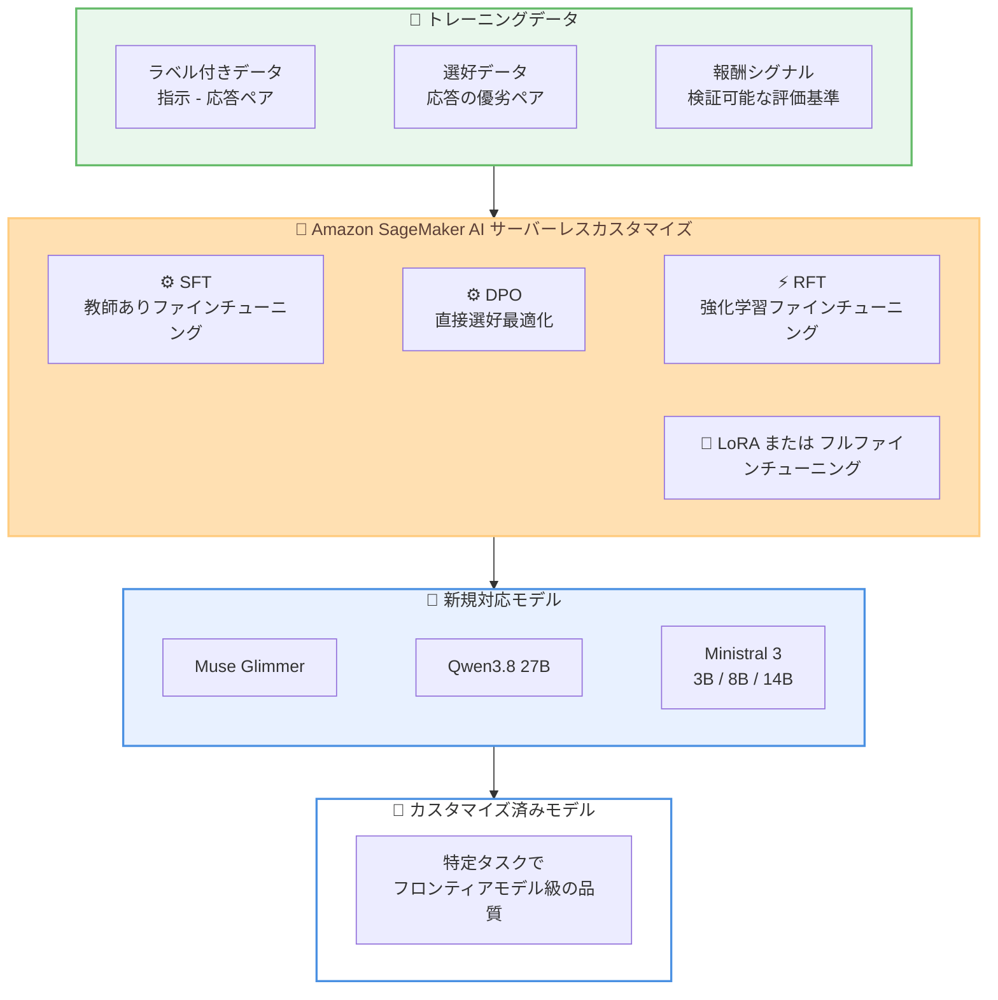

# Amazon SageMaker AI - Muse Glimmer、Qwen 3.8、Ministral 3 モデルのサーバーレスモデルカスタマイズ対応

**リリース日**: 2026 年 10 月 22 日
**サービス**: Amazon SageMaker AI
**機能**: Serverless Model Customization for Muse Glimmer, Qwen 3.8 and Ministral 3 Models

📊 [このアップデートのインフォグラフィックを見る](https://takech9203.github.io/aws-news-summary/20261022-amazon-sagemaker-muse-qwen-ministral.html)

## 概要

Amazon SageMaker AI のサーバーレスモデルカスタマイズが、新たに Muse Glimmer、Qwen3.8 27B、Ministral 3 (3B, 8B, 14B) の各モデルに対応しました。インフラストラクチャのプロビジョニングや管理を行うことなく、これらのモデルに対して教師ありファインチューニング (SFT)、直接選好最適化 (DPO)、強化学習ファインチューニング (RFT) を実行できます。各手法は LoRA またはフルファインチューニングのいずれかで利用可能です。

今回の対応により、サーバーレスカスタマイズに対応するモデルファミリーは、既存の Nova、Gemma 4、Nemotron 3.5、Qwen、Llama、gpt-oss、DeepSeek に加えてさらに拡大しました。独自データを使用して基盤モデルをカスタマイズすることで、小規模で適切なサイズのモデルでも特定タスクにおいてフロンティアモデルに匹敵する品質を実現でき、コストとレイテンシの削減につながります。

モデルカスタマイズジョブは SageMaker Studio の Models ページまたは SageMaker Python SDK から起動でき、SageMaker AI がインフラのプロビジョニングとトレーニングのオーケストレーションを自動的に管理します。

**アップデート前の課題**

- Muse Glimmer、Qwen3.8 27B、Ministral 3 の各モデルは、サーバーレス環境でのファインチューニングに対応していなかった
- これらのモデルをカスタマイズするには、トレーニングクラスタのセットアップやキャパシティプランニング、分散トレーニングの管理が必要だった
- 3B クラスの軽量モデルから 27B クラスの中規模モデルまで、サーバーレスで選択できるモデルサイズのバリエーションが限られていた

**アップデート後の改善**

- Muse Glimmer、Qwen3.8 27B、Ministral 3 (3B, 8B, 14B) をインフラ管理不要でファインチューニングできるようになった
- SFT、DPO、RFT の各手法を LoRA またはフルファインチューニングで選択できるようになった
- 従量課金制により、使用した分だけの支払いでモデルカスタマイズを実行できる

## アーキテクチャ図



トレーニングデータの種類に応じた 3 つのファインチューニング手法を通じて、新規対応モデルをサーバーレス環境でカスタマイズする流れを示しています。

## サービスアップデートの詳細

### 主要機能

1. **新規モデルのサーバーレスカスタマイズ対応**
   - Muse Glimmer、Qwen3.8 27B、Ministral 3 (3B, 8B, 14B) が新たに対応
   - 既存の Nova、Gemma 4、Nemotron 3.5、Qwen、Llama、gpt-oss、DeepSeek の各ファミリーに追加
   - インフラのプロビジョニングとトレーニングオーケストレーションは SageMaker AI が自動管理

2. **3 つのファインチューニング手法のサポート**
   - **SFT (Supervised Fine-Tuning)**: ラベル付きデータを使用し、ドメイン固有の精度を向上
   - **DPO (Direct Preference Optimization)**: 選好データを使用し、トーンや応答スタイルをアライメント
   - **RFT (Reinforcement Fine-Tuning)**: 報酬シグナルを使用し、新しいタスクへの適応を実現

3. **LoRA とフルファインチューニングの選択**
   - 各手法を LoRA (低ランク適応) またはフルファインチューニングで実行可能
   - コスト効率を重視する場合は LoRA、最大限の精度を追求する場合はフルファインチューニングと、要件に応じて選択できる

## 技術仕様

### 新規対応モデル一覧

| モデル名 | パラメータ数 | 特徴 |
|------|------|------|
| Muse Glimmer | - | SageMaker JumpStart でも提供されているオープンウェイトモデル |
| Qwen3.8 27B | 27B | Qwen ファミリーの中規模モデル |
| Ministral 3 3B | 3B | 軽量・低レイテンシ用途向け |
| Ministral 3 8B | 8B | バランス型の小規模モデル |
| Ministral 3 14B | 14B | 高精度が必要な用途向けの中規模モデル |

### ファインチューニング手法とデータ要件

| 手法 | 使用データ | 主な目的 |
|------|------|------|
| SFT | ラベル付きデータ (指示 - 応答ペア) | ドメイン固有タスクの精度向上 |
| DPO | 選好データ (応答の優劣ペア) | トーン・スタイルのアライメント |
| RFT | 報酬シグナル | 新しいタスクへの適応 |

### API 変更履歴

今回のアップデートに関連する API 変更は、調査時点では確認されていません。

## 設定方法

### 前提条件

1. AWS アカウントと SageMaker AI へのアクセス権限
2. 対応リージョン (US East (N. Virginia)、US West (Oregon)、Asia Pacific (Tokyo)、Europe (Ireland)) での利用
3. ファインチューニング手法に応じたトレーニングデータ (ラベル付きデータ、選好データ、または報酬シグナルの定義)

### 手順

#### ステップ 1: SageMaker Studio でモデルを選択

SageMaker Studio の Models ページにアクセスし、カスタマイズ対象のモデル (Muse Glimmer、Qwen3.8 27B、Ministral 3 のいずれか) を選択します。コンソールからカスタマイズジョブを直接起動できます。

#### ステップ 2: ファインチューニング手法とモードの選択

目的に応じて SFT、DPO、RFT のいずれかの手法を選択し、LoRA またはフルファインチューニングのモードを指定します。SageMaker Python SDK を使用してプログラムから起動することも可能です。

```python
# SageMaker Python SDK を使用したモデルカスタマイズの例
# 詳細は SageMaker Python SDK の model_customization ドキュメントを参照
from sagemaker import Session

# トレーニングデータを S3 にアップロードし、
# カスタマイズジョブを定義して実行する
```

SageMaker Python SDK の model_customization モジュールを使用して、ファインチューニングジョブをコードで定義・実行します。

#### ステップ 3: ジョブの実行とモニタリング

トレーニングデータを指定してジョブを開始します。インフラのプロビジョニングとトレーニングオーケストレーションは SageMaker AI が自動的に処理するため、クラスタ管理は不要です。ジョブの進捗は SageMaker Studio で確認できます。

## メリット

### ビジネス面

- **コスト削減**: 小規模で適切なサイズのモデルをカスタマイズすることで、特定タスクにおいてフロンティアモデルに匹敵する品質を低コストで実現できる
- **従量課金制**: 使用した分だけの支払いで、インフラの固定費が発生しない
- **迅速な導入**: インフラ管理が不要なため、モデルカスタマイズの開始までの時間を大幅に短縮できる

### 技術面

- **レイテンシの改善**: 3B〜27B クラスのモデルを特定タスク向けに最適化することで、大規模モデルよりも低レイテンシな推論を実現できる
- **柔軟な手法選択**: SFT、DPO、RFT の 3 手法と LoRA / フルファインチューニングの組み合わせにより、データの種類と要件に応じた最適なカスタマイズが可能
- **インフラ管理不要**: 分散トレーニングの専門知識やクラスタ管理が不要で、モデル開発に集中できる

## デメリット・制約事項

### 制限事項

- 利用可能リージョンは 4 リージョンに限定されている (US East (N. Virginia)、US West (Oregon)、Asia Pacific (Tokyo)、Europe (Ireland))
- サーバーレス環境のため、トレーニング実行環境に対するきめ細かな制御は制限される
- 対応モデルは SageMaker AI がサポートするモデルに限定される

### 考慮すべき点

- ファインチューニング手法ごとに必要なデータ形式が異なるため、事前のデータ準備戦略が重要
- フルファインチューニングは LoRA よりもコストが高くなる傾向があるため、まず LoRA で検証してから必要に応じてフルファインチューニングに移行するアプローチが推奨される

## ユースケース

### ユースケース 1: ドメイン固有タスクの精度向上

**シナリオ**: 医療、金融、法務などの専門ドメインにおいて、汎用モデルでは十分な精度が得られない文書分類や情報抽出タスクをカスタマイズします。

**実装例**:
```
モデル: Qwen3.8 27B
手法: SFT + LoRA
データ: ドメイン固有の指示 - 応答ペア (ラベル付きデータ)
```

**効果**: ドメイン固有タスクの精度が向上し、フロンティアモデルを使用する場合と比較してコストとレイテンシを削減

### ユースケース 2: ブランドトーンに合わせた応答スタイルの調整

**シナリオ**: カスタマー向けチャットボットの応答トーンを、自社のブランドガイドラインに合わせて最適化します。

**実装例**:
```
モデル: Ministral 3 14B
手法: DPO
データ: 望ましい応答と望ましくない応答の選好ペア
```

**効果**: ブランドガイドラインに沿った一貫性のある応答スタイルを実現

### ユースケース 3: 軽量モデルによる低レイテンシ推論

**シナリオ**: リアルタイム性が求められるアプリケーション向けに、軽量モデルを特定タスクに最適化して推論コストとレイテンシを最小化します。

**実装例**:
```
モデル: Ministral 3 3B
手法: RFT
データ: 検証可能な報酬シグナル (タスクの正解判定基準)
```

**効果**: 低コストかつ低レイテンシで、特定タスクに最適化されたモデルを取得

## 料金

SageMaker AI のサーバーレスモデルカスタマイズは従量課金制で、使用した分だけの支払いとなります。料金はモデルサイズ、ファインチューニング手法、モード (LoRA / フルファインチューニング)、トレーニング時間によって異なります。

### 料金例

詳細な料金は [Amazon SageMaker AI の料金ページ](https://aws.amazon.com/sagemaker/pricing/) で確認できます。モデルごと、手法ごとの正確な料金はこのページに記載されています。

## 利用可能リージョン

以下の 4 リージョンで利用可能です。

| リージョン名 | リージョンコード |
|------|------|
| US East (N. Virginia) | us-east-1 |
| US West (Oregon) | us-west-2 |
| Asia Pacific (Tokyo) | ap-northeast-1 |
| Europe (Ireland) | eu-west-1 |

## 関連サービス・機能

- **Amazon SageMaker JumpStart**: Muse Glimmer や Qwen 3.8 などのオープンウェイトモデルをデプロイするためのモデルハブ。2026 年 8 月に Muse Glimmer と Qwen 3.8 が JumpStart に追加済み
- **Amazon SageMaker AI 推論**: カスタマイズ済みモデルをデプロイして推論を実行するためのサービス
- **SageMaker Python SDK**: モデルカスタマイズジョブをコードで定義・実行するための SDK
- **Amazon S3**: ファインチューニング用トレーニングデータの保存先

## 参考リンク

- 📊 [インフォグラフィック](https://takech9203.github.io/aws-news-summary/20261022-amazon-sagemaker-muse-qwen-ministral.html)
- [公式発表 (What's New)](https://aws.amazon.com/about-aws/whats-new/2026/10/amazon-sagemaker-muse-qwen-ministral/)
- [モデルカスタマイズドキュメント (対応モデル一覧)](https://docs.aws.amazon.com/sagemaker/latest/dg/customizing-models.html#customizing-models-supported)
- [SageMaker Python SDK - Model Customization](https://sagemaker.readthedocs.io/en/stable/model_customization/index.html)
- [Amazon SageMaker AI 料金ページ](https://aws.amazon.com/sagemaker/pricing/)

## まとめ

Amazon SageMaker AI のサーバーレスモデルカスタマイズが Muse Glimmer、Qwen3.8 27B、Ministral 3 (3B, 8B, 14B) に対応し、インフラ管理不要で SFT、DPO、RFT によるファインチューニングが可能になりました。小規模モデルを独自データでカスタマイズすることで、特定タスクにおいてフロンティアモデル級の品質を低コスト・低レイテンシで実現できます。まず LoRA と小規模モデルの組み合わせで検証し、要件に応じてフルファインチューニングや大きなモデルサイズへ段階的に移行するアプローチが推奨されます。
