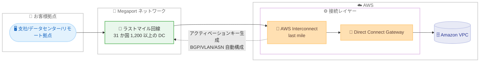

# AWS Interconnect - last mile - Megaport をパートナーとしたプレビューを開始

**リリース日**: 2026 年 10 月 22 日
**サービス**: AWS Interconnect - last mile
**機能**: フルマネージドなラストマイル接続 (Megaport パートナー、プレビュー)

📊 [このアップデートのインフォグラフィックを見る](https://takech9203.github.io/aws-news-summary/20261022-aws-announces-AWS-interconnect-last-mile-megaport-preview.html)
<!-- INFOGRAPHIC_BASE_URL は環境変数から取得 -->

## 概要

AWS は、支社、データセンター、リモート拠点を AWS へ簡単に接続できるフルマネージドな接続サービス「AWS Interconnect - last mile」について、Megaport をパートナーとしたプレビュー提供を発表しました。このサービスは、ネットワークセットアップに伴う手間と複雑さを排除し、数クリックでプライベートかつ高速な接続を確立することを目的としています。Megaport は SDN (Software Defined Network) プロバイダーであり、31 か国にわたる 1,200 以上のデータセンターをカバーする広範なフットプリントを持ちます。

利用者は、AWS Management Console から希望する AWS リージョン、帯域速度、Direct Connect Gateway ID、パートナーサブスクライバー ID を選択するだけで接続を開始できます。接続を開始すると AWS がアクティベーションキーを生成し、Megaport 側でのプロビジョニングを完了させます。容量の事前プロビジョニングに加え、BGP ピアリング、VLAN 設定、ASN 割り当てといった複雑なネットワーク構成が自動化されます。

プレビューでは San Jose (us-west-1) メトロと N. Virginia (us-east-1) メトロで Megaport 経由の接続が利用可能です。ダウンタイムなしのメンテナンス設計で 99.99% の SLA が提供され、GA 時にはコンソールから 1 Gbps〜100 Gbps の帯域を動的に変更できるようになる予定です。Lumen をローンチパートナーとした 2026 年 4 月の GA、2026 年 6 月の AT&T とのゲート付きプレビューに続き、パートナーの選択肢がさらに拡大しました。

**アップデート前の課題**

このアップデート以前は、拠点から AWS への専用線接続の構築に多くの手間がかかっていました。

- 以前は、ラストマイル回線の手配とネットワーク機器の設定を個別に行う必要があった
- 以前は、BGP ピアリング、VLAN 設定、ASN 割り当てなどを手動で構成する必要があり、専門知識と時間を要した
- 以前は、ラストマイルパートナーが Lumen (GA) と AT&T (ゲート付きプレビュー) に限られており、いずれも米国のお客様が中心だった

**アップデート後の改善**

今回のアップデートにより、Megaport を利用したラストマイル接続が可能になりました。

- 今回のアップデートにより、31 か国 1,200 以上のデータセンターをカバーする Megaport のフットプリントを利用した接続が選択できるようになった
- 今回のアップデートにより、コンソール、CLI、API のいずれからでもプレビューの Interconnect を作成できるようになった
- 今回のアップデートにより、BGP ピアリング、VLAN 設定、ASN 割り当てが自動構成され、99.99% の SLA とダウンタイムなしのメンテナンスが提供されるようになった

## アーキテクチャ図

お客様拠点から Megaport のラストマイル回線を経由し、AWS Interconnect と Direct Connect Gateway を通じて Amazon VPC へプライベート接続する流れを示しています。BGP、VLAN、ASN の構成は AWS Interconnect が自動的に処理します。

## サービスアップデートの詳細

### 主要機能

1. **Megaport をパートナーとしたプレビュー提供**
   - SDN プロバイダーである Megaport のネットワークを利用して、拠点から AWS へのプライベート接続を確立できる
   - Megaport は 31 か国にわたる 1,200 以上のデータセンターをカバーしている
   - プレビューでは San Jose (us-west-1) メトロと N. Virginia (us-east-1) メトロで利用可能

2. **数クリックでのラストマイル接続の確立**
   - AWS Management Console から、希望する AWS リージョン、帯域速度、Direct Connect Gateway ID、パートナーサブスクライバー ID を選択するだけで接続を開始できる
   - 接続開始後、AWS がアクティベーションキーを生成し、Megaport 側でのプロビジョニングを完了する
   - コンソールに加え、CLI および API からも Interconnect を作成できる

3. **複雑なネットワーク構成の自動化**
   - BGP ピアリング、VLAN 設定、ASN 割り当てを自動的に構成する
   - 容量の事前プロビジョニングにより、接続確立を迅速化する

4. **高可用性と帯域の動的スケーリング**
   - ダウンタイムなしのメンテナンス設計で、99.99% の SLA が提供される
   - GA 時には、コンソールから 1 Gbps〜100 Gbps の帯域変更が可能になる予定

## 技術仕様

### 接続に必要なパラメータ

| 項目 | 詳細 |
|------|------|
| AWS リージョン | 接続先となる希望の AWS リージョン |
| 帯域速度 (bandwidth) | 確立する接続の帯域幅。GA 時には 1 Gbps〜100 Gbps の動的変更に対応予定 |
| Direct Connect Gateway ID | 接続先の Direct Connect Gateway の ID |
| パートナーサブスクライバー ID | パートナー (Megaport) 側のサブスクライバー識別子 |
| アクティベーションキー | 接続開始時に AWS が生成し、Megaport 側のプロビジョニングに使用する |

### 自動構成される項目

| 項目 | 詳細 |
|------|------|
| BGP ピアリング | 経路交換のためのピアリング設定を自動化 |
| VLAN 設定 | 仮想 LAN の構成を自動化 |
| ASN 割り当て | 自律システム番号の割り当てを自動化 |
| 容量 | 事前プロビジョニングにより迅速な接続確立を実現 |

### パートナー向けオープン API パッケージ

- GitHub リポジトリ (https://github.com/aws/Interconnect) でオープン API パッケージが公開されている
- マネージドな L3 接続を調整するための API を定義し、パートナーが標準化された方法でサービスへ参画できる

## 設定方法

### 前提条件

1. Direct Connect Gateway が作成済みであること
2. Megaport のサブスクライバー ID を保有していること
3. プレビュー対象メトロ (San Jose または N. Virginia) で利用可能であること

### 手順

#### ステップ1: Interconnect の作成

AWS Management Console、CLI、API のいずれかで、希望する AWS リージョン、帯域速度、Direct Connect Gateway ID、パートナーサブスクライバー ID を選択して Interconnect を作成します。この操作により、AWS が接続に必要な構成を準備します。

#### ステップ2: アクティベーションキーによるプロビジョニング完了

接続を開始すると、AWS がアクティベーションキーを生成します。このキーを用いて Megaport 側でプロビジョニングを完了することで、拠点から AWS への接続が確立されます。

#### ステップ3: 接続の確認

BGP ピアリング、VLAN 設定、ASN 割り当ては自動的に構成されるため、プロビジョニング完了後に Direct Connect Gateway を介した VPC への疎通を確認します。

## メリット

### ビジネス面

- **接続構築の迅速化**: 数クリックで接続を開始でき、拠点から AWS までの接続確立にかかる時間を短縮できる
- **広範なカバレッジ**: 31 か国 1,200 以上のデータセンターをカバーする Megaport のフットプリントを活用できる
- **信頼性の担保**: 99.99% の SLA に裏付けられた高可用性設計により、ミッションクリティカルなワークロードにも適用しやすい

### 技術面

- **構成の自動化**: BGP、VLAN、ASN の設定が自動化され、手動設定に伴う設定ミスのリスクを低減できる
- **ダウンタイムなしのメンテナンス**: 運用中の接続に影響を与えずにメンテナンスを実施できる
- **柔軟な帯域変更**: GA 時にはコンソールから 1 Gbps〜100 Gbps の帯域を動的に変更できるようになる予定

## デメリット・制約事項

### 制限事項

- 現時点ではプレビューであり、利用可能なメトロは San Jose (us-west-1) と N. Virginia (us-east-1) に限定される
- Megaport のサブスクライバー ID が必要であり、Megaport との契約が前提となる
- 帯域の動的スケーリング (1 Gbps〜100 Gbps) は GA 時に提供予定の機能である

### 考慮すべき点

- プレビュー段階のサービスであるため、本番環境への適用は提供状況や SLA を十分に確認したうえで判断する必要がある
- 接続元の拠点が Megaport のデータセンターフットプリントでカバーされているかを事前に確認する必要がある
- 料金はメトロと最も遠い AWS リージョンとの距離に基づくティアで決まるため、構成による料金差を事前に見積もる必要がある

## ユースケース

### ユースケース1: 支社から AWS へのプライベート接続

**シナリオ**: 複数の拠点を持つ企業が、各拠点から AWS 上の業務システムへ低レイテンシかつセキュアに接続したい。

**効果**: 各拠点から Megaport のラストマイル回線経由で AWS へ数クリックで接続でき、拠点ごとの複雑なネットワーク設定作業を削減できます。

### ユースケース2: コロケーションデータセンターとのハイブリッド接続

**シナリオ**: Megaport がカバーするコロケーションデータセンターを利用する企業が、AWS とのハイブリッド構成でミッションクリティカルなワークロードを稼働させたい。

**効果**: Direct Connect Gateway を介したプライベート接続を 99.99% の SLA 付きで確立でき、高可用性を求められるハイブリッド環境の信頼性を高められます。

### ユースケース3: 帯域需要が変動するワークロードへの対応

**シナリオ**: データ移行や定期的なバックアップなど、時期によって必要な帯域が大きく変動するワークロードを運用している。

**効果**: GA 時に提供予定の動的スケーリングにより、コンソールから 1 Gbps〜100 Gbps の範囲で帯域を変更でき、需要に応じた柔軟な回線運用が可能になります。

## 料金

AWS Interconnect - last mile は、Interconnect ごとに選択した帯域幅と自動割り当てされる料金ティアに基づく時間課金制です。GB あたりのデータ転送料金は発生しません。課金は Interconnect の作成時に開始され、削除時に停止します (1 時間単位、端数は切り上げ)。

料金ティアは Tier 1 (最安) から Tier 5 (最高額) の 5 段階で、Interconnect メトロと、単一の Direct Connect Gateway に接続された最も遠い AWS リージョンとの地理的距離に基づいて自動決定されます。AWS Cloud WAN を利用する場合は、トポロジー内で最も高いティアの Core Network Edge によってティアが決まる点に注意が必要です。

### 料金例

| 構成 | 時間単価 | 月額 (730 時間、概算) |
|--------|------------------|------------------|
| 単一リージョン: NY メトロから us-east-1、10 Gbps、Tier 1 | 12.33 USD/時 | 9,000.90 USD |
| マルチリージョン: NY メトロ、Cloud WAN の CNE が us-east-1 と ap-southeast-1、10 Gbps、Tier 4 | 51.78 USD/時 | 37,799.40 USD |

詳細は [料金ページ](https://aws.amazon.com/interconnect/lastmile/pricing/) を参照してください。

## 利用可能リージョン

プレビューでは、以下のメトロで Megaport 経由の接続が利用可能です。

- San Jose (us-west-1) メトロ
- N. Virginia (us-east-1) メトロ

## 関連サービス・機能

- **AWS Direct Connect**: 専用のネットワーク接続を提供するサービス。AWS Interconnect - last mile は Direct Connect Gateway と連携してプライベート接続を確立する
- **AWS Direct Connect Gateway**: 複数の VPC やリージョンへの接続を集約するゲートウェイ。接続作成時に ID を指定する
- **AWS Cloud WAN**: グローバルネットワークを構築・管理するサービス。利用時は Core Network Edge の構成が料金ティアに影響する
- **AWS Interconnect - multicloud**: 他クラウドプロバイダーとのプライベート接続を提供する姉妹機能。Google Cloud、OCI、Microsoft Azure との接続に対応している

## 参考リンク

- 📊 [インフォグラフィック](https://takech9203.github.io/aws-news-summary/20261022-aws-announces-AWS-interconnect-last-mile-megaport-preview.html)
- [公式発表 (What's New)](https://aws.amazon.com/about-aws/whats-new/2026/10/aws-announces-AWS-interconnect-last-mile-megaport-preview/)
- [ドキュメント](https://docs.aws.amazon.com/interconnect/)
- [料金ページ](https://aws.amazon.com/interconnect/lastmile/pricing/)
- [オープン API パッケージ (GitHub)](https://github.com/aws/Interconnect)

## まとめ

AWS Interconnect - last mile の Megaport プレビューにより、31 か国 1,200 以上のデータセンターをカバーする Megaport のフットプリントを利用して、数クリックで拠点から AWS へのプライベート接続を確立できるようになりました。Lumen、AT&T に続くパートナーの追加であり、ラストマイル接続の選択肢が着実に拡大しています。San Jose または N. Virginia メトロ周辺に拠点を持ち、Megaport を利用中または検討中のお客様は、既存の Direct Connect Gateway と組み合わせてプレビューでの評価を進めることを推奨します。
