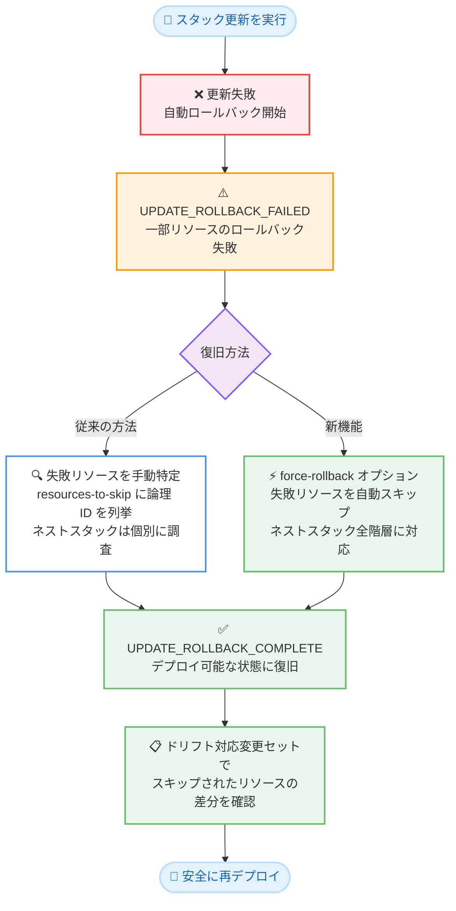

# AWS CloudFormation - スタック更新ロールバック操作の簡素化 (Force Rollback)

**リリース日**: 2026 年 10 月 22 日
**サービス**: AWS CloudFormation
**機能**: Force Rollback (強制ロールバック) によるスタック更新ロールバックの簡素化

📊 [このアップデートのインフォグラフィックを見る](https://takech9203.github.io/aws-news-summary/20261022-aws-cloudformation-cdk.html)

## 概要

AWS CloudFormation は、スタック更新のロールバック操作を簡素化する新機能「Force Rollback (強制ロールバック)」を発表しました。更新ロールバックはスタックを正常な状態に戻すための重要な操作ですが、一部のリソースが自動的にロールバックできない場合、スタックは `UPDATE_ROLLBACK_FAILED` 状態となり、復旧作業が必要になります。

これまでは、ロールバックに失敗した各リソースを手動で特定し、論理 ID を列挙して操作を再試行する必要がありました。今回のアップデートにより、Force Rollback オプションを指定するだけで、ロールバックに失敗したリソースを CloudFormation が自動的にスキップし、単一の操作でロールバックを完了できるようになりました。この機能は AWS CLI、SDK、AWS CDK、AI エージェントなど、すべての CloudFormation ワークフローで利用できます。

スキップされたリソース (CloudFormation の外部で変更されたリソースなど) は記録され、次回のデプロイ前に確認と解決ができます。ドリフト対応変更セット (drift-aware change set) と組み合わせることで、実際のリソース状態とテンプレートの差分を確認してから安全に再デプロイできます。

**アップデート前の課題**

- スタックが `UPDATE_ROLLBACK_FAILED` 状態になった場合、ロールバックに失敗したリソースを 1 つずつ手動で特定する必要があった
- `--resources-to-skip` オプションに失敗リソースの論理 ID をすべて列挙し、操作を再試行する必要があった
- ネストされたスタックでは `{NestedStackName}.{ResourceLogicalID}` 形式でネストスタック名と論理 ID を調べて指定する必要があり、多階層のスタック構成では特に煩雑だった
- 復旧までの手順が多く、障害対応時の MTTR (平均復旧時間) が長くなりがちだった

**アップデート後の改善**

- `--force-rollback` オプションを指定するだけで、ロールバックに失敗したリソースを自動的にスキップし、単一の操作でロールバックを完了できるようになった
- ネストされたスタックを含むすべての階層で、失敗リソースの特定や論理 ID の列挙が不要になった
- スキップされたリソースはステータス理由 `Resource skipped during UpdateRollback` として記録され、後から確認・解決できるようになった
- ロールバック完了後、ドリフト対応変更セットを作成して実際の構成差分を確認してから再デプロイできるようになった

## アーキテクチャ図



スタック更新が失敗しロールバックも失敗した場合の復旧フローです。従来は失敗リソースの手動特定が必要でしたが、Force Rollback により単一操作で `UPDATE_ROLLBACK_COMPLETE` 状態まで復旧できます。

## サービスアップデートの詳細

### 主要機能

1. **単一操作でのロールバック完了**
   - `continue-update-rollback` コマンドに `--force-rollback` オプションを追加するだけで実行可能
   - ロールバックに失敗した (`UPDATE_FAILED` 状態の) リソースを CloudFormation が自動的にスキップ
   - スキップされたリソースのステータスは `UPDATE_COMPLETE` に設定され、ステータス理由に `Resource skipped during UpdateRollback` と記録される
   - スキップ対象はロールバックに失敗したリソースのみで、フォワード更新 (更新処理そのもの) で失敗したリソースはスキップされない

2. **ネストされたスタックへの対応**
   - ネストスタックを含む全階層で、失敗リソースを自動的にスキップ
   - 従来必要だった `{NestedStackName}.{ResourceLogicalID}` 形式でのリソース指定が不要
   - 多階層のスタック構成でも、ルートスタックに対する 1 回の操作で全体を復旧可能

3. **スキップされたリソースの記録と確認**
   - ロールバック完了時に、スタックのステータス理由に 1 つ以上のリソースがスキップされたことが報告される
   - ドリフト検出ではスキップされたリソースは `NOT_CHECKED` と報告されるため、`DetectStackResourceDrift` で個別に差分を確認可能
   - ドリフト対応変更セットを作成することで、実際のリソース状態・前回デプロイ状態・desired state の 3 方向比較が可能

4. **すべてのワークフローで利用可能**
   - AWS CLI、SDK、AWS CDK、AI エージェントなど、CloudFormation を利用するすべてのワークフローで使用可能

## 技術仕様

### Force Rollback の動作

| 項目 | 詳細 |
|------|------|
| 対象の状態 | `UPDATE_ROLLBACK_FAILED` 状態のスタック |
| スキップ対象 | ロールバック中に `UPDATE_FAILED` となったリソース (ネストスタック内を含む) |
| スキップ対象外 | フォワード更新中に失敗したリソース |
| スキップ後のステータス | `UPDATE_COMPLETE` (理由: `Resource skipped during UpdateRollback`) |
| 完了後のスタック状態 | `UPDATE_ROLLBACK_COMPLETE` |
| ドリフト検出での扱い | スキップされたリソースは `NOT_CHECKED` と報告される |
| 排他制約 | `--force-rollback` と `--resources-to-skip` は同一リクエストで併用不可 |

### CLI コマンド

```bash
# 強制ロールバックの実行
aws cloudformation continue-update-rollback \
    --stack-name MyStack \
    --force-rollback
```

`UPDATE_ROLLBACK_FAILED` 状態のスタックに対して強制ロールバックを実行するコマンドです。ロールバックに失敗したリソースを自動的にスキップし、スタックを `UPDATE_ROLLBACK_COMPLETE` 状態に戻します。

## 設定方法

### 前提条件

1. スタックが `UPDATE_ROLLBACK_FAILED` 状態であること
2. AWS CLI または SDK が利用可能であること (コンソールからも操作可能)
3. `cloudformation:ContinueUpdateRollback` の IAM 権限があること

### 手順

#### ステップ 1: スタックの状態を確認

```bash
aws cloudformation describe-stacks \
    --stack-name MyStack \
    --query "Stacks[0].StackStatus"
```

スタックの現在のステータスを確認するコマンドです。`UPDATE_ROLLBACK_FAILED` であることを確認します。

#### ステップ 2: 強制ロールバックを実行

```bash
aws cloudformation continue-update-rollback \
    --stack-name MyStack \
    --force-rollback
```

ロールバックに失敗したリソースを自動的にスキップし、ロールバックを完了させるコマンドです。ネストされたスタックがある場合も、ルートスタックに対する 1 回の実行で全階層が対象になります。

#### ステップ 3: スキップされたリソースを確認

```bash
aws cloudformation describe-stack-events \
    --stack-name MyStack \
    --query "StackEvents[?ResourceStatusReason=='Resource skipped during UpdateRollback']"
```

スキップされたリソースをスタックイベントから確認するコマンドです。スキップされたリソースはテンプレートと実際の状態が不整合になっている可能性があるため、必ず確認します。

#### ステップ 4: ドリフト対応変更セットで差分を確認して再デプロイ

```bash
aws cloudformation create-change-set \
    --stack-name MyStack \
    --change-set-name my-drift-aware-changeset \
    --template-body file://updated-template.yaml \
    --deployment-mode REVERT_DRIFT
```

ドリフト対応変更セットを作成するコマンドです。実際のリソース状態とテンプレートの 3 方向比較により、スキップされたリソースを含む構成差分を確認してから、安全に次のデプロイを実行できます。

## メリット

### ビジネス面

- **復旧時間の短縮**: 失敗リソースの手動特定と列挙が不要になり、障害発生時の MTTR を大幅に短縮できる
- **運用負荷の軽減**: 複雑なネストスタック構成でも 1 回の操作で復旧できるため、オンコール対応の負担が軽減される
- **追加コストなし**: すべてのリージョンで追加料金なしで利用可能

### 技術面

- **自動化との親和性**: CLI、SDK、CDK、AI エージェントから利用できるため、自動復旧パイプラインに組み込みやすい
- **ネストスタック全階層への対応**: `{NestedStackName}.{ResourceLogicalID}` 形式の調査・指定が不要になり、オペレーションミスを防止できる
- **可視性の確保**: スキップされたリソースが記録され、ドリフト対応変更セットで差分を確認してから再デプロイできる

## デメリット・制約事項

### 制限事項

- `--force-rollback` と `--resources-to-skip` は同一リクエストで併用できない (特定のリソースのみスキップしたい場合は従来どおり `--resources-to-skip` を使用する)
- スキップ対象はロールバック中に失敗したリソースのみで、フォワード更新中に失敗したリソースはスキップされない
- ドリフト検出ではスキップされたリソースは `NOT_CHECKED` と報告されるため、差分確認には `DetectStackResourceDrift` やドリフト対応変更セットが必要

### 考慮すべき点

- ロールバック完了後、スキップされたリソースはスタックテンプレートと不整合な状態になる。次のスタック更新を行う前に、スタックまたはリソースを整合させる必要がある。整合させずに更新すると、以降のスタック更新が失敗し、スタックが復旧不能になる可能性がある
- 強制ロールバックは「エラーを修正できない場合」の手段であり、まずはロールバック失敗の原因調査と修正を検討することが推奨される

## ユースケース

### ユースケース 1: 外部変更されたリソースを含むスタックの復旧

**シナリオ**: スタック管理下のデータベースインスタンスが CloudFormation の外部で削除されており、スタック更新のロールバックが `UPDATE_ROLLBACK_FAILED` で停止した。

**実装例**:
```bash
aws cloudformation continue-update-rollback \
    --stack-name ProductionStack \
    --force-rollback
```

**効果**: 削除済みリソースを手動で特定することなくロールバックを完了し、スタックをデプロイ可能な状態に復旧できる。その後ドリフト対応変更セットで実際の状態を確認し、テンプレートを修正して再デプロイできる。

### ユースケース 2: 多階層ネストスタックの一括復旧

**シナリオ**: ルートスタック配下に複数のネストスタックを持つ大規模なインフラで更新が失敗し、スタック階層全体が `UPDATE_ROLLBACK_FAILED` 状態になった。

**実装例**:
```bash
aws cloudformation continue-update-rollback \
    --stack-name WebInfra \
    --force-rollback
```

**効果**: ネストスタック名や論理 ID を調査・列挙することなく、ルートスタックへの 1 回の操作で階層全体のロールバックを完了できる。

### ユースケース 3: CI/CD パイプラインでの自動復旧

**シナリオ**: CDK ベースの CI/CD パイプラインでデプロイが失敗した際、スタックが `UPDATE_ROLLBACK_FAILED` 状態のままだと後続のデプロイがすべてブロックされる。

**実装例**:
```bash
# パイプラインの復旧ステップに組み込む例
STATUS=$(aws cloudformation describe-stacks \
    --stack-name MyAppStack \
    --query "Stacks[0].StackStatus" --output text)

if [ "$STATUS" = "UPDATE_ROLLBACK_FAILED" ]; then
    aws cloudformation continue-update-rollback \
        --stack-name MyAppStack \
        --force-rollback
fi
```

**効果**: 人手の介入なしにスタックをデプロイ可能な状態へ自動復旧し、パイプラインの停止時間を最小化できる。スキップされたリソースは記録されるため、後から確認・解決できる。

## 料金

Force Rollback は追加料金なしで利用できます。CloudFormation 自体の料金体系 (AWS リソースタイプに対する操作は無料、サードパーティリソースタイプのハンドラーオペレーションに課金) に変更はありません。

## 利用可能リージョン

すべての AWS リージョンで利用可能です。

## 関連サービス・機能

- **ドリフト対応変更セット (Drift-aware Change Sets)**: 実際のリソース状態・前回デプロイ状態・desired state の 3 方向比較を提供する。強制ロールバック後にスキップされたリソースの差分確認と解消に活用できる
- **AWS CDK**: CDK によるデプロイが失敗した場合の復旧でも Force Rollback を利用できる
- **CloudFormation ドリフト検出**: スキップされたリソースは `NOT_CHECKED` となるため、`DetectStackResourceDrift` による個別の差分確認と組み合わせて使用する

## 参考リンク

- 📊 [インフォグラフィック](https://takech9203.github.io/aws-news-summary/20261022-aws-cloudformation-cdk.html)
- [公式発表 (What's New)](https://aws.amazon.com/about-aws/whats-new/2026/10/aws-cloudformation-cdk/)
- [ドキュメント: Continue rolling back an update](https://docs.aws.amazon.com/AWSCloudFormation/latest/UserGuide/using-cfn-updating-stacks-continueupdaterollback.html)
- [ドキュメント: Using drift-aware change sets](https://docs.aws.amazon.com/AWSCloudFormation/latest/UserGuide/drift-aware-change-sets.html)
- [AWS CLI リファレンス: continue-update-rollback](https://docs.aws.amazon.com/cli/latest/reference/cloudformation/continue-update-rollback.html)
- [AWS CDK ドキュメント](https://docs.aws.amazon.com/cdk/v2/guide/)

## まとめ

CloudFormation の Force Rollback により、これまで手動でのリソース特定と列挙が必要だった `UPDATE_ROLLBACK_FAILED` 状態からの復旧を、単一の操作で完了できるようになりました。ネストスタックを含む複雑な構成や CI/CD パイプラインでの自動復旧に特に有効です。スキップされたリソースはテンプレートと不整合になるため、再デプロイ前にドリフト対応変更セットで差分を確認するワークフローを整備することを推奨します。
