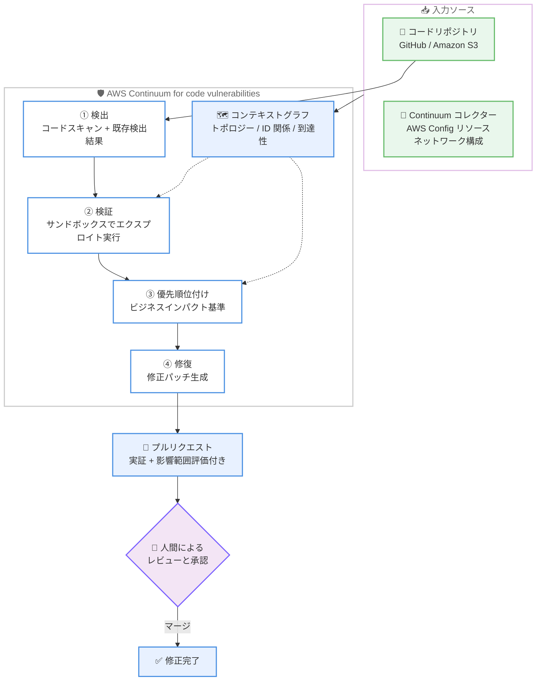

# AWS Continuum - コード脆弱性対応機能の一般提供開始

**リリース日**: 2026年10月22日
**サービス**: AWS Continuum
**機能**: AWS Continuum for code vulnerabilities (コード脆弱性の検出、検証、優先順位付け、修復) の一般提供 (GA)

📊 [このアップデートのインフォグラフィックを見る](https://takech9203.github.io/aws-news-summary/20261022-aws-continuum-for-code-vulnerabilities-is-now-generally-available.html)

## 概要

AWS Continuum for code vulnerabilities が一般提供 (GA) となりました。AWS Continuum は、コードの脆弱性を「マシンスピード」で検出、検証、優先順位付け、修復する自律型セキュリティサービスです。2026 年 6 月に gated preview (制限付きプレビュー) として発表された中核機能が、今回正式に利用可能になりました。

AWS Continuum は、リソーストポロジー、アイデンティティの関係性、ネットワーク到達性をマッピングした「コンテキストグラフ」を構築し、どのリソースがどのアプリケーションに属し、どの検出結果が実際のビジネスリスクに該当するかを把握します。既存の脆弱性検出結果の取り込みとコードスキャンを行い、隔離されたサンドボックス内でエクスプロイトを実行して悪用可能性を検証します。確認された問題はビジネスインパクトに基づいて順位付けされ、修正はエクスプロイトの実証 (proof) と影響範囲 (blast radius) の評価を添えたプルリクエストとして開発者のワークフローに直接届けられます。

サービスは「Learn モード」で開始され、エージェントが修正を提案し人間が承認するワークフローから始まります。十分な信頼が確立された後は、お客様が定義したガードレールの範囲内で自律的に動作する「Enforce モード」へ移行できます。なお、AWS News Blog によると、承認なしで特定クラスの修復を自動適用する機能は今後提供予定であり、現時点ではすべての修正に人間によるレビューとマージが必要です。セキュリティチームと開発チームの双方にとって、脆弱性のトリアージと修復の運用負荷を大幅に削減できるアップデートです。

**アップデート前の課題**

このアップデート以前には、以下のような課題が存在していました。

- gated preview であったため、利用には申請と承認が必要で、一般のお客様はすぐに利用できなかった
- スキャンツールが生成する大量の検出結果に対し、実際に悪用可能かどうかの検証を人手で行う必要があった
- 汎用的な深刻度スコアでは、開発環境のみで使われるユーティリティの Critical と、決済データベース近傍の Medium が適切に区別されず、優先順位付けが困難だった
- 脆弱性の修正コードの作成とプルリクエスト化は開発者の手作業に依存していた

**アップデート後の改善**

今回のアップデートにより、以下が可能になりました。

- すべての AWS アカウントから申請なしで AWS Continuum for code vulnerabilities を利用できるようになった
- 隔離されたサンドボックスでのエクスプロイト実行により、悪用可能性が実証された問題のみに集中できるようになった
- コンテキストグラフに基づき、攻撃経路が重要システム (顧客データストア、決済パイプライン、認証サービスなど) にどれだけ近いかで優先順位付けできるようになった
- 修正パッチ、依存関係のアップグレード、設定変更がプルリクエストとして自動生成され、GitHub 上でエビデンス付きのレビューが可能になった

## アーキテクチャ図



AWS Continuum はコードリポジトリと AWS 環境からコンテキストグラフを構築し、検出、検証、優先順位付け、修復の 4 フェーズを経て、エビデンス付きのプルリクエストを開発者ワークフローに届けます。

## サービスアップデートの詳細

### 主要機能

1. **コンテキストグラフによる環境理解**
   - コードリポジトリと AWS 環境の 2 つのソースからグラフを構築
   - コードが稼働するアカウント / リージョンにコレクターをセットアップし、AWS Config のリソース情報とネットワーク構成を収集
   - ネットワーク到達性と攻撃者のリーチを判断し、ビジネスクリティカルなシステム、所有者、サービス依存関係、扱うデータを学習

2. **サンドボックスでの悪用可能性検証**
   - 各検出結果をコードと環境のコンテキストに照らして分析し、エビデンスレベル (例: 静的解析で実証済みの「Static proven」) を付与
   - 再現可能な問題については隔離されたサンドボックス内でエクスプロイトを実行し、再現手順付きの実証コードを添付
   - 攻撃経路、ソース分析、影響範囲評価を提供し、既存の防御策が検証済みの攻撃経路を検知できるかも確認

3. **ビジネスインパクトに基づく優先順位付け**
   - 攻撃経路が重要システムにどれだけ近いかで問題をランク付け
   - 生のスキャナー検出結果 (Findings) ではなく、検証・優先順位付け済みの問題 (Issues) として提示

4. **プルリクエストによる修復**
   - 確認された問題ごとに、コードパッチ、依存関係のアップグレード、または設定変更を生成
   - 接続されたリポジトリにプルリクエストを作成し、PR の説明にリスク評価、サマリー、実証を記載
   - GitHub のレビュアーは使い慣れたワークフロー内でエビデンスを確認可能

5. **段階的な信頼モデル**
   - Learn モードで開始し、エージェントの提案を人間が承認
   - 信頼が確立された後、ガードレールの範囲内で自律動作する Enforce モードへ移行可能
   - テストカバレッジ、スコープ境界、過去の成功率などの確信度ゲートを通過した修復クラスの自動適用は今後提供予定

## 技術仕様

### 構成要素

| 項目 | 詳細 |
|------|------|
| コードソース | GitHub 連携または Amazon S3 バケット |
| S3 ソースの要件 | Continuum を有効化したアカウント / リージョンと同一であること。Continuum が引き受ける IAM ロール経由でアクセス |
| AWS 環境コンテキスト | Continuum コレクター (AWS Config リソース、ネットワーク構成を収集) |
| スキャン | スケジュール実行またはオンデマンド実行 |
| 動作モード | Learn モード (人間による承認) から開始、Enforce モード (ガードレール内での自律動作) へ移行可能 |
| 連携サービス | Amazon GuardDuty、AWS Security Hub と併用して動作 |

### API変更履歴

| 日付 | サービス | 変更内容 |
|------|----------|----------|
| 2026/10/22 | [continuum](https://awsapichanges.com/archive/changes/444e17-continuum.html) | 33 new api methods - Continuum for Code Vulnerabilities の SDK 向け API をリリース |

## 設定方法

### 前提条件

1. AWS アカウントと AWS Continuum コンソールへのアクセス権限
2. コードソース (GitHub リポジトリ、または Continuum と同一アカウント / リージョンの S3 バケットと IAM ロール)
3. AWS 環境コンテキストを利用する場合は、対象アカウント / リージョンでのコレクターのセットアップ

### 手順

#### ステップ1: コードソースの接続

AWS Continuum コンソールを開き、[Code vulnerabilities] を選択してコードソースを接続します。GitHub 連携または Amazon S3 バケットを選択できます。S3 を使用する場合は、Continuum が引き受ける IAM ロールでアクセスを許可します。

#### ステップ2: 環境の作成とスキャンスケジュールの設定

接続したコードソースに対して環境 (environment) を作成し、スキャンの実行スケジュールを設定します。[Scans] タブからスキャン頻度の変更やオンデマンドスキャンの実行も可能です。

#### ステップ3: AWS インフラストラクチャコンテキストの追加 (オプション)

コードが稼働するアカウント / リージョンに Continuum コレクターをセットアップし、環境からの利用を許可します。これにより、ネットワーク到達性やリソース構成を踏まえた優先順位付けが可能になります。

#### ステップ4: 問題の確認とプルリクエストのレビュー

[Issues] タブで検証・優先順位付け済みの問題を確認します。各問題には深刻度、悪用可能性、エビデンスレベル、実証 (Proof)、影響範囲評価が含まれます。生成されたプルリクエストを GitHub 上でレビューし、マージすることで修復が完了します。

## メリット

### ビジネス面

- **対応時間の短縮**: 検出から修復提案までをマシンスピードで実行し、脆弱性が悪用可能な状態で放置される時間を短縮できる
- **運用負荷の削減**: 手作業によるトリアージから、戦略策定と修正の承認へとセキュリティチームの役割をシフトできる
- **投資対効果の明確化**: ビジネスインパクトに基づく優先順位付けにより、重要システムに近いリスクへリソースを集中できる

### 技術面

- **誤検知対応の削減**: サンドボックスでの実証により、実際に悪用可能な問題のみに対応すればよくなる
- **開発者ワークフローとの統合**: エビデンス付きプルリクエストとして修正が届くため、開発者は使い慣れた GitHub 上でレビューできる
- **コンテキスト認識**: リソーストポロジー、アイデンティティ関係、ネットワーク到達性を踏まえた精度の高いリスク評価が得られる

## デメリット・制約事項

### 制限事項

- 利用可能リージョンは米国東部 (バージニア北部) と米国西部 (オレゴン) の 2 リージョンのみ
- S3 をコードソースとする場合、バケットは Continuum を有効化したアカウント / リージョンと同一である必要がある
- コレクターのセットアップはアカウント / リージョンごとに必要
- 承認なしの自動修復適用は今後提供予定であり、現時点ではすべての修正に人間によるレビューとマージが必要

### 考慮すべき点

- パッチが生成されても問題が修正されたことにはならず、レビューとマージが完了するまで脆弱性は残存する (コンソール上でも明示される)
- 推論フィー (CIU 課金) は脆弱性の件数と複雑さに応じて変動するため、大規模環境ではコストの見積もりと監視が重要

## ユースケース

### ユースケース1: スキャナー検出結果のノイズ削減

**シナリオ**: 複数のセキュリティスキャナーが大量の検出結果を生成しており、セキュリティチームが実際に対応すべき問題の選別に多くの時間を費やしている。

**実装例**:
```text
1. GitHub リポジトリを Continuum に接続し、定期スキャンを設定
2. Continuum コレクターで AWS 環境コンテキストを追加
3. Issues タブで「Exploitable」と判定された問題のみを対応対象とする
```

**効果**: サンドボックスでの実証により悪用可能な問題だけが Issues として提示され、トリアージ工数を大幅に削減できる。

### ユースケース2: 重要システム近傍の脆弱性への集中対応

**シナリオ**: 決済パイプラインや顧客データストアを扱うマイクロサービス群で、汎用的な CVSS スコアでは本当に危険な脆弱性を特定できない。

**実装例**:
```text
1. コードが稼働するアカウント / リージョンにコレクターをセットアップ
2. コンテキストグラフにより決済・認証サービスへの攻撃経路を評価
3. 攻撃経路が重要システムに近い問題から順に修正をマージ
```

**効果**: 認証不要でネットワーク到達可能な高リスク問題など、ビジネスインパクトの大きい脆弱性へ優先的に対応できる。

### ユースケース3: 修復のリードタイム短縮

**シナリオ**: 脆弱性の修正方針の検討、パッチ作成、プルリクエスト作成までを開発者が手作業で行っており、修復完了まで数週間かかっている。

**実装例**:
```text
1. Continuum の修復機能 (remediation patches) を有効化
2. 生成された「Continuum fix」プルリクエストを開発者がレビュー
3. PR 説明内のリスク評価と実証を確認してマージ
```

**効果**: 修正コードの作成が自動化され、開発者はレビューとマージに集中できるため、修復リードタイムを短縮できる。

## 料金

AWS Continuum for code vulnerabilities は従量課金制で、前払い費用や最低料金はありません。料金は 2 つのディメンションで構成されます。

1. **コンテキストフィー**: 保護対象のコード行数に基づく月額固定料金 (100 万行単位の段階制)
2. **推論フィー**: Continuum 推論ユニット (CIU) あたり 10 USD。複数のモデルが背後で使用されるが、課金は単一のユニットで行われる

### コンテキストフィーの段階料金

| コード行数 | 100 万行あたりの月額料金 |
|--------|------------------|
| 最初の 1,000 万行 | 200 USD |
| 次の 9,000 万行 | 180 USD |
| 1 億行超〜10 億行 | 160 USD |
| 10 億行超〜100 億行 | 130 USD |
| 100 億行超 | 100 USD |

### 料金例

| 使用量 | 月額料金 (概算) |
|--------|------------------|
| 100 万行 + 脆弱性 100 件 (各 1 CIU) | 1,200 USD |
| 1,000 万行 + 脆弱性 1,000 件 (各 1 CIU) | 12,000 USD |
| 1 億行 + 脆弱性 10,000 件 (各 2 CIU) | 218,200 USD |

最新の料金は [AWS Continuum 料金ページ](https://aws.amazon.com/continuum/pricing/) を参照してください。

## 利用可能リージョン

- 米国東部 (バージニア北部)
- 米国西部 (オレゴン)

最新のリージョン対応状況は [AWS リージョン別サービス表](https://aws.amazon.com/about-aws/global-infrastructure/regional-product-services/) を参照してください。

## 関連サービス・機能

- **AWS Continuum for penetration testing**: 旧 AWS Security Agent。オンデマンドのペネトレーションテストを数週間から数時間に短縮する、Continuum のもう 1 つの機能
- **Amazon GuardDuty**: 脅威検出サービス。Continuum と併用して動作する
- **AWS Security Hub**: セキュリティ検出結果の集約・管理サービス。Continuum と併用して動作する
- **AWS Config**: Continuum コレクターが AWS 環境コンテキストの収集に使用するリソース構成情報のソース

## 参考リンク

- 📊 [インフォグラフィック](https://takech9203.github.io/aws-news-summary/20261022-aws-continuum-for-code-vulnerabilities-is-now-generally-available.html)
- [公式発表 (What's New)](https://aws.amazon.com/about-aws/whats-new/2026/10/aws-continuum-for-code-vulnerabilities-is-now-generally-available)
- [AWS Blog: AWS Continuum for code vulnerabilities is now generally available](https://aws.amazon.com/blogs/aws/aws-continuum-for-code-vulnerabilities-is-now-generally-available/)
- [AWS Continuum 製品ページ](https://aws.amazon.com/continuum/)
- [料金ページ](https://aws.amazon.com/continuum/pricing/)
- [API 変更履歴 (awsapichanges.com)](https://awsapichanges.com/archive/changes/444e17-continuum.html)

## まとめ

AWS Continuum for code vulnerabilities の GA により、コード脆弱性の検出から検証、優先順位付け、修復提案までをマシンスピードで実行する自律型セキュリティサービスが、申請なしで利用可能になりました。サンドボックスでの悪用可能性の実証とコンテキストグラフに基づく優先順位付けにより、本当に対応すべき脆弱性へリソースを集中できる点が大きな価値です。現時点では米国 2 リージョンのみの提供ですが、GitHub リポジトリを持つ組織であれば小規模なコードベースから試験導入し、Issues の品質と CIU ベースのコストを評価することを推奨します。
