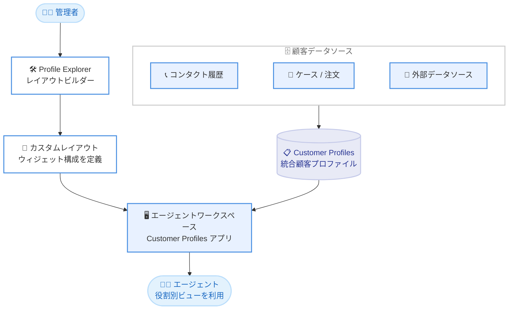

# Amazon Connect Customer - エージェントワークスペースの Customer Profiles アプリのカスタマイズ

**リリース日**: 2026 年 10 月 22 日
**サービス**: Amazon Connect Customer
**機能**: Customer Profiles アプリのカスタマイズ (Profile Explorer レイアウト)

📊 [このアップデートのインフォグラフィックを見る](https://takech9203.github.io/aws-news-summary/20261022-connect-customer-customize-cp.html)

## 概要

Amazon Connect Customer で、エージェントワークスペース上の Customer Profiles アプリをカスタマイズできるようになりました。管理者は Profile Explorer と呼ばれるレイアウトビルダーを使用して、エージェントに表示する顧客データの内容と表示方法を制御できます。Customer Profiles はコンタクト履歴とさまざまなデータソースの情報を統合し、エージェントに顧客のリアルタイムな統合ビューを提供する機能です。

管理者は、コンタクト履歴、顧客情報、ライフタイムバリューなどの計算属性といったウィジェットを組み合わせたレイアウトを構築、保存し、従来のデフォルトビューに代えてエージェントに割り当てられます。エージェントの役割ごとに異なるビューを提供できるため、例えば航空会社の手荷物クレーム担当エージェントにはコンタクト履歴、搭乗中のフライト、手荷物チケット情報を表示し、ロイヤルティ担当エージェントにはロイヤルティティア、顧客の好み、今後のフライトを表示するといった使い分けが可能です。さらに、顧客プロファイルを要約して重要なインサイトを提示する AI プロファイルサマリーもレイアウトに含められます。

**アップデート前の課題**

- エージェントワークスペースの Customer Profiles アプリは共通のデフォルトビューのみで、業務内容に合わせた表示のカスタマイズができなかった
- エージェントの役割が異なっても同じ顧客情報が表示されるため、業務に不要な情報が画面を占有し、必要な情報を探す手間が発生していた
- 顧客プロファイルの全体像を把握するには、エージェントが複数の情報を自分で読み解く必要があった

**アップデート後の改善**

- 管理者が Profile Explorer でウィジェットを組み合わせたレイアウトを構築、保存し、デフォルトビューに代えてエージェントに割り当てられるようになった
- エージェントの役割ごとに最適化されたビューを提供できるようになり、業務に必要な顧客データへ素早くアクセスできるようになった
- 生成 AI による顧客プロファイルサマリーをレイアウトに組み込み、重要なインサイトをエージェントへ即座に提示できるようになった

## アーキテクチャ図



管理者が Profile Explorer で構築したレイアウトをエージェントに割り当てると、Customer Profiles が統合した顧客データが、役割に最適化されたウィジェット構成でエージェントワークスペースに表示されます。

## サービスアップデートの詳細

### 主要機能

1. **Profile Explorer によるレイアウト構築**
   - 顧客の 360 度ビューを提供するダッシュボードを、管理者がウィジェットの組み合わせで自由に設計できる
   - ウィジェットはレイアウト定義内の JSON コンポーネントとして構成されるが、UI ビルダーが技術的な構成を自動処理するため、JSON を直接編集する必要はない
   - ドメインごとに複数のレイアウトを保存し、デフォルトとして表示するレイアウトを選択できる。利用中のレイアウトに影響を与えずに新しいレイアウトを構築、テストすることも可能

2. **デフォルトウィジェット**
   - 生成 AI サマリー: 顧客プロファイルを要約し、重要なパターンやインサイトをハイライト
   - 顧客情報: 氏名や連絡先などの基本情報を表示
   - 計算属性: ライフタイムバリューなどの計算済み属性を表示
   - コンタクト: 過去のコンタクト履歴を表示
   - ケース / 注文 / アセット: ケース管理、注文情報、顧客のアセット情報を表示

3. **カスタムウィジェット**
   - テーブル: 任意のデータを表形式で表示
   - キーバリューペア: 属性と値の組み合わせを一覧表示
   - キーメトリクス: 重要な指標を強調表示
   - ドーナツチャート: データの構成比を視覚化

4. **役割ごとのビュー割り当て**
   - 構築したレイアウトを、従来のデフォルトビューに代えてエージェントに割り当て可能
   - エージェントの業務内容に応じて異なるレイアウトを提供し、必要な情報だけを表示できる

5. **リアルタイム検索と統合ビュー**
   - メール、電話番号、予約番号など複数の識別子を同時に使用して顧客を即座に検索可能
   - 人口統計データ、コミュニケーション履歴、行動インタラクション、セグメントメンバーシップを含む完全な顧客コンテキストにアクセスできる

## 技術仕様

### 利用可能なウィジェット

| 分類 | ウィジェット | 内容 |
|------|--------------|------|
| デフォルト | 生成 AI サマリー | 顧客プロファイルの要約と重要インサイトの提示 |
| デフォルト | 顧客情報 | 顧客の基本情報の表示 |
| デフォルト | 計算属性 | ライフタイムバリューなどの計算済み属性の表示 |
| デフォルト | コンタクト | コンタクト履歴の表示 |
| デフォルト | ケース / 注文 / アセット | ケース、注文、アセット情報の表示 |
| カスタム | テーブル | 任意データの表形式表示 |
| カスタム | キーバリューペア | 属性と値の一覧表示 |
| カスタム | キーメトリクス | 重要指標の強調表示 |
| カスタム | ドーナツチャート | 構成比の視覚化 |

### 必要な権限

Profile Explorer の利用には、セキュリティプロファイルに以下の権限が必要です。

| 権限 | 内容 | 対象 |
|------|------|------|
| Profile explorer - Create | レイアウトの作成 | 管理者 |
| Profile explorer - Edit | 既存レイアウトの編集 | 管理者 |
| Profile explorer - View | 設定済みレイアウトの表示 | 管理者およびエージェント |

## 設定方法

### 前提条件

1. Amazon Connect Customer インスタンスが利用可能リージョンに存在すること
2. Customer Profiles が有効化され、ドメインが設定済みであること
3. 管理者のセキュリティプロファイルに Profile explorer の Create、Edit、View 権限があること
4. エージェントのセキュリティプロファイルに Profile explorer の View 権限があること

### 手順

#### ステップ 1: 権限を設定する

1. Amazon Connect Customer の管理画面でセキュリティプロファイルを開く
2. レイアウトを管理する管理者に **Profile explorer - Create**、**Profile explorer - Edit**、**Profile explorer - View** の権限を付与する
3. レイアウトを閲覧するエージェントに **Profile explorer - View** の権限を付与する

セキュリティプロファイルの権限により、レイアウトの構成操作と閲覧操作をそれぞれ制御します。

#### ステップ 2: レイアウトを作成する

1. 管理者として Profile Explorer のレイアウト管理 (Manage layouts) にアクセスする
2. 新しいレイアウトを作成し、コンタクト履歴、顧客情報、計算属性、生成 AI サマリーなどのウィジェットを配置する
3. 必要に応じてテーブルやキーメトリクスなどのカスタムウィジェットを追加する
4. レイアウトを保存する

UI ビルダーがウィジェットの JSON 構成を自動処理するため、画面操作のみでレイアウトを設計できます。既存のレイアウトに影響を与えずに新しいレイアウトを構築できます。

#### ステップ 3: レイアウトを割り当てて確認する

1. 作成したレイアウトをデフォルトのレイアウトとして設定するか、対象のエージェントに割り当てる
2. 管理者としてログインし、Profile Explorer ページへのアクセスとレイアウトの作成、編集ができることを確認する
3. エージェントとしてログインし、エージェントワークスペースの Customer Profiles アプリで割り当てられたレイアウトが表示されることを確認する

割り当て後、エージェントにはデフォルトビューに代わってカスタマイズされたビューが表示されます。

## メリット

### ビジネス面

- **対応時間の短縮**: 業務に必要な顧客データだけを表示することで、エージェントが情報を探す時間を削減し、顧客対応のスピードと品質を向上できる
- **役割に応じた最適化**: 手荷物クレーム担当、ロイヤルティ担当など、エージェントの役割ごとに最適な情報構成を提供できる
- **顧客体験の向上**: AI プロファイルサマリーにより、エージェントが顧客の状況を素早く把握し、パーソナライズされた対応を提供できる

### 技術面

- **ノーコードでのカスタマイズ**: UI ビルダーがウィジェットの JSON 構成を自動処理するため、独自開発なしで表示をカスタマイズできる
- **安全なレイアウト展開**: 利用中のレイアウトに影響を与えずに新しいレイアウトを構築、テストしてから展開できる
- **データ統合の活用**: Customer Profiles が統合したコンタクト履歴、外部データソース、計算属性をウィジェットとしてそのまま活用できる

## デメリット・制約事項

### 制限事項

- 利用可能リージョンは 9 リージョンに限定される (東京リージョンは現時点で対象外)
- レイアウトの管理と閲覧には、セキュリティプロファイルへの Profile explorer 権限の追加が必要
- Customer Profiles のドメイン設定とデータソース連携が前提となる

### 考慮すべき点

- 役割ごとに表示する情報を絞り込むため、エージェントの業務内容と必要なデータ項目を事前に整理しておく必要がある
- 計算属性ウィジェットを活用するには、ライフタイムバリューなどの計算属性を Customer Profiles 側で事前に定義しておく必要がある
- 表示の変更はエージェントの業務動線に影響するため、段階的な展開と事前の周知が望ましい

## ユースケース

### ユースケース 1: 航空会社の役割別エージェントビュー

**シナリオ**: 航空会社のコンタクトセンターで、手荷物クレーム担当とロイヤルティプログラム担当が同じ Customer Profiles アプリを使用しているが、必要な情報が大きく異なる。

**実装例**:
```
1. 手荷物クレーム担当向けレイアウト: コンタクト履歴、搭乗中の
   フライト、手荷物チケット情報のウィジェットを配置
2. ロイヤルティ担当向けレイアウト: ロイヤルティティア、顧客の
   好み、今後のフライトのウィジェットを配置
3. それぞれのレイアウトを対象エージェントに割り当て
```

**効果**: 各エージェントが業務に直結する情報へ即座にアクセスでき、確認の手間と対応時間を削減できる。

### ユースケース 2: AI サマリーによる対応品質の底上げ

**シナリオ**: 経験の浅いエージェントが多いチームで、顧客の背景を素早く把握して適切な対応を行えるようにしたい。

**実装例**:
```
1. レイアウトの上部に生成 AI サマリーウィジェットを配置
2. 補足としてコンタクト履歴と顧客情報ウィジェットを配置
3. 対象チームのエージェントにレイアウトを割り当て
```

**効果**: 顧客プロファイルの要点が AI により要約されて提示されるため、経験によらず顧客の状況把握が容易になり、対応品質が均一化される。

### ユースケース 3: 優良顧客対応チーム向けの指標重視ビュー

**シナリオ**: 優良顧客を担当する専門チームで、顧客のライフタイムバリューや利用状況を一目で確認しながら対応したい。

**実装例**:
```
1. ライフタイムバリューなどの計算属性ウィジェットと
   キーメトリクスウィジェットを配置
2. ドーナツチャートで購買カテゴリの構成比を視覚化
3. 注文、ケースのウィジェットで直近の取引状況を表示
```

**効果**: 顧客価値と取引状況を定量的に把握しながら対応でき、アップセルやリテンション施策につなげやすくなる。

## 料金

Customer Profiles アプリのカスタマイズ機能自体に関する追加料金の記載は、公式発表にはありません。Amazon Connect Customer Profiles は従量課金制であり、利用状況に基づいて課金されます。詳細は料金ページを参照してください。

## 利用可能リージョン

以下の 9 リージョンで利用可能です。

- 米国東部 (バージニア北部)
- 米国西部 (オレゴン)
- アフリカ (ケープタウン)
- アジアパシフィック (ソウル)
- アジアパシフィック (シンガポール)
- アジアパシフィック (シドニー)
- カナダ (中部)
- 欧州 (フランクフルト)
- 欧州 (ロンドン)

## 関連サービス・機能

- **Amazon Connect Customer Profiles**: コンタクト履歴と外部データソースを統合し、顧客の統合プロファイルを提供する基盤機能。本アップデートの表示対象となるデータを管理する
- **エージェントワークスペース**: エージェントが顧客対応に使用する統合ワークスペース。カスタマイズした Customer Profiles アプリはこのワークスペース上に表示される
- **計算属性 (Calculated Attributes)**: ライフタイムバリューなど、顧客データから算出される属性。ウィジェットとしてレイアウトに配置できる
- **Amazon Connect Customer Cases**: ケース管理機能。ケースウィジェットとしてレイアウトに表示できる

## 参考リンク

- 📊 [インフォグラフィック](https://takech9203.github.io/aws-news-summary/20261022-connect-customer-customize-cp.html)
- [公式発表 (What's New)](https://aws.amazon.com/about-aws/whats-new/2026/10/connect-customer-customize-cp)
- [ドキュメント: Profile Explorer のセットアップ](https://docs.aws.amazon.com/connect/latest/adminguide/customer-profiles-profile-explorer.html)
- [ドキュメント: Profile Explorer の有効化](https://docs.aws.amazon.com/connect/latest/adminguide/enabling-profile-explorer.html)
- [ドキュメント: レイアウトの管理](https://docs.aws.amazon.com/connect/latest/adminguide/manage-layouts.html)
- [ドキュメント: ウィジェット](https://docs.aws.amazon.com/connect/latest/adminguide/widgets.html)
- [料金ページ](https://aws.amazon.com/connect/pricing/)

## まとめ

Amazon Connect Customer のエージェントワークスペースで、Customer Profiles アプリの表示内容を Profile Explorer のレイアウトとしてカスタマイズできるようになりました。エージェントの役割ごとに必要な顧客データだけを表示し、生成 AI サマリーで顧客の状況把握を支援することで、対応時間の短縮と顧客体験の向上が期待できます。まずはセキュリティプロファイルに Profile explorer 権限を追加し、主要な役割向けのレイアウトを 1 つ作成して効果を検証することを推奨します。
