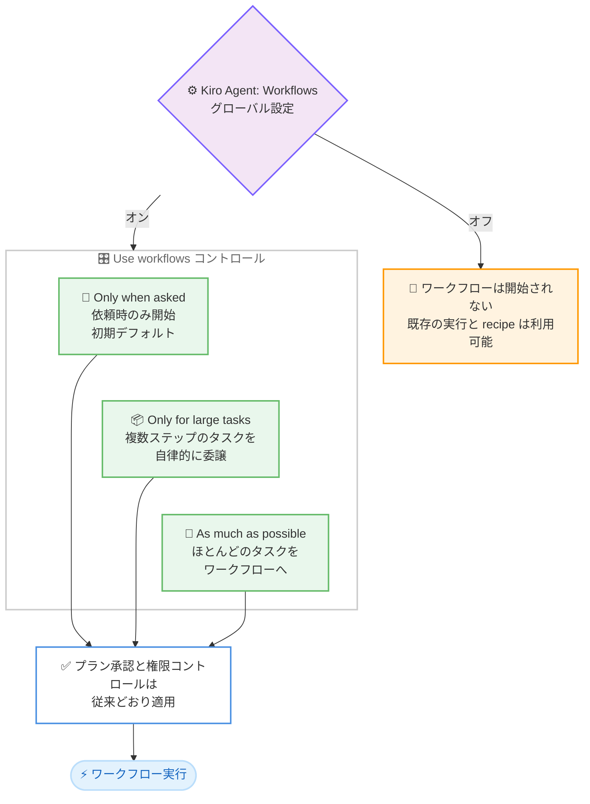

# Kiro - ワークフローを使用するタイミングの選択が可能に (IDE 1.4.26)

**リリース日**: 2026 年 10 月 22 日
**サービス**: Kiro
**機能**: Choose When Kiro Uses Workflows (Kiro IDE 1.4.26)

📊 [このアップデートのインフォグラフィックを見る](https://takech9203.github.io/aws-news-summary/20261022-kiro-changelog-2026-10-22.html)

## 概要

Kiro IDE 1.4.26 がリリースされました。本リリースでは、チャットごとに Kiro がワークフローを自発的に開始する頻度を選択できる **Use workflows** コントロールが追加されました。選択肢は **Only when asked** (依頼時のみ)、**Only for large tasks** (大きなタスクのみ)、**As much as possible** (可能な限り) の 3 段階で、新しいチャットは Only when asked から開始されます。従来の **Kiro Agent: Workflows** 設定はワークフロー機能全体のオン / オフを引き続き担い、Use workflows はセッション内で Kiro がどの程度積極的にワークフローを開始するかを制御します。

あわせて、Kiro CLI でインストールした Powers が IDE の Powers パネルで正しく表示されるようになるなど、インストール済み Powers の IDE と Kiro CLI 全体での信頼性が向上しました。また、Memory 設定で未選択の場合にデフォルトの Off が正しく適用されるようになったほか、エージェントターミナルでの `!` を含むコマンドの実行や、製品内フィードバック関連の動作も改善されています。

ワークフローへの委譲度合いを自分で決めたいユーザーから、多くのタスクをワークフローに任せたいユーザーまで、作業スタイルに合わせて Kiro の自律性を調整できるようになる重要なアップデートです。

**アップデート前の課題**

このアップデート以前には、以下のような課題がありました。

- ワークフロー機能を有効にすると、Kiro がワークフローを開始する頻度をセッション単位で調整する手段がなく、委譲の度合いをユーザーがコントロールしにくかった
- Kiro CLI でインストールした Powers が、IDE の Powers パネルの Installed 一覧から消えたり、パネル自体の表示が壊れたりすることがあった
- インストール済みのカスタム Powers で、`plugin.json` に記載した説明、作者、リポジトリの情報が一覧と詳細ビューに一貫して表示されないことがあった
- Memory 設定でレベルを未選択の場合に、デフォルトの Off が適用されないことがあった
- `echo "a!b"` のような `!` を含むコマンドが、エージェントターミナルで bash では「event not found」エラーで失敗し、zsh では閉じ引用符を待って停止することがあった

**アップデート後の改善**

今回のアップデートにより、以下が改善されました。

- チャットの Workflows パネルで **Use workflows** を Only when asked、Only for large tasks、As much as possible から選択し、Kiro がワークフローを開始する頻度を制御できるようになった
- ローカルセッションでの選択は記憶され、新しいチャットに引き継がれるようになった
- Kiro CLI でインストールした Powers が、IDE の Powers パネルの Installed 一覧に正しく表示され続けるようになった
- Memory 設定で未選択の場合にデフォルトの Off が適用されるようになった (選択済みの設定は変更されない)
- `!` を含むコマンドがエージェントターミナルで正常に実行されるようになった

## アーキテクチャ図



グローバル設定がワークフロー機能全体の利用可否を決め、Use workflows コントロールがセッション内で Kiro がどの程度自発的にワークフローを開始するかを決める 2 段階の制御です。どの選択肢でも、プラン承認とツール実行の権限コントロールは従来どおり適用されます。

## サービスアップデートの詳細

### 主要機能 (Improvements)

1. **Use workflows コントロールの追加**
   - チャットの Workflows パネルで、**Use workflows** を **Only when asked**、**Only for large tasks**、**As much as possible** のいずれかに設定できる
   - 新しいチャットは Only when asked から開始される。ローカルセッションで選択を変更すると、その選択が記憶され、以降の新しいチャットに適用される
   - クラウドセッションでの選択はそのセッション限りで、ローカルのデフォルトは変更されない
   - 従来の **Kiro Agent: Workflows** 設定 (`kiroAgent.workflows.enabled`) は、引き続きワークフロー機能全体のオン / オフを制御する
   - このコントロールは委譲の判断基準を変えるものであり、Kiro の権限を変えるものではない。ワークフローのプランとツールアクションは、従来どおりレビューと権限のコントロールに従う

### 不具合修正 (Fixes)

- Kiro CLI でインストールした Powers が、Powers パネルの Installed 一覧から消えたりパネルの表示を壊したりせず、正しく表示され続けるよう修正
- インストール済みのカスタム Powers が、`plugin.json` に記載された説明、作者、リポジトリの情報を Installed 一覧と詳細ビューの両方で一貫して表示するよう修正
- Memory 設定でレベルを未選択の場合に、デフォルトの Off が適用されるよう修正。選択済みの設定は変更されない
- `echo "a!b"` のような `!` を含むコマンドが、エージェントターミナルで bash の「event not found」エラーで失敗したり、zsh で閉じ引用符を待って停止したりする問題を修正
- プロンプトが入力を受け付ける前にシェル統合の準備が完了していた場合に、ターミナルコマンドの開始が遅延する問題を修正
- Auto モデルが応答を再試行する際の通知が、モデル名を表示せず「Couldn't complete this response. Retrying…」と表示されるよう修正
- ステータスバーから What's New を開いて閉じた後に、キーボードフォーカスが失われる問題を修正

## 技術仕様

### Use workflows コントロールの選択肢

| 選択肢 | 動作 |
|------|------|
| Only when asked (初期デフォルト) | アクティブなセッション内でタスクを処理し、ユーザーが依頼した場合のみワークフローを開始する |
| Only for large tasks | 複数ステップのタスクや、より多くのコンテキストが必要なタスクに対して、自律的にワークフローを使用する |
| As much as possible | コードの読解、実装、テスト、レビューなど、ほとんどのタスクをワークフローへルーティングしようとする |

### 今回の変更の対象

| 項目 | 詳細 |
|------|------|
| 対象製品 | Kiro IDE (Powers の修正は Kiro CLI との連携にも関係) |
| バージョン | 1.4.26 |
| Use workflows の表示場所 | チャットの Workflows パネル下部 (Share feedback for workflows の隣) |
| 表示条件 | ワークフローが有効なトップレベルのチャットのみ。Workflow のステップタブや、コントロール追加前に作成されたセッションには表示されない |
| 選択の記憶 | ローカルセッションでの直近の選択が新しいチャットに適用される。クラウドセッションでの選択はそのセッション限り |
| グローバル設定 | `kiroAgent.workflows.enabled` が引き続き機能全体のオン / オフを制御 |

## 設定方法

### 前提条件

1. Kiro IDE がインストールされていること
2. バージョン 1.4.26 以降にアップデートされていること
3. Workspace Configuration でワークフロー機能が有効になっていること

### 手順

#### ステップ 1: Kiro IDE のアップデート

Kiro IDE を再起動するか、アップデート通知に従って 1.4.26 へアップデートします。

#### ステップ 2: ワークフロー機能の有効化

プロジェクトの Workspace Configuration を開き、**Workflows** を選択して有効化します。設定の変更は新しいセッションから適用されます。Workflows の項目が表示されない場合、アカウントでまだ利用できない状態です。

#### ステップ 3: Use workflows の設定

新しいチャットを開始し、チャット上部の Workflows パネルを開きます。パネル下部の **Use workflows** で、Only when asked、Only for large tasks、As much as possible のいずれかを選択します。未選択の場合は Only when asked が表示されます。ローカルセッションでの選択は記憶され、以降の新しいチャットに適用されます。

## メリット

### ビジネス面

- **作業スタイルに合わせた自律性の調整**: 委譲の判断を自分で行いたいユーザーと、多くのタスクを自動で委譲したいユーザーの両方が、同じ機能を自分に合った形で利用できる
- **トークン消費の管理**: ワークフローの開始頻度を抑えることで、意図しないトークン消費の増加を避けられる (As much as possible は追加のトークン使用を許容する選択肢)
- **Powers 運用の安定化**: CLI でインストールした Powers が IDE でも確実に管理でき、チームでのツール配布運用が安定する

### 技術面

- **2 段階の制御モデル**: グローバル設定が機能の利用可否を、Use workflows がセッション内の開始頻度を担う明確な役割分担になっている
- **安全性の維持**: どの選択肢でもプラン承認とツール実行の権限コントロールは従来どおり適用され、委譲頻度の変更が権限の変更につながらない
- **既存設定との互換性**: Memory 設定の修正は未選択ユーザーへのデフォルト適用のみで、選択済みの設定には影響しない

## デメリット・制約事項

### 制限事項

- Use workflows コントロールは、ワークフローが有効なトップレベルのチャットにのみ表示される。Workflow のステップタブや、コントロール追加前に作成されたセッションには表示されない
- クラウドセッションでの選択はそのセッション限りで、ローカルのデフォルトには反映されない
- グローバル設定 (`kiroAgent.workflows.enabled`) がオフの場合、Use workflows の選択に関わらずワークフローは開始されない

### 考慮すべき点

- As much as possible を選択すると、ほとんどのタスクがワークフローへルーティングされるため、トークン使用量が増加する可能性がある
- ローカルセッションでの選択は以降の新しいチャットに引き継がれるため、一時的に変更した場合は次のチャットで設定を確認することが推奨される
- Memory 機能を利用したいユーザーは、デフォルトが Off であるため、設定で明示的にレベルを選択する必要がある

## ユースケース

### ユースケース 1: 委譲を自分で判断しながらのコーディング

**シナリオ**: 設計判断の多い開発作業で、ワークフローへの委譲タイミングを自分でコントロールしたい。

**実装例**:
```
1. Use workflows を Only when asked に設定 (初期デフォルト)
2. 通常のタスクはチャット内で対話的に処理
3. 定型的な作業のみ「ワークフローで実行して」と明示的に依頼
```

**効果**: 委譲の判断をすべて自分で行えるため、意図しないワークフローの起動を避けながら、必要な場面でのみバックグラウンド実行を活用できる。

### ユースケース 2: 大きなタスクのバックグラウンド委譲

**シナリオ**: 複数ファイルにまたがるリファクタリングなどの大きなタスクはワークフローに任せ、小さな質問や修正はチャットで素早く処理したい。

**実装例**:
```
1. Use workflows を Only for large tasks に設定
2. 複数ステップのタスクを依頼すると、Kiro が自律的にワークフローを開始
3. 小さなタスクは従来どおりチャット内で処理される
```

**効果**: 時間のかかる複数ステップの作業をバックグラウンドで進めながら、チャットでは軽量なやり取りを継続でき、作業の並列度が上がる。

### ユースケース 3: ワークフロー中心の開発スタイル

**シナリオ**: コードの読解、実装、テスト、レビューといった作業の大部分をワークフローとして実行し、実行履歴を構造化された形で残したい。

**実装例**:
```
1. Use workflows を As much as possible に設定
2. ほとんどのタスクがワークフローへルーティングされる
3. プラン承認と権限コントロールで各ワークフローの内容を確認
```

**効果**: セッション内の作業の大部分がワークフローとして実行され、タスクごとの計画と実行結果を追跡しやすくなる。追加のトークン使用を許容できる場合に有効。

## 利用可能リージョン

グローバル (Kiro はグローバルに提供されるサービスです)

## 関連サービス・機能

- **Kiro Workflows**: タスクをプランとステップに分けてバックグラウンドで実行する機能。今回、開始頻度をセッション単位で制御できるようになった
- **Kiro Powers**: MCP サーバーを通じて外部ツールやドキュメントへのアクセスを提供する機能。CLI でインストールした Powers の IDE での表示が今回修正された
- **Kiro Memory**: セッションをまたいでコンテキストを持ち越す機能。未選択時にデフォルトの Off が適用されるよう今回修正された
- **Kiro CLI**: Kiro のコマンドラインインターフェース。Powers のインストールと管理を IDE と共有する

## 参考リンク

- 📊 [インフォグラフィック](https://takech9203.github.io/aws-news-summary/20261022-kiro-changelog-2026-10-22.html)
- [Kiro Changelog](https://kiro.dev/changelog/)
- [Kiro IDE 1.4.26 Changelog](https://kiro.dev/changelog/ide/1-4-26/)
- [ドキュメント: Workflows - Turn it on](https://kiro.dev/docs/workflows/#turn-it-on)
- [ドキュメント: Memory](https://kiro.dev/docs/memory/)

## まとめ

Kiro IDE 1.4.26 は、Use workflows コントロールにより、Kiro がワークフローを開始する頻度をユーザーがセッション単位で選択できるようにするアップデートです。委譲の度合いを自分で決めたい場合は Only when asked、大きなタスクを任せたい場合は Only for large tasks、ワークフロー中心で作業したい場合は As much as possible を選択してください。Powers やエージェントターミナルの不具合修正も含まれるため、これらの機能を日常的に利用しているユーザーは早めのアップデートが推奨されます。
