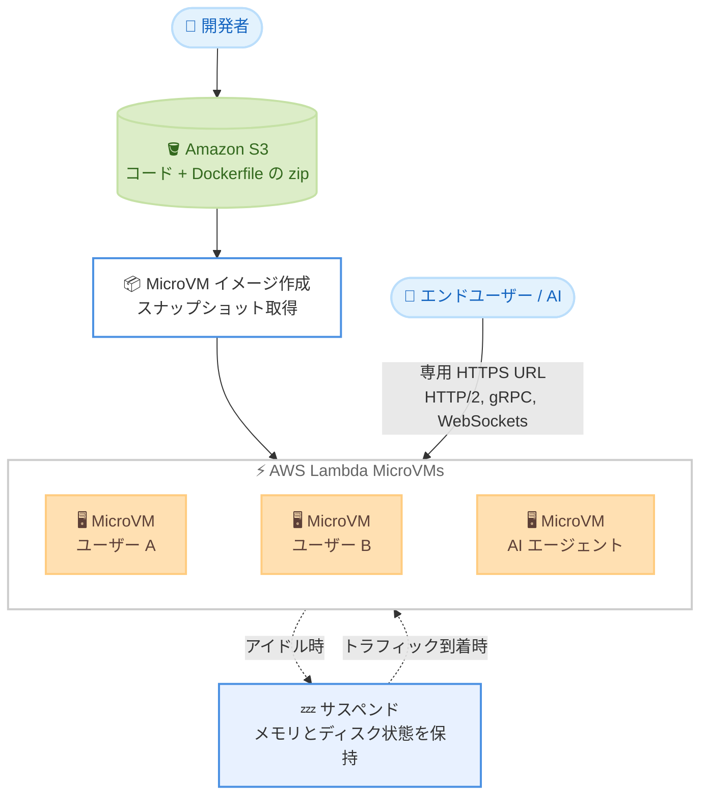

# AWS Lambda - MicroVMs が追加の 4 リージョンで利用可能に

**リリース日**: 2026 年 10 月 22 日
**サービス**: AWS Lambda
**機能**: AWS Lambda MicroVMs のリージョン拡大

📊 [このアップデートのインフォグラフィックを見る](https://takech9203.github.io/aws-news-summary/20261022-lambda-microvms-4-additional-regions.html)

## 概要

AWS Lambda MicroVMs が新たに 4 つのリージョン (アジアパシフィック (香港)、アジアパシフィック (マレーシア)、アジアパシフィック (タイ)、欧州 (スペイン)) で利用可能になりました。今回の拡大により、Lambda MicroVMs は合計 14 の AWS リージョンで利用できます。

Lambda MicroVMs は、VM レベルの分離、ほぼ瞬時の起動・再開速度、状態保持を提供するサーバーレスコンピューティングプリミティブです。ユーザーや AI が生成したコードを実行するアプリケーションにおいて、仮想化基盤を自前で管理することなく、ユーザーやジョブごとに専用の分離環境を割り当てることができます。AI コーディングアシスタント、インタラクティブな開発環境、脆弱性スキャナーなどのユースケースに適しています。

今回のリージョン拡大により、エンドユーザーに近い場所でワークロードを実行できるようになり、レイテンシー要件やデータレジデンシー要件への対応が容易になります。

**アップデート前の課題**

- 香港、マレーシア、タイ、スペインの各リージョンでは Lambda MicroVMs を利用できなかった
- これらの地域のエンドユーザー向けには、遠隔リージョンから MicroVMs を提供する必要があり、レイテンシーが増加していた
- データを特定の国や地域に保持する必要があるワークロードでは、Lambda MicroVMs の採用が困難だった

**アップデート後の改善**

- アジアパシフィック (香港)、アジアパシフィック (マレーシア)、アジアパシフィック (タイ)、欧州 (スペイン) で Lambda MicroVMs が利用可能になった
- 東南アジアや南欧のエンドユーザーに近い場所で分離されたコンピューティング環境を提供し、低レイテンシーを実現できるようになった
- 各地域のデータレジデンシー要件を満たしながら Lambda MicroVMs を活用できるようになった

## アーキテクチャ図



Lambda MicroVMs の基本的な動作フローです。Dockerfile からイメージを作成し、スナップショットからユーザーやジョブごとに分離された MicroVM を高速起動します。各 MicroVM は専用の HTTPS URL を持ち、アイドル時はサスペンドしてコストを削減します。

## サービスアップデートの詳細

### 主要機能

1. **新規対応リージョン**
   - アジアパシフィック (香港)
   - アジアパシフィック (マレーシア)
   - アジアパシフィック (タイ)
   - 欧州 (スペイン)
   - 今回の拡大により合計 14 リージョンで利用可能

2. **VM レベルの分離と高速起動**
   - Firecracker 仮想化技術により、MicroVM ごとに VM レベルの分離を提供
   - 初期化済み環境のスナップショットから起動するため、アプリケーションの初期化をスキップしてほぼ瞬時に起動・再開
   - システムパッケージのインストールやファイルシステムのマウントなど、完全な OS 機能を利用可能

3. **サスペンド・レジューム機能**
   - アイドル時に MicroVM をサスペンドし、メモリとディスクの状態を保持したままコストを削減
   - ライフサイクルポリシーによる自動制御、または API 呼び出し (suspend-microvm / resume-microvm) によるプログラマブルな制御が可能
   - トラフィック到着時にはほぼ瞬時に再開

4. **柔軟なネットワーキング**
   - 各 MicroVM に専用の HTTPS URL が付与され、HTTP/2、gRPC、WebSockets をサポート
   - ロードバランサーやイングレス基盤の構築が不要
   - アウトバウンドはパブリックインターネットアクセスと VPC アクセスを設定可能

## 技術仕様

### Lambda MicroVMs の主要仕様

| 項目 | 詳細 |
|------|------|
| 分離モデル | Firecracker 仮想化による VM レベルの分離 |
| イメージ作成 | コードと Dockerfile を zip 化して Amazon S3 にアップロードし、Lambda API でイメージ (スナップショット) を作成 |
| 起動方式 | 初期化済みスナップショットからの高速起動 |
| 接続方式 | MicroVM ごとの専用 HTTPS URL (HTTP/2、gRPC、WebSockets 対応)、サービス提供の JWE 認証 |
| ライフサイクル | run / suspend / resume / terminate を API または自動ポリシーで制御 |
| リソース割り当て | ベースラインを設定し、ピーク時はベースラインの最大 4 倍まで垂直スケール可能 |
| 管理ツール | Lambda コンソール、CloudFormation、AWS CDK、Agent Toolkit for AWS |

## 設定方法

### 前提条件

1. AWS アカウントと AWS Lambda へのアクセス権限
2. アプリケーションコードと Dockerfile
3. zip アーカイブをアップロードする Amazon S3 バケット

### 手順

#### ステップ 1: イメージソースの準備とアップロード

```bash
# アプリケーションコードと Dockerfile を zip 化して S3 にアップロード
zip -r my-microvm-app.zip ./app ./Dockerfile
aws s3 cp my-microvm-app.zip s3://my-bucket/my-microvm-app.zip
```

アプリケーションコードと Dockerfile を 1 つの zip アーカイブにまとめ、Amazon S3 にアップロードします。

#### ステップ 2: MicroVM イメージの作成

Lambda API を呼び出して MicroVM イメージを作成します。Lambda が Dockerfile を実行してアプリケーションを起動し、完全に初期化された環境のスナップショットを取得します。具体的な API 操作は[開発者ガイド](https://docs.aws.amazon.com/lambda/latest/dg/lambda-microvms-guide.html)を参照してください。

#### ステップ 3: MicroVM の起動と接続

ユーザーセッションやジョブごとに run-microvm を呼び出し、スナップショットから MicroVM を起動します。クライアントは発行された専用 HTTPS エンドポイント経由で接続します。アイドル時はライフサイクルポリシーまたは suspend-microvm / resume-microvm の API で状態を制御し、セッション終了時には MicroVM を終了してリソースを解放します。

## メリット

### ビジネス面

- **レイテンシーの低減**: 東南アジアや南欧のエンドユーザーに近いリージョンで実行することで、インタラクティブなユースケースの応答性が向上
- **データレジデンシー要件への対応**: 香港、マレーシア、タイ、スペインの各地域でデータを域内に保持するワークロードに対応可能
- **コスト効率**: アイドル時のサスペンドにより、インタラクティブ環境の待機コストを削減

### 技術面

- **運用負荷の軽減**: 仮想化基盤、ロードバランサー、イングレス基盤の管理が不要
- **強力な分離**: マルチテナント環境でもユーザーやジョブごとに VM レベルの分離を確保
- **高速な起動・再開**: スナップショットベースの起動により、環境の初期化を待たずに利用開始可能

## デメリット・制約事項

### 制限事項

- 利用可能リージョンは 14 リージョンに限定される (全リージョンでは利用不可)
- 今回の発表では既存の対応リージョン一覧は明示されておらず、最新の対応状況は AWS Capabilities by Region ページでの確認が必要

### 考慮すべき点

- 垂直スケールは設定したベースラインの最大 4 倍までであり、ワークロードに応じた適切なベースライン設定が必要
- ベースライン稼働分とベースラインを超えるアクティブ使用分で課金されるため、コスト見積もりの際は利用パターンの把握が重要

## ユースケース

### ユースケース 1: AI コード実行サンドボックス

**シナリオ**: AI コーディングアシスタントが生成したコードを、本番環境やほかのユーザーから分離された環境で安全に実行したい。

**実装例**:
```
1. 実行環境の Dockerfile からスナップショットイメージを作成
2. AI エージェントのタスクごとに run-microvm で専用 MicroVM を起動
3. 専用 HTTPS URL 経由でコードの実行とレスポンス取得
4. タスク完了後に MicroVM を終了
```

**効果**: AI 生成コードを VM レベルで分離して実行でき、タスクごとに高速にクリーンな環境を用意できる

### ユースケース 2: インタラクティブな開発環境

**シナリオ**: ブラウザベースの IDE サービスで、ユーザーごとに分離された開発環境をリアルタイムに提供したい。ユーザーの離席中はコストを抑えたい。

**実装例**:
```
1. 開発環境のイメージを事前に作成
2. ユーザーのセッション開始時に MicroVM を起動し、WebSockets で接続
3. アイドル時はライフサイクルポリシーで自動サスペンド
4. ユーザーが戻ったらメモリとディスク状態を保持したまま再開
```

**効果**: ユーザーの作業状態を保持しながら、アイドル時間のコストを削減できる

### ユースケース 3: セキュリティスキャンとマルチテナント CI/CD

**シナリオ**: 脆弱性評価ツールやテナントごとの CI/CD タスク実行で、テナント間の分離を確保した実行環境が必要。

**実装例**:
```
1. スキャナーやビルド環境のイメージを作成
2. テナントやジョブごとに MicroVM を起動して処理を実行
3. ジョブ完了後に MicroVM を終了し、環境を完全に破棄
```

**効果**: テナント間の情報漏えいリスクを抑えつつ、ジョブごとに使い捨ての分離環境を高速に提供できる

## 料金

MicroVM の稼働中はベースラインレートで課金され、ベースラインを超えるアクティブな使用分は追加で課金されます。サスペンド中はメモリとディスクの状態を保持しながらコストを削減できます。具体的な料金は [AWS Lambda 料金ページ](https://aws.amazon.com/lambda/pricing/)を参照してください。

## 利用可能リージョン

今回新たに以下の 4 リージョンで利用可能になりました。

- アジアパシフィック (香港)
- アジアパシフィック (マレーシア)
- アジアパシフィック (タイ)
- 欧州 (スペイン)

今回の拡大により合計 14 の AWS リージョンで利用可能です。最新のリージョン対応状況は [AWS Capabilities by Region](https://builder.aws.com/build/capabilities) を参照してください。

## 関連サービス・機能

- **AWS Lambda**: MicroVMs は Lambda ファミリーの機能であり、Lambda 関数と同じ Firecracker 仮想化技術を基盤としている
- **Amazon S3**: MicroVM イメージのソースとなる zip アーカイブ (コードと Dockerfile) の格納先
- **AWS CloudFormation / AWS CDK**: MicroVMs のプロビジョニングと管理を IaC で実現
- **Agent Toolkit for AWS**: エージェント型開発ツールから MicroVMs を利用するためのツールキット

## 参考リンク

- 📊 [インフォグラフィック](https://takech9203.github.io/aws-news-summary/20261022-lambda-microvms-4-additional-regions.html)
- [公式発表 (What's New)](https://aws.amazon.com/about-aws/whats-new/2026/10/lambda-microvms-4-additional-regions)
- [ドキュメント (AWS Lambda MicroVMs 開発者ガイド)](https://docs.aws.amazon.com/lambda/latest/dg/lambda-microvms-guide.html)
- [料金ページ](https://aws.amazon.com/lambda/pricing/)
- [Agent Toolkit for AWS](https://github.com/aws/agent-toolkit-for-aws)

## まとめ

AWS Lambda MicroVMs が香港、マレーシア、タイ、スペインの 4 リージョンに拡大し、合計 14 リージョンで利用可能になりました。これらの地域でレイテンシーやデータレジデンシー要件を持つ AI サンドボックス、インタラクティブ開発環境、マルチテナント実行基盤を構築している場合は、近接リージョンでの MicroVMs の活用を検討することを推奨します。
