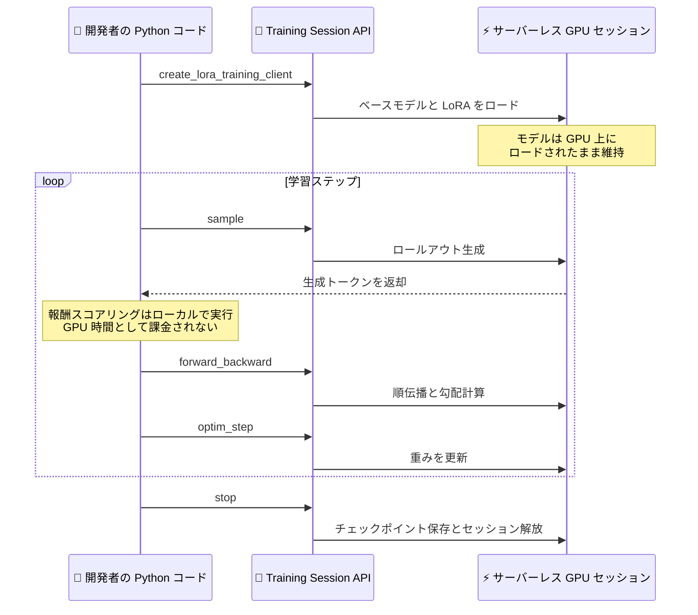

# Amazon SageMaker AI - サーバーレスモデルカスタマイズ向け Training Session API

**リリース日**: 2026 年 10 月 22 日
**サービス**: Amazon SageMaker AI
**機能**: Training Session APIs for Serverless Model Customization

📊 [このアップデートのインフォグラフィックを見る](https://takech9203.github.io/aws-news-summary/20261022-training-session-apis-on-sagemaker-ai.html)

## 概要

Amazon SageMaker AI のサーバーレスモデルカスタマイズにおいて、Training Session API が一般提供 (GA) されました。この API により、GPU インフラストラクチャのプロビジョニングや管理を行うことなく、ポストトレーニングのアルゴリズムを完全に制御できるようになります。

従来のマネージド手法 (SFT、DPO、その他の強化学習手法) では SageMaker がトレーニングを代行しますが、Training Session API では `forward_backward()`、`optim_step()`、`sample()` といったトレーニング操作を、ステートフルなライブセッションに対する API 呼び出しとして実行できます。開発者は独自の Python コードからこれらの操作を組み合わせ、カスタム損失関数、新しい RL 報酬シグナル、データカリキュラム、最新研究のアルゴリズムなど、任意のトレーニング手順を実装できます。

このアップデートの対象ユーザーは、新しいトレーニング手法を実験する ML 研究者、本番 RL システムを運用する高度な ML チーム、GRPO、DRO、DAPO などのカスタム損失関数を構築するチームです。あわせて、すぐに実行できる SFT および RL のレシピを収録した [SageMaker training sessions cookbook](https://github.com/aws/sagemaker-training-sessions-cookbook) も公開されています。

**アップデート前の課題**

- 既存の高レベルなファインチューニング API では、トレーニングループが SFT などの事前定義されたワークフローに制約され、カスタム損失関数の記述や、エラスティックなロールアウトを伴う最先端の強化学習を実行できなかった
- カスタムアルゴリズムを実行するには、GPU クラスターのプロビジョニング、分散実行、障害復旧、チェックポイント管理を自前で構築する必要があった
- API が決めたインフラストラクチャ構成に縛られ、アルゴリズムの反復実験やリージョンをまたぐ RL のスケールにはトレーニングコードの書き換えが必要だった

**アップデート後の改善**

- トレーニング操作を API 呼び出しとして実行し、任意のトレーニング手順 (SFT、PPO、GRPO、マルチターン RL、独自手法) を Python コードで自由に構成できるようになった
- GPU の割り当て、モデルと LoRA のロード、分散実行、障害復旧、チェックポイント保存、セキュリティを SageMaker が管理するため、インフラ運用が不要になった
- モデルが GPU 上にロードされたまま維持されるステートフルセッションにより、ロールアウト生成とポリシー更新の間のコールドスタートが解消された
- 課金は処理トークン単位であり、報酬スコアリングなどのローカル計算は GPU 時間として課金されない

## アーキテクチャ図



開発者は自身の Python コードから Training Session API を呼び出し、ステートフルなサーバーレス GPU セッション上でカスタムトレーニングループを直接オーケストレーションします。

## サービスアップデートの詳細

### 主要機能

1. **操作レベルの API によるトレーニング制御**
   - `forward_backward()` (順伝播と勾配計算)、`optim_step()` (重み更新)、`sample()` (ロールアウト生成) を個別の API 呼び出しとして実行
   - モノリシックなトレーニングスクリプトを提出するのではなく、操作を自由に組み合わせて任意のトレーニング手順を構成
   - 損失の発散や報酬ハッキングのステップ単位でのデバッグが可能

2. **ステートフルなサーバーレスセッション**
   - モデルは API 呼び出しをまたいで GPU 上にロードされたまま維持され、ロールアウト生成とポリシー更新の間にコールドスタートが発生しない
   - インスタンス選択、クラスター管理、キャパシティプランニングは不要で、GPU インフラはサービス側が自動でプロビジョニング
   - 分散実行、勾配同期、テナント分離はサービスが処理

3. **手法に依存しない柔軟性**
   - SFT、PPO、GRPO、マルチターン RL、独自のカスタム手法など、アルゴリズムの選択に制限がない
   - 複数の手順を 1 つのセッション内で連結するマルチステージパイプラインに対応
   - チェックポイントと再開機能を標準で提供

4. **SageMaker training sessions cookbook の公開**
   - すぐに実行できる SFT および RL のレシピを GitHub で公開
   - 独自のトレーニング手法を構築するためのブループリントとして活用可能

## 技術仕様

### サポートモデルとリージョン

| モデル | 利用可能リージョン |
|------|------|
| openai/gpt-oss-20b | us-east-1、us-west-2、ap-south-1 |
| google/gemma-4-31B-it | us-west-2、ap-south-1 |
| Qwen/Qwen3.6-27B | us-west-2、ap-south-1 |
| Qwen/Qwen3.8-27B | us-west-2 |

### クォータ

| 項目 | デフォルト値 | 調整可否 |
|------|------|------|
| 同時実行可能なファインチューニングトレーニングセッションの最大数 | 2 | 可能 (Service Quotas から申請) |

### コード例

公式ドキュメントに記載されているカスタム強化学習ループの例です。

```python
from sagemaker.train.training_session import ServiceClient, AdamParams

svc = ServiceClient(region="us-west-2", role_arn="arn:aws:iam::111122223333:role/MyRole")
tc = svc.create_lora_training_client(base_model="openai/gpt-oss-20b", rank=32, alpha=64)

# オンポリシーサンプリングを用いたカスタム強化学習ループ
sc = tc.create_sampling_client()
for step in range(num_steps):
    ops = [sc.sample(p, num_samples=4, sampling_params=params) for p in prompts]
    rollouts = [op.result() for op in ops]
    tc.forward_backward(build_batch(rollouts), loss_fn="ppo").result()
    tc.optim_step(AdamParams(learning_rate=5e-5)).result()
    sc = tc.save_weights_and_get_sampling_client()

tc.stop()
```

## 設定方法

### 前提条件

1. AWS アカウントと、SageMaker AI Training Session API に必要な権限を持つ IAM ロール
2. SageMaker Python SDK のインストール (または SageMaker Studio ノートブック環境)
3. 利用可能リージョン (us-east-1、us-west-2、ap-south-1) でのサービス利用

### 手順

#### ステップ 1: SageMaker Python SDK のインストールと cookbook の取得

```bash
pip install sagemaker
git clone https://github.com/aws/sagemaker-training-sessions-cookbook.git
```

SageMaker Python SDK をインストールし、SFT および RL のレシピを収録した cookbook リポジトリをクローンします。SageMaker Studio ノートブックを起動してコーディングエージェントを接続する方法も利用できます。

#### ステップ 2: トレーニングクライアントの作成

```python
from sagemaker.train.training_session import ServiceClient

svc = ServiceClient(region="us-west-2", role_arn="arn:aws:iam::111122223333:role/MyRole")
tc = svc.create_lora_training_client(base_model="openai/gpt-oss-20b", rank=32, alpha=64)
```

サービスクライアントを初期化し、ベースモデルと LoRA パラメータ (rank、alpha) を指定してトレーニングクライアントを作成します。この時点で SageMaker が GPU を割り当て、モデルと LoRA をロードします。

#### ステップ 3: トレーニングループの実装とセッションの終了

```python
tc.forward_backward(batch, loss_fn="ppo").result()
tc.optim_step(AdamParams(learning_rate=5e-5)).result()
tc.stop()
```

`forward_backward()` と `optim_step()` を組み合わせて独自のトレーニングループを実装します。完了後は `stop()` でセッションを終了します。チェックポイントの保存と再開は組み込みで提供されます。

## メリット

### ビジネス面

- **インフラ運用コストの削減**: GPU クラスターのプロビジョニング、キャパシティプランニング、障害対応が不要になり、チームはアルゴリズム開発に集中できる
- **実験サイクルの高速化**: 最新研究のアルゴリズムを分散トレーニングコードの書き換えなしに試せるため、モデル改善の反復速度が向上する
- **コスト効率の高い課金**: 処理トークン単位の課金であり、報酬スコアリングなどのローカル計算は GPU 時間として課金されない

### 技術面

- **完全なアルゴリズム制御**: カスタム損失関数、新しい RL 報酬シグナル、データカリキュラムなど、事前定義ワークフローでは不可能だった手法を実装できる
- **コールドスタートの解消**: ステートフルセッションによりモデルが GPU 上に維持され、ロールアウト生成とポリシー更新を効率的に往復できる
- **マネージドな分散実行**: 勾配同期、障害復旧、チェックポイント保存、テナント分離をサービスが処理する

## デメリット・制約事項

### 制限事項

- 利用可能リージョンは米国東部 (バージニア北部)、米国西部 (オレゴン)、アジアパシフィック (ムンバイ) の 3 リージョンに限定される (東京リージョンは未対応)
- サポートされるベースモデルは openai/gpt-oss-20b、google/gemma-4-31B-it、Qwen/Qwen3.6-27B、Qwen/Qwen3.8-27B に限定され、モデルによって利用可能リージョンが異なる
- 同時実行可能なトレーニングセッション数はデフォルトで 2 (クォータ引き上げ申請で調整可能)

### 考慮すべき点

- トレーニングループを駆動する Python コードの記述が必要なため、プログラミング不要のマネージドワークフローを求める場合はサーバーレスモデルカスタマイズの既存機能が適している
- 完結したトレーニングスクリプトをジョブとして投入したい場合は、従来の SageMaker AI Training Jobs が引き続き選択肢となる
- 課金は Prefill、Sample、Train の 3 つのディメンションで発生するため、トレーニングループの設計 (サンプリング数やステップ数) がコストに直結する

## ユースケース

### ユースケース 1: カスタム報酬シグナルを用いた強化学習

**シナリオ**: 独自のビジネス指標に基づく報酬関数で LLM をアラインメントしたいが、既存のマネージド RL 手法では報酬計算をカスタマイズできない。

**実装例**:
```python
sc = tc.create_sampling_client()
for step in range(num_steps):
    rollouts = [sc.sample(p, num_samples=4, sampling_params=params).result() for p in prompts]
    # 報酬計算はローカルで実行 (GPU 課金なし)
    rewards = [custom_reward_fn(r) for r in rollouts]
    tc.forward_backward(build_batch(rollouts, rewards), loss_fn="ppo").result()
    tc.optim_step(AdamParams(learning_rate=5e-5)).result()
```

**効果**: GPU インフラを管理することなく、独自の報酬ロジックを組み込んだオンポリシー RL を実行できる。報酬スコアリングはローカル計算のため GPU 時間として課金されない。

### ユースケース 2: 最新研究アルゴリズムの迅速な検証

**シナリオ**: GRPO や DAPO など、論文で発表された新しいポストトレーニング手法を自社モデルで検証したいが、分散トレーニング環境の構築に時間がかかる。

**実装例**:
```python
# cookbook のレシピをベースに損失関数と更新手順をカスタマイズ
tc.forward_backward(batch, loss_fn="custom_grpo").result()
tc.optim_step(AdamParams(learning_rate=1e-5)).result()
```

**効果**: 分散実行や勾配同期はサービスが処理するため、アルゴリズムのロジックのみに集中して数日ではなく数時間で検証を開始できる。

### ユースケース 3: マルチステージトレーニングパイプライン

**シナリオ**: SFT で基礎的な指示追従能力を獲得した後、同じセッション内で RL による選好最適化を続けて実行したい。

**実装例**:
```python
# ステージ 1: SFT
for batch in sft_dataloader:
    tc.forward_backward(batch, loss_fn="sft").result()
    tc.optim_step(AdamParams(learning_rate=2e-5)).result()

# ステージ 2: 同一セッションで RL に移行 (モデルはロードされたまま)
sc = tc.save_weights_and_get_sampling_client()
```

**効果**: モデルが GPU 上にロードされたまま複数の手順を連結できるため、ステージ間のモデル再ロードやコールドスタートが発生しない。

## 料金

課金は処理トークン単位で行われます。報酬スコアリングなどのローカル計算は GPU 時間として課金されません。料金は以下の 3 つのディメンションに基づきます。

| ディメンション | 内容 |
|--------|------------------|
| Prefill | 各トレーニングステップの開始時にモデルへ入力されるトークン (プロンプト、会話履歴、コンテキスト) の処理コスト |
| Sample | トレーニングロールアウト中にモデルが生成するトークンのコスト |
| Train | 報酬シグナルに基づいてモデルの重みを更新するバックワードパスのコスト |

最新の料金詳細は [SageMaker AI 料金ページ](https://aws.amazon.com/sagemaker/ai/pricing/) を参照してください。

## 利用可能リージョン

- 米国東部 (バージニア北部) : us-east-1
- 米国西部 (オレゴン) : us-west-2
- アジアパシフィック (ムンバイ) : ap-south-1

モデルによって利用可能なリージョンが異なります。詳細は「技術仕様」セクションのサポートモデル表を参照してください。

## 関連サービス・機能

- **SageMaker AI サーバーレスモデルカスタマイズ**: SFT、DPO などのマネージド手法を提供する既存機能。プログラミング不要のワークフローを求める場合はこちらが適している
- **SageMaker AI Training Jobs**: 完結したトレーニングスクリプトをジョブとして投入する従来の方式。Training Session API と相互補完の関係にある
- **SageMaker Studio**: ノートブック環境から Training Session API を利用でき、コーディングエージェントとの連携も可能
- **SageMaker Python SDK**: Training Session API のクライアントとなる `sagemaker.train.training_session` モジュールを提供

## 参考リンク

- 📊 [インフォグラフィック](https://takech9203.github.io/aws-news-summary/20261022-training-session-apis-on-sagemaker-ai.html)
- [公式発表 (What's New)](https://aws.amazon.com/about-aws/whats-new/2026/10/training-session-apis-on-sagemaker-ai)
- [ドキュメント: Training session APIs](https://docs.aws.amazon.com/sagemaker/latest/dg/customizing-models-training-sessions.html)
- [SageMaker training sessions cookbook (GitHub)](https://github.com/aws/sagemaker-training-sessions-cookbook)
- [SageMaker AI モデルカスタマイズ](https://aws.amazon.com/sagemaker/ai/model-customization/)
- [料金ページ](https://aws.amazon.com/sagemaker/ai/pricing/)

## まとめ

Training Session API の登場により、GPU インフラの管理から解放されたまま、ポストトレーニングアルゴリズムを操作レベルで完全に制御できるようになりました。カスタム RL や新しい損失関数の実験を計画している ML チームは、公開された cookbook のレシピから検証を開始することを推奨します。東京リージョンは未対応のため、利用時は us-east-1、us-west-2、ap-south-1 のいずれかを選択する必要があります。
