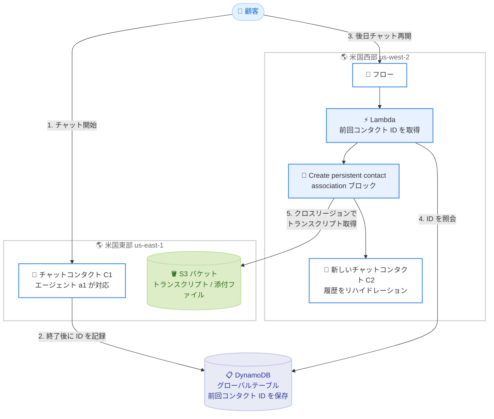

# Amazon Connect - Customer Global Resiliency がリンクされたリージョン間での永続チャットをサポート

**リリース日**: 2026 年 10 月 23 日
**サービス**: Amazon Connect
**機能**: Customer Global Resiliency (ACGR) における永続チャット (Persistent Chat) のクロスリージョンサポート

📊 [このアップデートのインフォグラフィックを見る](https://takech9203.github.io/aws-news-summary/20261023-amazon-connect-global-resiliency-persistent-chat.html)

## 概要

Amazon Connect Customer Global Resiliency (ACGR) が、リンクされた AWS リージョン間での永続チャット (Persistent Chat) をサポートしました。エンドユーザーは、過去のチャット会話をコンテキスト、メタデータ、トランスクリプト、チャット添付ファイルとともに引き継ぎ、どちらのアクティブリージョンからでも会話を再開できます。例えば、米国東部 (バージニア北部) リージョンでチャットを開始したユーザーが、後からリンクされた米国西部 (オレゴン) リージョンで同じ会話を完全な履歴付きで継続できます。

この機能は「チャットリハイドレーション (chat rehydration)」という仕組みによって実現されます。過去のチャットコンタクトのトランスクリプトと添付ファイルをリージョンをまたいで取得し、顧客とエージェントの双方に表示することで、顧客は同じ説明を繰り返す必要がなくなり、エージェントはどのリージョンで対応していても会話の全体像を把握したパーソナライズされた対応を提供できます。

本機能を利用するには、ACGR の Global routing へのオンボーディングが必要です。Global routing は、2026 年 9 月 1 日以降に作成された新規 ACGR インスタンスではデフォルトで有効化されており、既存インスタンスでは AWS サポートへの依頼により有効化できます。

**アップデート前の課題**

- 以前は、永続チャットは単一リージョン内でのみ機能し、リージョンをまたいで過去の会話を再開することができなかった
- ACGR 環境でトラフィックを別リージョンにシフトした場合、顧客は過去のチャット履歴を引き継げず、状況を最初から説明し直す必要があった
- エージェントは別リージョンで発生した過去の会話のトランスクリプトや添付ファイルを参照できず、一貫したパーソナライズ対応が困難だった

**アップデート後の改善**

- リンクされたリージョン間でコンテキスト、メタデータ、トランスクリプト、チャット添付ファイルを引き継いで会話を再開できるようになった
- どちらのリージョンに新しいチャットがルーティングされても、顧客は繰り返しの説明が不要になり、一貫した顧客体験を提供できるようになった
- エージェントは担当リージョンに関係なく完全な会話履歴を参照でき、業務継続性 (BC) 構成や Global routing によるアクティブ / アクティブ構成でもチャットチャネルの品質を維持できるようになった

## アーキテクチャ図



顧客が米国東部で開始したチャットを、後日米国西部で再開するフローの例です。外部データストア (DynamoDB グローバルテーブルなど) に保存した前回コンタクト ID を Lambda で取得し、フロー内の「Create persistent contact association」ブロックに渡すことで、過去のトランスクリプトと添付ファイルがクロスリージョンでリハイドレーションされます。

## サービスアップデートの詳細

### 主要機能

1. **リージョンをまたぐチャットリハイドレーション**
   - 過去のチャットコンタクトのトランスクリプトと添付ファイルを取得し、顧客とエージェントに表示する
   - コンタクトがどちらのアクティブリージョンで処理されても、完全な会話履歴を参照可能
   - リハイドレーションのタイプは 2 種類から選択できる
     - `ENTIRE_PAST_SESSION`: 新しいチャットセッションを開始し、過去のセッションの全チャットセグメントをリハイドレーション
     - `FROM_SEGMENT`: 新しいセッションを開始し、指定した過去のチャットセグメントからリハイドレーション

2. **「Create persistent contact association」フローブロックによる有効化**
   - 前回のコンタクト ID をフローブロックに渡すことで永続チャットを確立する
   - StartChatContact API で前回コンタクト ID を渡すことも可能だが、クロスリージョンの永続チャットではフローブロックの使用が推奨される
   - 前回コンタクト ID が存在しない場合でも、ブロックはチャットコンタクトを正常に作成する

3. **Global Resiliency for chat の機能セットの一部**
   - チャットチャネルの Global routing により、エージェントを両リージョンに分散して常時アクティブ / アクティブ運用が可能
   - 代替リージョンで新規チャットコンタクトを開始し、チャットチャネルの業務継続性を維持
   - 今回の機能により、リージョンをまたいだ会話の再開まで対応し、チャットのクロスリージョン体験が完結

## 技術仕様

### 前回コンタクト ID の管理

| 項目 | 詳細 |
|------|------|
| コンタクト ID の自動設定 | なし。Amazon Connect は前回コンタクト ID を自動では設定しないため、顧客ごとに ID を保存する外部データストアを顧客側で用意する必要がある |
| データストアの要件 | ACGR のリンクされたリージョン間でエントリをレプリケーションし、両リージョンから参照できるように設計する (例: DynamoDB グローバルテーブル) |
| エントリ作成方法 1 | チャットメッセージストリーミングを使用し、チャット終了時にエントリを作成 |
| エントリ作成方法 2 | コンタクトイベントを監視し、Lambda 関数でデータストアにエントリを作成 |
| フローへの受け渡し | コンタクト属性を通じて前回コンタクト ID を動的に「Create persistent contact association」ブロックへ渡す |

### クロスリージョンアクセスに必要な権限

チャットのトランスクリプトと添付ファイルが保存されている S3 バケットと KMS キーに対し、相手リージョンの Amazon Connect サービスリンクロール (SLR) のアクセス許可を追加する必要があります。

| シナリオ | 必要な権限更新 |
|------|------|
| AWS マネージド KMS キー + Connect インスタンスが作成した S3 バケット | 更新不要。権限は自動的にレプリケーションされる |
| AWS マネージド KMS キー + ユーザー作成の S3 バケット | 両リージョンで S3 バケットポリシーに相手リージョンの SLR を追加 |
| カスタマーマネージドキー CMK + ユーザー作成の S3 バケット | 両リージョンで S3 バケットポリシーと KMS キーポリシーの両方に相手リージョンの SLR を追加 |
| カスタマーマネージドキー CMK + Connect インスタンスが作成した S3 バケット | 両リージョンで KMS キーポリシーに相手リージョンの SLR を追加 |

### S3 バケットポリシーの例

```json
{
    "Version": "2012-10-17",
    "Statement": [
        {
            "Sid": "OptionDCrossRegionReplicaSLRRead",
            "Effect": "Allow",
            "Principal": {
                "AWS": "arn:aws:iam::123456789012:role/aws-service-role/connect.amazonaws.com/AWSServiceRoleForAmazonConnect_unique-suffix"
            },
            "Action": [
                "s3:GetObject",
                "s3:GetObjectAcl",
                "s3:ListBucket",
                "s3:GetBucketLocation"
            ],
            "Resource": [
                "arn:aws:s3:::bucket-name",
                "arn:aws:s3:::bucket-name/*"
            ]
        }
    ]
}
```

### KMS キーポリシーの例

```json
{
    "Sid": "OptionDCrossRegionReplicaSLRDecrypt",
    "Effect": "Allow",
    "Principal": {
        "AWS": "arn:aws:iam::123456789012:role/aws-service-role/connect.amazonaws.com/AWSServiceRoleForAmazonConnect_unique-suffix"
    },
    "Action": [
        "kms:Decrypt",
        "kms:GenerateDataKey",
        "kms:DescribeKey"
    ],
    "Resource": "arn:aws:kms:us-east-1:123456789012:key/key-id"
}
```

アカウント ID と `AWSServiceRoleForAmazonConnect_` のサフィックスは、相手リージョンの Connect インスタンスの SLR (マネジメントコンソールの「アカウント概要」ページで確認可能) に置き換えます。

### API 変更履歴

| 日付 | サービス | 変更内容 |
|------|----------|----------|
| 2026/10/22 | [connect](https://awsapichanges.com/archive/changes/444e17-connect.html) | 1 new 1 updated api methods - レプリケーションエラーを顧客側でクエリ可能にするサポートを追加 (Global Resiliency 関連の変更) |

本機能自体は既存の「Create persistent contact association」フローブロックと StartChatContact API を利用するため、永続チャット固有の新規 API は追加されていません。

## 設定方法

### 前提条件

1. Amazon Connect Customer Global Resiliency (ACGR) をセットアップし、2 つのリージョン間でインスタンスをリンクしていること
2. Global routing にオンボーディング済みであること (2026 年 9 月 1 日以降に作成された新規 ACGR インスタンスはデフォルトで有効。既存インスタンスは AWS サポートへ依頼)
3. 前回コンタクト ID を保存する外部データストア (DynamoDB グローバルテーブルなど) を両リージョンで利用できること
4. トランスクリプト / 添付ファイル用の S3 バケットと KMS キーに、相手リージョンの SLR のアクセス許可を設定済みであること

### 手順

#### ステップ 1: 前回コンタクト ID を保存するデータストアを構築する

```bash
aws dynamodb create-table \
  --table-name chat-contact-history \
  --attribute-definitions AttributeName=customerId,AttributeType=S \
  --key-schema AttributeName=customerId,KeyType=HASH \
  --billing-mode PAY_PER_REQUEST \
  --region us-east-1

aws dynamodb update-table \
  --table-name chat-contact-history \
  --replica-updates '[{"Create": {"RegionName": "us-west-2"}}]' \
  --region us-east-1
```

顧客 ID をキーとして前回コンタクト ID を保存する DynamoDB テーブルを作成し、グローバルテーブルとしてリンク先リージョン (us-west-2) にレプリカを追加しています。これにより、どちらのリージョンからも前回コンタクト ID を参照できます。

#### ステップ 2: チャット終了時にコンタクト ID を記録する仕組みを実装する

チャットメッセージストリーミング、またはコンタクトイベント + Lambda 関数のいずれかの方法で、チャット終了時にデータストアへエントリを作成します。

```python
# コンタクトイベントを処理する Lambda 関数の例
import boto3

dynamodb = boto3.resource("dynamodb")
table = dynamodb.Table("chat-contact-history")

def handler(event, context):
    detail = event["detail"]
    if detail["channel"] == "CHAT" and detail["eventType"] == "DISCONNECTED":
        table.put_item(Item={
            "customerId": detail["contactId"],  # 顧客を識別するキーに置き換える
            "previousContactId": detail["contactId"]
        })
```

EventBridge 経由で受信したコンタクトイベントのうち、チャットの切断イベントを検知してデータストアに前回コンタクト ID を書き込んでいます。

#### ステップ 3: S3 バケットと KMS キーにクロスリージョン権限を付与する

「技術仕様」セクションのポリシー例を参考に、両リージョンの S3 バケットポリシーと KMS キーポリシーへ相手リージョンの Connect インスタンスの SLR を追加します。SLR の ARN は各リージョンのマネジメントコンソールの「アカウント概要」ページで確認できます。

#### ステップ 4: フローに「Create persistent contact association」ブロックを追加する

1. チャットの着信フローに Lambda 関数呼び出しブロックを追加し、データストアから前回コンタクト ID を取得してコンタクト属性に設定する
2. 「Create persistent contact association」ブロックを追加し、コンタクト属性から前回コンタクト ID を動的に渡す
3. ブロック内でリハイドレーションタイプ (`ENTIRE_PAST_SESSION` または `FROM_SEGMENT`) を選択する
4. 両リージョンのフローに同じ構成を適用し、どちらのリージョンに着信しても会話を再開できるようにする

#### ステップ 5: 動作を検証する

一方のリージョンでチャットを開始・終了した後、トラフィック分散を変更するなどして別リージョンでチャットを再開し、トランスクリプトと添付ファイルが顧客とエージェントの双方に表示されることを確認します。

## メリット

### ビジネス面

- **一貫した顧客体験**: 顧客はリージョンをまたいでも同じ説明を繰り返す必要がなく、会話の文脈を維持したままサポートを受けられる
- **業務継続性の強化**: 災害対策やリージョン障害時のトラフィックシフト後も、チャットチャネルの会話履歴が途切れず、サービス品質を維持できる
- **規制要件への対応**: 地理的に離れた拠点間での冗長性を求める規制要件を満たしつつ、顧客体験を犠牲にしないコンタクトセンターを構築できる

### 技術面

- **アクティブ / アクティブ構成との親和性**: Global routing と組み合わせることで、両リージョンを常時アクティブとして運用しながら永続チャットを提供できる
- **クロスリージョンのリハイドレーション**: トランスクリプトと添付ファイルを相手リージョンの S3 バケットから安全に取得する仕組みが標準で提供される
- **柔軟なリハイドレーション制御**: セッション全体 (`ENTIRE_PAST_SESSION`) または特定セグメント (`FROM_SEGMENT`) からの再開を要件に応じて選択できる

## デメリット・制約事項

### 制限事項

- 利用には Global routing へのオンボーディングが必須 (2026 年 9 月 1 日より前に作成された既存 ACGR インスタンスは AWS サポートまたはアカウントチームへの依頼が必要)
- 前回コンタクト ID は Amazon Connect が自動では設定しないため、外部データストアの構築・運用とリージョン間レプリケーションを顧客側で実装する必要がある
- 添付ファイルの設定 (許可するファイルタイプ、サイズ上限) は ACGR でレプリケーションされないため、各リージョンで個別に設定する必要がある
- チャットメッセージストリーミングは、コンタクトが発生したリージョンでのみ利用可能 (例: us-east-1 で発生し us-west-2 のエージェントが対応したチャットのストリーミングは us-east-1 で利用)

### 考慮すべき点

- ユーザー作成の S3 バケットやカスタマーマネージド KMS キーを使用している場合、両リージョンでバケットポリシーと KMS キーポリシーに相手リージョンの SLR を追加する権限設定作業が発生する
- チャットのクイックレスポンスなど一部のリソースは ACGR で自動レプリケーションされないため、一貫したエージェント体験のためには自前でのレプリケーションが必要
- StartChatContact API でも前回コンタクト ID を渡せるが、クロスリージョンの永続チャットでは「Create persistent contact association」フローブロックの使用が推奨される

## ユースケース

### ユースケース 1: リージョン障害時のチャット会話の継続

**シナリオ**: 金融機関のコンタクトセンターが us-east-1 と us-west-2 で ACGR を構成している。us-east-1 で障害が発生し、トラフィックを 100% us-west-2 にシフトした。障害前にチャットで問い合わせ中だった顧客が再度チャットを開始する。

**実装例**:
```
1. UpdateTrafficDistribution API でトラフィックを us-west-2 に 100% シフト
2. 顧客の新規チャットは us-west-2 の ACGR インスタンスに着信
3. フロー内の Lambda が DynamoDB グローバルテーブルから前回コンタクト ID を取得
4. Create persistent contact association ブロックで ENTIRE_PAST_SESSION を指定
```

**効果**: 障害によるリージョン切り替え後も顧客は会話を最初からやり直す必要がなく、エージェントは完全な履歴を参照して対応を継続できる。

### ユースケース 2: アクティブ / アクティブ構成でのグローバルカスタマーサポート

**シナリオ**: グローバル EC 事業者が Global routing を有効化し、エージェントを東京リージョンと大阪リージョンに 50% ずつ分散して運用している。顧客が日中に開始したチャットを、夜間に再開する。

**実装例**:
```
1. トラフィック分散グループでエージェントを両リージョンに 50% ずつ配置
2. チャット終了時にコンタクトイベント経由で前回コンタクト ID を記録
3. 再開時はどちらのリージョンに着信しても同一のフロー構成でリハイドレーション
```

**効果**: どちらのリージョンのエージェントが対応しても、顧客のコンテキストと添付ファイルを引き継いだパーソナライズされたサポートを提供できる。

### ユースケース 3: 非同期チャットによる長期的な問い合わせ対応

**シナリオ**: 保険会社で、顧客が保険金請求の手続きについて数日にわたり断続的にチャットで問い合わせる。請求書類の画像を添付ファイルとして送信しており、途中でトラフィック分散の変更があった。

**実装例**:
```
1. 顧客 ID をキーに過去のコンタクト ID チェーンをデータストアで管理
2. FROM_SEGMENT を使用して、直近の関連セグメントから会話を再開
3. S3 クロスリージョン権限により過去の添付ファイルも表示
```

**効果**: 数日にわたる非同期の問い合わせでも、添付ファイルを含む全履歴がリージョンをまたいで維持され、手続きがスムーズに進行する。

## 料金

永続チャットのクロスリージョンサポート自体に追加料金は発生しません。Amazon Connect のチャット料金は、送受信されたメッセージ数に基づく従量課金です。外部データストア (DynamoDB グローバルテーブルなど) や Lambda 関数、S3 ストレージの利用料金は別途発生します。

詳細は [Amazon Connect 料金ページ](https://aws.amazon.com/connect/pricing/) を参照してください。

## 利用可能リージョン

Amazon Connect Customer Global Resiliency がサポートされるすべての AWS リージョンで利用可能です。ACGR は以下のリージョンペアで利用できます。

- 米国東部 (バージニア北部) ⇔ 米国西部 (オレゴン)
- 欧州 (ロンドン) ⇔ 欧州 (フランクフルト)
- アジアパシフィック (東京) ⇔ アジアパシフィック (大阪)

## 関連サービス・機能

- **Amazon Connect Global routing**: 本機能の前提となる機能。リンクされた 2 つのリージョンの両方をアクティブとして、コンタクトを両リージョンのエージェントへルーティングする
- **Amazon DynamoDB グローバルテーブル**: 前回コンタクト ID をリージョン間でレプリケーションする外部データストアの推奨実装例
- **AWS Lambda**: コンタクトイベントからデータストアへのエントリ作成や、フロー内での前回コンタクト ID の取得に使用
- **Amazon S3 / AWS KMS**: チャットトランスクリプトと添付ファイルの保存・暗号化。クロスリージョンアクセスのための権限設定が必要

## 参考リンク

- 📊 [インフォグラフィック](https://takech9203.github.io/aws-news-summary/20261023-amazon-connect-global-resiliency-persistent-chat.html)
- [公式発表 (What's New)](https://aws.amazon.com/about-aws/whats-new/2026/10/amazon-connect-global-resiliency-persistent-chat)
- [ドキュメント: Enable users to resume chat conversations across active Regions](https://docs.aws.amazon.com/connect/latest/adminguide/resume-chat-across-regions.html)
- [ドキュメント: Global Resiliency for chat](https://docs.aws.amazon.com/connect/latest/adminguide/global-resiliency-for-chat.html)
- [ドキュメント: Global routing across ACGR Regions](https://docs.aws.amazon.com/connect/latest/adminguide/global-routing-across-acgr-regions.html)
- [ドキュメント: Set up Connect Customer Global Resiliency](https://docs.aws.amazon.com/connect/latest/adminguide/setup-connect-global-resiliency.html)
- [ドキュメント: Get started with Connect Customer Global Resiliency](https://docs.aws.amazon.com/connect/latest/adminguide/get-started-connect-global-resiliency.html)
- [料金ページ](https://aws.amazon.com/connect/pricing/)

## まとめ

Amazon Connect Customer Global Resiliency の永続チャット対応により、リージョンをまたぐアクティブ / アクティブ構成や災害対策構成でも、チャットチャネルの会話コンテキストを途切れさせない顧客体験を実現できるようになりました。すでに ACGR を利用中または検討中の場合は、Global routing へのオンボーディングを確認した上で、前回コンタクト ID を管理する外部データストアの設計と、S3 / KMS のクロスリージョン権限設定から着手することを推奨します。
