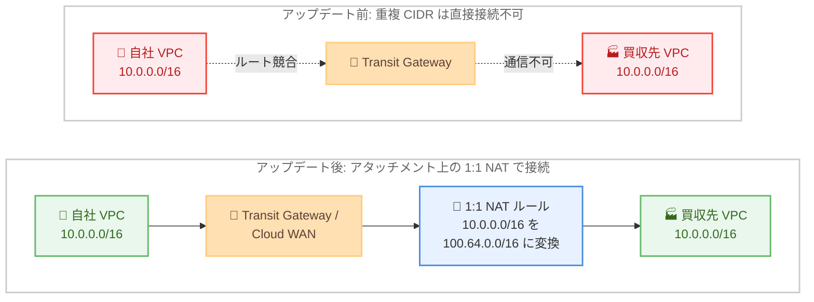

# AWS Transit Gateway / AWS Cloud WAN - アタッチメントでの 1:1 NAT サポート

**リリース日**: 2026 年 10 月 23 日
**サービス**: AWS Transit Gateway、AWS Cloud WAN
**機能**: Regional Private NAT Gateway 統合によるアタッチメント上のマネージド 1 対 1 NAT

📊 [このアップデートのインフォグラフィックを見る](https://takech9203.github.io/aws-news-summary/20261023-aws-transit-gateway-cloud-wan-1-1-nat.html)

## 概要

AWS Transit Gateway と AWS Cloud WAN が、Regional Private NAT Gateway との統合により、アタッチメント上で直接マネージドな 1 対 1 NAT (1:1 NAT) を提供できるようになりました。これにより、同一の IP アドレスレンジ (重複 CIDR) を持つプライベートネットワーク同士を、どちらのネットワークも再番号付けすることなく接続できます。

重複 CIDR の問題は、M&A (企業の合併・買収) による既存ネットワークの統合、Site-to-Site VPN を介したパートナーネットワークとの接続、マルチクラウド構成、独立してプロビジョニングされた VPC 同士の相互接続などで頻繁に発生します。従来、こうしたネットワーク同士は直接通信できず、IP アドレスの再設計やセルフマネージドな NAT アプライアンスの導入が必要でした。

今回のアップデートにより、アタッチメント上でアドレス変換ルール (送信元 CIDR をどのプライベート IP レンジにマッピングするか) を定義するだけで、AWS が変換処理を双方向に自動適用します。リターントラフィック用のルールを別途記述する必要はなく、NAT 機能の運用・スケーリング・管理はすべて AWS が行います。

**アップデート前の課題**

- 重複 CIDR を持つネットワーク同士は Transit Gateway / Cloud WAN 経由で直接通信できず、どちらかのネットワークの IP アドレスを再番号付けする必要があった
- 再番号付けを避ける場合、EC2 上に NAT アプライアンスを自前で構築・運用する必要があり、可用性設計やスケーリング、パッチ適用の負担が発生していた
- 行きと戻りのトラフィックに対して個別の NAT ルールを設計・管理する必要があり、設定が複雑でミスが発生しやすかった

**アップデート後の改善**

- アタッチメント上の NAT ルール定義のみで、重複 CIDR を持つネットワーク同士を再番号付けなしで接続できるようになった
- 変換は双方向に自動適用されるため、リターントラフィック用のルール記述が不要になった
- NAT 機能はフルマネージドで AWS が運用・スケール・管理するため、NAT アプライアンスの導入・運用が不要になった
- AWS Management Console、AWS CLI、SDK、CloudFormation から数分で設定でき、CloudWatch メトリクスと EventBridge イベントで監視できる

## アーキテクチャ図



アップデート前は同一 CIDR (10.0.0.0/16) を持つ VPC 同士はルートが競合し通信できませんでした。アップデート後は、買収先 VPC のアタッチメントに 1:1 NAT ルールを定義することで、自社 VPC からは買収先 VPC が 100.64.0.0/16 として見え、再番号付けなしで双方向の通信が可能になります。

## サービスアップデートの詳細

### 主要機能

1. **アタッチメント上のマネージド 1 対 1 NAT**
   - Regional Private NAT Gateway との統合により、Transit Gateway / Cloud WAN のアタッチメント上で直接アドレス変換を実行
   - 送信元 CIDR をどのプライベート IP レンジにマッピングするかをアドレス変換ルールとして定義
   - 1 対 1 NAT のため、変換後も個々のホストを一意に識別でき、通信の発信元を特定可能

2. **双方向の自動変換**
   - 変換ルールは双方向に自動適用され、リターントラフィック用のルールを別途記述する必要がない
   - 行きと戻りの整合性を AWS が保証するため、非対称ルーティングによる通信断のリスクを低減

3. **幅広いアタッチメントタイプへの対応**
   - Amazon VPC アタッチメント
   - AWS Site-to-Site VPN アタッチメント
   - AWS Direct Connect アタッチメント
   - Transit Gateway Connect 経由で接続された SD-WAN アプライアンス

4. **フルマネージドな運用**
   - NAT 機能の運用、スケーリング、管理はすべて AWS が実施
   - AWS Management Console、AWS CLI、SDK、CloudFormation から数分で設定可能
   - CloudWatch メトリクスと EventBridge イベントによる監視に対応

## 技術仕様

### 機能概要

| 項目 | 詳細 |
|------|------|
| NAT 方式 | 1 対 1 NAT (送信元 CIDR をプライベート IP レンジへマッピング) |
| 基盤技術 | Regional Private NAT Gateway との統合 |
| 変換の方向 | 双方向に自動適用 (リターントラフィックルール不要) |
| 対応アタッチメント | VPC、Site-to-Site VPN、Direct Connect、Transit Gateway Connect (SD-WAN) |
| 設定方法 | AWS Management Console、AWS CLI、SDK、AWS CloudFormation |
| 監視 | Amazon CloudWatch メトリクス、Amazon EventBridge イベント |

### API 変更履歴

| 日付 | サービス | 変更内容 |
|------|----------|----------|
| 2026/10/22 | [Amazon EC2](https://awsapichanges.com/archive/changes/444e17-ec2.html) | 2 new 5 updated api methods - `ModifyTransitGatewayAttachmentNatConfiguration` で NAT の有効化と NAT ルールの設定、`GetTransitGatewayAttachmentNatConfiguration` で設定の参照が可能に |
| 2026/10/22 | [AWS Network Manager](https://awsapichanges.com/archive/changes/444e17-networkmanager.html) | 2 new 25 updated api methods - Cloud WAN のコアネットワークアタッチメント向けに `UpdateAttachmentNatConfiguration` で NAT の有効化と NAT ルールの設定、`ListAttachmentNatConfigurations` で設定の一覧表示が可能に |

## 設定方法

### 前提条件

1. Transit Gateway または Cloud WAN コアネットワークが構築済みであること
2. 接続対象のネットワーク (VPC、VPN、Direct Connect、Connect アタッチメント) が Transit Gateway / Cloud WAN にアタッチされていること
3. 変換先として使用する、既存ネットワークと重複しないプライベート IP レンジ (例: 100.64.0.0/16) を確保していること

### 手順

#### ステップ 1: 変換先 IP レンジの設計

重複 CIDR を持つネットワークのうち、どちらのアタッチメントで変換を行うかを決定し、変換先のプライベート IP レンジを設計します。他のネットワークと重複しないレンジ (RFC 6598 の 100.64.0.0/10 など) の利用が候補になります。

#### ステップ 2: アタッチメントで NAT を有効化しルールを設定

```bash
# Transit Gateway アタッチメントの NAT 設定を変更 (API: ModifyTransitGatewayAttachmentNatConfiguration)
aws ec2 modify-transit-gateway-attachment-nat-configuration \
    --transit-gateway-attachment-id <アタッチメント ID> \
    ...
```

対象アタッチメントで NAT を有効化し、送信元 CIDR (例: 10.0.0.0/16) を変換先レンジ (例: 100.64.0.0/16) にマッピングするアドレス変換ルールを設定します。Cloud WAN の場合は Network Manager の `UpdateAttachmentNatConfiguration` API を使用します。具体的なパラメータは各サービスの公式ドキュメントを参照してください。

#### ステップ 3: 設定の確認とルーティングの更新

```bash
# Transit Gateway アタッチメントの NAT 設定を確認 (API: GetTransitGatewayAttachmentNatConfiguration)
aws ec2 get-transit-gateway-attachment-nat-configuration \
    --transit-gateway-attachment-id <アタッチメント ID>
```

設定した NAT ルールを確認します。対向ネットワーク側のルートテーブルには、変換後のレンジ (例: 100.64.0.0/16) を宛先とするルートを設定し、疎通を確認します。

#### ステップ 4: 監視の設定

CloudWatch メトリクスで NAT の稼働状況とトラフィックを監視し、EventBridge イベントで状態変化を検知する仕組みを構成します。

## メリット

### ビジネス面

- **M&A 後のネットワーク統合を迅速化**: 買収先ネットワークの再番号付けという大規模プロジェクトを回避し、数分の設定で接続を確立できるため、統合のリードタイムとコストを大幅に削減できる
- **パートナー接続の障壁を低減**: パートナーの IP アドレス体系に依存せず Site-to-Site VPN で接続できるため、ビジネス連携の開始を加速できる
- **運用コストの削減**: セルフマネージド NAT アプライアンスの構築・運用 (冗長化、スケーリング、パッチ適用) が不要になる

### 技術面

- **双方向自動変換による設計の簡素化**: リターントラフィックルールが不要なため、非対称ルーティングや戻りルールの記述ミスといった典型的な NAT 設計の落とし穴を回避できる
- **幅広い接続形態への適用**: VPC、VPN、Direct Connect、Transit Gateway Connect (SD-WAN) と主要なアタッチメントタイプを横断して同じ仕組みで変換できる
- **フルマネージドなスケーラビリティ**: NAT 処理のスケーリングと可用性を AWS が管理するため、トラフィック増加時のキャパシティ設計が不要
- **IaC と監視への対応**: CloudFormation による構成管理、CloudWatch / EventBridge による監視に最初から対応している

## デメリット・制約事項

### 制限事項

- 1 対 1 NAT のため、変換先として送信元 CIDR と同サイズのプライベート IP レンジを確保する必要がある (アドレス空間の消費は削減されない)
- Transit Gateway と Cloud WAN が利用可能な商用リージョンでの提供であり、構成の詳細な条件は公式ドキュメントでの確認が必要

### 考慮すべき点

- 変換後の IP レンジを前提にルートテーブル、セキュリティグループ、ネットワーク ACL、ファイアウォールルールを設計する必要がある
- IP アドレスベースで通信相手を識別するアプリケーションやログ分析では、変換前後のアドレスの対応関係を考慮する必要がある
- DNS で名前解決を行う場合、変換後のアドレスを返すよう DNS の設計 (プライベートホストゾーンの分離など) を検討する必要がある
- Regional Private NAT Gateway との統合機能であるため、NAT 処理に伴う料金が発生する (詳細は Amazon VPC 料金ページを参照)

## ユースケース

### ユースケース 1: M&A による重複 CIDR ネットワークの統合

**シナリオ**: 買収した企業の VPC と自社の VPC がどちらも 10.0.0.0/16 を使用しており、業務システムの統合のために早期の相互接続が必要。

**実装例**:
```
1. 買収先 VPC を Transit Gateway にアタッチ
2. 買収先 VPC のアタッチメントで NAT を有効化し、
   10.0.0.0/16 -> 100.64.0.0/16 の変換ルールを設定
3. 自社 VPC のルートテーブルに 100.64.0.0/16 -> Transit Gateway のルートを追加
4. 自社側からは買収先のホストに 100.64.x.x でアクセス
```

**効果**: どちらの VPC も再番号付けせずに即座に接続でき、システム統合プロジェクトを数か月単位で短縮できる。

### ユースケース 2: Site-to-Site VPN によるパートナーネットワーク接続

**シナリオ**: 複数のパートナー企業と Site-to-Site VPN で接続するが、各パートナーのオンプレミスネットワークが自社 VPC や他パートナーと重複する CIDR を使用している。

**実装例**:
```
1. 各パートナーとの VPN 接続を Transit Gateway にアタッチ
2. 各 VPN アタッチメントで NAT を有効化し、パートナーごとに
   重複しない変換先レンジを割り当て
   - パートナー A: 10.0.0.0/16 -> 100.64.0.0/16
   - パートナー B: 10.0.0.0/16 -> 100.65.0.0/16
3. 自社側からは変換後レンジでそれぞれのパートナーにアクセス
```

**効果**: パートナーの IP アドレス体系を変更させることなく複数パートナーを同一ハブに収容でき、接続ごとの NAT アプライアンス運用も不要になる。

### ユースケース 3: Cloud WAN によるグローバルネットワークでの重複 CIDR 解消

**シナリオ**: グローバル展開する企業が Cloud WAN でネットワークを統合しているが、各国の拠点や事業部が独立して払い出した VPC の CIDR が重複している。

**実装例**:
```
1. 重複 CIDR を持つ VPC を Cloud WAN のコアネットワークにアタッチ
2. 対象アタッチメントで UpdateAttachmentNatConfiguration により
   NAT を有効化し、変換ルールを設定
3. ListAttachmentNatConfigurations で設定を一元的に確認
4. CloudWatch / EventBridge で変換トラフィックを監視
```

**効果**: グローバル規模でも IP アドレス計画の衝突を後付けで解消でき、全社ネットワーク統合を段階的に進められる。

## 料金

本機能は Regional Private NAT Gateway との統合により提供されるため、NAT 処理に関する料金が適用されます。詳細は [Amazon VPC 料金ページ](https://aws.amazon.com/vpc/pricing/) を参照してください。

このほか、Transit Gateway / Cloud WAN 自体のアタッチメント料金およびデータ処理料金は従来どおり発生します。

## 利用可能リージョン

Transit Gateway および Cloud WAN が提供されているすべての AWS 商用リージョンで利用可能です。

## 関連サービス・機能

- **Regional Private NAT Gateway**: 本機能の基盤となるマネージド NAT サービス。マルチ AZ への自動拡張に対応したリージョナル NAT Gateway のプライベートモード
- **AWS Site-to-Site VPN**: パートナーやオンプレミスとの VPN 接続。本機能により重複 CIDR のリモートネットワークとも接続可能
- **AWS Direct Connect**: 専用線接続。Direct Connect アタッチメントでも 1:1 NAT を利用可能
- **Transit Gateway Connect**: SD-WAN アプライアンスとの接続。Connect アタッチメント経由のトラフィックにも変換を適用可能
- **Amazon CloudWatch / Amazon EventBridge**: NAT のメトリクス監視とイベント検知に使用

## 参考リンク

- 📊 [インフォグラフィック](https://takech9203.github.io/aws-news-summary/20261023-aws-transit-gateway-cloud-wan-1-1-nat.html)
- [公式発表 (What's New)](https://aws.amazon.com/about-aws/whats-new/2026/10/aws-transit-gateway-cloud-wan-1-1-nat/)
- [AWS Transit Gateway 製品ページ](https://aws.amazon.com/transit-gateway/)
- [AWS Cloud WAN 製品ページ](https://aws.amazon.com/cloud-wan/)
- [AWS Transit Gateway ドキュメント](https://docs.aws.amazon.com/vpc/latest/tgw/)
- [AWS Cloud WAN ドキュメント](https://docs.aws.amazon.com/network-manager/latest/cloudwan/what-is-cloudwan.html)
- [NAT Gateway ドキュメント](https://docs.aws.amazon.com/vpc/latest/userguide/vpc-nat-gateway.html)
- [Amazon VPC 料金ページ](https://aws.amazon.com/vpc/pricing/)

## まとめ

Transit Gateway と Cloud WAN のアタッチメント上でマネージドな 1 対 1 NAT が利用可能になり、M&A やパートナー接続で長年の課題だった重複 CIDR 問題を、再番号付けや NAT アプライアンスなしで解決できるようになりました。双方向の自動変換とフルマネージド運用により、設計・運用の負担を大きく削減できます。重複 CIDR を理由に接続を見送っていたネットワーク統合案件がある場合は、本機能の適用を検討することを推奨します。
