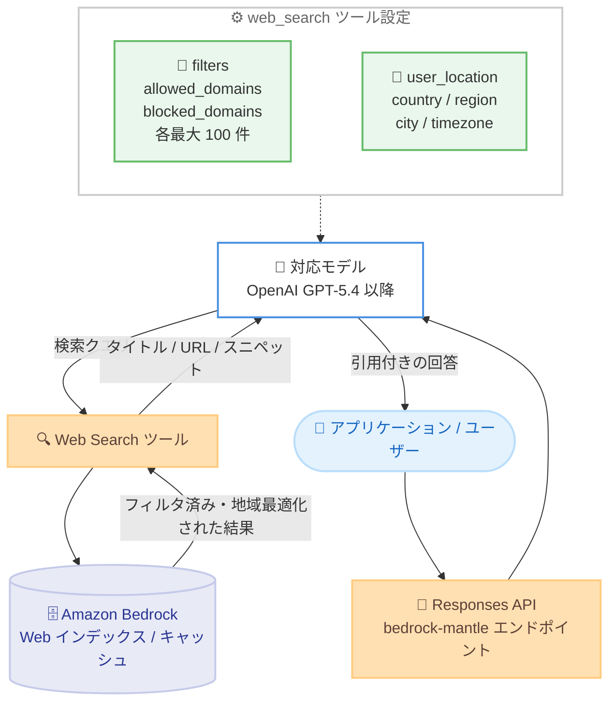

# Amazon Bedrock - Web Search のドメインフィルタリングとユーザーロケーションコントロール

**リリース日**: 2026 年 10 月 23 日
**サービス**: Amazon Bedrock
**機能**: Web Search domain filtering / user location controls

📊 [このアップデートのインフォグラフィックを見る](https://takech9203.github.io/aws-news-summary/20261023-bedrock-web-search-domain-user-location.html)

## 概要

Amazon Bedrock の Web Search が、モデル応答のグラウンディングに使用する検索結果を制御するための 2 つの新しいコントロールをサポートしました。1 つ目は**ドメインフィルタリング**で、`filters` パラメータを使用して、検索結果を信頼できるサイトに限定する `allowed_domains`、または不要なソースを除外する `blocked_domains` をそれぞれ最大 100 件まで指定できます。2 つ目は**ユーザーロケーション**で、国やタイムゾーンなどの位置情報パラメータを任意で指定することで、地域に関連した検索結果を取得できます。

Web Search は Amazon Bedrock に組み込まれたサーバーサイドツールであり、対応モデルがリクエスト処理中に Web から最新情報を取得し、出典の引用付きで回答をグラウンディングできます。今回の 2 つのコントロールは、いずれも既存の OpenAI Responses API リクエスト内の `web_search` ツール上で直接設定でき、アプリケーションコードの大きな変更は不要です。

検索結果の品質とコンプライアンスを重視するエンタープライズユーザーや、地域性の高い情報 (店舗、サービスの地域提供状況など) を扱うアプリケーション開発者にとって、グラウンディングの精度と制御性を高めるアップデートです。

**アップデート前の課題**

- 以前は Web Search の検索対象ドメインを制御できず、信頼性の低いソースや意図しないサイトの情報がモデル応答のグラウンディングに使われる可能性があった
- 社内ポリシー上参照してはならないサイト (競合サイト、非公式情報源など) を検索結果から除外する手段がなかった
- 位置情報を指定できず、検索結果は米国を前提としたものになりがちで、地域固有の質問 (地域でのサービス提供状況やローカル情報) に対する回答精度に限界があった

**アップデート後の改善**

- `filters` パラメータの `allowed_domains` (最大 100 件) により、検索結果を信頼できるドメインのみに限定できるようになった
- `blocked_domains` (最大 100 件) により、特定ドメインを検索結果から除外できるようになった
- `user_location` パラメータにより、国、地域、都市、タイムゾーンを指定して地域に即した検索結果を取得できるようになった

## アーキテクチャ図



`web_search` ツールに設定した `filters` と `user_location` が検索結果の取得に反映され、モデルはフィルタ済み・地域最適化された結果に基づいて引用付きの回答を生成します。

## サービスアップデートの詳細

### 主要機能

1. **ドメインフィルタリング (filters パラメータ)**
   - `web_search` ツールの `filters` パラメータで、`allowed_domains` と `blocked_domains` をそれぞれ最大 100 件まで指定可能
   - `allowed_domains` を指定すると、検索結果が指定したドメインのみに限定される
   - `blocked_domains` を指定すると、指定したドメインが検索結果から除外される
   - ドメインの指定時は `http://` や `https://` のプレフィックスを省略する
   - 各エントリはサブドメインにもマッチする (例: `aws.amazon.com` は `docs.aws.amazon.com` もカバー)

2. **ユーザーロケーション (user_location パラメータ)**
   - 位置情報を Web Search ツールに共有するためのオプションパラメータ
   - モデルや検索サービスが位置情報を利用して、応答をローカライズする
   - 未設定または空の場合、ロケーションは米国 (United States) がデフォルトとなる
   - `country` は ISO 3166-1 alpha-2 コードで検証される。大文字小文字は区別されず (`de` は `DE` として受理)、`UK` や `XK` のような未割り当て・ユーザー割り当てコードは拒否される
   - `region` と `city` は自由形式の文字列、`timezone` は IANA タイムゾーン識別子として受理される

3. **既存リクエストへのシームレスな追加**
   - いずれのコントロールも、既存の OpenAI Responses API リクエスト内の `web_search` ツール定義に直接追加するだけで利用可能
   - `external_web_access` や `search_context_size` などの既存パラメータと組み合わせて使用できる

## 技術仕様

### Web Search の基本仕様

| 項目 | 詳細 |
|------|------|
| 利用エンドポイント | `bedrock-mantle` (サーバーサイドツールのため `bedrock-runtime` では利用不可) |
| API | OpenAI Responses API |
| 対応モデル (商用リージョン) | OpenAI GPT-5.4 以降のモデル |
| 対応モデル (GovCloud) | `openai.gpt-5.6-terra`、`openai.gpt-5.6-luna`、`openai.gpt-5.4` |
| ドメインフィルタ上限 | `allowed_domains` 最大 100 件、`blocked_domains` 最大 100 件 |
| ロケーションのデフォルト | 米国 (未設定時) |
| IAM サービスプレフィックス | `bedrock-websearch` |
| データ境界制御 | `external_web_access` パラメータと `bedrock-websearch:ExternalWebAccess` 権限で制御 |

### 新パラメータの設定例

ドメインフィルタリングの設定例。

```json
{
  "type": "web_search",
  "external_web_access": false,
  "filters": {
    "allowed_domains": [
      "aws.amazon.com",
      "docs.aws.amazon.com"
    ]
  }
}
```

ユーザーロケーションの設定例。

```json
{
  "type": "web_search",
  "external_web_access": false,
  "user_location": {
    "type": "approximate",
    "country": "US"
  }
}
```

### search_context_size との組み合わせ

| 値 | 観測結果の上限 | 用途 |
|------|------|------|
| `low` | 最大 5 件 | シンプルな質問向け。入力トークン使用量を抑制 |
| `medium` | 最大 11 件 | デフォルト。カバレッジとトークン使用量のバランス |
| `high` | 最大 25 件 | 複雑・マルチホップな質問向け。入力トークン使用量は増加 |

## 設定方法

### 前提条件

1. リクエストを実行する IAM アイデンティティに Web Search のアクション (`bedrock-websearch:InvokeSearch`、`bedrock-websearch:InvokeFetch`) が許可されていること
2. `bedrock-mantle` エンドポイント経由で OpenAI Responses API を呼び出せること (Amazon Bedrock API キーの発行)
3. 対応モデル (OpenAI GPT-5.4 以降) へのアクセスが有効であること

### 手順

#### ステップ 1: 環境変数の設定

```bash
export OPENAI_API_KEY="your-amazon-bedrock-api-key"
export OPENAI_BASE_URL="https://bedrock-mantle.us-west-2.api.aws/openai/v1"
```

OpenAI SDK から Amazon Bedrock の `bedrock-mantle` エンドポイントに接続するため、API キーとベース URL を環境変数に設定します。

#### ステップ 2: ドメインフィルタリング付きリクエストの送信

```bash
curl "https://bedrock-mantle.us-west-2.api.aws/openai/v1/responses" \
  -H "Authorization: Bearer $OPENAI_API_KEY" \
  -H "Content-Type: application/json" \
  -d '{
    "model": "openai.gpt-5.6-terra",
    "input": "AWS Lambda のコールドスタートに関する最新のガイダンスをまとめてください。",
    "tools": [{
      "type": "web_search",
      "external_web_access": false,
      "filters": {
        "allowed_domains": ["aws.amazon.com", "docs.aws.amazon.com"]
      }
    }]
  }'
```

Responses API に `web_search` ツールを追加し、`filters.allowed_domains` で検索対象を AWS 公式ドメインに限定したリクエストを送信します。モデルは指定ドメイン (サブドメイン含む) の検索結果のみを使用して回答をグラウンディングします。

#### ステップ 3: ユーザーロケーション付きリクエストの送信

```python
from openai import OpenAI

client = OpenAI()

response = client.responses.create(
    model="openai.gpt-5.6-terra",
    input="What are the best restaurants near me?",
    tools=[{
        "type": "web_search",
        "external_web_access": False,
        "user_location": {
            "type": "approximate",
            "country": "US",
        },
    }],
)

print(response.output_text)
```

`user_location` パラメータで国コードなどの位置情報を指定してリクエストを送信します。モデルと検索サービスが位置情報を利用し、地域に即した検索結果に基づく回答を返します。

## メリット

### ビジネス面

- **情報源の信頼性向上**: 回答のグラウンディングに使用する情報源を公式サイトや社内で承認済みのドメインに限定でき、生成 AI アプリケーションの回答品質とブランドリスク管理が向上する
- **コンプライアンス対応**: 参照すべきでないサイトを `blocked_domains` で除外でき、業界規制や社内ポリシーに沿った情報利用を実現できる
- **地域ユーザー体験の向上**: ユーザーの所在地に応じたローカルな検索結果に基づく回答により、地域性の高いサービスでの回答精度が向上する

### 技術面

- **既存コードへの影響が最小**: 既存の OpenAI Responses API リクエストの `web_search` ツール定義にパラメータを追加するだけで利用でき、移行コストが低い
- **サブドメインの自動カバー**: ドメイン指定はサブドメインにもマッチするため、少ないエントリ数で広い範囲を制御できる
- **他のコントロールとの併用**: `external_web_access` によるデータ境界制御や `search_context_size` によるコンテキスト量制御と組み合わせ、きめ細かな検索動作の設計が可能

## デメリット・制約事項

### 制限事項

- `allowed_domains` と `blocked_domains` はそれぞれ最大 100 件まで
- Web Search 自体の利用可能リージョンは米国の 3 商用リージョンと AWS GovCloud (US-West) に限定される
- サーバーサイドツールのため `bedrock-runtime` エンドポイントの Responses API では利用できず、`bedrock-mantle` エンドポイントが必要
- 対応モデルは OpenAI GPT-5.4 以降に限定される (GovCloud では `openai.gpt-5.6-terra`、`openai.gpt-5.6-luna`、`openai.gpt-5.4`)
- `country` に指定できるのは ISO 3166-1 alpha-2 の割り当て済みコードのみで、`UK` や `XK` などの未割り当て・ユーザー割り当てコードは拒否される

### 考慮すべき点

- `user_location` を指定しない場合、ロケーションは米国がデフォルトになるため、米国以外のユーザー向けアプリケーションでは明示的な指定を検討する
- `allowed_domains` を狭く設定しすぎると、回答に必要な情報が検索結果から得られず、モデルが「回答できない」と返すケースが増える可能性がある
- `external_web_access` はデフォルトで `true` のため、機密データを扱う場合は `false` を明示的に設定し、データを AWS 境界内に保つことが推奨される
- 検索結果の引用 (出典) はエンドユーザーへの表示時に保持する必要がある (Acceptable Use)

## ユースケース

### ユースケース 1: 公式ドキュメント限定の社内テクニカルアシスタント

**シナリオ**: 社内エンジニア向けのアシスタントで、AWS 公式情報のみを根拠とした回答を提供したい。非公式ブログやフォーラムの誤情報を排除する。

**実装例**:
```json
{
  "type": "web_search",
  "external_web_access": false,
  "filters": {
    "allowed_domains": ["aws.amazon.com", "docs.aws.amazon.com", "repost.aws"]
  }
}
```

**効果**: 回答のグラウンディングが公式ドメインに限定され、引用付きで信頼性の高い回答を提供できる。

### ユースケース 2: ブランドセーフティのためのドメイン除外

**シナリオ**: カスタマー向けチャットボットで、競合他社サイトや信頼性の低い情報源が回答の根拠として引用されることを防ぎたい。

**実装例**:
```json
{
  "type": "web_search",
  "filters": {
    "blocked_domains": ["example-competitor.com", "unreliable-source.example"]
  }
}
```

**効果**: 不適切な情報源が検索結果から除外され、ブランドポリシーに沿った回答を維持できる。

### ユースケース 3: 地域密着型サービスのローカライズ回答

**シナリオ**: 店舗検索や地域のサービス提供状況を案内するアプリケーションで、ユーザーの所在地に応じた検索結果を利用したい。

**実装例**:
```json
{
  "type": "web_search",
  "user_location": {
    "type": "approximate",
    "country": "US",
    "region": "Washington",
    "city": "Seattle",
    "timezone": "America/Los_Angeles"
  }
}
```

**効果**: 位置情報に基づいてローカライズされた検索結果が使用され、「近くのレストラン」のような地域性の高い質問への回答精度が向上する。

## 料金

ドメインフィルタリングとユーザーロケーションの指定自体に追加料金の記載はありません。Web Search の利用料金およびモデル推論料金が適用されます。なお、`search_context_size` を大きくすると入力トークンが増加し、推論コストが増える可能性があります。最新の料金は [Amazon Bedrock 料金ページ](https://aws.amazon.com/bedrock/pricing/) を参照してください。

## 利用可能リージョン

Web Search が利用可能なすべてのリージョンでサポートされます。

| リージョン | リージョンコード |
|------|------|
| 米国東部 (バージニア北部) | us-east-1 |
| 米国東部 (オハイオ) | us-east-2 |
| 米国西部 (オレゴン) | us-west-2 |
| AWS GovCloud (US-West) | us-gov-west-1 |

Web Search は厳密にリージョン単位で動作し、クエリ、フェッチ、インデックスデータ、結果がリージョン間でルーティングされることはありません。

## 関連サービス・機能

- **OpenAI Responses API on Amazon Bedrock**: Web Search は `bedrock-mantle` エンドポイントの Responses API 経由で利用するサーバーサイドツール。今回の新パラメータもこの API 上で設定する
- **AWS IAM**: `bedrock-websearch` プレフィックスのアクション (`InvokeSearch`、`InvokeFetch`、`ExternalWebAccess`) で Web Search の利用と外部 Web アクセスを制御する
- **AWS CloudTrail**: Web Search の API アクティビティをデータイベントとして記録でき、`fetchedSources` フィールドでフェッチ結果の監査が可能

## 参考リンク

- 📊 [インフォグラフィック](https://takech9203.github.io/aws-news-summary/20261023-bedrock-web-search-domain-user-location.html)
- [公式発表 (What's New)](https://aws.amazon.com/about-aws/whats-new/2026/10/bedrock-web-search-domain-user-location/)
- [ドキュメント: Web Search (Amazon Bedrock User Guide)](https://docs.aws.amazon.com/bedrock/latest/userguide/web-search.html)
- [料金ページ](https://aws.amazon.com/bedrock/pricing/)

## まとめ

Amazon Bedrock の Web Search にドメインフィルタリングとユーザーロケーションの 2 つのコントロールが追加され、モデル応答のグラウンディングに使用する検索結果の信頼性と地域適合性を制御できるようになりました。既存の OpenAI Responses API リクエストにパラメータを追加するだけで利用できるため、Web Search を利用中のアプリケーションではまず `allowed_domains` による信頼ドメインの限定から検討することを推奨します。
