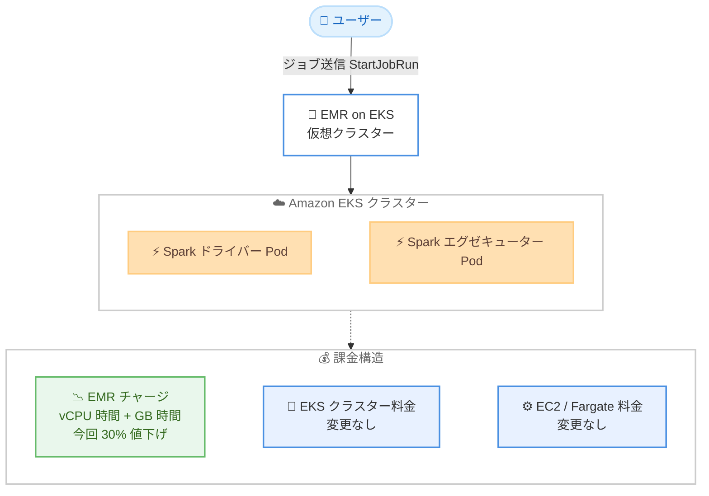

# Amazon EMR on EKS - EMR チャージ 30% 値下げ

**リリース日**: 2026 年 10 月 23 日
**サービス**: Amazon EMR on EKS
**機能**: EMR on EKS 利用時の EMR チャージ (アップリフト料金) の 30% 値下げ

📊 [このアップデートのインフォグラフィックを見る](https://takech9203.github.io/aws-news-summary/20261023-emr-eks-reduces-emr-charge-30-percent.html)

## 概要

Amazon EMR は、EMR on EKS デプロイオプションを利用する際に Amazon EKS の料金に上乗せされる EMR チャージ (アップリフト料金) を 30% 値下げすることを発表しました。値下げは vCPU 時間あたりの課金と GB 時間あたりの課金の両方に適用されます。基盤となる Amazon EKS 自体の料金 (クラスター料金や EC2 / Fargate のコンピューティング料金) に変更はありません。

新料金は EMR on EKS で実行されるすべてのワークロードに自動的に適用され、ユーザー側での設定変更や追加の対応は一切不要です。Amazon EKS 上で Apache Spark などのビッグデータワークロードを実行しているユーザーは、何もしなくても EMR チャージ分のコストが 30% 削減されます。

Kubernetes 基盤上で分析ワークロードを集約したいプラットフォームチームや、既存の EKS クラスターで Spark ジョブを実行しているデータエンジニアリングチームにとって、EMR on EKS を採用・拡大する際のコスト面のハードルが下がるアップデートです。

**アップデート前の課題**

値下げ以前は、EMR on EKS の利用に際して以下のようなコスト面の考慮が必要でした。

- EKS のコンピューティング料金に加えて、ジョブがリクエストした vCPU とメモリに比例する EMR チャージが上乗せされるため、大規模な Spark ワークロードではアップリフト分のコストが無視できなかった
- セルフマネージドの Spark on EKS (OSS 版 Spark Operator など) と比較した際、EMR チャージ分のコスト差がマネージドサービス採用の判断材料になっていた
- vCPU とメモリの両方に課金されるため、メモリ集約型ワークロードでもアップリフト料金が積み上がっていた

**アップデート後の改善**

今回の値下げにより、以下のように改善されます。

- vCPU 時間あたりの EMR チャージが 30% 削減され、新料金は $0.007084 / vCPU 時間となった (米国東部バージニア北部の料金ページ記載例)
- GB 時間あたりの EMR チャージが 30% 削減され、新料金は $0.000777875 / GB 時間となった (同上)
- 新料金は全ワークロードに自動適用されるため、設定変更・移行作業・再デプロイは不要
- EMR on EKS が利用可能なすべての AWS リージョンで値下げが適用される

## アーキテクチャ図



EMR on EKS の課金は「EMR チャージ」「EKS クラスター料金」「コンピューティング料金」の 3 層で構成されており、今回値下げされたのはこのうち EMR チャージ部分のみです。

## サービスアップデートの詳細

### 主要機能

1. **vCPU 時間あたりの EMR チャージを 30% 値下げ**
   - Spark ドライバー / エグゼキューター Pod がリクエストした vCPU 量に基づく課金が 30% 削減
   - 料金ページの計算例では $0.007084 / vCPU 時間 (米国東部バージニア北部)
   - CPU 集約型の変換処理やバッチジョブで特に効果が大きい

2. **GB 時間あたりの EMR チャージを 30% 値下げ**
   - Pod がリクエストしたメモリ量に基づく課金も同率で 30% 削減
   - 料金ページの計算例では $0.000777875 / GB 時間 (米国東部バージニア北部)
   - メモリ集約型の Spark ワークロード (大規模シャッフル、キャッシュ利用など) でも恩恵を受けられる

3. **全ワークロードへの自動適用**
   - EKS デプロイオプションで実行されるすべての EMR ワークロードが対象
   - ユーザー側での設定変更、ジョブの再送信、バージョンアップなどの対応は不要
   - EMR on EKS が利用可能なすべての AWS リージョンで適用

## 技術仕様

### 課金の仕組み

| 項目 | 詳細 |
|------|------|
| 課金対象 | ジョブの Pod がリクエストした vCPU およびメモリのリソース量 |
| 課金期間 | EMR アプリケーションイメージのダウンロード開始から EKS Pod の終了まで |
| 課金単位 | 秒単位 (切り上げ) |
| 値下げ対象 | EMR チャージ (vCPU 時間課金と GB 時間課金の両方) |
| 変更なし | EKS クラスター料金 ($0.10 / 時間)、EC2 / Fargate などのコンピューティング料金 |
| 適用方法 | 自動適用 (ユーザー側の対応不要) |

## メリット

### ビジネス面

- **即時のコスト削減**: 既存ワークロードに自動適用されるため、移行コストゼロで EMR チャージ分の請求額が 30% 減少する
- **マネージドサービス採用の後押し**: セルフマネージドの Spark on EKS と比較した際のコスト差が縮小し、パフォーマンス最適化済みの EMR Spark ランタイムや運用負荷軽減といった付加価値を得やすくなる
- **分析基盤の拡大が容易に**: ジョブ数やデータ量の増加に伴うコスト増が緩やかになり、ワークロード集約の投資対効果が向上する

### 技術面

- **対応作業が不要**: 設定変更、再デプロイ、ジョブ定義の修正なしで新料金が適用される
- **課金モデルは従来どおり**: リクエストした vCPU / メモリに基づく秒単位課金という仕組み自体は変わらないため、既存のコスト見積もりロジックは単価の差し替えのみで更新できる
- **リソース最適化の効果が継続**: Pod のリソースリクエスト最適化によるコスト削減施策と値下げ効果は併用できる

## デメリット・制約事項

### 制限事項

- 値下げ対象は EMR チャージのみであり、EKS クラスター料金や EC2 / Fargate などのコンピューティング料金は変わらない
- EMR on EKS のコスト全体に占める EMR チャージの割合はワークロード構成に依存するため、請求総額の削減率は 30% より小さくなる

### 考慮すべき点

- コスト配分タグや予算アラートで EMR チャージを監視している場合、値下げ後の実績に合わせてしきい値の見直しを推奨
- EMR on EC2 / EMR Serverless など他のデプロイオプションとのコスト比較を行っている場合は、新単価で再評価する価値がある

## ユースケース

### ユースケース 1: 既存 EKS クラスターへの Spark ワークロード集約

**シナリオ**: マイクロサービスを運用中の EKS クラスターに、別途 EMR on EC2 で運用している夜間バッチの Spark ジョブを集約したい。

**実装例**:
```bash
aws emr-containers start-job-run \
  --virtual-cluster-id <virtual-cluster-id> \
  --name nightly-batch \
  --execution-role-arn <role-arn> \
  --release-label emr-7.x.0-latest \
  --job-driver '{
    "sparkSubmitJobDriver": {
      "entryPoint": "s3://my-bucket/jobs/etl.py",
      "sparkSubmitParameters": "--conf spark.executor.instances=10 --conf spark.executor.cores=4 --conf spark.executor.memory=16G"
    }
  }'
```

**効果**: クラスター統合による EC2 稼働率の向上に加え、EMR チャージが 30% 下がったことで集約後のランニングコストをさらに圧縮できる。

### ユースケース 2: セルフマネージド Spark からの移行判断

**シナリオ**: OSS の Spark Operator を EKS 上で自前運用しており、運用負荷が課題。EMR on EKS への移行を検討しているが、アップリフト料金がネックだった。

**実装例**:
```text
移行判断の比較観点
- EMR チャージ: 30% 値下げ後の単価で試算
- EMR Spark ランタイムの性能最適化による実行時間短縮
- バージョンアップ / パッチ適用の運用工数削減
```

**効果**: アップリフト料金の 30% 削減と EMR ランタイムによる実行時間短縮を合わせると、セルフマネージド運用に対する総所有コストの優位性を得やすくなる。

### ユースケース 3: 大規模 ETL パイプラインのコスト最適化

**シナリオ**: MWAA (Amazon Managed Workflows for Apache Airflow) から多数の Spark ジョブを EMR on EKS に毎日投入している。コスト削減の全社目標がある。

**実装例**:
```text
値下げ後の施策の組み合わせ
1. EMR チャージ 30% 値下げ (自動適用)
2. エグゼキューターのリソースリクエスト適正化
3. EC2 スポットインスタンス / Graviton ノードの活用
```

**効果**: 値下げによる自動削減に加えてリソース最適化施策を重ねることで、パイプライン全体のコストを段階的に削減できる。

## 料金

EMR on EKS では、Amazon EKS のコンピューティング料金に加えて、ジョブの Pod がリクエストした vCPU とメモリの量に応じた EMR チャージ (アップリフト料金) が発生します。課金は EMR アプリケーションイメージのダウンロード開始から Pod の終了まで、秒単位 (切り上げ) で行われます。今回のアップデートで、この EMR チャージが 30% 値下げされました。

### 新旧料金の比較 (米国東部バージニア北部)

| 課金項目 | 値下げ前 (逆算値) | 値下げ後 (料金ページ記載) | 削減率 |
|----------|-------------------|---------------------------|--------|
| vCPU 時間あたり | $0.01012 | $0.007084 | 30% |
| GB 時間あたり | $0.00111125 | $0.000777875 | 30% |

値下げ後の単価は公式料金ページの計算例に記載されている値です。値下げ前の単価は、30% 値下げという公式発表に基づく逆算値 ($0.007084 ÷ 0.7 = $0.01012) として記載しています。EKS クラスター料金 ($0.10 / 時間) および EC2 / Fargate のコンピューティング料金に変更はありません。

### 料金例

100 vCPU / 300 GB メモリをリクエストするジョブを 30 分 (0.5 時間) 実行した場合の EMR チャージ (米国東部バージニア北部)。

| 項目 | 計算式 | 値下げ前 | 値下げ後 |
|------|--------|----------|----------|
| vCPU 分の EMR チャージ | 100 vCPU × 単価 × 0.5 時間 | $0.506 | $0.3542 |
| メモリ分の EMR チャージ | 300 GB × 単価 × 0.5 時間 | $0.1667 | $0.1167 |
| 合計 EMR チャージ | 上記の合計 | $0.6727 | $0.4709 |

このジョブを毎日 20 回、30 日間実行すると、EMR チャージは月額約 $403.6 から約 $282.5 となり、月あたり約 $121 の削減になります。これに EKS クラスター料金とコンピューティング料金が別途加算されます。最新の料金は [Amazon EMR 料金ページ](https://aws.amazon.com/emr/pricing/) を参照してください。

## 利用可能リージョン

EMR on EKS が利用可能なすべての AWS リージョンで新料金が適用されます。

## 関連サービス・機能

- **Amazon EKS**: EMR on EKS の基盤となる Kubernetes マネージドサービス。EKS 自体の料金は今回変更なし
- **Amazon EMR on EC2 / EMR Serverless**: EMR の他のデプロイオプション。ワークロード特性に応じた使い分けのコスト比較は新単価で再評価が推奨される
- **Amazon MWAA**: Apache Airflow のマネージドサービス。EMR on EKS へのジョブのスケジュール実行に利用可能
- **Amazon EMR Studio**: EMR on EKS 上の分析アプリケーションの開発・デバッグに利用できる IDE

## 参考リンク

- 📊 [インフォグラフィック](https://takech9203.github.io/aws-news-summary/20261023-emr-eks-reduces-emr-charge-30-percent.html)
- [公式発表 (What's New)](https://aws.amazon.com/about-aws/whats-new/2026/10/emr-eks-reduces-emr-charge-30-percent/)
- [ドキュメント (Amazon EMR on EKS 開発ガイド)](https://docs.aws.amazon.com/emr/latest/EMR-on-EKS-DevelopmentGuide/emr-eks.html)
- [料金ページ (Amazon EMR)](https://aws.amazon.com/emr/pricing/)

## まとめ

EMR on EKS の EMR チャージが vCPU 時間・GB 時間の両方で 30% 値下げされ、既存ワークロードにも自動適用されるため、ユーザーは何もせずにコスト削減の恩恵を受けられます。EMR on EKS を利用中のチームは値下げ後の実績に合わせてコスト監視のしきい値を見直し、セルフマネージド Spark や他の EMR デプロイオプションを利用中のチームは、新単価を前提に EMR on EKS 採用の費用対効果を再評価することを推奨します。
