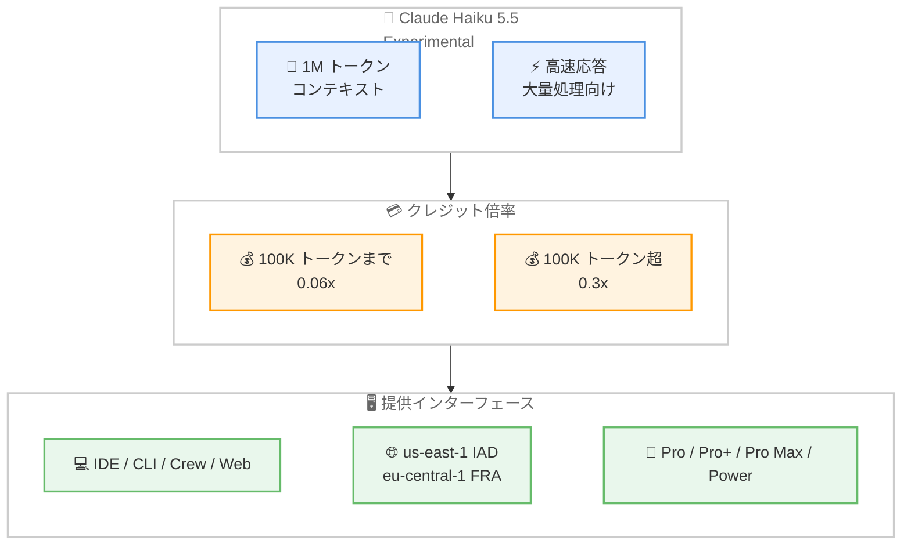
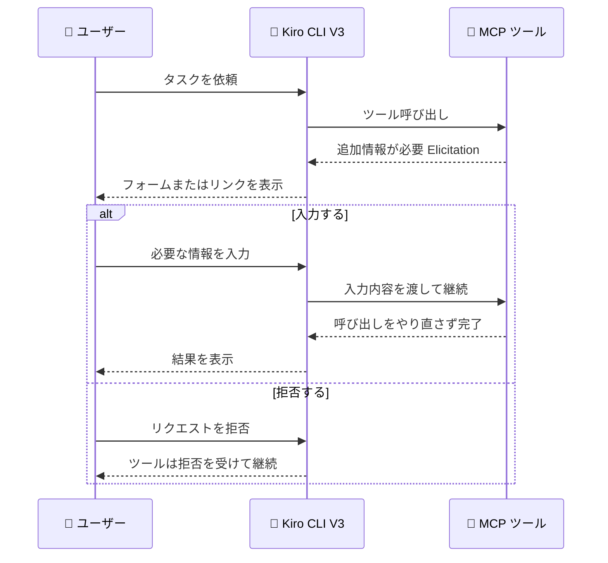

# Kiro - Claude Haiku 5.5 の提供開始と MCP Elicitation / Workflow 制御 / メモリ削除

**リリース日**: 2026 年 10 月 23 日
**サービス**: Kiro
**機能**: Claude Haiku 5.5 の experimental サポート提供開始、および CLI 2.34.0 における MCP Elicitation・Workflow 制御・メモリ削除

📊 [このアップデートのインフォグラフィックを見る](https://takech9203.github.io/aws-news-summary/20261023-kiro-changelog-2026-10-23.html)

## 概要

2026 年 10 月 23 日、Kiro の Changelog に 2 件のアップデートが公開されました。本レポートでは両方をまとめて解説します。

1 件目は、**Claude Haiku 5.5 が Kiro IDE、CLI、Crew、Web で experimental サポートとして利用可能になった**アップデートです。対象は us-east-1 (IAD) および eu-central-1 (FRA) の Pro、Pro+、Pro Max、Power プラン顧客です。Haiku 5.5 は高速なレスポンスが求められる大量処理向けに設計されたモデルで、**1M トークンのコンテキストウィンドウ**を備えています。クレジット倍率は 100K トークンまでのリクエストが **0.06x**、100K トークンを超えるリクエストが **0.3x** です。

2 件目は、**Kiro CLI 2.34.0 のリリース**です。ローカル V3 セッションにおいて MCP ツールが追加入力をユーザーに求められるようになり (MCP Elicitation)、Workflows の開始頻度やプラン修正の制御が強化され、`/memories` からメモリを削除できるようになりました。あわせて、`/model edit` によるモデルピッカーの編集機能が追加され、ワークフローのリカバリー、ヘッドレスモードでの MCP サインイン再利用、保存済みセッション、アクセシビリティなど多数の改善・修正が含まれています。

**アップデート前の課題**

- 高速・軽量なタスク向けの最新世代 Claude モデルが Kiro で利用できず、小規模なリクエストにも相対的に高いクレジット倍率のモデルを使う必要があった
- MCP ツールが実行中に追加情報を必要とする場合、ツール呼び出しを中断してユーザーが手動で情報を渡し、呼び出しをやり直す必要があった
- V3 ワークフロープランの承認時にプランを修正できず、承認するか拒否するかの選択しかなかった
- `/memories` で保存済みメモリを確認はできたが、CLI から不要なメモリを削除できなかった
- `/model` ピッカーに使用しないモデルも常に表示され、選択肢が多くなりがちだった
- ヘッドレスモードが対話セッションで保存した MCP サインインを再利用できず、信頼されていないツールへのリクエストに応答してしまうケースがあった
- 再起動後に V3 Workflows が再プランニングや完了済みステップの再実行を行うことがあった

**アップデート後の改善**

- Claude Haiku 5.5 により、1M トークンコンテキストと低いクレジット倍率 (100K トークンまで 0.06x) で高速・大量処理が可能になった
- MCP ツールが実行を中断せずにフォームやリンクを提示して追加入力を受け取り、呼び出しをやり直さずに処理を継続できるようになった
- ワークフロープランの承認時に修正案を直接入力でき、ステップ実行前にプランへ反映されるようになった
- `/memories` でメモリを選択して `Ctrl+D` を押すだけで削除できるようになった
- `/model edit` で使用しないモデルをピッカーから非表示にできるようになった (非表示モデルも ID 指定では利用可能)
- **Workflow use** 設定 (Only when asked / Only for large tasks / As much as possible) でワークフローの開始頻度を選択できるようになった
- V3 Workflows が再起動後に再プランニングや完了済みステップの繰り返しなしで再開できるようになった

## アーキテクチャ図



Claude Haiku 5.5 の特徴、クレジット倍率、提供範囲の関係を示しています。



MCP Elicitation の処理フローです。ツールは呼び出しを中断・再実行することなく、ユーザーからの追加入力を受け取って処理を継続します。

## サービスアップデートの詳細

### 主要機能

1. **Claude Haiku 5.5 の提供開始 (Experimental)**
   - Kiro IDE、CLI、Crew、Web で experimental サポートとして利用可能
   - 対象は us-east-1 (IAD) および eu-central-1 (FRA) の Pro、Pro+、Pro Max、Power プラン顧客
   - 高速なレスポンスが求められる大量処理向けに設計
   - 1M トークンのコンテキストウィンドウを搭載
   - クレジット倍率は 100K トークンまでのリクエストが 0.06x、100K トークン超が 0.3x
   - 最新のモデルリストを読み込むには、IDE / CLI の再起動、Crew では `kirocrew restart`、Web ではブラウザの更新が必要

2. **MCP Elicitation: MCP ツールが入力を求められるように (CLI 2.34.0)**
   - ローカル V3 セッションで、MCP ツールが追加情報を必要とする際に一時停止し、フォームまたはリンクを表示
   - ユーザーは要求された情報の入力、別ページでのアクション完了、またはリクエストの拒否を選択可能
   - ツールは呼び出しをやり直すことなく処理を継続

3. **Workflow 制御の強化 (CLI 2.34.0)**
   - **プランの事前修正**: V3 ワークフロープランの承認画面で修正案を直接入力すると、ステップ実行前にプランへ反映される
   - **Workflow use 設定**: ワークフローの開始頻度を Only when asked (求められた時のみ)、Only for large tasks (大きなタスクのみ)、As much as possible (可能な限り) から選択可能
   - **ワークフローリカバリー**: V3 Workflows が再起動後に、再プランニングや完了済みステップの繰り返しなしで再開

4. **メモリ削除とモデルピッカー編集 (CLI 2.34.0)**
   - `/memories` でメモリを選択し `Ctrl+D` を押すと削除できる
   - `/model edit` で使用しないモデルを `/model` ピッカーから非表示にできる (非表示モデルも ID では利用可能)

5. **セキュリティ・承認フローの改善 (CLI 2.34.0)**
   - `--trust-workspace` フラグで、選択を保存せずに 1 回の起動だけワークスペース信頼プロンプトをスキップ可能
   - V3 のツール承認画面で Allow once / Deny once が先頭に表示され、ルールを保存する選択肢がその後に続くように変更
   - V3 セッションダッシュボードでセッション削除前に確認を要求
   - 解析できない不明瞭なシェルコマンドは、承認を求めるのではなく拒否するように変更
   - V3 サブエージェントが、親エージェントがインラインで宣言した MCP サーバーを受け取らないように境界を強化
   - V3 のリモート MCP サーバーが HTTP 経由で同一オリジンのリダイレクトのみ追従するように修正

6. **その他の修正 (CLI 2.34.0)**
   - エージェントがツール呼び出しの準備で一時停止した際、フリーズしたように見えず `Working...` を表示
   - ヘッドレスモードがエージェントの質問への自動応答や、信頼されたツール名を含まないリクエストの承認を行わないように修正
   - ヘッドレスモードが対話セッションで保存された MCP サインインを再利用
   - 保存済みセッションが多数ある場合でも `/sessions` がフリーズせずに開閉・スクロール可能に
   - `/usage` がエンタープライズの超過ステータスと消費クレジットを表示
   - モデル拒否後も部分的な応答を保持し、フォールバックモデルが続きから継続 (V2 Rust エンジンと V3)
   - `chat.allowIcons` 無効時に罫線・ブロック文字を表示せず、矢印キーを単語として読み上げるアクセシビリティ改善
   - Mermaid 図が生 HTML の表示や描画失敗をせず、より多くのケースで描画されるように修正
   - V3 の拒否ルールが選択したスコープで保存され、ブロックされた呼び出しがキャンセル扱いにならないように修正
   - `/rewind` が失敗・未完了ターンの正しい位置で分岐するように修正
   - ワークフローモニターの承認が現在の呼び出しで開き、`q` で閉じられるように修正
   - `kiro-cli acp` がエージェント実行中にシャットダウンしないように修正
   - メニューとピッカーで画像の貼り付けと、貼り付け・音声入力によるフィルターテキストが動作
   - `/agent` で切り替えたエージェントが宣言する Skills を読み込むように修正
   - macOS サンドボックス内で `ssh` と `ssh-keygen` がエラーなく動作
   - Windows でワークスペースフォルダー外のファイルを削除可能に

## 技術仕様

### Claude Haiku 5.5 の提供仕様

| 項目 | 詳細 |
|------|------|
| ステータス | Experimental |
| 提供インターフェース | Kiro IDE、CLI、Crew、Web |
| 対象プラン | Pro、Pro+、Pro Max、Power |
| 提供リージョン | us-east-1 (IAD)、eu-central-1 (FRA) |
| コンテキストウィンドウ | 1M トークン |
| クレジット倍率 | 100K トークンまで: 0.06x / 100K トークン超: 0.3x |
| 想定用途 | 高速なレスポンスが求められる大量処理 |

### CLI 2.34.0 の変更点サマリー

| 分類 | 内容 |
|------|------|
| 新機能 | MCP Elicitation (ローカル V3 セッションで MCP ツールが追加入力を要求可能) |
| Improvements | ワークフロープランの事前修正、`/memories` からのメモリ削除、`/model edit`、Workflow use 設定、`--trust-workspace`、承認 UI の改善、サブエージェントの MCP 境界強化など 9 件 |
| Fixes | ワークフローリカバリー、ヘッドレス MCP サインイン再利用、保存済みセッション、アクセシビリティ、Mermaid 描画、`/rewind`、macOS サンドボックスなど 18 件 |

## 設定方法

### 前提条件

1. Kiro のアカウントを保有していること (Claude Haiku 5.5 の利用には us-east-1 または eu-central-1 の Pro 以上のプランが必要)
2. CLI 2.34.0 の新機能を利用する場合は Kiro CLI 2.34.0 以降
3. MCP Elicitation、Workflow 制御などの機能はローカル V3 セッションが対象

### 手順

#### ステップ 1: 最新のモデルリストを読み込む

```bash
# CLI の場合: CLI を再起動する
kiro-cli

# Crew の場合: Crew を再起動する
kirocrew restart
```

IDE または CLI を再起動すると、Claude Haiku 5.5 を含む最新のモデルリストが読み込まれます。Crew の場合は `kirocrew restart` コマンドを実行し、Web の場合はブラウザでページを更新します。

#### ステップ 2: モデルピッカーを整理して Haiku 5.5 を選択する

```bash
# V3 セッション内でモデルピッカーを編集する
/model edit

# モデルを切り替える
/model
```

`/model edit` を実行すると、使用しないモデルを `/model` ピッカーから非表示にできます。非表示にしたモデルも ID 指定では引き続き利用可能です。整理後、`/model` で Claude Haiku 5.5 を選択します。

#### ステップ 3: ワークフローの開始頻度を設定する

CLI のチャット設定から **Workflow use** を開き、Only when asked、Only for large tasks、As much as possible のいずれかを選択します。チームの運用方針に合わせてワークフローの自動開始の度合いを制御できます。詳細は [設定ドキュメント](https://kiro.dev/docs/cli/chat/settings/#settings-features) を参照してください。

#### ステップ 4: 不要なメモリを削除する

```bash
# V3 セッション内でメモリ一覧を開く
/memories
```

`/memories` を開き、削除したいメモリを選択して `Ctrl+D` を押すと削除できます。詳細は [Memory ドキュメント](https://kiro.dev/docs/memory/#review-what-kiro-remembers) を参照してください。

## メリット

### ビジネス面

- **コスト効率の向上**: Haiku 5.5 の低いクレジット倍率 (100K トークンまで 0.06x) により、定型的・大量のタスクをより少ないクレジット消費で処理できる
- **運用統制の強化**: Workflow use 設定とプランの事前修正により、エージェントの自動実行の度合いを組織の方針に合わせて制御できる
- **データ管理の改善**: 不要になったメモリを CLI から削除でき、エージェントに記憶させる情報を整理できる

### 技術面

- **MCP ツールの対話性向上**: Elicitation により、ツールが追加情報を必要とする場合でも呼び出しをやり直さずに処理を継続でき、MCP ツールの設計自由度が高まる
- **大規模コンテキストの活用**: Haiku 5.5 の 1M トークンコンテキストにより、大きなコードベースやログの高速処理が可能になる
- **堅牢性とアクセシビリティの向上**: ワークフローリカバリー、ヘッドレスモードの安全性強化、スクリーンリーダー向けのターミナル出力改善など、日常運用の信頼性が向上する

## デメリット・制約事項

### 制限事項

- Claude Haiku 5.5 は Experimental での提供であり、本番ワークロードでの利用には注意が必要
- Haiku 5.5 の対象は us-east-1 (IAD) および eu-central-1 (FRA) の Pro、Pro+、Pro Max、Power プラン顧客に限定される
- MCP Elicitation はローカル V3 セッションが対象
- 100K トークンを超えるリクエストはクレジット倍率が 0.3x に上がるため、コンテキストサイズに応じたコスト設計が必要

### 考慮すべき点

- 最新のモデルリストを反映するには、IDE / CLI の再起動、`kirocrew restart`、または Web のブラウザ更新が必要
- 解析できないシェルコマンドは承認を求めずに拒否されるようになったため、複雑なコマンドを多用する運用では挙動の変化に注意
- サブエージェントが親エージェントのインライン MCP サーバーを受け取らなくなったため、サブエージェント側で MCP サーバーが必要な場合は個別の設定が必要
- `--trust-workspace` は信頼の選択を保存しないため、毎回の起動で指定が必要

## ユースケース

### ユースケース 1: 大量の軽量タスクのコスト最適化

**シナリオ**: Pro Max プランの開発チームが、コードレビューコメントの下書きやログの要約など、高速応答が求められる軽量タスクを大量に処理したい。

**実装例**:
```text
1. IDE / CLI を再起動して Claude Haiku 5.5 を含む最新のモデルリストを読み込む
2. /model edit で使用しないモデルを非表示にし、ピッカーを整理
3. 軽量タスクでは Haiku 5.5 (0.06x) を選択し、複雑なタスクでは上位モデルを選択
```

**効果**: タスクの性質に応じたモデルの使い分けにより、クレジット消費を抑えながら処理速度を向上できる。

### ユースケース 2: 追加入力が必要な MCP ツールの統合

**シナリオ**: 社内の MCP ツールがチケット作成時に担当者や優先度などの追加情報を必要とするが、従来はツール呼び出しを中断して情報を渡し直す必要があった。

**実装例**:
```text
1. Kiro CLI を 2.34.0 以降に更新
2. ローカル V3 セッションで MCP ツールを呼び出す
3. ツールが表示するフォームに担当者・優先度を入力し、処理を継続
```

**効果**: ツール呼び出しのやり直しが不要になり、対話的な MCP ツールをスムーズに利用できる。

### ユースケース 3: ワークフロー実行の段階的導入

**シナリオ**: チームで V3 Workflows を導入したいが、最初は限定的に使い、慣れてきたら適用範囲を広げたい。

**実装例**:
```text
1. 導入初期は Workflow use を Only when asked に設定
2. プラン承認時に修正案を直接入力し、実行前にプランを調整
3. 運用が安定したら Only for large tasks や As much as possible へ段階的に変更
```

**効果**: ワークフローの自動開始の度合いを段階的に制御しながら、プラン修正機能で実行内容の精度を高められる。

## 料金

CLI 2.34.0 のアップデート自体に追加料金はありません。Claude Haiku 5.5 は既存プランのクレジット体系の中で利用でき、クレジット倍率は以下のとおりです。

| リクエストサイズ | クレジット倍率 |
|------------------|----------------|
| 100K トークンまで | 0.06x |
| 100K トークン超 | 0.3x |

対象プランは Pro、Pro+、Pro Max、Power です。最新の料金は [料金ページ](https://kiro.dev/pricing/) を参照してください。

## 利用可能リージョン

グローバル (Kiro はグローバルサービス)。ただし、Claude Haiku 5.5 は us-east-1 (IAD) および eu-central-1 (FRA) の顧客向けの提供です。

## 関連サービス・機能

- **Kiro IDE / CLI / Crew / Web**: Claude Haiku 5.5 を利用できる Kiro の各インターフェース
- **MCP (Model Context Protocol)**: Kiro のエージェントに外部ツールを統合する仕組み。今回の CLI 2.34.0 で Elicitation に対応した
- **Kiro V3 Workflows**: エージェントによる複数ステップの自動実行機能。今回のリリースで開始頻度の設定とプランの事前修正、リカバリーが強化された
- **Kiro Memory**: エージェントがセッションをまたいで情報を記憶する機能。今回のリリースで CLI からのメモリ削除に対応した

## 参考リンク

- 📊 [インフォグラフィック](https://takech9203.github.io/aws-news-summary/20261023-kiro-changelog-2026-10-23.html)
- [Kiro Changelog](https://kiro.dev/changelog/)
- [Changelog: Claude Haiku 5.5 Now Available](https://kiro.dev/changelog/models/claude-haiku-5-5/)
- [Changelog: MCP Elicitation, Workflow Controls, and Memory Deletion (CLI 2.34.0)](https://kiro.dev/changelog/cli/2-34/)
- [ドキュメント: Available Models - Claude Haiku 5.5](https://kiro.dev/docs/models/available-models/#claude-haiku-55)
- [ドキュメント: MCP Elicitation](https://kiro.dev/docs/mcp/usage/#mcp-elicitation)
- [ドキュメント: Workflows - Start from the Agent](https://kiro.dev/docs/workflows/#start-from-the-agent)
- [ドキュメント: Memory - Review What Kiro Remembers](https://kiro.dev/docs/memory/#review-what-kiro-remembers)
- [ドキュメント: Settings - Features](https://kiro.dev/docs/cli/chat/settings/#settings-features)
- [ドキュメント: Permissions - Trust a Workspace in Kiro CLI](https://kiro.dev/docs/permissions/#trust-a-workspace-in-kiro-cli)
- [料金ページ](https://kiro.dev/pricing/)

## まとめ

Claude Haiku 5.5 の提供開始により、1M トークンコンテキストと低いクレジット倍率を活かした高速・大量処理の選択肢が Kiro に加わりました。あわせて CLI 2.34.0 では、MCP Elicitation によるツールの対話性向上、Workflow use 設定とプラン事前修正による実行制御の強化、`/memories` からのメモリ削除など、エージェント運用の統制と利便性が大きく向上しています。IDE / CLI の再起動や `kirocrew restart` で最新のモデルリストを読み込み、Workflow use 設定をチームの運用方針に合わせて調整することを推奨します。
