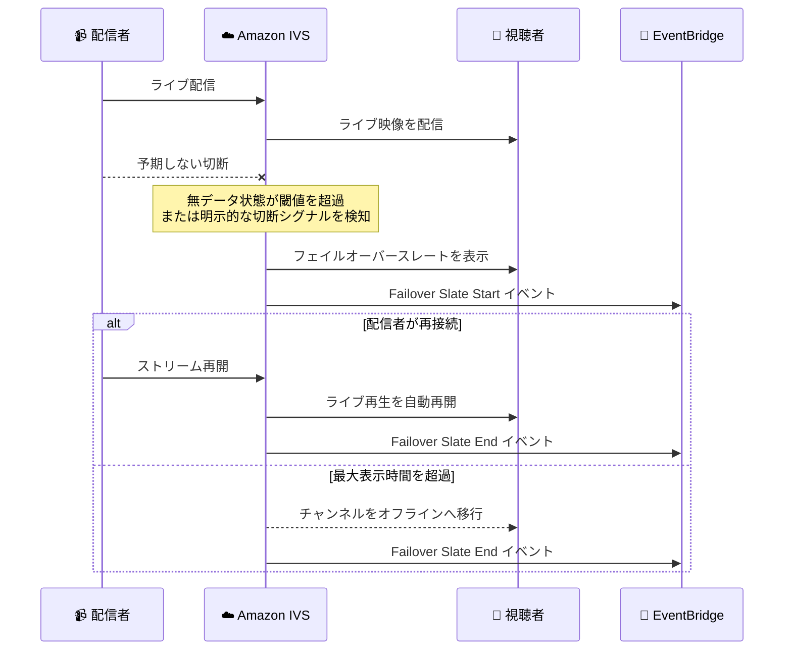

# Amazon IVS - Low-Latency Streaming フェイルオーバースレート

**リリース日**: 2026 年 10 月 26 日
**サービス**: Amazon Interactive Video Service (Amazon IVS)
**機能**: Low-Latency Streaming Failover Slate (フェイルオーバースレート)

📊 [このアップデートのインフォグラフィックを見る](https://takech9203.github.io/aws-news-summary/20261026-amazon-ivs-low-latency-streaming-failover-slate.html)

## 概要

Amazon IVS Low-Latency Streaming が、フェイルオーバースレート機能の提供を開始しました。配信者のストリームが予期せず中断された際、視聴者にはバッファリングアイコンやフリーズしたフレームの代わりに、IVS が提供するアニメーション画像 (スレート) が自動的に表示されます。配信者が再接続すると、視聴者がプレイヤーを再読み込みすることなく、ライブ再生が自動的に再開されます。

この機能は、モバイルデバイスからの配信や、接続が不安定な場所からの配信で特に有効です。一時的なネットワーク障害や技術的トラブルが発生しても、視聴者に滑らかな視聴体験を提供し、視聴者の離脱を防ぐことができます。スレートは新規チャンネル・既存チャンネルのどちらでも有効化でき、Amazon EventBridge イベントと Amazon CloudWatch メトリクスでスレートのアクティビティを監視できます。

**アップデート前の課題**

- 配信者の接続が予期せず切断されると、視聴者にはフリーズしたフレームやバッファリングアイコンが表示され、視聴体験が大きく損なわれていた
- 中断が続くと視聴者がプレイヤーを再読み込みしたり、配信ページから離脱したりするリスクが高かった
- モバイル配信や屋外配信など、接続が不安定な環境では、短時間の切断のたびに視聴者維持が難しかった

**アップデート後の改善**

- 予期しない中断時に、IVS がアニメーションのスレート画像を視聴者へ自動表示し、滑らかな視聴体験を維持できるようになった
- 配信者が再接続すると、視聴者側のプレイヤー再読み込みなしでライブ再生が自動的に再開されるようになった
- スレートの表示開始・終了を EventBridge イベントと CloudWatch メトリクスで監視できるようになった

## アーキテクチャ図



予期しない中断を IVS が検知するとスレートが視聴者に表示され、配信者の再接続時には自動でライブ再生へ復帰します。中断が最大表示時間を超えた場合はチャンネルがオフラインになります。

## サービスアップデートの詳細

### 主要機能

1. **フェイルオーバースレートの自動表示**
   - ストリームの予期しない中断を IVS が検知すると、アニメーションのデフォルトスレートを視聴者に自動表示
   - 検知方法は 2 種類: 無データ状態が `activationThresholdSeconds` を超えた場合の推定検知と、エンコーダーが異常切断シグナルを送信した場合の明示的検知
   - 配信者が意図的に配信を停止した場合 (クリーンな切断) は、通常どおりストリームが終了しスレートは表示されない

2. **プレイヤー再読み込み不要の自動復帰**
   - 配信者が再接続すると、最小表示時間の経過後にスレートからライブ映像へ自動で切り替わる
   - 視聴者はプレイヤーの再読み込みや手動操作なしで、継続的な再生体験を得られる

3. **再利用可能なフェイルオーバースレート設定**
   - スレートの表示タイミングと表示時間を制御する「フェイルオーバースレート設定」をリソースとして作成
   - 1 つの設定を複数のチャンネルに関連付けて再利用可能
   - 新規チャンネル作成時と既存チャンネル更新時のどちらでも有効化できる

4. **EventBridge と CloudWatch による監視**
   - スレートの開始・終了時に `Failover Slate Start` / `Failover Slate End` イベントを EventBridge に送信
   - CloudWatch メトリクス `FailoverSlateStarts` で、チャンネル横断的なスレート発動状況を集計可能

## 技術仕様

### フェイルオーバースレート設定のパラメータ

| パラメータ | 説明 |
|------|------|
| `activationThresholdSeconds` | 無データ状態がこの秒数続いた場合にスレートを表示する閾値 |
| `minSlateDisplaySeconds` | スレートの最小表示時間。再接続してもこの時間はスレートが継続表示される |
| `maxSlateDisplaySeconds` | スレートの最大表示時間。これを超えて中断が続くとチャンネルはオフラインになる |

### 中断の検知方式

| 検知方式 | 動作 |
|------|------|
| 推定検知 | `activationThresholdSeconds` で指定した期間、データを受信しない場合にスレートを表示 |
| 明示的検知 | エンコーダーが異常切断シグナルを送信した場合、即座にスレートを表示 |

### 監視

| 監視手段 | 内容 |
|------|------|
| Amazon EventBridge | `Failover Slate Start` / `Failover Slate End` イベント |
| Amazon CloudWatch | `FailoverSlateStarts` メトリクス |

## 設定方法

### 前提条件

1. Amazon IVS Low-Latency Streaming のチャンネルを作成できる AWS アカウントと IAM 権限があること
2. AWS CLI が利用可能であること (コンソールからも設定可能)
3. 配信用のエンコーダー (OBS、モバイルアプリなど) が利用可能であること

### 手順

#### ステップ 1: フェイルオーバースレート設定を作成する

```bash
aws ivs create-failover-slate-configuration \
  --name "my-failover-slate" \
  --activation-threshold-seconds 5 \
  --min-slate-display-seconds 2 \
  --max-slate-display-seconds 180
```

スレートの表示タイミングと表示時間を制御する設定リソースを作成します。この例では、無データ状態が 5 秒続くとスレートを表示し、最小 2 秒間表示、最大 180 秒でチャンネルをオフラインにします。作成した設定は複数チャンネルで再利用できます。

#### ステップ 2: チャンネルに設定を関連付ける

```bash
# 新規チャンネル作成時に関連付ける場合
aws ivs create-channel \
  --name "my-channel" \
  --failover-slate-configuration-arn \
    "arn:aws:ivs:us-west-2:123456789012:failover-slate-configuration/ABcdef12ghIJ"

# 既存チャンネルを更新する場合
aws ivs update-channel \
  --arn "arn:aws:ivs:us-west-2:123456789012:channel/ABcdef12ghIJ" \
  --failover-slate-configuration-arn \
    "arn:aws:ivs:us-west-2:123456789012:failover-slate-configuration/ABcdef12ghIJ"
```

ステップ 1 で作成したフェイルオーバースレート設定の ARN をチャンネルに関連付けます。ライブ中のチャンネルは更新できないため、既存チャンネルの場合は配信を停止してから更新し、配信を再開する必要があります。

#### ステップ 3: 動作をテストする

配信を開始した状態で、OS レベルでネットワークを切断 (例: スマートフォンの Wi-Fi をオフ) して、予期しない中断をシミュレートします。閾値の経過後に視聴者側でスレートが表示されることを確認します。配信ソフトの停止ボタンはクリーンな切断シグナルを送信するためスレートは発動しません。

#### ステップ 4: 無効化する場合

```bash
aws ivs update-channel \
  --arn "arn:aws:ivs:us-west-2:123456789012:channel/ABcdef12ghIJ" \
  --failover-slate-configuration-arn ""
```

空の ARN を指定してチャンネルを更新すると、フェイルオーバースレートが無効になり、中断時にスレートは表示されなくなります。

## メリット

### ビジネス面

- **視聴者維持率の向上**: 一時的な中断時にも視聴者がページから離脱しにくくなり、エンゲージメントを維持できる
- **視聴体験の品質向上**: フリーズ画面やバッファリング表示を排除し、プロフェッショナルな配信体験を提供できる
- **モバイル配信の信頼性向上**: 屋外や移動中など、接続が不安定な環境からの配信でもサービス品質を保てる

### 技術面

- **プレイヤー側の実装不要**: 視聴者側のプレイヤーに追加実装をせずに、IVS 側の設定だけで利用できる
- **設定の再利用性**: 1 つのフェイルオーバースレート設定を複数チャンネルに適用でき、運用負荷を低減できる
- **可観測性**: EventBridge イベントと CloudWatch メトリクスにより、スレート発動の検知やアラート、自動対応の構築が可能

## デメリット・制約事項

### 制限事項

- カスタムスレート画像は現時点でサポートされておらず、IVS が提供するデフォルトのアニメーション画像のみ利用可能
- ライブ中のチャンネルは更新できないため、既存チャンネルへの適用には配信の停止・再開が必要
- スレート表示から通常再生に戻る際、次のキーフレームまで視覚的なアーティファクトが発生する場合がある (既知の問題)

### 考慮すべき点

- スレート表示中もチャンネルはライブ状態として扱われ、映像入力・映像出力の両方に通常どおりの IVS 料金が発生する
- 録画 (Recording) を有効にしているチャンネルでは、中断期間中のスレートのフレームも S3 バケットへの録画に含まれる
- サードパーティ製エンコーダーの中にはクリーンな切断シグナルを送信しないものがあり、意図的な配信停止でもスレートが表示される可能性がある。利用するエンコーダーで事前にテストすることが推奨される

## ユースケース

### ユースケース 1: モバイルからの屋外ライブ配信

**シナリオ**: スポーツ中継やイベント現場からスマートフォンで配信しており、モバイル回線の瞬断が頻繁に発生する。

**実装例**:
```bash
aws ivs create-failover-slate-configuration \
  --name "mobile-irl-slate" \
  --activation-threshold-seconds 3 \
  --min-slate-display-seconds 2 \
  --max-slate-display-seconds 300
```

**効果**: 短い閾値でスレートへ素早く切り替え、回線復帰後は自動でライブに戻るため、電波状況が変わりやすい屋外でも視聴者が離脱しにくくなる。

### ユースケース 2: UGC ライブ配信プラットフォーム

**シナリオ**: 多数の個人配信者を抱えるプラットフォームで、配信者ごとの回線品質がまちまちであり、切断時の体験を全チャンネルで統一したい。

**実装例**:
```bash
# 共通のスレート設定を全チャンネルに適用
aws ivs update-channel \
  --arn "arn:aws:ivs:us-west-2:123456789012:channel/CHANNEL_ID" \
  --failover-slate-configuration-arn "arn:aws:ivs:us-west-2:123456789012:failover-slate-configuration/SHARED_CONFIG"
```

**効果**: 1 つのフェイルオーバースレート設定を全チャンネルで再利用し、プラットフォーム全体で一貫した中断時の視聴体験を提供できる。

### ユースケース 3: スレート発動の監視と運用アラート

**シナリオ**: 重要なライブイベント配信で、配信者側の回線トラブルを運用チームが即座に検知して対応したい。

**実装例**:
```json
{
  "source": ["aws.ivs"],
  "detail-type": ["IVS Stream State Change"],
  "detail": {
    "event_name": ["Failover Slate Start"]
  }
}
```

**効果**: EventBridge ルールで `Failover Slate Start` イベントを捕捉して通知を送り、CloudWatch の `FailoverSlateStarts` メトリクスで傾向を分析することで、回線トラブルへの迅速な対応と品質改善が可能になる。

## 料金

フェイルオーバースレート機能自体の追加料金に関する記載はありませんが、スレート表示中もチャンネルはライブ状態を維持するため、通常の配信時と同様に標準の Amazon IVS 料金が発生します。スレートが視聴者に表示されている間、映像入力と映像出力の両方が全期間にわたって課金対象となる点に注意が必要です。

詳細は [Amazon IVS 料金ページ](https://aws.amazon.com/ivs/pricing/) を参照してください。

## 利用可能リージョン

発表では個別のリージョンは明記されていません。Amazon IVS のコンソールおよびストリーム制御・作成 API が利用可能なリージョンについては、[AWS リージョン別サービス表](https://aws.amazon.com/about-aws/global-infrastructure/regional-product-services/) を参照してください。

## 関連サービス・機能

- **Amazon IVS Low-Latency Streaming**: 本機能の対象となる低遅延ライブストリーミングサービス。チャンネル単位でスレート設定を関連付ける
- **Amazon EventBridge**: `Failover Slate Start` / `Failover Slate End` イベントを受信し、通知や自動対応のトリガーとして利用できる
- **Amazon CloudWatch**: `FailoverSlateStarts` メトリクスにより、チャンネル横断でのスレート発動状況を可視化できる
- **Amazon S3**: チャンネルの録画機能を有効にしている場合、スレート表示中のフレームも S3 への録画に含まれる

## 参考リンク

- 📊 [インフォグラフィック](https://takech9203.github.io/aws-news-summary/20261026-amazon-ivs-low-latency-streaming-failover-slate.html)
- [公式発表 (What's New)](https://aws.amazon.com/about-aws/whats-new/2026/10/amazon-ivs-low-latency-streaming-failover-slate)
- [ドキュメント: Amazon IVS Failover Slate](https://docs.aws.amazon.com/ivs/latest/LowLatencyUserGuide/failover-slate.html)
- [ドキュメント: Using Amazon EventBridge with IVS Low-Latency Streaming](https://docs.aws.amazon.com/ivs/latest/LowLatencyUserGuide/eventbridge.html)
- [ドキュメント: Monitoring Amazon IVS Low-Latency Streaming](https://docs.aws.amazon.com/ivs/latest/LowLatencyUserGuide/stream-health.html)
- [料金ページ](https://aws.amazon.com/ivs/pricing/)

## まとめ

Amazon IVS Low-Latency Streaming のフェイルオーバースレートは、配信中断時の視聴体験を大きく改善し、特にモバイル配信や不安定な接続環境での視聴者維持に直結する機能です。CLI またはコンソールからスレート設定を作成してチャンネルに関連付けるだけで利用でき、プレイヤー側の変更は不要です。利用するエンコーダーのクリーン切断の挙動と、スレート表示中も通常課金が継続する点を確認した上で、まずはテストチャンネルでの動作検証から始めることを推奨します。
