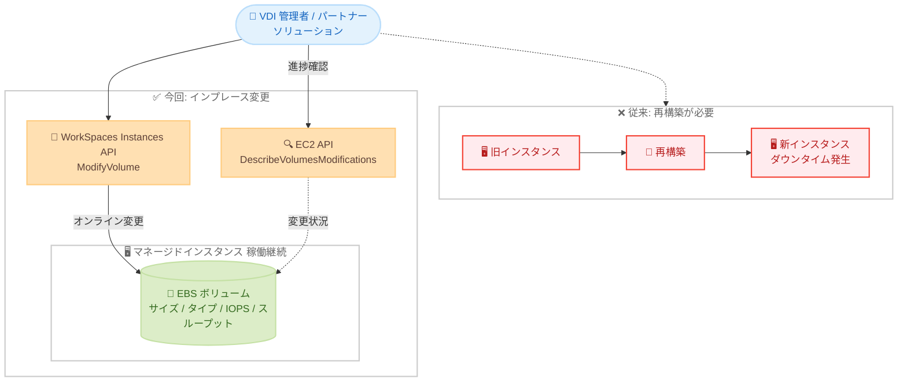

# Amazon WorkSpaces Core Managed Instances - ModifyVolume API サポート

**リリース日**: 2026 年 10 月 26 日
**サービス**: Amazon WorkSpaces Core
**機能**: Managed Instances における ModifyVolume API のサポート

📊 [このアップデートのインフォグラフィックを見る](https://takech9203.github.io/aws-news-summary/20261026-amazon-workspaces-cmi-modifyvolume.html)

## 概要

Amazon WorkSpaces Core Managed Instances が ModifyVolume API をサポートしました。これにより、ボリュームのデタッチやインスタンスの再起動を行うことなく、マネージドインスタンスにアタッチされたボリュームのサイズ、ボリュームタイプ、IOPS、スループットをインプレース (稼働中のまま) で変更できるようになります。

WorkSpaces Core は、パートナーの VDI ソリューションと組み合わせて利用する仮想デスクトップ基盤であり、Managed Instances は AWS が管理するアカウント内で EC2 ベースのインスタンスを提供する機能です。これまで、デプロイ済みのマネージドインスタンスのストレージ容量やパフォーマンスを変更するには、インスタンスの再構築が必要でした。今回のアップデートにより、ユーザーのデスクトップ環境を停止せずにストレージ要件の変化へ柔軟に対応できます。

本機能は、WorkSpaces Core Managed Instances を利用する VDI 管理者や、WorkSpaces Core パートナーソリューションを構築するパートナーに有用です。

**アップデート前の課題**

- デプロイ済みのマネージドインスタンスのストレージ容量やパフォーマンスを変更するには、インスタンスの再構築が必要だった
- 再構築に伴い、ユーザーのデスクトップ環境にダウンタイムが発生し、運用負荷が高かった
- 利用状況の変化 (データ増加やワークロードの高負荷化) に対して、ストレージ構成を迅速に追従させることが難しかった

**アップデート後の改善**

- ボリュームをデタッチせず、インスタンスを再起動することなく、ボリューム構成をインプレースで変更できるようになった
- ボリュームサイズを最大 16,384 GiB まで拡張できるほか、サポートされる EBS ボリュームタイプ間の変更、gp3/io1/io2 の IOPS 調整、gp3 のスループット変更が可能になった
- 冪等性トークン (ClientToken) により重複した変更リクエストを防止でき、進捗は Amazon EC2 の DescribeVolumesModifications 操作で追跡できるようになった

## アーキテクチャ図



従来はストレージ変更にインスタンスの再構築が必要でしたが、今回のアップデートにより ModifyVolume API を呼び出すだけで、稼働中のインスタンスにアタッチされたボリュームをオンラインで変更し、EC2 の DescribeVolumesModifications で進捗を追跡できます。

## サービスアップデートの詳細

### 主要機能

1. **ボリュームサイズのインプレース拡張**
   - ボリュームをデタッチせず、インスタンスを再起動することなくサイズを拡張可能
   - 最大 16,384 GiB まで拡張できる
   - サイズは拡張のみ可能で、縮小はできない (現在のサイズ以上を指定する必要がある)

2. **ボリュームタイプの変更**
   - サポートされる Amazon EBS ボリュームタイプ間での切り替えが可能
   - API で指定可能な値は `standard | io1 | io2 | gp2 | sc1 | st1 | gp3`
   - 一部のボリュームタイプ変更はサポートされないため、EBS ユーザーガイドの制限事項の確認が必要

3. **IOPS / スループットの調整**
   - gp3、io1、io2 ボリュームの IOPS を調整可能
   - gp3 ボリュームのスループット (MiB/s) を変更可能
   - 指定しなかったパラメータは現在の値が維持される

4. **冪等性と進捗追跡**
   - ClientToken による冪等性サポートにより、重複したボリューム変更を防止
   - 変更の進捗は Amazon EC2 の DescribeVolumesModifications 操作で直接追跡可能

## 技術仕様

### ModifyVolume API リクエストパラメータ

| パラメータ | 型 | 必須 | 説明 |
|------|------|------|------|
| VolumeId | String | はい | 変更対象のボリューム ID (パターン: `vol-[0-9a-zA-Z]{1,63}`) |
| SizeInGB | Integer | いいえ | 目標サイズ (GiB)。1〜16,384。現在のサイズ以上を指定 |
| VolumeType | String | いいえ | 目標 EBS ボリュームタイプ (`standard`/`io1`/`io2`/`gp2`/`sc1`/`st1`/`gp3`) |
| Iops | Integer | いいえ | 目標 IOPS。gp3/io1/io2 のみ有効 |
| Throughput | Integer | いいえ | 目標スループット (MiB/s)。gp3 のみ有効 |
| ClientToken | String | いいえ | 冪等性トークン (1〜64 文字) |

少なくとも 1 つの変更パラメータ (SizeInGB、VolumeType、Iops、Throughput のいずれか) を指定する必要があり、同一ボリュームに対する前回の変更が完了するまで次の変更は実行できません。

### 主なエラー

| エラー | HTTP ステータス | 説明 |
|------|------|------|
| ValidationException | 400 | 入力パラメータが不正 |
| ConflictException | 409 | リソースの現在の状態と競合 |
| VolumeModificationRateExceededException | 429 | 前回の変更が進行中、または 24 時間以内の変更回数上限 (4 回) に到達 |
| ResourceNotFoundException | 404 | 対象リソースが見つからない |
| ThrottlingException | 429 | リクエストレート超過 |

### API変更履歴

| 日付 | サービス | 変更内容 |
|------|----------|----------|
| 2026/10/19 | [workspaces-instances](https://awsapichanges.com/archive/changes/626f4f-workspaces-instances.html) | 1 new api method - ModifyVolume が WorkSpaces Core Managed Instances 向けの新しいパブリック API として追加。既存のマネージドボリュームのサイズ、タイプ、IOPS、スループットを停止なしでオンライン変更可能 |

## 設定方法

### 前提条件

1. Amazon WorkSpaces Core Managed Instances が利用可能であること
2. 変更対象のボリューム ID (`vol-xxxx`) を把握していること
3. `workspaces-instances:ModifyVolume` を実行できる IAM 権限があること

### 手順

#### ステップ1: ボリュームの変更を実行

```bash
aws workspaces-instances modify-volume \
  --volume-id vol-0123456789abcdef0 \
  --size-in-gb 500 \
  --volume-type gp3 \
  --iops 6000 \
  --throughput 500 \
  --client-token my-idempotency-token-001
```

WorkSpaces Instances の ModifyVolume API を呼び出し、ボリュームサイズを 500 GiB、タイプを gp3、IOPS を 6,000、スループットを 500 MiB/s に変更します。`--client-token` により同じリクエストが重複実行されることを防ぎます。

#### ステップ2: 変更の進捗を確認

```bash
aws ec2 describe-volumes-modifications \
  --volume-ids vol-0123456789abcdef0
```

Amazon EC2 の DescribeVolumesModifications 操作で、ボリューム変更の進捗 (`modifying`、`optimizing`、`completed` など) を確認します。

#### ステップ3: ファイルシステムの拡張

ボリュームサイズを拡張した場合、OS 側でパーティションとファイルシステムを拡張して新しい容量を認識させる必要があります。Linux では `growpart` と `resize2fs`/`xfs_growfs`、Windows ではディスクの管理または `diskpart` を使用します。詳細は [Amazon EBS ユーザーガイド](https://docs.aws.amazon.com/ebs/latest/userguide/recognize-expanded-volume-linux.html) を参照してください。

## メリット

### ビジネス面

- **ダウンタイムの削減**: インスタンスの再構築が不要になり、ユーザーのデスクトップ環境を停止せずにストレージを変更できるため、業務影響を最小化できる
- **運用コストの削減**: 再構築に伴うイメージ管理、再デプロイ、ユーザー調整などの作業が不要になる
- **コスト最適化**: 必要になったタイミングで必要な分だけストレージ容量やパフォーマンスを引き上げる運用が可能になる

### 技術面

- **インプレース変更**: ボリュームのデタッチやインスタンスの再起動が不要で、稼働中のまま構成変更が完了する
- **冪等性の確保**: ClientToken により、リトライ時の重複変更を防止できる
- **既存の運用フローとの親和性**: 進捗追跡には既存の EC2 DescribeVolumesModifications をそのまま利用でき、EBS Elastic Volumes と同様の運用モデルで扱える

## デメリット・制約事項

### 制限事項

- ボリュームサイズは拡張のみ可能で、縮小はできない
- サイズとパフォーマンスの変更は、変更先のボリュームタイプの上限内である必要があり、一部のボリュームタイプ間の変更はサポートされない ([EBS の制限事項](https://docs.aws.amazon.com/ebs/latest/userguide/ebs-modify-volume.html#elastic-volumes-limitations) を参照)
- 同一ボリュームに対する前回の変更が完了するまで、次の変更は実行できない。また、ローリング 24 時間あたりの変更回数には上限 (4 回) がある
- IOPS の指定は gp3/io1/io2 のみ、スループットの指定は gp3 のみ有効

### 考慮すべき点

- サイズ拡張後は、OS 側でパーティションとファイルシステムの拡張作業が別途必要になる
- 変更後は EBS の料金が新しい構成に基づいて課金されるため、コストへの影響を事前に見積もる必要がある
- WorkSpaces Core パートナーソリューション経由で利用する場合は、パートナー側の対応状況を確認する必要がある

## ユースケース

### ユースケース1: ユーザーデータ増加に伴うディスク容量の拡張

**シナリオ**: 開発者向け仮想デスクトップでリポジトリやビルド成果物が増加し、ディスク空き容量が逼迫している。業務時間中のダウンタイムは許容できない。

**実装例**:
```bash
aws workspaces-instances modify-volume \
  --volume-id vol-0123456789abcdef0 \
  --size-in-gb 1000
```

**効果**: ユーザーが作業を継続したまま容量を 1,000 GiB に拡張でき、再構築やデータ移行が不要になる。

### ユースケース2: gp2 から gp3 への移行によるコスト最適化

**シナリオ**: 既存のマネージドインスタンスが gp2 ボリュームを使用しており、gp3 への移行でコスト効率とベースライン性能の改善を図りたい。

**実装例**:
```bash
aws workspaces-instances modify-volume \
  --volume-id vol-0123456789abcdef0 \
  --volume-type gp3 \
  --iops 3000 \
  --throughput 250
```

**効果**: 稼働中のまま gp3 へ移行し、IOPS とスループットを独立して設定できるため、性能要件に合わせたコスト最適化が実現できる。

### ユースケース3: 高負荷ワークロード向けの一時的な性能引き上げ

**シナリオ**: CAD や動画編集など I/O 集約型のワークロードを扱う期間だけ、特定ユーザーのデスクトップのストレージ性能を引き上げたい。

**実装例**:
```bash
# 繁忙期: IOPS とスループットを引き上げ
aws workspaces-instances modify-volume \
  --volume-id vol-0123456789abcdef0 \
  --iops 10000 \
  --throughput 700 \
  --client-token peak-season-2026
```

**効果**: 再構築なしで必要な期間だけ性能を引き上げられる。冪等性トークンにより、自動化スクリプトのリトライ時にも重複変更を防げる。

## 料金

ModifyVolume API の呼び出し自体に追加料金は発生しません。変更後のボリューム構成 (サイズ、タイプ、IOPS、スループット) に応じて、Amazon EBS および WorkSpaces Core Managed Instances の料金が適用されます。容量や性能を引き上げた場合は、その分のストレージ料金が増加する点に注意してください。

詳細は [Amazon WorkSpaces Core 料金ページ](https://aws.amazon.com/workspaces-family/core/pricing/) および [Amazon EBS 料金ページ](https://aws.amazon.com/ebs/pricing/) を参照してください。

## 利用可能リージョン

Amazon WorkSpaces Core Managed Instances が利用可能なすべての AWS リージョンで利用できます。

## 関連サービス・機能

- **Amazon EBS Elastic Volumes**: 本機能の基盤となる EBS のオンラインボリューム変更機能。変更可能な組み合わせや制限事項は EBS 側の仕様に準拠する
- **Amazon EC2 DescribeVolumesModifications**: ボリューム変更の進捗追跡に使用する EC2 API
- **Amazon WorkSpaces Core パートナーソリューション**: Citrix、Omnissa、Workspot などのパートナー VDI 管理ソリューション。パートナー経由でも本機能を利用可能 (提供開始後)

## 参考リンク

- 📊 [インフォグラフィック](https://takech9203.github.io/aws-news-summary/20261026-amazon-workspaces-cmi-modifyvolume.html)
- [公式発表 (What's New)](https://aws.amazon.com/about-aws/whats-new/2026/10/amazon-workspaces-cmi-modifyvolume/)
- [ModifyVolume API リファレンス (WorkSpaces Instances)](https://docs.aws.amazon.com/workspaces-instances/latest/api/API_ModifyVolume.html)
- [ボリューム変更の制限事項 (Amazon EBS ユーザーガイド)](https://docs.aws.amazon.com/ebs/latest/userguide/ebs-modify-volume.html#elastic-volumes-limitations)
- [Amazon WorkSpaces Core](https://aws.amazon.com/workspaces/vdi-partners/)

## まとめ

Amazon WorkSpaces Core Managed Instances の ModifyVolume API サポートにより、これまで再構築が必要だったストレージ構成の変更を、ダウンタイムなしのインプレース操作で実行できるようになりました。VDI 環境のストレージ運用を大幅に簡素化できるアップデートであり、WorkSpaces Core Managed Instances を利用中の場合は、既存の再構築ベースの運用手順を本 API を活用したフローへ見直すことを推奨します。
