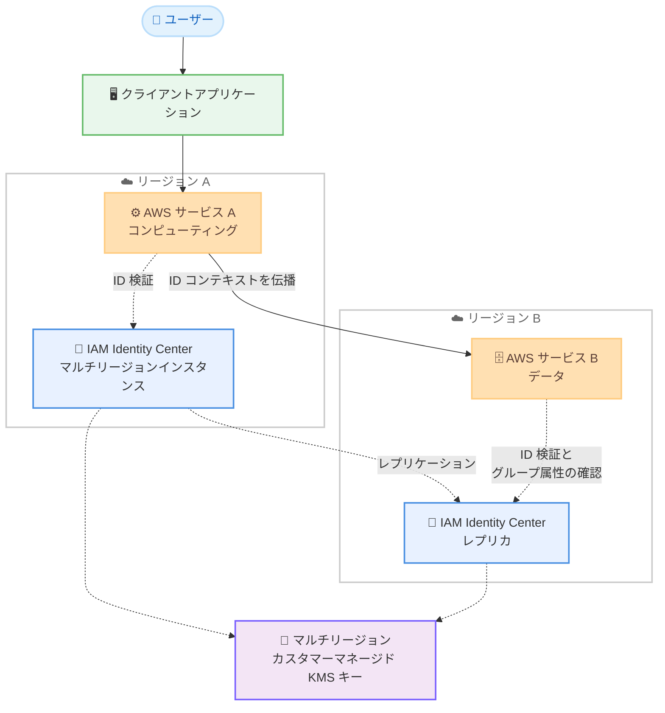

# AWS IAM Identity Center - クロスリージョン信頼できる ID 伝播のサポート

**リリース日**: 2026 年 10 月 26 日
**サービス**: AWS IAM Identity Center
**機能**: クロスリージョン信頼できる ID 伝播 (Cross-Region Trusted Identity Propagation)

📊 [このアップデートのインフォグラフィックを見る](https://takech9203.github.io/aws-news-summary/20261026-aws-iam-identity-center-cross-region-tip.html)

## 概要

AWS IAM Identity Center の信頼できる ID 伝播 (trusted identity propagation) がクロスリージョンに対応しました。信頼できる ID 伝播は、ユーザーの ID をリクエストに付加することで、AWS サービスが「どのユーザーが、どのグループに所属しているか」に基づいてアクセスを認可し、監査目的でアクセスを記録できる機能です。今回のアップデートにより、この ID コンテキストを異なる AWS リージョンで実行される AWS サービスへ伝播できるようになりました。

多くのお客様は、コンピューティングとデータの分離、利用可能なキャパシティの活用、ディザスタリカバリ、グローバル展開などの理由で、ワークロードを複数のリージョンに分散しています。今回の対応により、ユーザー ID がリクエストとともに自動的にリージョンをまたいで伝わるため、クロスリージョン構成でもユーザーごとのきめ細かなアクセス制御と監査を維持できます。

本機能は、IAM Identity Center が利用可能なすべての AWS リージョンで、追加料金なしで利用できます。

**アップデート前の課題**

このアップデート以前は、信頼できる ID 伝播は単一リージョン内に閉じた機能でした。

- ユーザー ID にアクセスするすべての AWS サービスが同一リージョンに存在する必要があった
- 別リージョンのサービスへアクセスする場合、個々のユーザーを区別できない広範な IAM ロールを使用する必要があった
- あるいは、すべてのサービスを単一リージョンに集約する構成変更が必要だった
- 広範な IAM ロールを使用した場合、ユーザー単位のアクセス制御や監査ログの記録ができなかった

**アップデート後の改善**

今回のアップデートにより、クロスリージョン構成でも ID ベースのアクセス制御が可能になりました。

- ユーザーの ID コンテキストが、リクエストとともに自動的にリージョンをまたいで伝播されるようになった
- 受信側リージョンの AWS サービスが、ユーザーとグループ関連付けに基づいてアクセスを認可できるようになった
- クロスリージョンワークロードでも、ユーザー単位のきめ細かなアクセス許可と監査が可能になった
- 広範な IAM ロールへのフォールバックや、単一リージョンへのサービス集約が不要になった

## アーキテクチャ図



マルチリージョン IAM Identity Center インスタンスを使用すると、リージョン A で認証したユーザーの ID コンテキストが、リージョン B の AWS サービスへのリクエストとともに伝播され、受信側サービスがユーザーとグループ属性に基づいてアクセスを認可します。

## サービスアップデートの詳細

### 主要機能

1. **クロスリージョンでの ID コンテキスト伝播**
   - ユーザーがあるリージョンで認証し AWS サービスにアクセスすると、その ID コンテキストを別リージョンの AWS サービスへ伝播できる
   - ID コンテキストには、リクエスト元ユーザーの識別情報、アクセス対象の AWS サービス、アクセススコープ (読み取り専用など) が含まれる
   - 受信側の AWS サービスは、このコンテキストとユーザーに割り当てられた権限を使用してアクセスを認可する

2. **ユーザーとグループ属性に基づくきめ細かな認可**
   - 受信側リージョンの AWS サービスが、グループ関連付けなどのユーザー属性に基づいてアクセスを認可する
   - クロスリージョンワークロードでも、個々のユーザー単位のアクセス制御を実現できる
   - 広範な IAM ロールでは不可能だった「誰がアクセスしたか」の識別が可能

3. **監査の継続性**
   - AWS サービスは、ユーザー識別子を AWS CloudTrail やサービスログに記録できる
   - リージョンをまたいだアクセスでも「どのユーザーがどのデータにアクセスしたか」を監査可能

4. **既存設定からの自動的な拡張**
   - すでにマルチリージョンレプリケーションを有効化し、AWS サービスで信頼できる ID 伝播を設定済みの場合、追加リージョンでのクロスリージョン信頼できる ID 伝播は自動的に機能する

## 技術仕様

### 前提となる構成要素

| 項目 | 詳細 |
|------|------|
| IAM Identity Center インスタンス | マルチリージョンインスタンスが必要 (レプリケーション先リージョン間で動作) |
| KMS キー | マルチリージョンのカスタマーマネージド KMS キーが必要 |
| 対応範囲 | インスタンスをレプリケートしたリージョン間で ID 伝播が動作 |
| 認可の仕組み | 受信側サービスがユーザー属性 (グループ関連付けなど) に基づき認可 |
| 監査 | AWS CloudTrail および各サービスのログにユーザー識別子を記録可能 |

### 信頼できる ID 伝播の有効化ステップ

ドキュメントによると、信頼できる ID 伝播の有効化には以下の 2 つのステップが必要です。

1. IAM Identity Center を有効化し、既存の ID ソース (外部 IdP など) を接続する
2. ユースケースに含まれる各 AWS サービスを、各サービスのドキュメントに従って IAM Identity Center に接続する

サードパーティ製またはお客様が開発したアプリケーションが関与する場合は、アプリケーションユーザーを認証する ID プロバイダーと IAM Identity Center の間に信頼関係 (信頼できるトークン発行者) を構成します。

## 設定方法

### 前提条件

1. IAM Identity Center の組織インスタンスが有効化されていること
2. マルチリージョンレプリケーションが有効化されたマルチリージョンインスタンスであること
3. マルチリージョンのカスタマーマネージド KMS キーが設定されていること
4. 利用する AWS サービス側で信頼できる ID 伝播の設定が完了していること

### 手順

#### ステップ 1: マルチリージョンインスタンスと KMS キーの確認

```bash
# IAM Identity Center インスタンスの一覧を確認
aws sso-admin list-instances
```

IAM Identity Center インスタンスの ARN と設定状態を確認します。マルチリージョンレプリケーションが未設定の場合は、IAM Identity Center コンソールからマルチリージョン対応を有効化し、マルチリージョンのカスタマーマネージド KMS キーを設定します。

#### ステップ 2: 各 AWS サービスでの信頼できる ID 伝播の設定

各 AWS サービス (Amazon Redshift、Amazon Athena、Amazon QuickSight など) のドキュメントに従い、サービスを IAM Identity Center に接続して信頼できる ID 伝播を設定します。設定方法はサービスごとに異なるため、ユースケースガイダンスを参照してください。

#### ステップ 3: クロスリージョンでの動作確認

すでにマルチリージョンレプリケーションと信頼できる ID 伝播を設定済みの場合、追加の設定なしで、レプリケートされたリージョン間のクロスリージョン ID 伝播が自動的に機能します。別リージョンのサービスへアクセスし、CloudTrail やサービスログにユーザー識別子が記録されることを確認します。

## メリット

### ビジネス面

- **グローバル展開の柔軟性**: コンピューティングとデータを異なるリージョンに配置する構成でも、ユーザー単位のアクセス制御を維持したままワークロードを展開できる
- **コンプライアンスと監査の強化**: リージョンをまたぐアクセスでも「誰が何にアクセスしたか」を CloudTrail やサービスログで追跡でき、監査要件に対応しやすい
- **追加コストなし**: IAM Identity Center が利用可能なすべてのリージョンで追加料金なしで利用できる

### 技術面

- **広範な IAM ロールの排除**: 個々のユーザーを区別できない共有 IAM ロールを使用する必要がなくなり、最小権限の原則に沿った設計が可能
- **アーキテクチャ制約の解消**: すべてのサービスを単一リージョンに集約する必要がなくなり、キャパシティ活用やディザスタリカバリを考慮したマルチリージョン設計が可能
- **自動的な ID 伝播**: ユーザー ID がリクエストとともに自動的にリージョンをまたいで伝わるため、アプリケーション側での独自の ID 引き回し実装が不要

## デメリット・制約事項

### 制限事項

- マルチリージョン IAM Identity Center インスタンスが必要 (単一リージョンインスタンスでは利用不可)
- マルチリージョンのカスタマーマネージド KMS キーが必要 (AWS 所有キーでは不可)
- ID 伝播が動作するのは、インスタンスをレプリケートしたリージョン間に限られる

### 考慮すべき点

- 利用する各 AWS サービスが信頼できる ID 伝播に対応している必要があるため、ユースケースごとに対応状況をドキュメントで確認する必要がある
- マルチリージョンのカスタマーマネージド KMS キーの運用 (キーポリシー、ローテーション、コスト) を設計に含める必要がある
- 既存の単一リージョンインスタンスからマルチリージョン構成への移行計画が必要になる場合がある

## ユースケース

### ユースケース 1: コンピューティングとデータを分離したクロスリージョン分析基盤

**シナリオ**: データレイクを東京リージョンに配置し、分析用のコンピューティングリソースをキャパシティに余裕のある別リージョンで実行する。アナリストごとにアクセスできるデータを制御したい。

**実装例**:
```text
1. IAM Identity Center をマルチリージョンインスタンスとして構成し、
   東京リージョンと分析実行リージョンへレプリケート
2. マルチリージョンのカスタマーマネージド KMS キーを設定
3. 分析サービスとデータサービスの両方で信頼できる ID 伝播を設定
4. データ側でユーザーのグループ関連付けに基づくアクセス許可を定義
```

**効果**: 分析リージョンで認証されたアナリストの ID が東京リージョンのデータサービスまで伝播され、グループに基づくきめ細かなデータアクセス制御と、ユーザー単位の監査ログの記録が可能になります。

### ユースケース 2: ディザスタリカバリ構成での ID ベースアクセス制御の維持

**シナリオ**: プライマリリージョンの障害に備え、セカンダリリージョンにワークロードをスタンバイ配置している。フェイルオーバー後もユーザー単位のアクセス制御と監査を維持したい。

**実装例**:
```text
1. IAM Identity Center のマルチリージョンレプリケーションで
   プライマリとセカンダリの両リージョンをカバー
2. 両リージョンのサービスで信頼できる ID 伝播を設定
3. フェイルオーバー後も同じユーザー・グループベースの
   アクセス許可が自動的に適用されることを確認
```

**効果**: フェイルオーバー時にも広範な IAM ロールへ切り替えることなく、通常時と同じ ID ベースのアクセス制御と監査証跡を維持できます。

### ユースケース 3: 広範な IAM ロールからの移行によるセキュリティ強化

**シナリオ**: 現在、別リージョンのサービスへのアクセスに共有の IAM ロールを使用しており、個々のユーザーを区別したアクセス制御や監査ができていない。

**実装例**:
```text
1. 既存の IAM Identity Center インスタンスをマルチリージョン構成に拡張
2. 対象リージョンの AWS サービスで信頼できる ID 伝播を設定
3. 共有 IAM ロールによるアクセスを、ユーザー・グループベースの
   アクセス許可に段階的に置き換え
4. CloudTrail でユーザー単位のアクセスログを確認
```

**効果**: 共有ロールを廃止し、最小権限の原則に沿ったユーザー単位のアクセス制御へ移行することで、セキュリティポスチャと監査能力が向上します。

## 料金

クロスリージョン信頼できる ID 伝播は、追加料金なしで利用できます。IAM Identity Center 自体も無料で利用できます。

なお、前提条件であるマルチリージョンのカスタマーマネージド KMS キーには、AWS KMS の標準料金 (キー保管料金および API リクエスト料金) が適用される点に留意してください。

## 利用可能リージョン

IAM Identity Center が利用可能なすべての AWS リージョンで利用できます。クロスリージョン信頼できる ID 伝播は、マルチリージョンインスタンスをレプリケートしたリージョン間で動作します。

## 関連サービス・機能

- **AWS IAM Identity Center マルチリージョンインスタンス**: 本機能の前提となる構成。Identity Center インスタンスを複数リージョンへレプリケートする機能で、2026 年に対応リージョンが順次拡大されている
- **AWS KMS**: マルチリージョンのカスタマーマネージドキーが本機能の前提条件。ID コンテキストの保護に使用される
- **AWS CloudTrail**: 伝播されたユーザー識別子を記録し、リージョンをまたぐアクセスの監査を実現
- **Amazon Redshift / Amazon Athena / Amazon QuickSight など**: 信頼できる ID 伝播に対応する分析系サービス。ユーザー・グループベースのデータアクセス制御のユースケースで利用される

## 参考リンク

- 📊 [インフォグラフィック](https://takech9203.github.io/aws-news-summary/20261026-aws-iam-identity-center-cross-region-tip.html)
- [公式発表 (What's New)](https://aws.amazon.com/about-aws/whats-new/2026/10/aws-iam-identity-center-cross-region-tip/)
- [ドキュメント: Trusted identity propagation overview](https://docs.aws.amazon.com/singlesignon/latest/userguide/trustedidentitypropagation-overview.html)
- [ドキュメント: Trusted identity propagation use cases](https://docs.aws.amazon.com/singlesignon/latest/userguide/trustedidentitypropagation-integrations.html)

## まとめ

IAM Identity Center の信頼できる ID 伝播がクロスリージョンに対応し、マルチリージョン構成でもユーザー・グループベースのきめ細かなアクセス制御と監査を維持できるようになりました。これまで広範な IAM ロールや単一リージョンへの集約を強いられていたクロスリージョンワークロードにおいて、セキュリティとアーキテクチャの柔軟性を両立できます。マルチリージョンインスタンスとマルチリージョンのカスタマーマネージド KMS キーが前提となるため、まずは現在のインスタンス構成を確認し、マルチリージョン化を検討することを推奨します。
