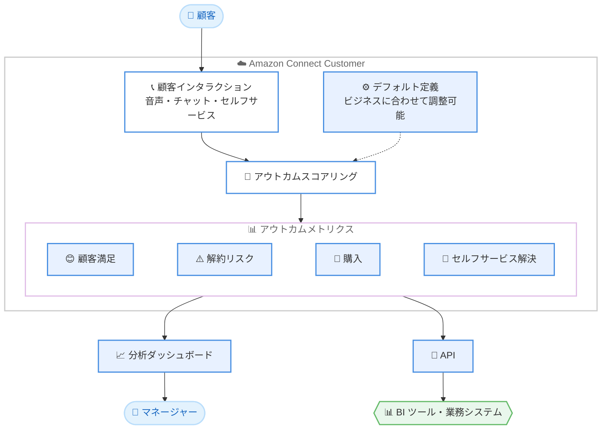

# Amazon Connect Customer - ビジネスアウトカムメトリクス

**リリース日**: 2026 年 10 月 26 日
**サービス**: Amazon Connect Customer
**機能**: 顧客維持と収益に直結するインタラクションアウトカムの測定機能

📊 [このアップデートのインフォグラフィックを見る](https://takech9203.github.io/aws-news-summary/20261026-connect-customer-boma-metrics.html)

## 概要

Amazon Connect Customer が、顧客インタラクションのアウトカム (成果) をスコアリングする新しいメトリクスを発表しました。この機能により、顧客が満足して対応を終えたか、解約 (チャーン) のリスクがあるか、購入に至ったか、セルフサービスでニーズを解決できたかを可視化できます。従来の「インタラクションがどれだけ効率的に処理されたか」という視点に加えて、「インタラクションが実際に成果を生んだか」を把握できるようになります。

各アウトカムメトリクスにはデフォルトの定義が用意されており、そのまま利用を開始できます。さらに、各ビジネス固有の「成功の定義」に合わせて定義を調整することも可能です。メトリクスは分析ダッシュボードと API の両方から利用できるため、コンタクトセンターのマネージャーによる日々のモニタリングから、BI ツールや業務システムへの連携まで幅広く活用できます。

**アップデート前の課題**

従来のコンタクトセンター分析は、処理効率を中心としたメトリクスに偏っていました。

- 平均処理時間や応答率などの効率指標では、顧客が満足して終了したかどうかを判断できなかった
- 解約リスクのある顧客や購入につながったインタラクションを特定するには、別途の調査や外部ツールによる分析が必要だった
- セルフサービスで解決したかどうかを含めた「成果ベース」の評価を標準メトリクスとして取得する手段がなかった

**アップデート後の改善**

今回のアップデートにより、成果に基づくコンタクトセンター運営が可能になります。

- インタラクションごとのアウトカム (満足、解約リスク、購入、セルフサービス解決) をスコアとして確認できるようになった
- デフォルト定義により追加設定なしで利用を開始でき、必要に応じてビジネス独自の成功定義にカスタマイズできるようになった
- 分析ダッシュボードと API の両方でメトリクスを取得でき、既存の分析基盤やレポーティングフローに組み込めるようになった

## アーキテクチャ図



顧客インタラクションが Amazon Connect Customer 上でスコアリングされ、4 種類のアウトカムメトリクスとして分析ダッシュボードと API の両方から利用できる流れを示しています。

## サービスアップデートの詳細

### 主要機能

1. **インタラクションアウトカムのスコアリング**
   - 個々の顧客インタラクションの「成果」をスコアとして測定
   - 顧客が満足して終了したか、解約リスクがあるか、購入したか、セルフサービスで解決したかを可視化
   - 効率指標だけでは見えなかった「インタラクションが機能したかどうか」を把握可能

2. **デフォルト定義とカスタマイズ**
   - 各メトリクスにはデフォルト定義が付属しており、追加設定なしで利用開始が可能
   - ビジネスごとの成功の定義に合わせてメトリクス定義を調整可能
   - 業種や KPI 設計に応じた柔軟な運用が可能

3. **ダッシュボードと API の両対応**
   - 分析ダッシュボードでアウトカムメトリクスを確認可能
   - API 経由でメトリクスを取得し、外部の BI ツールやデータ基盤に連携可能

## 技術仕様

### 測定されるアウトカム

| アウトカム | 内容 |
|------|------|
| 顧客満足 | 顧客が満足して対応を終えたかどうか |
| 解約リスク | 顧客にチャーン (解約) のリスクがあるかどうか |
| 購入 | インタラクションが購入につながったかどうか |
| セルフサービス解決 | 顧客がセルフサービスでニーズを解決したかどうか |

### 利用方法

| 項目 | 詳細 |
|------|------|
| メトリクス定義 | デフォルト定義を提供、ビジネスの成功定義に合わせて調整可能 |
| 参照方法 | 分析ダッシュボードおよび API |
| 対象サービス | Amazon Connect Customer |

## 設定方法

### 前提条件

1. Amazon Connect Customer インスタンスが作成済みであること
2. ダッシュボードおよびレポートを閲覧するためのセキュリティプロファイル権限が付与されていること
3. メトリクス定義を調整する場合は、該当する管理権限を持つユーザーで操作すること

### 手順

#### ステップ 1: デフォルト定義でメトリクスを確認する

Amazon Connect Customer の管理 Web サイトにサインインし、分析ダッシュボードでアウトカムメトリクスを確認します。各メトリクスにはデフォルト定義が用意されているため、追加設定なしで利用を開始できます。

#### ステップ 2: ビジネスの成功定義に合わせて調整する

デフォルト定義が自社の「成功」の定義と異なる場合は、メトリクス定義をビジネス要件に合わせて調整します。具体的な設定項目は [Connect Customer 管理者ガイド](https://docs.aws.amazon.com/connect/latest/adminguide/amazon-connect-metrics.html)を参照してください。

#### ステップ 3: API で外部システムに連携する

アウトカムメトリクスは API でも取得できます。既存の BI ツールやデータウェアハウスに取り込み、他の業務データと組み合わせた分析に活用します。

## メリット

### ビジネス面

- **成果ベースの運営**: 効率指標だけでなく「インタラクションが成果を生んだか」でコンタクトセンターを評価できる
- **解約の予防**: 解約リスクのある顧客を特定し、プロアクティブなリテンション施策につなげられる
- **収益への貢献の可視化**: 購入につながったインタラクションを把握し、コンタクトセンターを収益貢献部門として位置付けられる

### 技術面

- **即時利用可能**: デフォルト定義により、複雑な初期設定なしで利用を開始できる
- **柔軟なカスタマイズ**: ビジネス固有の成功定義に合わせてメトリクスを調整できる
- **API 連携**: ダッシュボードに加えて API でも取得でき、既存の分析基盤に統合しやすい

## デメリット・制約事項

### 制限事項

- Amazon Connect Customer が提供されているリージョンでのみ利用可能
- アウトカムのスコアリング精度は、デフォルト定義のままではビジネスの実態と乖離する可能性があり、定義の調整が必要になる場合がある

### 考慮すべき点

- 「満足」「解約リスク」などの定義は組織の KPI 設計と整合させる必要があるため、導入前に関係部門と成功の定義を合意しておくことが望ましい
- スコアはあくまで指標であり、重要な意思決定 (解約予防施策の発動など) には他のデータと組み合わせた検証を推奨
- 具体的な対応チャネルやスコアリングの仕組みの詳細は、管理者ガイドで最新情報を確認すること

## ユースケース

### ユースケース 1: 解約リスク顧客への早期フォロー

**シナリオ**: サブスクリプションサービスのコンタクトセンターで、解約の予兆がある顧客を早期に発見し、リテンションチームにエスカレーションしたい。

**実装例**:
```
1. アウトカムメトリクスの「解約リスク」を分析ダッシュボードでモニタリング
2. 解約リスクが高いと判定されたインタラクションを API で抽出
3. リテンションチームの CRM にリストを連携し、フォローアップを実施
```

**効果**: 解約予兆の早期検知により、プロアクティブな顧客維持施策が可能になり、チャーンレートの低減が期待できる。

### ユースケース 2: セルフサービスの効果測定

**シナリオ**: チャットボットや IVR などのセルフサービスチャネルへの投資効果を、実際の「解決率」で評価したい。

**実装例**:
```
1. 「セルフサービス解決」メトリクスをダッシュボードで確認
2. セルフサービスで解決したインタラクションと、オペレーター対応に
   エスカレーションされたインタラクションを比較
3. 解決率の低いシナリオを特定し、ボットのフローや FAQ を改善
```

**効果**: セルフサービスの実効性をデータで把握でき、改善の優先順位付けとオペレーターコストの最適化につながる。

### ユースケース 3: 収益貢献に基づくコンタクトセンター評価

**シナリオ**: コンタクトセンターをコストセンターではなく収益貢献部門として評価するため、インタラクションと購入の関係を可視化したい。

**実装例**:
```
1. 「購入」アウトカムメトリクスを API で取得
2. BI ツールでキャンペーンやキュー別の購入率を分析
3. 購入につながりやすい対応パターンを特定し、トレーニングに反映
```

**効果**: コンタクトセンターの収益貢献を定量的に示すことができ、経営層への報告や投資判断の根拠として活用できる。

## 料金

今回の発表では、本機能に固有の追加料金については言及されていません。最新の料金情報は [Amazon Connect の料金ページ](https://aws.amazon.com/connect/pricing/)を確認してください。

## 利用可能リージョン

Amazon Connect Customer が提供されているすべての AWS リージョンで利用可能です。

## 関連サービス・機能

- **Amazon Connect Customer 分析ダッシュボード**: アウトカムメトリクスを含むコンタクトセンターのパフォーマンスデータを可視化
- **Amazon Connect Contact Lens**: 会話分析により顧客感情やコンプライアンスを把握する機能で、アウトカム評価と組み合わせた分析が可能
- **Amazon Kinesis**: コンタクトレコードをストリーミングして長期保存や高度な分析を行う際に利用

## 参考リンク

- 📊 [インフォグラフィック](https://takech9203.github.io/aws-news-summary/20261026-connect-customer-boma-metrics.html)
- [公式発表 (What's New)](https://aws.amazon.com/about-aws/whats-new/2026/10/connect-customer-boma-metrics/)
- [ドキュメント: Metrics, dashboards, and insights in Connect Customer](https://docs.aws.amazon.com/connect/latest/adminguide/amazon-connect-metrics.html)
- [Amazon Connect 製品ページ](https://aws.amazon.com/connect/)
- [料金ページ](https://aws.amazon.com/connect/pricing/)

## まとめ

Amazon Connect Customer のアウトカムメトリクスにより、コンタクトセンターを「効率」だけでなく「成果」で評価できるようになりました。顧客満足、解約リスク、購入、セルフサービス解決という 4 つの観点がデフォルト定義付きで提供され、ダッシュボードと API の両方から利用できます。まずはデフォルト定義でダッシュボードを確認し、自社の成功の定義に合わせてメトリクスを調整することから始めることを推奨します。
