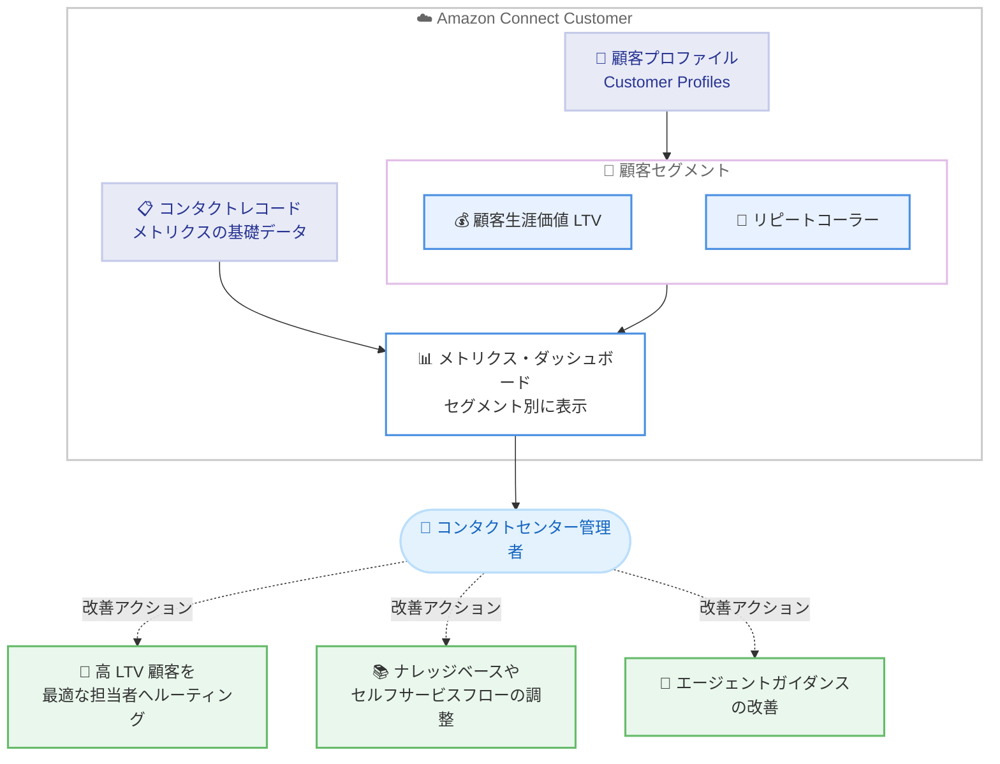

# Amazon Connect Customer - 顧客生涯価値・リピートコーラー別のメトリクス表示

**リリース日**: 2026 年 10 月 26 日
**サービス**: Amazon Connect Customer
**機能**: 顧客セグメント (顧客生涯価値・リピートコーラー) 別のメトリクス表示

📊 [このアップデートのインフォグラフィックを見る](https://takech9203.github.io/aws-news-summary/20261026-connect-customer-boma-segment.html)

## 概要

Amazon Connect Customer で、メトリクスを顧客セグメント別に表示できるようになりました。利用できるセグメントは「顧客生涯価値 (LTV)」と「リピートコーラーステータス」の 2 種類です。リピートコーラーとそれ以外のコンタクトでメトリクスがどう異なるか、また LTV が高い顧客層でのパフォーマンスがどうなっているかを確認できます。

この機能の狙いは、全体の集計値に現れる前に、悪化傾向にある顧客グループを早期に発見することです。コンタクトセンター全体の平均値は正常に見えても、特定のセグメント (例: 高 LTV 顧客やリピートコーラー) では満足度や解決率が低下しているケースがあります。セグメント別の可視化により、こうした「平均値に埋もれる問題」を検出できます。

公式発表では「The segment tells you where to look; the metrics tell you what to fix. (セグメントはどこを見るべきかを教え、メトリクスは何を直すべきかを教える)」と表現されており、セグメント分析を起点とした改善アクションの実行が想定されています。コンタクトセンターの運用管理者やカスタマーエクスペリエンス (CX) 担当者が主な対象ユーザーです。

**アップデート前の課題**

このアップデート以前は、メトリクスを顧客属性の観点で分解することが困難でした。

- メトリクスは全体の集計値やキュー・エージェント単位での確認が中心で、顧客の価値やコンタクト履歴に基づくセグメント別の比較が標準機能ではできなかった
- 全体平均が正常に見える場合、高 LTV 顧客やリピートコーラーなど特定グループでの体験悪化に気付くのが遅れがちだった
- 問題が集計値に現れてから原因調査を開始するため、重要顧客への影響が拡大した後の事後対応になりやすかった

**アップデート後の改善**

今回のアップデートにより、顧客セグメントの観点からメトリクスを分析できるようになりました。

- 顧客生涯価値 (LTV) とリピートコーラーステータスの 2 つのセグメントでメトリクスを表示できるようになった
- リピートコーラーとそれ以外のコンタクトのメトリクス比較や、高 LTV 顧客層でのパフォーマンス確認が可能になった
- 悪化傾向のセグメントを集計値に現れる前に発見し、ルーティング変更やセルフサービスフローの調整など、的を絞った改善アクションを実行できるようになった

## アーキテクチャ図



顧客プロファイルに基づく 2 つのセグメント (LTV・リピートコーラー) の観点でメトリクスを表示し、不調なセグメントの発見から改善アクションへつなげる流れを示しています。

## サービスアップデートの詳細

### 主要機能

1. **顧客生涯価値 (LTV) 別のメトリクス表示**
   - 顧客生涯価値のセグメントでメトリクスを分解して表示できる
   - LTV が高い顧客層に限定して、応対品質や満足度などのメトリクスの状況を確認できる
   - 重要顧客層での体験悪化を、全体集計に現れる前に検出することが狙い

2. **リピートコーラーステータス別のメトリクス表示**
   - リピートコーラー (繰り返し問い合わせてくる顧客) とそれ以外のコンタクトでメトリクスを比較できる
   - リピートコーラーの比率やメトリクスの傾向から、一次解決できていない領域を特定する手がかりが得られる

3. **セグメント起点の改善アクション**
   - 公式発表では、セグメントが不調な場合の対応例として以下が挙げられている
   - 高 LTV 顧客を最も効果的な担当者にルーティングする
   - リピートコーラーがフォールバックしている (離脱している) ナレッジベースやセルフサービスフローを調整する
   - 満足度が低下しているセグメント向けのエージェントガイダンスを改善する

## 技術仕様

### セグメントの種類

| セグメント | 内容 | 主な分析観点 |
|------|------|------|
| 顧客生涯価値 (LTV) | 顧客の生涯価値に基づくセグメント | 高 LTV 顧客層でのメトリクス状況の確認 |
| リピートコーラー | 繰り返し問い合わせている顧客かどうか | リピートコーラーとそれ以外のメトリクス比較 |

### メトリクスの基礎データ

| 項目 | 詳細 |
|------|------|
| メトリクスの基礎 | Connect Customer のコンタクトレコード (ほとんどの履歴・リアルタイムメトリクスの算出元) |
| コンタクトレコードの保持期間 | コンタクト開始から 24 か月 (Amazon Kinesis へのストリーミングで長期保持・高度な分析も可能) |
| 顧客セグメントの前提 | Connect Customer の顧客プロファイル (Customer Profiles) が利用可能であること |

## 設定方法

### 前提条件

1. Amazon Connect Customer インスタンスを運用していること
2. Connect Customer の顧客プロファイル (Customer Profiles) が利用可能なリージョンであること
3. ダッシュボードおよびメトリクスレポートを閲覧できる権限 (セキュリティプロファイル) が付与されていること

### 手順

#### ステップ 1: 管理者 Web サイトで分析画面を開く

Connect Customer の管理者 Web サイトにサインインし、ダッシュボードまたはメトリクスレポートの画面を開きます。メトリクスの閲覧には適切なセキュリティプロファイルの権限が必要です。

#### ステップ 2: 顧客セグメントの観点でメトリクスを表示する

メトリクスの表示設定で、顧客セグメント (顧客生涯価値またはリピートコーラーステータス) の観点を適用し、セグメント別にメトリクスを確認します。リピートコーラーとそれ以外の比較や、高 LTV 顧客層でのメトリクス状況を確認できます。具体的な画面操作は管理者ガイドのメトリクス・ダッシュボードのセクションを参照してください。

#### ステップ 3: 不調なセグメントへの改善アクションを実行する

セグメント別の分析結果に基づき、高 LTV 顧客のルーティング変更、セルフサービスフローやナレッジベースの調整、エージェントガイダンスの改善などのアクションを実行します。

## メリット

### ビジネス面

- **重要顧客の体験悪化の早期検出**: 高 LTV 顧客層のメトリクスを個別に監視でき、売上への影響が大きい顧客層の問題に先手を打てる
- **プロアクティブな運用改善**: 悪化傾向のセグメントを集計値に現れる前に発見でき、事後対応から予防的な改善へ移行できる
- **改善施策の優先順位付け**: どのセグメントが不調かが明確になるため、限られたリソースを効果の高い施策に集中できる

### 技術面

- **追加の分析基盤が不要**: Connect Customer の標準機能としてセグメント別表示が提供され、外部 BI ツールへのデータ連携や独自集計を構築しなくても分析を開始できる
- **既存メトリクス体系との統合**: コンタクトレコードを基礎とする既存のメトリクス体系に対して、顧客セグメントという新しい分析軸が加わる
- **運用アクションとの接続**: ルーティング、セルフサービスフロー、エージェントガイダンスなど Connect Customer 内の改善手段と直接つなげやすい

## デメリット・制約事項

### 制限事項

- 利用できるセグメントは顧客生涯価値 (LTV) とリピートコーラーステータスの 2 種類である
- 顧客プロファイル (Customer Profiles) が利用可能なリージョンであることが前提となる
- セグメントの判定には顧客データが必要であり、プロファイルデータが整備されていない場合は分析の精度が限定される可能性がある

### 考慮すべき点

- LTV などの顧客データを正しくセグメントに反映するには、顧客プロファイルへのデータ統合 (CRM や注文データとの連携) の整備が重要になる
- セグメント別メトリクスは「どこを見るべきか」を示すものであり、根本原因の特定にはコンタクトレコードや会話分析など他の情報との組み合わせが必要になる
- 顧客データの取り扱いにあたっては、自社のプライバシーポリシーやコンプライアンス要件を確認することが推奨される

## ユースケース

### ユースケース 1: 高 LTV 顧客の優先ルーティング

**シナリオ**: 全体の顧客満足度は目標を達成しているが、売上貢献の大きい高 LTV 顧客層に限ると満足度が低下傾向にあることをセグメント別メトリクスで発見した。

**実装例**:
```text
1. メトリクスを LTV セグメント別に表示し、高 LTV 顧客層の
   満足度・解決率の傾向を確認
2. 高 LTV 顧客のコンタクトを、該当領域で最も効果的な担当者
   またはチームへルーティングするようフローを変更
3. 変更後、同じセグメント別メトリクスで改善効果を継続的に確認
```

**効果**: 重要顧客の離反リスクを早期に抑制し、顧客生涯価値の維持・向上につなげられる。

### ユースケース 2: リピートコーラーのセルフサービス改善

**シナリオ**: リピートコーラーのメトリクスをそれ以外のコンタクトと比較したところ、特定の問い合わせ種別でセルフサービスから有人対応へのフォールバックが多いことが判明した。

**実装例**:
```text
1. メトリクスをリピートコーラーステータス別に表示し、
   それ以外のコンタクトとの差分を確認
2. リピートコーラーがフォールバックしているナレッジベースの
   記事やセルフサービスフローを特定して内容を調整
3. 調整後のリピートコーラー比率・一次解決率の変化を確認
```

**効果**: 繰り返しの問い合わせを削減し、一次解決率の向上と運用コストの削減を両立できる。

### ユースケース 3: セグメント別のエージェントガイダンス改善

**シナリオ**: 特定のセグメントで満足度の低下傾向が見られ、エージェントの応対内容に改善余地があると考えられる。

**実装例**:
```text
1. セグメント別メトリクスで満足度が低下しているセグメントを特定
2. 該当セグメントのコンタクトに対するエージェントガイダンス
   (応対手順や推奨トーク) を改善
3. 改善後のセグメント別メトリクスで満足度の回復を確認
```

**効果**: 悪化傾向のセグメントに的を絞った応対品質の改善により、全体集計に影響が出る前に問題を解消できる。

## 料金

本アップデートに関する追加料金の記載は公式発表にはありません。Amazon Connect Customer の料金体系については、製品ページを参照してください。

- [Amazon Connect Customer 製品ページ](https://aws.amazon.com/products/connect/customer/)

## 利用可能リージョン

Connect Customer の顧客プロファイル (Customer Profiles) が利用可能なすべての AWS リージョンで利用できます。リージョン別の機能提供状況は管理者ガイドを参照してください。

- [リージョン別の機能提供状況](https://docs.aws.amazon.com/connect/latest/adminguide/regions.html)

## 関連サービス・機能

- **Connect Customer 顧客プロファイル (Customer Profiles)**: 顧客セグメントの基礎となる顧客データを統合管理する機能。本機能の利用可能リージョンの前提条件
- **Connect Customer のメトリクス・ダッシュボード**: コンタクトレコードを基礎とするリアルタイム・履歴メトリクスの表示機能。本アップデートでセグメント別の分析観点が追加
- **Amazon Connect フロー**: セグメント分析の結果を受けて、高 LTV 顧客の優先ルーティングやセルフサービスフローの調整を実装する手段

## 参考リンク

- 📊 [インフォグラフィック](https://takech9203.github.io/aws-news-summary/20261026-connect-customer-boma-segment.html)
- [公式発表 (What's New)](https://aws.amazon.com/about-aws/whats-new/2026/10/connect-customer-boma-segment/)
- [ドキュメント: Connect Customer のメトリクス・ダッシュボード・インサイト](https://docs.aws.amazon.com/connect/latest/adminguide/amazon-connect-metrics.html)
- [Amazon Connect Customer 製品ページ](https://aws.amazon.com/products/connect/customer/)

## まとめ

Amazon Connect Customer のメトリクスを、顧客生涯価値 (LTV) とリピートコーラーステータスという顧客セグメント別に表示できるようになり、全体集計に埋もれがちな重要顧客層の体験悪化を早期に発見できるようになりました。コンタクトセンターを運用するチームは、顧客プロファイルのデータ整備状況を確認したうえで、高 LTV 顧客やリピートコーラーのメトリクス監視を定常運用に組み込むことを推奨します。
