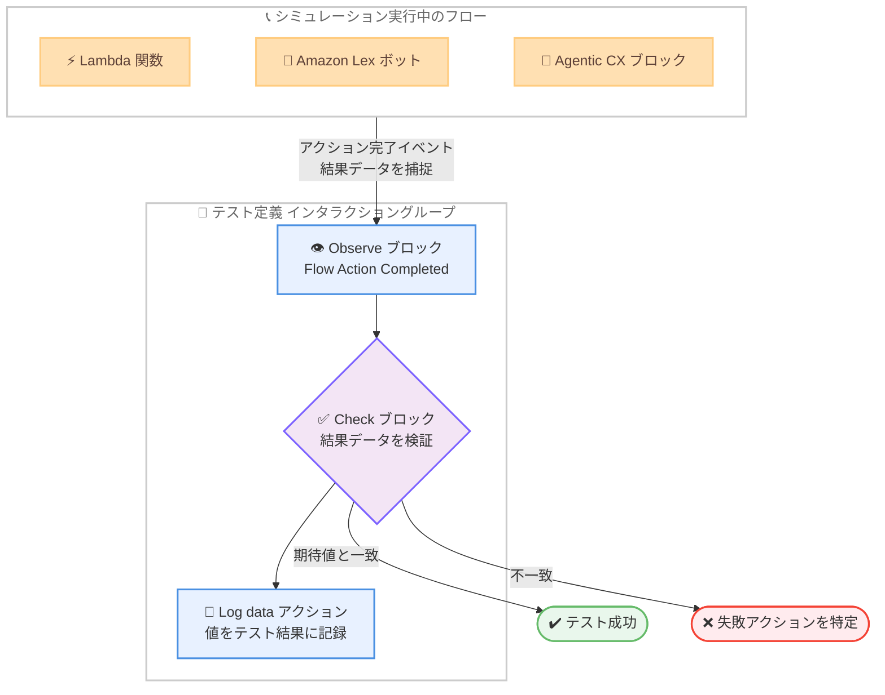

# Amazon Connect Customer - テスト・シミュレーションによるフローアクション結果の検証

**リリース日**: 2026 年 10 月 26 日
**サービス**: Amazon Connect Customer
**機能**: フローアクション結果 (アウトカム) のテスト・シミュレーション検証

📊 [このアップデートのインフォグラフィックを見る](https://takech9203.github.io/aws-news-summary/20261026-connect-customer-validate-flow-actions.html)

## 概要

Amazon Connect Customer のテスト・シミュレーション機能が拡張され、カスタマーエクスペリエンスフロー内のアクションの「結果 (アウトカム)」を検証できるようになりました。従来はアクションが開始されたことの確認のみが可能でしたが、今回のアップデートにより、アクション完了時に返されるデータそのものをテストで検証できます。

検証対象には、Lambda 関数のレスポンス、Amazon Lex の解決インテントとスロット値、Agentic CX ブロックが設定するコンテキスト変数などが含まれます。テストが失敗した場合、下流のステップから原因を遡って調査する代わりに、予期しない結果を返した正確なアクションを特定できるため、問題解決が高速化し、より自信を持ってフロー変更をリリースできます。

Amazon Connect Customer は、企業が優れた顧客体験を提供することを支援する Agentic AI ソリューションであり、本アップデートはコンタクトセンターのフロー開発における品質保証プロセスを大きく強化するものです。

**アップデート前の課題**

このアップデート以前は、テスト・シミュレーションにおける検証範囲に制限がありました。

- 以前はアクションが「開始された」ことしか確認できず、アクションが返したデータの正しさは検証できなかった
- Lambda 関数や Lex ボットが期待と異なる値を返しても、テスト上はアクション実行として成功扱いになり、問題が下流のステップで初めて顕在化していた
- テスト失敗時に、どのアクションが予期しない結果を返したのかを特定するために、下流のステップから遡って手動で調査する必要があった

**アップデート後の改善**

今回のアップデートにより、アクション完了時の結果データを直接検証できるようになりました。

- 「Flow Action Completed」イベントの Observe ブロックにより、Lambda 関数・Lex ボット・Agentic CX の各アクションが正常完了した時点の結果データを捕捉できるようになった
- 捕捉した結果データを Check ブロックで検証 (アサーション) し、Log data アクションでテスト結果に記録できるようになった
- 結果データはフロー本番実行時と同じ JSONPath (`$.External.*`、`$.Lex.*`、`$.AgenticCX.*`) で参照でき、テストの検証内容と実際の顧客体験が一致する
- テスト失敗時に、予期しない結果を返したアクションをピンポイントで特定でき、遡り調査が不要になった

## アーキテクチャ図



シミュレーション中にフローアクションが正常完了すると、Observe ブロックが完了イベントを捕捉して結果データを取得し、Check ブロックによる検証と Log data アクションによる記録を実行します。

## サービスアップデートの詳細

### 主要機能

1. **Flow Action Completed イベントの Observe ブロック**
   - フロー内の特定のアクションが「正常に完了した」タイミングを検出する新しいイベントタイプ
   - 従来の「Flow Action Started (Action Triggered)」イベントがアクションの開始を検出するのに対し、完了時に生成された結果データをテストで利用可能にする
   - 対象リソースタイプは Lambda 関数、Lex ボット、Agentic CX の 3 種類

2. **結果データの検証 (Check ブロック)**
   - アクション完了時に捕捉した結果データを、Check ブロックで期待値と比較検証できる
   - 例: Lambda が `orderStatus = "Shipped"` を返したこと、Lex ボットが `CheckOrderStatus` インテントを期待どおりのスロット値で解決したこと、Agentic CX インタラクションが期待するコンテキスト変数を設定したことを確認

3. **結果データの記録 (Log data アクション)**
   - JSONPath 参照 (例: `$.External.orderStatus`) を使用して、アクションの結果値をテスト結果に記録できる
   - テスト実行後のレビューやデバッグに活用可能

4. **本番と同一の参照方法**
   - 観測が成功すると、結果データへの参照は実際のコンタクト実行時とまったく同じ値に解決される
   - テストで記述したアサーションが、顧客が実際に体験する動作と一致することを保証

## 技術仕様

### 結果データの参照名前空間

| アクション | 名前空間 | 参照例 |
|------|------|------|
| Lambda 関数 | `$.External.<key>` または `$.LambdaInvocation.ResultData.<key>` | `$.External.orderStatus` |
| Amazon Lex | `$.Lex.<path>` | `$.Lex.IntentName`、`$.Lex.Slots.OrderNumber`、`$.Lex.IntentConfidence.Score` |
| Agentic CX | `$.AgenticCX.ContextVariables.<key>`、`$.AgenticCX.metadata.<key>` | `$.AgenticCX.ContextVariables.customerTier` |

### 観測 (Observation) の動作仕様

| 項目 | 詳細 |
|------|------|
| 一致条件 | アクションが成功ブランチまたはデフォルトブランチで完了した場合のみ一致 (エラーブランチは「完了」とみなされない) |
| タイムアウト | 期待イベントが発生しない場合、5 分でタイムアウトしテストは失敗 |
| 参照可能になるタイミング | 該当アクションの Flow Action Completed 観測が一致した後のみ結果データを参照可能 |
| 複数回完了時の挙動 | 同じアクションタイプが複数回正常完了した場合、参照は最後に捕捉された結果に解決される |
| 参照可能な値 | 単一の値のみ参照可能 (オブジェクトやリスト全体への参照は空の値に解決される) |
| イベント発生回数 | 各 Observe ブロックはイベントが 1 回だけ発生することを期待 (変更不可) |

## 設定方法

### 前提条件

1. Amazon Connect Customer が利用可能なリージョンでインスタンスを運用していること
2. 検証対象の Lambda 関数、Lex ボット、または Agentic CX アプリケーションがフローに組み込まれていること
3. テスト・シミュレーション機能へのアクセス権限があること

### 手順

#### ステップ 1: Observe ブロックの追加

テスト定義のインタラクショングループに Observe ブロックを追加し、以下を設定します。

- **Event Type**: 「Action completed」を選択
- **Resource Type**: 「Lambda function」「Lex Bot」「Agentic CX」のいずれかを選択
- **Target resource**: ドロップダウンから対象リソースを選択 (または ARN を指定)

これにより、対象アクションが正常完了したタイミングで観測が一致し、結果データが捕捉されます。

#### ステップ 2: Check ブロックで結果を検証

同じインタラクショングループに Check ブロックを追加します。Lambda の例は以下のとおりです。

- **Namespace**: External
- **Key**: `orderStatus`
- **Condition**: Equals
- **Value**: `Shipped`

Lambda が返した `orderStatus` の値が `Shipped` と等しいことを検証します。Lex や Agentic CX も、それぞれの名前空間を使用して同様に設定します。

#### ステップ 3: Log data アクションで値を記録

必要に応じて Log data アクションを追加します。

- **Log identifier**: `"Order status"`
- **Log value**: `$.External.orderStatus`

アクションが返した値をテスト結果に記録し、実行後のレビューに活用できます。

#### ステップ 4: インタラクショングループの接続

インタラクショングループのメニューから「Add connector」を選択し、次の観測を含むインタラクショングループへ接続します。これにより、イベントの発生に沿ってテストがチェックポイントを順に進む論理フローが構成されます。

## メリット

### ビジネス面

- **問題解決の高速化**: テスト失敗時に予期しない結果を返したアクションを直接特定できるため、下流ステップからの遡り調査が不要になり、トラブルシューティング時間を短縮できる
- **リリースの信頼性向上**: フロー変更がアクションの出力レベルで検証されるため、より自信を持って本番リリースできる
- **顧客体験の品質保証**: テストのアサーションが実際のコンタクト時の動作と一致するため、顧客に影響が及ぶ前に問題を検出できる

### 技術面

- **出力レベルの検証**: アクションが「実行されたか」だけでなく「正しい結果を返したか」を検証でき、テストカバレッジが向上する
- **本番同一の参照体系**: フロー言語と同じ JSONPath 参照 (`$.External.*`、`$.Lex.*`、`$.AgenticCX.*`) を使用するため、学習コストが低い
- **Agentic AI の検証**: Agentic CX ブロックが設定するコンテキスト変数を検証でき、AI 主導の顧客対応フローの品質管理が可能になる

## デメリット・制約事項

### 制限事項

- Flow Action Completed 観測はアクションが成功ブランチで完了した場合のみ一致する。エラーブランチに進んだ場合は「完了」とみなされず、観測は 5 分のタイムアウト後にテスト失敗となる
- 結果データは単一の値のみ参照可能で、オブジェクトやリスト全体への参照 (例: `$.Lex.Slots`) は空の値に解決される
- 同じアクションタイプが複数回完了した場合、参照は最後に捕捉された結果のみに解決される
- 各 Observe ブロックのイベント発生回数は「1 回」固定であり、変更できない

### 考慮すべき点

- アクションの結果を参照する Check ブロックや Log data アクションは、必ず該当アクションの Flow Action Completed 観測の後に配置する必要がある。観測前に参照すると空の値となりアサーションが失敗する
- 音声テストでは、音声のセグメント分割が発話のポーズや文構造により変動するため、実行ごとに結果が若干異なる場合がある (Message Received イベント使用時)
- エラーブランチの動作自体を検証したい場合は、本イベントではなく別のテスト設計が必要になる

## ユースケース

### ユースケース 1: Lambda 関数の注文状況照会の検証

**シナリオ**: 注文状況を照会する Lambda 関数をフローに組み込んでおり、特定の注文番号に対して正しいステータスが返ることを検証したい。

**実装例**:
```text
1. Observe ブロック: Event Type = Action completed、Resource Type = Lambda function、
   Target resource = getCustomerInfo
2. Check ブロック: Namespace = External、Key = orderStatus、
   Condition = Equals、Value = Shipped
3. Log data アクション: Log identifier = "Order status"、
   Log value = $.External.orderStatus
```

**効果**: Lambda のレスポンス内容そのものを検証でき、データ連携の不具合をフロー変更のリリース前に検出できる。

### ユースケース 2: Lex ボットのインテント解決の検証

**シナリオ**: 顧客の発話から Lex ボットが正しいインテントとスロット値を解決することを、フロー全体のシミュレーションの中で確認したい。

**実装例**:
```text
1. Observe ブロック: Event Type = Action completed、Resource Type = Lex Bot、
   Target resource = 対象ボットの ARN とエイリアス
2. Check ブロック: $.Lex.IntentName が CheckOrderStatus と等しいことを検証
3. Check ブロック: $.Lex.Slots.OrderNumber が期待する注文番号と等しいことを検証
```

**効果**: ボットの会話設計変更やモデル更新後も、インテント解決の品質をリグレッションテストとして自動検証できる。

### ユースケース 3: Agentic CX インタラクションのコンテキスト変数検証

**シナリオ**: Agentic CX ブロックによる AI 主導の顧客対応が、後続のフロー分岐で使用するコンテキスト変数を期待どおりに設定することを確認したい。

**実装例**:
```text
1. Observe ブロック: Event Type = Action completed、Resource Type = Agentic CX、
   Target resource = Agentic CX ワークスペース、アプリケーション、エイリアス
2. Check ブロック: $.AgenticCX.ContextVariables.customerTier が
   期待する値と等しいことを検証
3. Log data アクション: $.AgenticCX.metadata の個別の値を記録
```

**効果**: Agentic AI の出力を定量的に検証でき、AI 主導フローの変更を安心してリリースできる。

## 料金

本アップデートに関する追加料金の記載は公式発表にはありません。Amazon Connect Customer の料金体系については、製品ページおよび料金ページを参照してください。

- [Amazon Connect Customer 製品ページ](https://aws.amazon.com/products/connect/customer/)

## 利用可能リージョン

Amazon Connect Customer の機能が利用可能なリージョンについては、管理者ガイドの「Availability of Connect Customer features by Region」を参照してください。

- [リージョン別の機能提供状況](https://docs.aws.amazon.com/connect/latest/adminguide/regions.html)

## 関連サービス・機能

- **AWS Lambda**: フローから呼び出される Lambda 関数のレスポンスデータが検証対象。`$.External.*` 名前空間で参照
- **Amazon Lex**: フロー内のボットが解決したインテント、スロット値、信頼度スコアが検証対象。`$.Lex.*` 名前空間で参照
- **Amazon Connect フロー**: テスト・シミュレーションはフローの実行をシミュレートし、実際のコンタクトと同じ参照体系で結果を検証する
- **Agentic CX**: Amazon Connect Customer の AI 主導の顧客対応ブロック。設定するコンテキスト変数とメタデータが検証対象

## 参考リンク

- 📊 [インフォグラフィック](https://takech9203.github.io/aws-news-summary/20261026-connect-customer-validate-flow-actions.html)
- [公式発表 (What's New)](https://aws.amazon.com/about-aws/whats-new/2026/10/connect-customer-validate-flow-actions/)
- [ドキュメント: Observe ブロック (テストとシミュレーション)](https://docs.aws.amazon.com/connect/latest/adminguide/testing-simulation-observe-block.html)
- [ドキュメント: リージョン別の機能提供状況](https://docs.aws.amazon.com/connect/latest/adminguide/regions.html)
- [Amazon Connect Customer 製品ページ](https://aws.amazon.com/products/connect/customer/)

## まとめ

Amazon Connect Customer のテスト・シミュレーション機能が、アクションの開始確認から結果 (アウトカム) の検証へと拡張され、Lambda レスポンス、Lex インテント、Agentic CX のコンテキスト変数を出力レベルで検証できるようになりました。テスト失敗時の原因特定が大幅に効率化されるため、コンタクトセンターのフロー開発に携わるチームは、Flow Action Completed イベントを活用したリグレッションテストの整備を検討することを推奨します。
