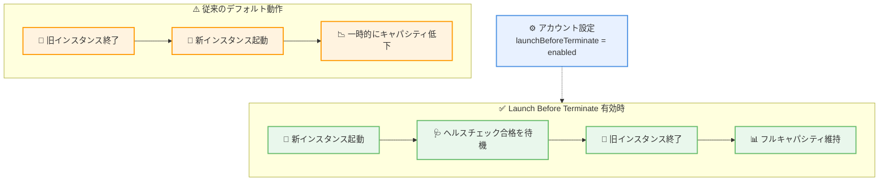

# AWS EC2 Auto Scaling - アカウントレベルでの Launch Before Terminate サポート

**リリース日**: 2026 年 10 月 26 日
**サービス**: Amazon EC2 Auto Scaling
**機能**: アカウントレベル設定による Launch Before Terminate (launchBeforeTerminate)

📊 [このアップデートのインフォグラフィックを見る](https://takech9203.github.io/aws-news-summary/20261026-ec2-auto-scaling-launch-before-terminate.html)

## 概要

AWS EC2 Auto Scaling で、Launch Before Terminate をアカウント内のすべての Auto Scaling グループに対するデフォルトの置換動作として有効化できるようになりました。Launch Before Terminate を有効化すると、Auto Scaling は置換先のインスタンスを起動し、ヘルスチェックに合格するのを待ってから、置換元のインスタンスを終了します。これにより、インスタンス置換イベント中もアプリケーションのフルキャパシティと可用性を維持できます。

この動作は、インスタンスリフレッシュ、アベイラビリティーゾーンのリバランシング、ヘルスチェックによる置換、最大インスタンス存続時間による置換といった、さまざまなインスタンス置換イベントに適用されます。新しい API である `PutAccountSetting` と `DescribeAccountSettings` を使用して、AWS マネジメントコンソール、AWS CLI、AWS SDK からアカウントレベル設定を管理できます。

可用性を重視するワークロードを多数の Auto Scaling グループで運用しているユーザーにとって、グループごとに個別設定することなく、リージョン単位で一度設定するだけで安全な置換動作を標準化できる点が大きな価値となります。

**アップデート前の課題**

- 以前は、Launch Before Terminate 相当の動作を実現するには、Auto Scaling グループごとにインスタンスメンテナンスポリシーを設定するか、インスタンスリフレッシュごとに最小・最大正常パーセンテージを指定する必要があった
- 多数の Auto Scaling グループを運用する環境では、すべてのグループに同じ置換ポリシーを適用する作業が煩雑で、設定漏れが発生しやすかった
- デフォルトの置換動作では置換元インスタンスの終了が先行するため、置換イベント中に一時的にキャパシティが希望容量を下回るリスクがあった

**アップデート後の改善**

- アカウントレベル設定 `launchBeforeTerminate` を有効化するだけで、リージョン内のすべての Auto Scaling グループのデフォルト置換動作を Launch Before Terminate に統一できるようになった
- インスタンスリフレッシュだけでなく、ヘルスチェック置換、最大インスタンス存続時間置換、リバランシングなどのライフサイクルイベントでもフルキャパシティを維持できるようになった
- 置換先インスタンスの起動に失敗した場合は置換元インスタンスをサービス内に維持して再試行するため、キャパシティ喪失を防げるようになった

## アーキテクチャ図



アカウント設定 `launchBeforeTerminate` を有効化すると、インスタンス置換時に新インスタンスの起動とヘルスチェック合格を待ってから旧インスタンスを終了するため、置換中もキャパシティが希望容量を下回りません。

## サービスアップデートの詳細

### 主要機能

1. **アカウントレベルのデフォルト置換動作**
   - アカウント設定 `launchBeforeTerminate` を `enabled` にすると、リージョン内のすべての Auto Scaling グループで Launch Before Terminate がデフォルトの置換動作になる
   - 設定はリージョン単位で適用されるため、有効化したいすべてのリージョンで設定が必要
   - インスタンスメンテナンスポリシーが設定されていないグループ、およびインスタンスリフレッシュの設定 (最小・最大正常パーセンテージ) を指定していない場合に適用される

2. **幅広い置換イベントへの適用**
   - インスタンスリフレッシュ
   - ヘルスチェックによる置換
   - 最大インスタンス存続時間 (Maximum Instance Lifetime) による置換
   - アベイラビリティーゾーンのリバランシング

3. **デフォルトの正常パーセンテージ**
   - アカウント設定が有効な場合、最小正常パーセンテージ 100%、最大正常パーセンテージ 110% がデフォルトとして使用される
   - グループにインスタンスメンテナンスポリシーが設定されている場合はそちらが優先される
   - インスタンスリフレッシュで最小・最大正常パーセンテージを明示的に指定した場合はその指定が優先される

4. **置換失敗時の安全な動作**
   - 置換先インスタンスの起動に必要なキャパシティを確保できない場合、置換元インスタンスをサービス内に維持したまま再試行する
   - オンデマンドキャパシティ不足やキャパシティ予約の空き不足が原因で置換が失敗しても、グループのキャパシティは失われない

## 技術仕様

### アカウント設定の仕様

| 項目 | 詳細 |
|------|------|
| 設定名 | `launchBeforeTerminate` |
| 有効な値 | `enabled` / `disabled` |
| 適用範囲 | 単一リージョン内のアカウント全体 |
| 優先順位 | インスタンスメンテナンスポリシー > インスタンスリフレッシュの設定 > アカウント設定 |
| デフォルトの正常パーセンテージ | 最小 100% / 最大 110% |
| 管理方法 | AWS マネジメントコンソール、AWS CLI、AWS SDK |

### API変更履歴

| 日付 | サービス | 変更内容 |
|------|----------|----------|
| 2026/10/21 | [Auto Scaling](https://awsapichanges.com/archive/changes/ece305-autoscaling.html) | 2 new api methods - アカウントレベル設定を管理する `PutAccountSetting` と `DescribeAccountSettings` を追加 |

### 新しい API

| API | 説明 |
|------|------|
| `PutAccountSetting` | アカウント設定の値を設定する (例: `launchBeforeTerminate` を `enabled` に設定) |
| `DescribeAccountSettings` | アカウント設定の現在の値を取得する |

## 設定方法

### 前提条件

1. AWS CLI がインストールされ、認証情報が設定されていること
2. Auto Scaling のアカウント設定を変更できる IAM 権限 (新 API `autoscaling:PutAccountSetting` および `autoscaling:DescribeAccountSettings` 相当のアクション) を持っていること
3. 有効化したいリージョンを確認していること (設定はリージョンごとに必要)

### 手順

#### ステップ1: Launch Before Terminate を有効化する

```bash
aws autoscaling put-account-setting \
    --name launchBeforeTerminate \
    --value enabled
```

`put-account-setting` コマンドで、アカウント設定 `launchBeforeTerminate` の値を `enabled` に設定します。これにより、現在のリージョン内でインスタンスメンテナンスポリシーを持たないすべての Auto Scaling グループのデフォルト置換動作が Launch Before Terminate になります。

#### ステップ2: 現在の設定状態を確認する

```bash
aws autoscaling describe-account-settings \
    --name launchBeforeTerminate
```

`describe-account-settings` コマンドで、アカウント設定 `launchBeforeTerminate` の現在の値を確認します。有効化されていれば `enabled` が返されます。

#### ステップ3: 他のリージョンにも設定を適用する

アカウント設定は単一リージョン内のアカウント全体に適用されます。複数リージョンで Auto Scaling グループを運用している場合は、`--region` オプションを指定して、有効化したいすべてのリージョンでステップ 1 と 2 を繰り返します。

## メリット

### ビジネス面

- **可用性の向上**: インスタンス置換イベント中もフルキャパシティを維持できるため、置換に伴うパフォーマンス低下やサービス影響のリスクを軽減できる
- **運用コストの削減**: グループごとの個別設定が不要になり、多数の Auto Scaling グループを運用する組織での設定・管理の工数を削減できる
- **ガバナンスの標準化**: アカウントレベルで安全な置換動作を一括適用できるため、組織全体で一貫した可用性ポリシーを実現できる

### 技術面

- **設定漏れの防止**: 新規作成されたグループにもデフォルトで適用されるため、インスタンスメンテナンスポリシーの設定漏れによるキャパシティ低下を防げる
- **柔軟な優先順位**: グループのインスタンスメンテナンスポリシーやインスタンスリフレッシュの個別設定が優先されるため、グループごとの細かい制御も引き続き可能
- **安全な失敗時動作**: 置換先の起動に失敗しても置換元インスタンスが維持されるため、キャパシティ不足時でもグループの容量が失われない

## デメリット・制約事項

### 制限事項

- 設定はリージョン単位で適用されるため、複数リージョンで利用する場合はリージョンごとに設定が必要
- インスタンスメンテナンスポリシーが設定されているグループには、アカウント設定ではなくグループのポリシーが適用される
- 置換中は一時的に追加インスタンスが 1 台起動するため、その間は追加インスタンス分の料金が発生する

### 考慮すべき点

- **キャパシティのヘッドルーム**: 置換のたびに追加インスタンスが短時間稼働するため、アカウントのサービスクォータ (vCPU 上限など) に余裕があるか確認が必要
- **キャパシティ予約との組み合わせ**: 予約 ID を直接指定するターゲット型のオンデマンドキャパシティ予約を使用している場合、置換後のインスタンスが予約外の通常のオンデマンドキャパシティとして稼働し続ける可能性がある。オープン型の予約を使用するか、`CapacityReservationResourceGroupArns` パラメータでキャパシティ予約リソースグループ経由で参照することが推奨される
- **置換失敗の低減策**: 希望容量より多めにキャパシティを予約する、オンデマンドキャパシティを利用可能にしておく、インスタンスタイプとアベイラビリティーゾーンの選択肢を増やすといった対策で、置換先の起動失敗の可能性を減らせる

## ユースケース

### ユースケース1: 多数の Auto Scaling グループを持つ組織での可用性標準化

**シナリオ**: 数十の Auto Scaling グループを運用しており、すべてのグループでインスタンス置換時の可用性低下を防ぎたいが、グループごとのインスタンスメンテナンスポリシー設定は管理負荷が高い。

**実装例**:
```bash
# リージョンごとに一度だけ実行
aws autoscaling put-account-setting \
    --name launchBeforeTerminate \
    --value enabled \
    --region ap-northeast-1
```

**効果**: リージョン内のすべてのグループ (インスタンスメンテナンスポリシー未設定のもの) に Launch Before Terminate が一括適用され、個別設定なしで置換時の可用性を標準化できる。

### ユースケース2: 最大インスタンス存続時間を使用したワークロードの安定運用

**シナリオ**: コンプライアンス要件により最大インスタンス存続時間を設定してインスタンスを定期的に入れ替えているが、置換のたびにキャパシティが一時的に低下し、ピーク時間帯のパフォーマンスに影響が出ている。

**実装例**:
```bash
# アカウント設定を有効化
aws autoscaling put-account-setting \
    --name launchBeforeTerminate \
    --value enabled

# 最大インスタンス存続時間が設定されたグループは
# 置換時に新インスタンス起動後に旧インスタンスが終了される
aws autoscaling describe-auto-scaling-groups \
    --auto-scaling-group-names my-asg \
    --query "AutoScalingGroups[].MaxInstanceLifetime"
```

**効果**: 最大インスタンス存続時間による定期的な置換でも、新インスタンスがヘルスチェックに合格してから旧インスタンスが終了されるため、ピーク時間帯でもフルキャパシティを維持できる。

### ユースケース3: ヘルスチェック置換時のキャパシティ保護

**シナリオ**: ELB ヘルスチェックで異常と判定されたインスタンスが置換される際、従来は終了が先行するため、残りのインスタンスへの負荷集中が発生していた。

**実装例**:
```bash
# アカウント設定を有効化した上で、設定状態を確認
aws autoscaling describe-account-settings \
    --name launchBeforeTerminate
```

**効果**: 異常インスタンスの置換時も、置換先インスタンスがサービスインしてから終了が行われるため、残存インスタンスへの負荷集中を緩和し、連鎖的な障害のリスクを低減できる。

## 料金

Launch Before Terminate のアカウントレベル設定自体に追加料金はありません。Amazon EC2 Auto Scaling は無料で利用でき、起動した EC2 インスタンスなどのリソースに対してのみ料金が発生します。

ただし、Launch Before Terminate では置換のたびに追加インスタンスが 1 台短時間稼働するため、その稼働時間分の EC2 インスタンス料金が発生する点に留意してください。

## 利用可能リージョン

すべての AWS リージョンで利用可能です。アカウント設定はリージョン単位で適用されるため、利用するリージョンごとに設定してください。

## 関連サービス・機能

- **インスタンスメンテナンスポリシー**: グループ単位で最小・最大正常パーセンテージを制御する既存機能。設定されている場合はアカウント設定より優先される
- **インスタンスリフレッシュ**: グループ内のインスタンスをローリング置換する機能。リフレッシュ開始時に正常パーセンテージを指定した場合はその指定が優先される
- **オンデマンドキャパシティ予約**: Launch Before Terminate と併用する場合、オープン型予約またはキャパシティ予約リソースグループ経由での参照が推奨される
- **Elastic Load Balancing**: ELB ヘルスチェックと組み合わせることで、置換先インスタンスのサービスイン確認後に旧インスタンスを終了できる

## 参考リンク

- 📊 [インフォグラフィック](https://takech9203.github.io/aws-news-summary/20261026-ec2-auto-scaling-launch-before-terminate.html)
- [公式発表 (What's New)](https://aws.amazon.com/about-aws/whats-new/2026/10/ec2-auto-scaling-launch-before-terminate/)
- [ドキュメント: Amazon EC2 Auto Scaling account settings](https://docs.aws.amazon.com/autoscaling/ec2/userguide/ec2-auto-scaling-account-settings.html)
- [ドキュメント: Launch replacement instances before terminating old ones](https://docs.aws.amazon.com/autoscaling/ec2/userguide/ec2-auto-scaling-launch-before-terminate-account-setting.html)
- [API リファレンス: Amazon EC2 Auto Scaling](https://docs.aws.amazon.com/autoscaling/ec2/APIReference/API_Operations.html)

## まとめ

アカウントレベルの `launchBeforeTerminate` 設定により、グループごとの個別設定なしで、すべての Auto Scaling グループのインスタンス置換時にフルキャパシティと可用性を維持できるようになりました。多数の Auto Scaling グループを運用している場合や、ヘルスチェック置換・最大インスタンス存続時間置換での一時的なキャパシティ低下が課題となっている場合は、有効化を検討することを推奨します。キャパシティ予約を利用している場合は、オープン型予約またはキャパシティ予約リソースグループ経由での参照への見直しも併せて実施してください。
