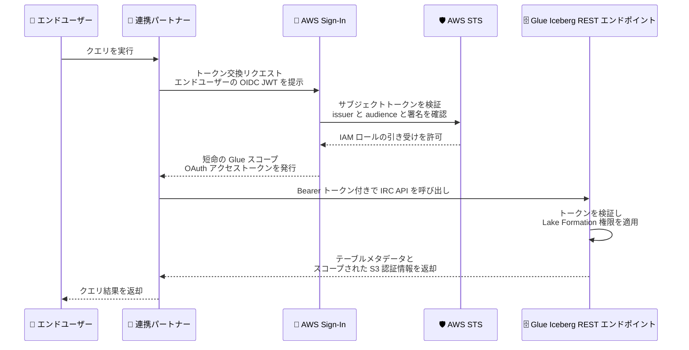

# AWS Glue - Data Catalog が Apache Iceberg REST Catalog API で OAuth 2.0 認証をサポート

**リリース日**: 2026 年 10 月 26 日
**サービス**: AWS Glue (Data Catalog)
**機能**: Apache Iceberg REST Catalog API における OAuth 2.0 ベアラートークン認証

📊 [このアップデートのインフォグラフィックを見る](https://takech9203.github.io/aws-news-summary/20261026-glue-catalog-oauth-iceberg-rest.html)

## 概要

AWS Glue Data Catalog が、Apache Iceberg REST Catalog (IRC) API において AWS Sign-In を利用した OAuth 2.0 ベアラートークン認証をサポートしました。IRC 仕様は OAuth 2.0 を標準の認証メカニズムとして定義しており、Apache Spark、Trino、Apache Flink などのクエリエンジンがネイティブに実装しています。今回のアップデートにより、これらのエンジンや外部連携パートナーは、既存の AWS Signature Version 4 (SigV4) に加えて、業界標準の OAuth 2.0 ベアラートークンで Glue Data Catalog の Iceberg エンドポイントに認証できるようになりました。

認証の仕組みには OAuth 2.0 Token Exchange (RFC 8693) が採用されています。連携パートナーはエンドユーザーの OIDC ID トークン (JWT) を AWS Sign-In のトークン交換エンドポイントに提示し、Glue サービスにスコープされた短命の OAuth アクセストークンと交換します。これにより、AWS 認証情報をパートナーに配布することなく、サードパーティの分析プラットフォームやデータクラウドにフェデレーテッドアクセスを付与できます。アクセス権限は引き続き AWS IAM と AWS Lake Formation によって管理されるため、既存のガバナンスモデルを維持したまま外部連携を実現できます。

**アップデート前の課題**

- Glue Iceberg REST エンドポイントへの認証は SigV4 のみであり、外部のクエリエンジンやパートナープラットフォームに AWS 認証情報 (アクセスキーや IAM ロールの認証情報) を配布・管理する必要があった
- IRC 仕様の標準認証である OAuth 2.0 をネイティブ実装するエンジンやサードパーティ製品から接続する際、SigV4 署名のための追加実装や設定が必要だった
- パートナーのエンドユーザー単位でのフェデレーテッドアクセスを標準的な方法で実現することが難しかった

**アップデート後の改善**

- IRC 仕様に準拠した標準の OAuth 2.0 ベアラートークン (`Authorization: Bearer` ヘッダー) で Glue Iceberg REST エンドポイントに認証できるようになった
- OAuth 2.0 Token Exchange (RFC 8693) により、パートナーの OIDC ID トークンを短命の Glue スコープのアクセストークンに交換でき、AWS 認証情報の配布が不要になった
- アクセスは IAM ロールの権限、Lake Formation のきめ細かな権限付与、およびオプションのセッションポリシーによって制御され、セキュリティガバナンスを維持できる

## アーキテクチャ図



連携パートナーがエンドユーザーの OIDC トークンを AWS Sign-In で Glue スコープのアクセストークンに交換し、Glue Iceberg REST エンドポイントに Bearer トークンで認証するフローです。すべてのリクエストで Lake Formation の権限が適用されます。

## サービスアップデートの詳細

### 主要機能

1. **OAuth 2.0 ベアラートークン認証**
   - Glue Iceberg REST エンドポイントが `Authorization: Bearer` ヘッダーによる OAuth 2.0 アクセストークンを受け付ける
   - IRC 仕様が定義する標準認証メカニズムに準拠し、Apache Spark、Trino、Apache Flink などの OAuth ネイティブ実装と互換
   - 既存の SigV4 認証も引き続き利用可能で、AWS SDK や AWS ネイティブ分析エンジンからの接続は従来どおり

2. **OAuth 2.0 Token Exchange (RFC 8693) によるフェデレーション**
   - 連携パートナーがエンドユーザーの JWT (サブジェクトトークン) を AWS Sign-In の地域別トークン交換エンドポイント (`https://{region}.oauth.signin.aws`) に提示
   - AWS STS がトークンの issuer、audience、署名を IAM OIDC プロバイダーに対して検証し、JWT の `https://aws.amazon.com/roles` クレームで指定された単一の IAM ロールを引き受ける
   - Glue サービスプリンシパル (`glue.amazonaws.com`) にスコープされた短命のアクセストークンを発行

3. **IAM と Lake Formation による一貫したアクセス制御**
   - OAuth 認証は追加の AWS 権限を付与せず、アクセスは指定した IAM ロールの権限と Lake Formation の権限付与の範囲に制限される
   - トークン交換時にお客様所有の IAM 管理ポリシーの ARN を `scope` パラメータとして渡すことで、セッションポリシーとしてアクセスをさらに絞り込み可能
   - `LoadTable` 操作で Glue が払い出す Amazon S3 認証情報も、引き受けたロールと Lake Formation の権限付与の範囲に制限される

4. **監査とトークン管理**
   - トークン交換 (`CreateOAuth2Token`) とトークンイントロスペクション (`IntrospectOAuth2Token`) は AWS CloudTrail に記録される
   - `IntrospectOAuth2Token` API でトークンのメタデータを検証可能

## 技術仕様

### 認証方式の比較

| 項目 | SigV4 | OAuth 2.0 ベアラートークン |
|------|-------|---------------------------|
| 対象 | AWS SDK、AWS ネイティブ分析エンジン | 外部連携パートナー、サードパーティクエリエンジン |
| 認証情報 | AWS 認証情報 (アクセスキー等) | 短命の OAuth アクセストークン |
| 標準仕様 | AWS 独自の署名方式 | IRC 仕様の標準認証 (OAuth 2.0)、RFC 8693 |
| 権限制御 | IAM + Lake Formation | IAM ロール + Lake Formation + セッションポリシー |

### トークン仕様

| 項目 | 詳細 |
|------|------|
| トークン交換エンドポイント | `https://{region}.oauth.signin.aws/v1/token` |
| grant_type | `urn:ietf:params:oauth:grant-type:token-exchange` |
| subject_token_type | `urn:ietf:params:oauth:token-type:jwt` |
| resource | `glue.amazonaws.com` (Glue サービスプリンシパル) |
| scope (オプション) | お客様所有の IAM 管理ポリシー ARN (セッションポリシーとして適用) |
| アクセストークン有効期間 | 最大 1 時間。リフレッシュトークンは発行されず、期限切れ時は再度トークン交換を実行 |
| セッション時間 | JWT の `https://aws.amazon.com/session_duration` クレームで 900〜43,200 秒を指定可能 (ロールの最大セッション時間が上限) |

### サブジェクトトークン (JWT) の必須クレーム

| クレーム | 用途 |
|----------|------|
| `iss` | 発行者。お客様アカウントに登録した IAM OIDC プロバイダーと一致する必要がある |
| `sub` | パートナーのエンドユーザーを識別 |
| `aud` | 地域別トークン交換エンドポイント URL と一致する必要がある |
| `exp` / `iat` | 有効期限と発行時刻 |
| `https://aws.amazon.com/roles` | 引き受ける IAM ロール ARN (ちょうど 1 つ) |
| `https://aws.amazon.com/role_session_name` | ロールセッション名 (2〜64 文字) |

### トークン交換リクエストの例

```http
POST /v1/token HTTP/1.1
Host: {region}.oauth.signin.aws
Content-Type: application/x-www-form-urlencoded

grant_type=urn%3Aietf%3Aparams%3Aoauth%3Agrant-type%3Atoken-exchange
&subject_token={partner-jwt}
&subject_token_type=urn%3Aietf%3Aparams%3Aoauth%3Atoken-type%3Ajwt
&resource=glue.amazonaws.com
&scope={managed-policy-arn}
```

レスポンスとして `access_token` (Bearer 形式、`expires_in: 3600`) が返却され、以下のように IRC API 呼び出しに使用します。

```http
GET /iceberg/v1/catalogs/{catalog}/namespaces HTTP/1.1
Host: glue.{region}.amazonaws.com
Authorization: Bearer {oauth-access-token}
```

## 設定方法

### 前提条件

1. Glue Data Catalog に Apache Iceberg テーブルが存在すること
2. AWS Lake Formation によるアクセス管理が有効であること
3. 連携パートナーの JWT 発行者 (issuer) URL が提供されていること

### 手順

#### ステップ 1: IAM OIDC アイデンティティプロバイダーを作成

IAM コンソールの [Identity providers] ページで、パートナーの JWT 発行者を信頼する OpenID Connect プロバイダーを作成します。

| 設定 | 値 |
|------|-----|
| プロバイダータイプ | OpenID Connect |
| プロバイダー URL | パートナーの JWT 発行者 URL |
| Audience | `https://{region}.oauth.signin.aws` |

パートナーの JWT の `iss` クレームと一致する発行者 URL を登録し、audience には地域別の AWS Sign-In トークン交換エンドポイントを指定します。

#### ステップ 2: 信頼ポリシー付きの IAM ロールを作成

```json
{
  "Version": "2012-10-17",
  "Statement": [
    {
      "Effect": "Allow",
      "Principal": {
        "Federated": "arn:aws:iam::{your-account-id}:oidc-provider/{oidc-provider-issuer}"
      },
      "Action": "sts:AssumeRoleWithWebIdentity",
      "Condition": {
        "StringEquals": {
          "{oidc-provider-issuer}:aud": "https://{region}.oauth.signin.aws"
        },
        "Bool": {
          "sts:RoleAuthorizedByIdp": "true"
        }
      }
    }
  ]
}
```

パートナーのフェデレーテッドアイデンティティが引き受ける IAM ロールを作成します。信頼ポリシーで `sts:AssumeRoleWithWebIdentity` を許可し、`aud` クレームを検証します。`sts:RoleAuthorizedByIdp` 条件により、パートナーのトークンが `https://aws.amazon.com/roles` クレームで認可した場合のみロールを引き受け可能にします。

#### ステップ 3: Lake Formation 権限をロールに付与

AWS Lake Formation で、ステップ 2 のロールに対して公開したいデータベース、テーブル、列に必要な権限 (例: 特定テーブルへの SELECT と DESCRIBE) のみを付与します。Lake Formation の権限付与が、パートナーに見えるデータを制御する主要な境界となります。

#### ステップ 4: AWS Sign-In のトークン発行権限をロールに付与

```json
{
  "Version": "2012-10-17",
  "Statement": [
    {
      "Effect": "Allow",
      "Action": "signin:CreateOAuth2Token",
      "Resource": "arn:aws:signin:{region}:{your-account-id}:service-principal/glue.amazonaws.com"
    }
  ]
}
```

ロールにアイデンティティベースポリシーをアタッチし、トークン交換で Glue スコープのアクセストークンを発行できるようにします。

#### ステップ 5 (オプション): 管理ポリシーでアクセスをさらに絞り込み

許可する Glue アクションとリソースをスコープする IAM 管理ポリシーを作成し、パートナー接続の `scope` として設定します。実効アクセスはロールの権限、このポリシー、Lake Formation の権限付与の積集合になります。

#### ステップ 6: パートナー接続を設定

パートナーに以下の情報を提供します。

- Glue Iceberg REST エンドポイント (`https://glue.{region}.amazonaws.com/iceberg`)
- AWS Sign-In トークン交換エンドポイント (`https://{region}.oauth.signin.aws`)
- ステップ 2 で作成したロール ARN
- ステップ 5 のリソーススコープ (設定した場合)

接続設定後は、トークン交換とクエリは透過的に実行され、パートナーのユーザーは外部テーブルをクエリするだけで利用できます。

## メリット

### ビジネス面

- **AWS 認証情報の配布が不要**: サードパーティの分析プラットフォームやデータクラウドにアクセスキーを渡す必要がなくなり、認証情報漏えいリスクと管理コストを削減できる
- **パートナーエコシステムとの連携強化**: IRC 仕様の標準認証に準拠することで、Iceberg エコシステムの外部製品からの接続が容易になり、データ共有のハードルが下がる
- **ガバナンスの一元化**: データアクセスの制御は引き続き IAM と Lake Formation で一元管理でき、既存の監査・コンプライアンス体制を維持できる

### 技術面

- **標準準拠**: OAuth 2.0 Token Exchange (RFC 8693) と OIDC という業界標準に基づくため、Apache Spark、Trino、Apache Flink など OAuth ネイティブ実装のエンジンがそのまま利用できる
- **短命トークンによるセキュリティ向上**: アクセストークンの有効期間は最大 1 時間で、リフレッシュトークンも発行されないため、トークン漏えい時の影響範囲が限定される
- **多層防御**: IAM ロール権限、オプションのセッションポリシー、Lake Formation のきめ細かな権限付与の積集合でアクセスが制限され、`LoadTable` で払い出される S3 認証情報も同じ境界内に収まる
- **監査可能性**: トークン交換とイントロスペクションが CloudTrail に記録され、ネットワーク条件キー (`aws:SourceIp`、`aws:SourceVpc` 等) も評価されるため、アクセス経路の制御と追跡が可能

## デメリット・制約事項

### 制限事項

- アクセストークンの有効期間は最大 1 時間で、リフレッシュトークンは発行されない。期限切れ時はパートナー側で再度トークン交換を実行する必要がある
- JWT の `https://aws.amazon.com/roles` クレームに指定できるロール ARN はちょうど 1 つのみ
- `scope` パラメータに指定できるのはお客様アカウント内のお客様所有の管理ポリシーのみで、クロスアカウントのポリシーは受け付けられない
- 無効なサブジェクトトークン (署名不正、発行者不一致、期限切れ) によるトークン交換の失敗は、対象アカウントの CloudTrail イベントとして記録されない
- Glue Iceberg REST エンドポイントは単一レベルのネームスペースのみをサポート (マルチレベルカタログ階層は catalog パスで表現)

### 考慮すべき点

- パートナーの発行者が共有プロバイダーに分類される場合、信頼ポリシーにテナンシーを強制する追加条件が必要 (IAM の OIDC secure-by-default 動作を参照)
- Lake Formation の権限付与がデータ可視性の主要な境界となるため、パートナー用ロールには最小権限の原則に基づき必要最小限の SELECT / DESCRIBE のみを付与することが推奨される
- OIDC プロバイダー、IAM ロール、Lake Formation 権限などのリソースは、Iceberg テーブルが存在するリージョンに作成する必要がある

## ユースケース

### ユースケース 1: サードパーティデータクラウドからの Iceberg テーブル参照

**シナリオ**: 外部のデータクラウドプラットフォームのユーザーが、AWS 上の Glue Data Catalog に登録された Iceberg テーブルを、プラットフォームの認証基盤のまま直接クエリしたい。

**実装例**:
```
1. パートナーの JWT 発行者を IAM OIDC プロバイダーとして登録
2. 読み取り専用の IAM ロールを作成し、Lake Formation で対象テーブルに SELECT / DESCRIBE を付与
3. パートナー接続に Glue IRC エンドポイント、トークン交換エンドポイント、ロール ARN を設定
```

**効果**: AWS 認証情報を配布せず、パートナーのエンドユーザー単位のフェデレーテッドアクセスで単一ストレージコピーのまま安全にデータ共有できる。

### ユースケース 2: セルフマネージドの OSS クエリエンジンからの接続

**シナリオ**: AWS 外 (オンプレミスや他クラウド) で運用する Trino や Apache Flink から、IRC 標準の OAuth 認証で Glue Data Catalog の Iceberg テーブルにアクセスしたい。

**実装例**:
```
エンジンの Iceberg REST カタログ設定で以下を指定。
- uri: https://glue.{region}.amazonaws.com/iceberg
- warehouse: {aws_account_id}
- 認証: OAuth 2.0 ベアラートークン (AWS Sign-In のトークン交換で取得)
```

**効果**: SigV4 署名のための AWS SDK 統合や認証情報管理が不要になり、エンジン標準の OAuth 設定だけで接続できる。

### ユースケース 3: セッションポリシーによる限定スコープのデータ提供

**シナリオ**: 特定のパートナーには一部のデータベース・テーブルのみ参照を許可し、将来のロール権限拡大の影響も受けないようにしたい。

**実装例**:
```
1. 許可する Glue アクションとリソースを限定した IAM 管理ポリシーを作成
2. パートナー接続の scope パラメータにポリシー ARN を設定
3. 実効権限 = ロール権限 ∩ セッションポリシー ∩ Lake Formation 権限付与
```

**効果**: トークン交換時にセッションポリシーが適用され、多層防御により過剰なアクセスを構造的に防止できる。

## 料金

今回のアップデートに伴う追加料金の発表はありません。AWS Glue Data Catalog の利用には、既存の Glue Data Catalog のストレージおよびリクエスト料金が適用されます。詳細は AWS Glue の料金ページを参照してください。

## 利用可能リージョン

AWS Glue と AWS Lake Formation の両方が利用可能なすべての AWS リージョンで利用できます。

## 関連サービス・機能

- **AWS Lake Formation**: Iceberg テーブルへのきめ細かなアクセス制御 (データベース、テーブル、列単位) を提供し、OAuth 経由のすべてのリクエストに適用される
- **AWS Sign-In**: OAuth 2.0 Token Exchange のトークン交換エンドポイントを提供し、OIDC ID トークンを Glue スコープのアクセストークンに変換する
- **AWS IAM / AWS STS**: OIDC アイデンティティプロバイダーの登録、`sts:AssumeRoleWithWebIdentity` によるロール引き受け、信頼ポリシーと条件キーによる制御を担う
- **Amazon S3 / S3 Tables**: Iceberg テーブルの実データストレージ。`LoadTable` 操作でスコープされた S3 認証情報が払い出される
- **AWS CloudTrail**: トークン交換 (`CreateOAuth2Token`) とトークンイントロスペクションの監査ログを記録する

## 参考リンク

- 📊 [インフォグラフィック](https://takech9203.github.io/aws-news-summary/20261026-glue-catalog-oauth-iceberg-rest.html)
- [公式発表 (What's New)](https://aws.amazon.com/about-aws/whats-new/2026/10/glue-catalog-oauth-iceberg-rest/)
- [AWS Glue User Guide - Connecting to the Data Catalog using AWS Glue Iceberg REST endpoint](https://docs.aws.amazon.com/glue/latest/dg/connect-glu-iceberg-rest.html)
- [AWS Sign-In User Guide - Configure OAuth access to AWS Glue Iceberg REST Catalog](https://docs.aws.amazon.com/signin/latest/userguide/configure-oauth-glue-iceberg-rest.html)
- [RFC 8693 - OAuth 2.0 Token Exchange](https://datatracker.ietf.org/doc/html/rfc8693)
- [AWS Glue 料金ページ](https://aws.amazon.com/glue/pricing/)

## まとめ

AWS Glue Data Catalog の Iceberg REST Catalog API が OAuth 2.0 ベアラートークン認証に対応したことで、AWS 認証情報を配布することなく、サードパーティのクエリエンジンやデータプラットフォームに標準的な方法でフェデレーテッドアクセスを付与できるようになりました。アクセス制御は引き続き IAM と Lake Formation に集約されるため、既存のガバナンスを維持したまま Iceberg エコシステムとの連携を拡大できます。外部パートナーとのデータ共有を検討している場合は、IAM OIDC プロバイダーとロールの設定、Lake Formation の最小権限付与から着手することを推奨します。
