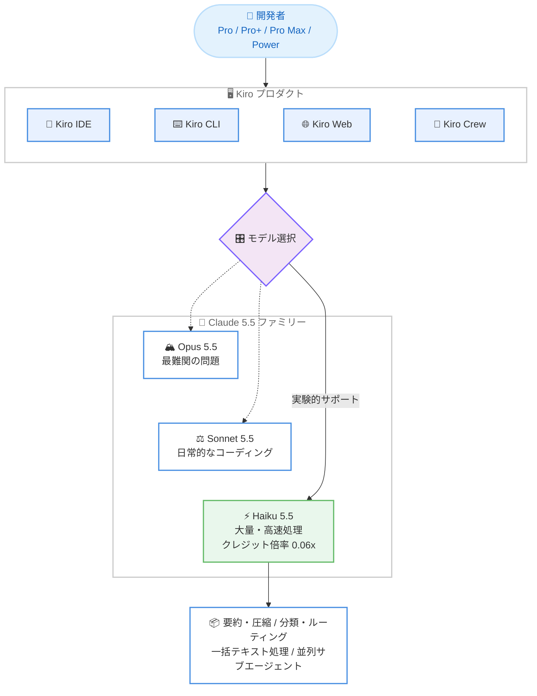

# Kiro - Claude Haiku 5.5 モデルの提供開始

**リリース日**: 2026 年 10 月 26 日
**サービス**: Kiro
**機能**: Claude Haiku 5.5 モデルの実験的サポート

📊 [このアップデートのインフォグラフィックを見る](https://takech9203.github.io/aws-news-summary/20261026-kiro-haiku-5-5.html)

## 概要

Anthropic の Claude Haiku 5.5 が Kiro で利用可能になりました。Kiro IDE、CLI、Web、Crew のすべてのプロダクトで本日から提供され、Claude 5.5 ファミリーの中で最も高速なモデルとして、大量処理や即応性が求められるタスクを対象としています。Claude Haiku 4.5 からの明確な性能向上を実現したモデルです。

Haiku 5.5 の追加により、Claude 5.5 の 3 モデルがすべて Kiro で揃いました。最難関の問題には Opus 5.5、日常的なコーディングには Sonnet 5.5、そしてボリュームやスピードが最重要となる場面には Haiku 5.5 という使い分けが可能になります。

Haiku 5.5 は Adaptive Thinking に対応し、low から max までの 5 段階の思考努力レベル (デフォルトは medium) と 1M (100 万) トークンのコンテキストウィンドウを備えています。クレジット倍率は 0.06x と低く設定されており、コスト効率を重視した高頻度のタスクに適しています。

**アップデート前の課題**

このアップデート以前は、以下のような課題がありました。

- Kiro で利用できる Claude 5.5 ファミリーは Opus 5.5 と Sonnet 5.5 のみで、速度とコスト効率に特化した最新世代の軽量モデルを選択できなかった
- 長いコンテキストの要約・圧縮、リクエストの分類・ルーティング、大量テキスト処理といった高頻度タスクにも、相対的に高コストなモデルを使う必要があった
- 並列実行するレビューやコンピュータ操作のサブエージェントに、低コストで高速な最新モデルを割り当てる選択肢が限られていた

**アップデート後の改善**

今回のアップデートにより、以下が可能になりました。

- Kiro IDE、CLI、Web、Crew のすべてのプロダクトで Claude Haiku 5.5 を選択できるようになった
- Anthropic が出荷した中で最速のモデルを、0.06x という低いクレジット倍率で大量・高速処理タスクに利用できるようになった
- Opus 5.5、Sonnet 5.5、Haiku 5.5 の 3 モデルを、タスクの難易度・頻度・速度要件に応じて使い分けられるようになった

## アーキテクチャ図



Kiro の各プロダクトのモデル選択で Claude Haiku 5.5 を指定すると、大量・高速処理に最適化された推論が低いクレジット倍率で実行されます。Opus 5.5、Sonnet 5.5 とのタスクに応じた使い分けが可能です。

## サービスアップデートの詳細

### 主要機能

1. **Claude 5.5 ファミリー最速のモデル**
   - Anthropic のデータによると、Haiku 5.5 は同社がこれまで出荷した中で最速のモデル
   - Haiku 4.5 からの大幅な品質向上を実現
   - エージェンティックコーディングのベンチマーク Terminal-Bench 4.0 で 39.2% を達成 (Haiku 4.5 は 0.0%)
   - 実世界のナレッジワークを測る GDPval-AA v2.1 で 1620 を達成 (Haiku 4.5 は 735)

2. **大量・高速・コスト効率重視のタスク向け設計**
   - 長いコンテキストの要約・圧縮 (コンパクション)
   - リクエストの分類とルーティング
   - 大量テキストの一括処理
   - 多数のファイルにまたがる小規模で特定的な編集
   - 並列実行するレビューサブエージェントやコンピュータ操作サブエージェントとしても有効

3. **Adaptive Thinking と 1M トークンコンテキスト**
   - low から max までの 5 段階の思考努力レベルに対応 (デフォルトは medium)
   - 1M (100 万) トークンのコンテキストウィンドウを搭載

4. **強化されたセーフガード**
   - Anthropic のセーフガードを搭載し、モデルコントロールは Haiku 4.5 より厳格化
   - Sonnet 5.5 のセーフガードよりも幅広い防御的セキュリティタスクを許可しつつ、ペネトレーションテストなど攻撃者利用に傾く手法は拒否
   - バイオロジー関連のセーフガードは Sonnet 5、Sonnet 5.5、Opus 5 と同等で、研究レベルの質問は許可し、有害と判断されるリクエストは拒否

5. **Claude 5.5 の 3 モデルが Kiro で完結**
   - Opus 5.5: 最難関の問題向け
   - Sonnet 5.5: 日常的なコーディング向け
   - Haiku 5.5: ボリュームとスピードが最重要の場面向け

## 技術仕様

### Claude Haiku 5.5 モデルの仕様

| 項目 | 詳細 |
|------|------|
| 開発元 | Anthropic |
| モデルファミリー | Claude 5.5 |
| 位置付け | ファミリー最速・大量/高速処理向け |
| 思考モード | Adaptive Thinking (low〜max の 5 段階、デフォルト medium) |
| コンテキストウィンドウ | 1M (100 万) トークン |
| Terminal-Bench 4.0 | 39.2% (Haiku 4.5 は 0.0%) |
| GDPval-AA v2.1 | 1620 (Haiku 4.5 は 735) |
| 提供ステータス | 実験的サポート (experimental support) |
| 対応プロダクト | Kiro IDE、CLI、Web、Crew |
| 対象プラン | Pro、Pro+、Pro Max、Power |
| 提供リージョン | us-east-1 (バージニア北部)、eu-central-1 (フランクフルト) |
| クレジット倍率 | 0.06x (100K トークン超のリクエストは 0.3x) |

## 設定方法

### 前提条件

1. Kiro の Pro、Pro+、Pro Max、Power のいずれかの有料プランに加入していること
2. us-east-1 (バージニア北部) または eu-central-1 (フランクフルト) を使用していること
3. Kiro IDE、CLI、Web、Crew のいずれかを利用できること

### 手順

#### ステップ 1: Kiro を最新の状態にする

Kiro IDE または CLI を利用している場合は、最新バージョンへ更新します。Kiro Web および Crew はブラウザからアクセスするため更新は不要です。

#### ステップ 2: モデルセレクターで Claude Haiku 5.5 を選択する

Kiro のチャットやエージェントセッションのモデルセレクターから Claude Haiku 5.5 を選択します。実験的サポートのモデルとして表示されます。

#### ステップ 3: タスクに応じてモデルを使い分ける

要約・分類・一括編集などの大量・高速処理タスクには Haiku 5.5 を、日常的なコーディングには Sonnet 5.5 を、最難関の問題には Opus 5.5 を選択し、クレジット消費と品質のバランスを最適化します。

## メリット

### ビジネス面

- **大幅なコスト削減**: クレジット倍率 0.06x により、高頻度・大量のタスクを低コストで実行でき、クレジット消費を大きく抑制できる
- **開発スループットの向上**: ファミリー最速の応答速度により、分類・要約・一括編集などの待ち時間が短縮され、開発サイクル全体が高速化する
- **モデル選択の最適化**: Claude 5.5 の 3 モデルが揃ったことで、タスクの価値に応じたコスト配分が可能になる

### 技術面

- **前世代からの大幅な品質向上**: Terminal-Bench 4.0 が 0.0% から 39.2% へ、GDPval-AA v2.1 が 735 から 1620 へ向上し、軽量モデルでも実用的なエージェンティックコーディングが可能になった
- **1M トークンコンテキスト**: 軽量モデルでありながら長大なコンテキストを扱え、長いコンテキストの要約・圧縮タスクに適している
- **並列サブエージェント運用**: レビューやコンピュータ操作のサブエージェントとして並列実行でき、メインエージェントのワークフローを低コストで補強できる

## デメリット・制約事項

### 制限事項

- 実験的サポート (experimental support) としての提供であり、一般提供 (GA) ではない
- 提供リージョンは us-east-1 (バージニア北部) と eu-central-1 (フランクフルト) のみ
- 対象は Pro、Pro+、Pro Max、Power の有料プランのみで、無料プランでは利用できない

### 考慮すべき点

- 100K トークンを超えるリクエストには 0.3x の倍率が適用されるため、長文コンテキストを多用する場合はクレジット消費が通常の 5 倍になる点に注意が必要
- 大量・高速処理向けのモデルであるため、複雑な設計判断や難易度の高い問題には Sonnet 5.5 や Opus 5.5 の利用が適している
- モデルコントロールが Haiku 4.5 より厳格化されており、ペネトレーションテストなど攻撃的セキュリティ用途のリクエストは拒否される

## ユースケース

### ユースケース 1: 長いコンテキストの要約とコンパクション

**シナリオ**: 長時間のエージェントセッションで肥大化した会話履歴やログを要約・圧縮し、コンテキストを整理しながら作業を継続したい。

**実装例**:
```
1. Kiro のモデルセレクターで Claude Haiku 5.5 を選択
2. 会話履歴や長大なログを渡して要約・圧縮を指示
3. 圧縮したコンテキストをメインの作業セッションに引き継ぐ
```

**効果**: 1M トークンコンテキストと高速応答により、長大なコンテキストの整理を低コスト (0.06x) で高速に実行できる。

### ユースケース 2: 多数ファイルへの小規模な一括編集

**シナリオ**: リネームやインポートパスの変更、コメント形式の統一など、小さく特定的な編集を多数のファイルに適用したい。

**実装例**:
```
1. Kiro IDE または CLI で Claude Haiku 5.5 を選択
2. 編集ルールと対象ファイル群をエージェントに指示
3. 高速な応答で多数のファイルを順次編集
```

**効果**: 大量の定型的な編集を、高性能モデルを使う場合と比べて大幅に少ないクレジット消費で高速に完了できる。

### ユースケース 3: 並列レビューサブエージェントの実行

**シナリオ**: メインエージェントが実装を進める間に、生成されたコードのレビューや動作確認を並列のサブエージェントに任せたい。

**実装例**:
```
1. メインエージェントには Sonnet 5.5 または Opus 5.5 を割り当て
2. レビュー用・コンピュータ操作用のサブエージェントに Haiku 5.5 を割り当て
3. 並列実行でレビュー結果をメインエージェントにフィードバック
```

**効果**: 低コストで高速なサブエージェントを並列に走らせることで、品質チェックを強化しながらクレジット消費を抑えられる。

## 料金

Claude Haiku 5.5 の利用には、Kiro のクレジットに対して **0.06x のクレジット倍率**が適用されます。100K トークンを超えるリクエストには **0.3x の倍率**が適用され、これは Anthropic および Amazon Bedrock における Haiku 5.5 の長文コンテキスト料金と整合した設定です。

| 条件 | クレジット倍率 |
|------|----------------|
| 通常のリクエスト | 0.06x |
| 100K トークン超のリクエスト | 0.3x |

対象プランは Pro、Pro+、Pro Max、Power です。各プランの料金詳細は [Kiro の料金ページ](https://kiro.dev/pricing/) を参照してください。

## 利用可能リージョン

Kiro はグローバルに利用可能なサービスですが、本アップデートの Claude Haiku 5.5 は **us-east-1 (バージニア北部) および eu-central-1 (フランクフルト)** の Kiro Pro、Pro+、Pro Max、Power のお客様が対象です。

## 関連サービス・機能

- **Kiro IDE / CLI / Web / Crew**: Claude Haiku 5.5 はこれらすべての Kiro プロダクトで利用可能
- **Claude Opus 5.5 / Sonnet 5.5**: 同じ Claude 5.5 ファミリーのモデルで、最難関の問題には Opus 5.5、日常的なコーディングには Sonnet 5.5 と使い分けられる
- **Amazon Bedrock**: Claude Haiku 5.5 は Amazon Bedrock でも提供されており、アプリケーションへの組み込み用途では Bedrock 経由で利用できる

## 参考リンク

- 📊 [インフォグラフィック](https://takech9203.github.io/aws-news-summary/20261026-kiro-haiku-5-5.html)
- [公式発表 (Kiro Blog)](https://kiro.dev/blog/haiku-5-5/)
- [Kiro Changelog](https://kiro.dev/changelog/)
- [Kiro ドキュメント](https://kiro.dev/docs/)
- [Kiro 料金ページ](https://kiro.dev/pricing/)

## まとめ

Kiro に Claude Haiku 5.5 が実験的サポートとして追加され、Claude 5.5 ファミリーの 3 モデル (Opus 5.5、Sonnet 5.5、Haiku 5.5) がすべて Kiro で選択可能になりました。0.06x という低いクレジット倍率と 1M トークンコンテキストを備えたファミリー最速のモデルであり、要約・分類・一括編集・並列サブエージェントといった大量・高速処理タスクでの活用を推奨します。100K トークン超のリクエストには 0.3x の倍率が適用される点を踏まえ、タスクの性質に応じたモデルの使い分けが効果的です。
