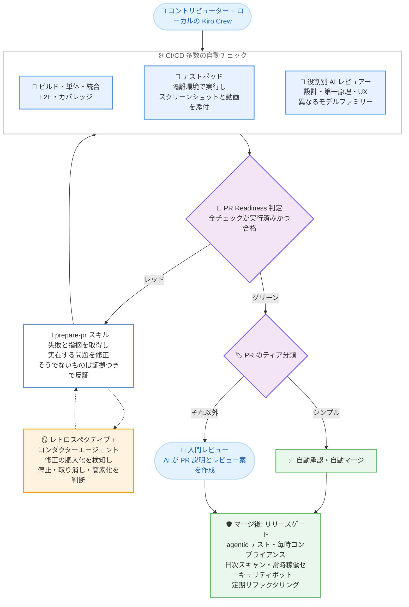

# Kiro - 週 1,000 PR のソフトウェアファクトリーを安定稼働させる方法 (Keeping a software factory stable at 1,000 PRs a week)

**リリース日**: 2026 年 10 月 26 日
**サービス**: Kiro
**機能**: Kiro Crew による大規模 AI 開発の品質・安定性確保プラクティスの解説記事

📊 [このアップデートのインフォグラフィックを見る](https://takech9203.github.io/aws-news-summary/20261026-kiro-software-factory-stability.html)

## 概要

Kiro チームは、3 人のエンジニアとエージェントの「クルー」で週 1,000 件のプルリクエストをマージするソフトウェアファクトリー (前回記事で紹介) を、どのように壊さず安定稼働させているかを解説する Blog 記事を公開しました。本記事は新機能の発表ではなく、Kiro Crew の開発で実際に使われている品質保証の仕組みと、その進化の 5 つのステージを解説するエンジニアリング記事です。

記事の出発点は「人間は、自分が書いておらず 1 行ずつ読んでもいないコードを含む PR に責任を持てるのか」という問いです。チームの答えは、信頼の源泉を人間のコードリーディングからテストと自動チェックに移すことです。AI 以前から、変更への確信は目視レビューだけでなくテストから得られていたことを踏まえ、「人間が読むより信頼できる自動テストとチェックをどう構築するか」という問題に置き換えています。Kiro Crew チームは時間の約 20% を自動化のためのインフラ構築に費やし、テストカバレッジを 90% 超 (目標 100%) まで引き上げ、エージェントが実際のアプリをユーザーのように操作する agentic testing も導入しています。

また、「PR を知っている」ことの意味も再定義されます。PR 番号を問われたら差分を暗記して答えるのではなく、クルーに尋ねてコード・テストエビデンス (スクリーンショット、動画、データ)・レビュー記録に基づく平易な要約を 1 分で得ます。CI がすべての PR に残すレビュー記録 (各レビュアーの指摘、修正や反証の経緯、チェック結果、最終的な準備完了判定) こそが、人間が責任を持つ対象であるとしています。

**記事が扱う課題**

AI エージェントによる高速開発では、以下の課題が顕在化していました。

- エージェントは数分でコードを書けるため速度は容易だが、人間が全行を読まずに「正しく、安全で、マージする価値がある」と確信することが困難だった
- 人間による全件レビューは、サイドプロジェクト規模の変更量ですら 1 日も持たずに破綻した
- 「全コメント解決必須」などの厳格なルールは、エンドツーエンドテストの欠如や際限のないレビューラウンドにより、品質ではなく摩擦を生んでいた
- レビューと修正のループを自動化すると、過剰設計 (over-engineering) や行き過ぎたセキュリティ修正という新たな問題が発生した

**記事が示す解決策**

- 信頼の基盤をテストと CI/CD に置き、テストカバレッジ 90% 超、役割別の複数 AI レビュアー、agentic testing を整備した
- すべての CI/CD チェック結果を単一の「PR Readiness」判定に集約し、`prepare-pr` スキルがグリーンになるまで修正ループを自律的に実行するようにした
- レトロスペクティブと「コンダクター」エージェントにより、修正がサブシステム化する過剰設計を自動的に抑止するようにした
- マージ後も、リリースゲート、多層のセキュリティチェック、定期リファクタリングで品質を維持する体制を構築した

## アーキテクチャ図

Kiro Crew の自動化された PR 処理フローです。すべてのチェック結果が単一の PR Readiness 判定に集約され、`prepare-pr` スキルがグリーンになるまでループを回します。人間とエージェントが「完了」の定義を 1 つの判定で共有している点が特徴です。

## サービスアップデートの詳細

### 品質向上の 5 つのステージ

チームはシステム全体を最初から計画したのではなく、1 つの問題を解決すると次の問題が現れるという形で 5 段階に進化させました。記事は「実際のコードベースでコーディングエージェントを動かせば、同じ壁に同じ順序でぶつかるだろう」と述べています。

1. **ステージ 0: 人間による全件レビュー (即座に破綻)**
   - 2026 年 3 月初頭、すべての変更を人手でレビューする体制を試みたが、1 日も持たなかった
   - 当時の Kiro Crew はサイドプロジェクトで変更量もはるかに少なかったにもかかわらず破綻し、レビュー自動化を迫られた

2. **ステージ 1: 自動レビュアー + 人間のパイプライン**
   - 社内のビルド・レビューシステムの自動レビューボットを全変更に適用し、「優先度を問わずすべての AI コメントをマージ前に解決する」という厳格なルールを設定
   - 問題 1: 実際のエンドツーエンドテストがなく、全コメントを解決してもアプリが壊れることがあり、人間が手動テストとスクリーンショット添付を強いられた
   - 問題 2: コメントが何ラウンドにも分けて届き、修正がさらに新しいコメントを呼び、小さな変更が 1 日がかりの往復や計画外の大きな変更に膨らんだ
   - 問題 3: レビュアーのルールがいつ・なぜ発火したか (あるいは見逃したか) が見えず、チューニングできなかった
   - 教訓: 厳格なルールは「完全でチューニング可能なフィードバック」と「実プロダクトでの E2E テスト」の両方があって初めて機能する

3. **ステージ 2: 重要度ティアと 2 人目のレビュアー**
   - コメントを重要度でティア分けし、ブロッキングと実質的な懸念は同一 PR で修正、軽微な指摘やスタイルの指摘は将来の PR のフォローアップ Issue に回すことで、PR を小さく保った
   - 独自のレビューエージェントを既存ボットの隣に追加し、複数パスでスキャン (各パスは前のパスの検出をスキップ) することで、すべての実質的なコメントを 1 ラウンドで出し切る設計にした
   - このステージで AI レビュアーが人間の読解では通常見つからない深い問題を発見することが分かり、人手による 1 行ずつのレビューを手放す判断につながった
   - それでも「ローカルで修正 → 人間がプッシュ → オンラインレビュー待ち → コメントをローカルに持ち帰る」という人間主導のループが長く、離脱するコントリビューターが出たため、同じテストと AI レビューをローカルで実行できる組み込みスキルを提供した

4. **ステージ 3: オープンソース化、本物の CI、多数のレビュアー**
   - Kiro Crew を GitHub に移し、全 PR でビルド・単体テスト・E2E テストを自動実行。組み込みのテストポッドが隔離環境で更新後のコードを実行し、関連機能のスクリーンショットと動画を PR に添付する
   - フォークからの信頼されないコードと、信頼されたレビューワークフローを境界の反対側で実行するセキュリティ設計を採用
   - レビュアーを役割で分割: 設計レビュアー (アーキテクチャ適合性とよりシンプルな解の有無)、第一原理レビュアー (根本原因の修正か、ユーザーに本当に必要か)、UX レビュアー (ユーザー向け変更の評価)。さらに異なるモデルファミリーのレビュアーでもスキャンする (同一ファミリーは盲点を共有するため)
   - 単体・統合・フロントエンド・デスクトップパッケージング・バンドルサイズ予算・カバレッジ下限・E2E と、異なる失敗クラスを捕捉するテスト群を整備。エージェントが最も間違えやすいのは統合部分 (個々の変更は単体では正しく見えるため)
   - 「ブロッキング」の定義を統一: 具体的な位置、引用された証拠、トリガー、帰結を示せない指摘は助言扱い。設計上の懸念は、後から取り消せない one-way door でない限り助言扱いとする

5. **ステージ 4: ループを閉じる**
   - `prepare-pr` スキルが、PR がグリーンになるまで「失敗した CI と指摘の取得 → 実在する問題の修正・実在しない指摘への証拠つき反証 → プッシュ → 再チェック」のループを自律実行する
   - 80 以上のチェックを人間が走査するのは高コストなため、全 CI/CD アクションの結果を単一の「PR Readiness」判定に集約。「期待されるすべてのアクションが実行され、かつ合格した」ことを意味し、「まだ何も失敗していない」とは区別する (新規 PR では「失敗なし」と「未実行」が同じに見えるため)
   - PR をティア分類し、シンプルなティアは自動承認・自動マージ。それ以外は AI がレビュー案を起草して人間に提示する
   - エージェントが PR 説明を固定テンプレート・平易な言葉・図解つきで記述し、コード変更のたびに書き直す。説明がコードと厳密に一致するかを検証する CI チェックも存在する

6. **ステージ 5: マージ後の仕組み**
   - リリースゲート: リリース前にビルド済みプロダクトで追加テストを実行。agentic テストでは、エージェントが実アプリをインストールし、セッション開始、タスク実行、メモリ利用、ジョブスケジューリングなどのコアフローを操作する
   - マージ後のセキュリティ: 毎時のコンプライアンスチェック、社内セキュリティエージェントによる日次スキャン、ガードレールへの侵入を実際に試みる常時稼働のセキュリティボット、外部報告を迅速に処理するマネージドセキュリティインボックスの多層構成
   - 定期リファクタリング: 高速な変更が残す大きなファイル、重複ロジック、デッドコードを定期的に整理し、人間とエージェントの両方が変更しやすいコードベースを維持。最新モデルによるより良いコードの書き直しも可能にする
   - チェック自体のスケーリング: 1 日 100 PR × 数十チェックで GitHub のレート制限に到達したため、CI アクションをグループ分けして段階実行 (安価なチェックを先に実行するファストゲート)。レビューを AWS CodeCommit に、一部テストワークロードを自前ホストに移した
   - 開発プロセス: すべての機能リクエストを構築前に分類し、シンプルな変更は直接構築、中規模な機能は 1 ページの設計書、複雑なものはチーム全体のレビューを必須とした。最も高くつくバグは「ユーザーが必要としない機能」から生まれるため

### 乗り越えた 2 つの重大な問題

1. **過剰設計 (over-engineering)**
   - レビューと修正のループが自律化すると最大の無駄の源泉になる。レビュアーがエッジケースを指摘するとエージェントが仕組みを追加し、その仕組みのエッジケースがまた指摘され、5 ラウンド後には 10 行の修正が不要な小さなサブシステムに育ってしまう
   - 対策 1 - レトロスペクティブ: `prepare-pr` と CI の両方に組み込み、同じ領域で数ラウンド続いた場合に自身の履歴 (何を変えたか、レビュアーが何を言ったか、変更が収束せず成長していないか) を振り返り、停止・取り消し・より単純なアプローチを推奨する。最初の一手は通常「不要になった仕組みの削除」で、それにより残りの指摘も減る
   - 対策 2 - 比例原則: 指摘が正しくても要求が過大な場合がある。修正は PR 説明に記載された問題を解決する直接的なコード変更に限定し、それ以上はフォローアップに回す。例外は到達可能なクラッシュ、セキュリティホール、データ損失で、これらは常に修正する
   - 対策 3 - コンダクターエージェント: レトロスペクティブの推奨を読んで最初の判断を自ら下す第 2 のエージェント。人間への質問は自動化を止めるため、コンダクターが判断できない場合のみ人間を呼ぶ

2. **行き過ぎたセキュリティ修正**
   - AI はセキュリティに熱心で、1 つの実在する指摘に対して 3 層の防御、新しい設定フラグ、決して実行されない検証ステップを追加しがち。追加のたびに壊れうる新コードと次のレビューラウンドの指摘対象が増える
   - 事例 1: レビューラウンドごとにエージェントサンドボックスが少しずつ強化され、個々のステップは合理的でも、合わせるとビルド実行やプロジェクトファイルの読み取りといった通常作業が失敗するようになった (紙の上では安全だが実用に耐えない)
   - 事例 2: 実行ファイルを専用フォルダーにコピーしてロックダウンする古典的な提案は、コピー・権限チェック・更新パスという壊れうる要素を追加しながら、「すでにマシンを掌握した攻撃者」という極めて稀なケースにしか備えない
   - 結論: セキュリティ修正は「ユーザーが実際に到達可能な問題を、最小のコード変更で修正する」というシンプルなルールに従う

### 今日から適用できるプラクティス

記事は、読者のプロダクトに合わせて調整することを前提に、以下の 7 つの提案を挙げています。

1. **レビューコメントをティア分けする**: 「全コメント解決」は厳格に聞こえるが、しばしば空回り (churn) を生む
2. **すべてのコメントを 1 ラウンドで求める**: 遅くても完全なレビュアーの方が、ラウンドをまたいで指摘を小出しにするレビュアーよりコストが低い
3. **レビュアーを役割とモデルで分割する**: 異なる問いと異なるモデルファミリーは異なる問題を捕捉する
4. **チェックを単一の準備完了フラグに集約する**: 「すべて実行され合格した」を意味させる。「まだ何も失敗していない」ではない
5. **部分ではなくプロダクト全体をテストする**: リリース前に少なくとも 1 つは実フローを操作するステップを設ける
6. **エージェントループにレトロスペクティブを入れ、第 2 のエージェントに最初の判断をさせる**: 立ち止まるたびに人間が必要にならないようにする
7. **セキュリティ修正を妥当な範囲に保つ**: 厳格なチェックで実在する問題をあぶり出しつつ、修正自体は小さく直接的にする

## メリット

### ビジネス面

- **スピードと品質の両立**: 週 1,000 PR という速度を維持しながら、全変更が同一のレビュー・テスト・ゲートを通過したことをレビュー記録で証明できる
- **人間の時間の最適配分**: シンプルな PR の自動マージと AI によるレビュー案・PR 説明の生成により、人間は判断が本当に必要な箇所にのみ関与する
- **無駄な機能・修正の抑制**: 機能リクエストの事前分類と修正の比例原則により、「ユーザーが必要としない機能」という最も高くつくバグを減らせる

### 技術面

- **単一の完了シグナル**: PR Readiness 判定により、人間とエージェントが「完了」の定義を共有し、エージェントが自律的にループを回せる
- **多層防御の品質保証**: 役割別・モデルファミリー別のレビュアー、失敗クラス別のテスト群、マージ後の継続チェックにより、1 つの層をすり抜けた問題も長くは生き残らない
- **自己抑制機構**: レトロスペクティブとコンダクターエージェントにより、自律ループの典型的な失敗である過剰設計を仕組みレベルで抑止できる

## デメリット・制約事項

### 制限事項

- 本記事はエンジニアリングプラクティスの解説であり、Kiro 製品の新機能発表ではない
- 記事で紹介される社内インフラの一部 (内部ビルドシステム、社内セキュリティエージェントなど) は Kiro チーム固有のものであり、そのまま利用できるわけではない (ワークフロー、レビュープロンプト、`prepare-pr` スキルは GitHub のリポジトリで公開されている)
- 記事自身が述べる通り、各プラクティスはどのステージも完成しておらず、毎週改善が続いている段階にある

### 考慮すべき点

- 大量の自動チェックは GitHub のレート制限やリソース制限に到達しうるため、チェックのグループ化や段階実行、実行基盤の分散といったスケーリング対策が必要になる
- マージ前に全チェックを通過することと、時間の経過とともに健全であり続けることは別問題であり、マージ後も動き続けるチェックと機能選定プロセスが必要になる
- 自律ループを導入する場合、過剰設計と行き過ぎたセキュリティ修正という副作用への対策をセットで設計する必要がある

## 料金

本記事は開発プラクティスの解説記事であり、料金に関する変更はありません。Kiro の料金は [Kiro Pricing](https://kiro.dev/pricing/) を参照してください。

## 利用可能リージョン

グローバル (Kiro はグローバルに提供されるサービスです)

## 関連サービス・機能

- **Kiro Crew**: 本記事の主題であるエージェントのクルー機能。オープンソースとして公開されており、記事で解説されたワークフロー、レビュープロンプト、`prepare-pr` スキルはリポジトリで確認できる
- **Kiro IDE / CLI**: Kiro Crew を利用する基盤となる AI 搭載 IDE とコマンドラインツール
- **AWS CodeCommit**: GitHub のレート制限対策として、Kiro チームがレビュー処理の移行先に採用したマネージド Git サービス

## 参考リンク

- 📊 [インフォグラフィック](https://takech9203.github.io/aws-news-summary/20261026-kiro-software-factory-stability.html)
- [Kiro Blog: Keeping a software factory stable at 1,000 PRs a week](https://kiro.dev/blog/software-factory-stability/)
- [Kiro Blog: 前回記事 - 週 1,000 PR のソフトウェアファクトリー](https://kiro.dev/blog/software-factory-1000-prs/)
- [Kiro Changelog](https://kiro.dev/changelog/)
- [Kiro ドキュメント](https://kiro.dev/docs/)
- [Kiro 公式サイト](https://kiro.dev/)

## まとめ

本記事は、週 1,000 PR という速度で AI エージェントと開発する際の品質保証を、「人間が全行を読む」モデルから「人間より信頼できるテストと自動チェックを構築する」モデルへ転換する実践知をまとめたものです。単一の PR Readiness 判定、役割別レビュアー、レトロスペクティブとコンダクターによる過剰設計の抑止といったパターンは、コーディングエージェントを実コードベースで運用するすべてのチームに応用可能です。Kiro Crew はオープンソースで公開されているため、記事のワークフローやスキルを実際に確認しながら自チームへの導入を検討することを推奨します。
