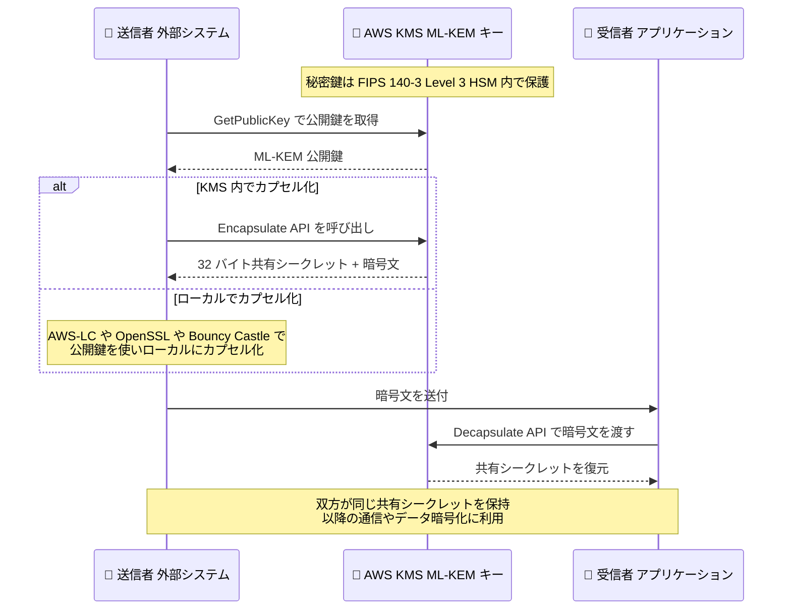

# AWS Key Management Service - ML-KEM によるポスト量子鍵カプセル化のサポート

**リリース日**: 2026 年 10 月 26 日
**サービス**: AWS Key Management Service (KMS)
**機能**: ML-KEM (Module-Lattice-Based Key-Encapsulation Mechanism) のサポート

📊 [このアップデートのインフォグラフィックを見る](https://takech9203.github.io/aws-news-summary/20261026-kms-ml-kem-post-quantum.html)

## 概要

AWS Key Management Service (KMS) が、ポスト量子暗号標準である ML-KEM (Module-Lattice-Based Key-Encapsulation Mechanism) をサポートしました。ML-KEM は NIST FIPS 203 で標準化された鍵カプセル化メカニズムで、2 者間で共有シークレットを確立するために使用されます。NIST IR 8547 では、DH / ECDH 鍵合意や RSA 鍵転送といった古典的な鍵確立スキームを将来的に置き換えるアルゴリズムとして位置付けられています。

このアップデートの背景にあるのは「harvest now, decrypt later」と呼ばれる脅威です。これは、攻撃者が現在の鍵交換トラフィックを傍受して保存しておき、将来十分な能力を持つ量子コンピュータが実用化された時点で復号するという攻撃シナリオです。ML-KEM は量子コンピュータによる攻撃に対して耐性を持つ格子ベースの暗号方式であり、長期間の機密性が求められるデータの鍵確立において、この脅威への対策となります。

KMS では FIPS 203 で定義された 3 つのパラメータセット (ML-KEM-512 / ML-KEM-768 / ML-KEM-1024) すべてをサポートします。秘密鍵は FIPS 140-3 Level 3 検証済みの HSM で保護され、暗号化されていない状態で KMS の外部に出ることはありません。金融、医療、政府機関など、長期的なデータ保護要件を持つ組織にとって、ポスト量子暗号への移行を開始するための重要な選択肢となります。

**アップデート前の課題**

ML-KEM サポート以前には、以下の課題がありました。

- KMS での共有シークレット確立は ECDH ベースの DeriveSharedSecret (KEY_AGREEMENT) に限定されており、量子コンピュータに対して脆弱な古典的アルゴリズムに依存していた
- 「harvest now, decrypt later」攻撃により、現在確立した共有シークレットが将来復号されるリスクがあった
- ポスト量子の鍵確立を行うには、KMS の外部で独自に ML-KEM 実装を運用し、秘密鍵を自前で保護する必要があった

**アップデート後の改善**

- NIST FIPS 203 標準の ML-KEM による量子耐性のある共有シークレット確立が KMS のマネージド機能として利用可能になった
- ML-KEM の秘密鍵が FIPS 140-3 Level 3 検証済み HSM で保護され、KMS のキーポリシー、CloudTrail 監査などの既存のガバナンス機能をそのまま活用できるようになった
- GetPublicKey で公開鍵をエクスポートし、AWS-LC、OpenSSL、Bouncy Castle などのライブラリを使って KMS 外部でもカプセル化できるようになった

## アーキテクチャ図



ML-KEM による共有シークレット確立のフローです。公開鍵でカプセル化した暗号文を相手に渡し、受信側は KMS の Decapsulate API で HSM 内の秘密鍵を使って同じ共有シークレットを復元します。

## サービスアップデートの詳細

### 主要機能

1. **3 つの ML-KEM キースペック**
   - FIPS 203 で定義されたすべてのパラメータセットをサポート: `ML_KEM_512`、`ML_KEM_768`、`ML_KEM_1024`
   - CreateKey 時に `KeyUsage` として新しい `ENCAPSULATE_DECAPSULATE` を指定して作成する
   - キースペックとキー用途は作成後に変更できない (他の KMS キーと同様)

2. **Encapsulate API (新規)**
   - ML-KEM キーの公開鍵を使用して、ランダムな 32 バイトの共有シークレットとその暗号文 (ciphertext) を生成する
   - 生成された共有シークレットは、データ暗号化キーの導出やセキュアチャネルの確立などに利用できる

3. **Decapsulate API (新規)**
   - 暗号文を入力として、HSM 内の秘密鍵を使用して共有シークレットを復元する
   - 秘密鍵は暗号化されていない状態で KMS の外部に出ることはない

4. **GetPublicKey による公開鍵のエクスポート**
   - 既存の GetPublicKey API で ML-KEM 公開鍵をダウンロードし、パートナー、クライアント、外部システムに配布できる
   - 受け取った側は AWS-LC、OpenSSL、Bouncy Castle などのライブラリを使用して、KMS を呼び出さずにローカルでカプセル化を実行できる

## 技術仕様

### ML-KEM キースペック

| 項目 | 詳細 |
|------|------|
| キースペック | `ML_KEM_512` / `ML_KEM_768` / `ML_KEM_1024` |
| キー用途 (KeyUsage) | `ENCAPSULATE_DECAPSULATE` |
| カプセル化アルゴリズム | `ML_KEM` (全キースペック共通) |
| 準拠標準 | NIST FIPS 203 |
| 共有シークレット | 32 バイト (Encapsulate がランダム生成) |
| 秘密鍵の保護 | FIPS 140-3 Level 3 検証済み HSM |
| キーマテリアルの生成元 | AWS KMS (Origin: `AWS_KMS`) |

FIPS 203 では、パラメータセットが大きいほど高いセキュリティ強度カテゴリに対応します (ML-KEM-512 < ML-KEM-768 < ML-KEM-1024)。セキュリティ要件とパフォーマンス、鍵・暗号文サイズのバランスを考慮して選択します。

### API 変更履歴

| 日付 | サービス | 変更内容 |
|------|----------|----------|
| 2026/10/26 | [kms](https://awsapichanges.com/archive/changes/8f8240-kms.html) | 2 new 10 updated api methods - Encapsulate / Decapsulate API の追加、CreateKey などへの ML-KEM キースペックと ENCAPSULATE_DECAPSULATE キー用途の追加 |

### IAM 権限

Encapsulate / Decapsulate 操作には、キーポリシーまたは IAM ポリシーで対応する権限が必要です。

```json
{
  "Version": "2012-10-17",
  "Statement": [
    {
      "Sid": "AllowMlKemOperations",
      "Effect": "Allow",
      "Action": [
        "kms:Encapsulate",
        "kms:Decapsulate",
        "kms:GetPublicKey"
      ],
      "Resource": "arn:aws:kms:ap-northeast-1:123456789012:key/1234abcd-12ab-34cd-56ef-1234567890ab"
    }
  ]
}
```

## 設定方法

### 前提条件

1. KMS の `CreateKey` 権限を持つ IAM プリンシパル
2. ML-KEM をサポートするリージョンの利用 (中東 UAE、中東バーレーン、中国リージョンを除く)
3. 最新の AWS CLI または AWS SDK

### 手順

#### ステップ 1: ML-KEM キーの作成

```bash
aws kms create-key \
  --key-spec ML_KEM_768 \
  --key-usage ENCAPSULATE_DECAPSULATE \
  --description "Post-quantum key encapsulation key"
```

`ML_KEM_768` キースペックと `ENCAPSULATE_DECAPSULATE` キー用途を指定して、ML-KEM キーペアを持つ非対称 KMS キーを作成します。秘密鍵は HSM 内で生成・保護されます。

#### ステップ 2: 共有シークレットのカプセル化

```bash
aws kms encapsulate \
  --key-id 1234abcd-12ab-34cd-56ef-1234567890ab \
  --algorithm ML_KEM \
  --output json
```

公開鍵を使用してランダムな 32 バイトの共有シークレットを生成し、その暗号文とともに返します。共有シークレットは呼び出し元のみが保持し、暗号文は相手側に安全に送付できます。

#### ステップ 3: 共有シークレットのデカプセル化

```bash
aws kms decapsulate \
  --key-id 1234abcd-12ab-34cd-56ef-1234567890ab \
  --ciphertext fileb://ciphertext.bin \
  --algorithm ML_KEM
```

受け取った暗号文を入力として、HSM 内の秘密鍵で同じ共有シークレットを復元します。これにより双方が同一の共有シークレットを保持できます。

#### ステップ 4: 公開鍵のエクスポート (KMS 外部でのカプセル化)

```bash
aws kms get-public-key \
  --key-id 1234abcd-12ab-34cd-56ef-1234567890ab \
  --output text \
  --query PublicKey | base64 --decode > mlkem_public_key.der
```

ML-KEM 公開鍵をダウンロードします。配布先では AWS-LC、OpenSSL、Bouncy Castle などの ML-KEM 対応ライブラリを使用して、KMS を呼び出さずにローカルでカプセル化を実行できます。

## メリット

### ビジネス面

- **量子時代への先行対応**: 「harvest now, decrypt later」脅威に対して、今日から量子耐性のある鍵確立を導入でき、長期的な機密データの保護を強化できる
- **コンプライアンス対応**: NIST FIPS 203 準拠のアルゴリズムと FIPS 140-3 Level 3 検証済み HSM により、政府機関や規制業界のポスト量子移行要件に対応しやすい
- **運用負荷の削減**: ポスト量子暗号の鍵管理基盤を自前で構築・運用することなく、マネージドサービスとして利用できる

### 技術面

- **秘密鍵の非エクスポート設計**: 秘密鍵は HSM 内から出ないため、デカプセル化の実行は常に KMS の認可と監査の下で行われる
- **既存ガバナンスとの統合**: キーポリシー、IAM、CloudTrail、キーローテーションの運用プラクティスなど、KMS の既存機能をそのまま適用できる
- **ハイブリッド構成の柔軟性**: 公開鍵をエクスポートして外部ライブラリでカプセル化できるため、KMS に依存しないクライアント側実装と組み合わせられる

## デメリット・制約事項

### 制限事項

- 中東 (UAE)、中東 (バーレーン)、中国リージョンでは利用できない (ML-KEM キースペックは中国リージョン非対応)
- キースペックとキー用途 (`ENCAPSULATE_DECAPSULATE`) は作成後に変更できない
- Encapsulate が生成する共有シークレットは 32 バイト固定で、任意の値をカプセル化することはできない

### 考慮すべき点

- ML-KEM は鍵カプセル化メカニズムであり、データ本体の暗号化には共有シークレットから導出した対称鍵 (AES など) を併用する設計が必要
- 古典アルゴリズムからの移行期には、ECDH と ML-KEM を組み合わせたハイブリッド方式の採用を検討する (NIST IR 8547 の移行ガイダンスを参照)
- 公開鍵・暗号文のサイズは RSA や ECC より大きいため、プロトコル設計時に通信量への影響を考慮する
- KMS の非対称キーは保管とリクエストに課金が発生するため、呼び出し頻度に応じたコスト評価が必要

## ユースケース

### ユースケース 1: パートナー企業との量子耐性のあるデータ交換

**シナリオ**: 金融機関が外部パートナーと長期保存が必要な機密データを交換する。通信経路で傍受されたデータが将来量子コンピュータで復号されるリスクを排除したい。

**実装例**:
```
1. 受信側が ML_KEM_1024 の KMS キーを作成し、GetPublicKey で公開鍵をパートナーに配布
2. パートナーは AWS-LC でローカルにカプセル化し、共有シークレットでデータを AES-256-GCM 暗号化
3. 暗号文 (KEM ciphertext) と暗号化データを送付
4. 受信側は Decapsulate API で共有シークレットを復元し、データを復号
```

**効果**: 鍵確立部分が量子耐性を持つため、通信を傍受・保存されても将来の復号リスクを低減できる。

### ユースケース 2: 既存の ECDH ベース鍵合意からの段階的移行

**シナリオ**: 現在 KMS の DeriveSharedSecret (ECDH) を利用してセキュアチャネルを確立しているシステムを、ポスト量子暗号へ段階的に移行したい。

**実装例**:
```
1. 既存の ECC_NIST_P384 キーと並行して ML_KEM_768 キーを作成
2. ECDH 由来のシークレットと ML-KEM 由来のシークレットの両方を KDF に入力する
   ハイブリッド方式を実装
3. 相互運用性の検証後、ML-KEM 単独方式への切り替えを計画
```

**効果**: 古典暗号とポスト量子暗号のハイブリッド構成により、移行期間中も双方のアルゴリズムの安全性を確保できる。

### ユースケース 3: IoT デバイスへの量子耐性のある鍵配送

**シナリオ**: 長期間フィールドに設置される IoT デバイスとクラウド間で、デバイスごとのセッション鍵を量子耐性のある方式で確立したい。

**実装例**:
```
1. クラウド側で ML_KEM_768 キーを作成し、製造時にデバイスへ公開鍵を書き込み
2. デバイスは組み込みの ML-KEM ライブラリでカプセル化を実行し、
   暗号文をクラウドに送信
3. クラウド側は Decapsulate API で共有シークレットを復元し、
   セッション鍵として利用
```

**効果**: 10 年以上稼働するデバイスでも、ライフサイクル全体を通じて量子耐性のある鍵配送を維持できる。

## 料金

KMS の標準的な料金体系が適用されます。非対称 KMS キーはキーごとの月額保管料金と、API リクエストごとの料金が発生します。キースペックによってリクエスト料金が異なるため、最新の料金は [AWS KMS 料金ページ](https://aws.amazon.com/kms/pricing/) を参照してください。

## 利用可能リージョン

中東 (UAE)、中東 (バーレーン)、中国リージョンを除く、AWS KMS が提供されているすべての AWS リージョンで利用可能です。東京・大阪リージョンを含みます。

## 関連サービス・機能

- **AWS KMS ML-DSA キー**: 同じくポスト量子標準 (FIPS 204) に基づく署名・検証用のキースペック。ML-KEM と組み合わせることで、鍵確立と署名の両方を量子耐性化できる
- **AWS KMS DeriveSharedSecret**: ECDH による古典的な共有シークレット導出機能。ML-KEM への移行元またはハイブリッド構成の組み合わせ対象
- **AWS-LC**: AWS が開発する暗号ライブラリ。ML-KEM を含むポスト量子アルゴリズムをサポートし、エクスポートした公開鍵でのローカルカプセル化に利用できる
- **AWS CloudTrail**: Encapsulate / Decapsulate を含むすべての KMS API 呼び出しを記録し、監査要件に対応

## 参考リンク

- 📊 [インフォグラフィック](https://takech9203.github.io/aws-news-summary/20261026-kms-ml-kem-post-quantum.html)
- [公式発表 (What's New)](https://aws.amazon.com/about-aws/whats-new/2026/10/kms-ml-kem-post-quantum/)
- [キースペックリファレンス (ML-KEM key specs)](https://docs.aws.amazon.com/kms/latest/developerguide/symm-asymm-choose-key-spec.html)
- [Encapsulate API リファレンス](https://docs.aws.amazon.com/kms/latest/APIReference/API_Encapsulate.html)
- [Decapsulate API リファレンス](https://docs.aws.amazon.com/kms/latest/APIReference/API_Decapsulate.html)
- [NIST FIPS 203 (ML-KEM)](https://csrc.nist.gov/pubs/fips/203/final)
- [NIST IR 8547 (ポスト量子暗号標準への移行)](https://csrc.nist.gov/pubs/ir/8547/ipd)
- [料金ページ](https://aws.amazon.com/kms/pricing/)

## まとめ

AWS KMS の ML-KEM サポートにより、NIST FIPS 203 準拠の量子耐性のある鍵確立を、FIPS 140-3 Level 3 検証済み HSM による秘密鍵保護のもとでマネージドに利用できるようになりました。「harvest now, decrypt later」脅威を考慮すると、長期的な機密性が求められるデータを扱う組織は、早期にポスト量子暗号への移行計画を開始することが推奨されます。まずは NIST IR 8547 の移行ガイダンスを確認し、既存の DH / ECDH / RSA ベースの鍵確立箇所を棚卸ししたうえで、ML-KEM によるハイブリッド構成の検証から着手するとよいでしょう。
