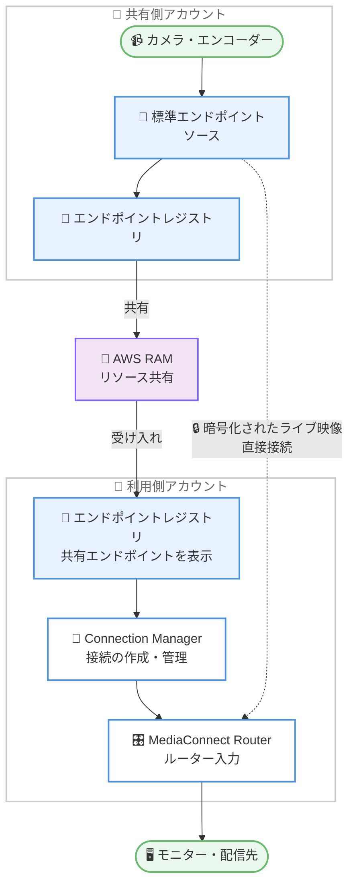

# AWS Elemental MediaConnect - Router エンドポイント接続管理

**リリース日**: 2026 年 10 月 26 日
**サービス**: AWS Elemental MediaConnect
**機能**: MediaConnect Router エンドポイントレジストリとクロスアカウントエンドポイント共有

📊 [このアップデートのインフォグラフィックを見る](https://takech9203.github.io/aws-news-summary/20261026-mediaconnect-cross-account-endpoints.html)

## 概要

AWS Elemental MediaConnect Router が、新しい**エンドポイントレジストリ**による外部接続管理をサポートしました。エンドポイントレジストリは、ライブ映像ワークフローのソースと宛先を表すエンドポイントを一元管理する仕組みです。カメラ、エンコーダー、デコーダー、モニターなどサービス外のデバイスやソフトウェアを表す「標準エンドポイント」と、ルーター入出力などサービス内リソースを表す「マネージドエンドポイント」の両方を登録し、エンドポイント同士を接続するだけでコンテンツを流すことができます。

さらに、登録したエンドポイントを AWS Resource Access Manager (AWS RAM) 経由で他の AWS アカウント、組織、組織単位 (OU) と直接共有できるようになりました。共有を受け入れたアカウントのエンドポイントレジストリに共有エンドポイントが表示され、自アカウントのエンドポイントと同じ操作で接続できます。これにより、コンテンツ配信事業者が下流パートナーへライブフィードを提供するケースや、放送事業者が組織の境界を越えて協業するケースなど、クロスアカウントのライブ映像ワークフローが大幅に簡素化されます。

接続に必要なコンピューティングインスタンスの削減によるコスト低減と、ネットワークホップ削減によるレイテンシー低下も実現します。暗号化やプロトコル制御を透過的に確認でき、内蔵の Connection Manager で接続を管理できるため、接続セキュリティを独自に管理する必要もなくなります。

**アップデート前の課題**

このアップデート以前は、MediaConnect Router でアカウントをまたいでライブ映像を受け渡す際に、以下の課題がありました。

- アカウント間で映像を受け渡すには、ルーターの入力と出力を手動でチェーン接続する必要があった
- IP アドレスやポートなどの接続情報を、システム外 (スプレッドシートやメールなど) で帯域外調整する必要があった
- 接続のセキュリティ (暗号化設定やアクセス制御) を利用者側で個別に管理する必要があった
- 中継用のコンピューティングインスタンスが追加で必要になり、コストとレイテンシーが増加していた
- ソースや宛先の情報がスプレッドシート、コンソール、個別ツールに分散し、全体像の把握が困難だった

**アップデート後の改善**

今回のアップデートにより、以下が可能になりました。

- エンドポイントレジストリで、サービス外デバイスと他アカウントへの接続を一元管理できるようになった
- 登録したエンドポイントを AWS RAM 経由で他の AWS アカウント、組織、OU と直接共有できるようになった
- 共有エンドポイントへの直接接続により、中継用コンピューティングインスタンスが不要になり、コストとレイテンシーが低減した
- 暗号化とプロトコル制御の透過的な確認、Connection Manager による接続管理が組み込みで提供されるようになった
- ルーター入出力の手動チェーン、IP アドレスの帯域外調整、独自の接続セキュリティ管理が不要になった

## アーキテクチャ図



共有側アカウントが登録した標準エンドポイントを AWS RAM のリソース共有で利用側アカウントに共有し、利用側はレジストリに表示された共有エンドポイントを自アカウントのエンドポイントと同様に接続します。映像は中継インスタンスを経由せず直接転送されます。

## サービスアップデートの詳細

### 主要機能

1. **エンドポイントレジストリ**
   - ソースと宛先を表すエンドポイントを一元管理する場所
   - 各エンドポイントは接続の片側を表す再利用可能な参照として機能
   - 利用可能なエンドポイントを一覧表示し、ワークフローの構築・変更時に接続可能
   - コンソールまたは MediaConnect API の両方から操作可能

2. **標準エンドポイント**
   - カメラ、エンコーダー、デコーダー、モニターなど、サービス外のデバイスやソフトウェアを表すエンドポイント
   - MediaConnect がそのデバイスへ到達するための設定 (プロトコル、アドレス、ポート、ネットワーク設定) を定義
   - SRT caller、SRT listener、RTP、RIST プロトコルをサポート

3. **マネージドエンドポイント**
   - ルーター入力・出力など、MediaConnect が管理するリソースを表すエンドポイント
   - 対応リソースでは MediaConnect が自動的に登録する場合がある
   - ルーター入出力を表すマネージドエンドポイントは Amazon CloudWatch メトリクスを発行

4. **クロスアカウント共有 (AWS RAM 連携)**
   - 共有側アカウントがエンドポイントをリソース共有に追加し、アカウント、組織、OU を指定して共有
   - 利用側アカウントがリソース共有を受け入れると、共有エンドポイントがレジストリに表示される
   - 共有側アカウントはエンドポイントの制御を保持し、リソース共有から削除することでいつでも共有を停止可能

5. **Connection Manager**
   - ソースエンドポイントと宛先エンドポイントの接続・切断を管理する組み込み機能
   - 接続状態 (接続中・切断など) の追跡と、エンドポイント接続のネットワークトポロジーの可視化が可能

## 技術仕様

### エンドポイントの考慮事項と制限

| 項目 | 詳細 |
|------|------|
| 接続トポロジー | 1 つの接続は 1 つのソースエンドポイントと 1 つの宛先エンドポイントを結合 |
| サポートプロトコル | 標準エンドポイントは SRT caller、SRT listener、RTP、RIST をサポート |
| 暗号化シークレット | 同一アカウント・同一リージョンのカスタマーマネージド、有効化済み、対称 AWS KMS キーが必要。AWS マネージドキー `aws/secretsmanager` は使用不可 |
| パブリックエンドポイント | 最大 10 個の CIDR 許可ルールをサポート |
| VPC エンドポイント | 1〜5 個のセキュリティグループと、1 つのアベイラビリティーゾーン内の 1 つのサブネットを使用 |
| メトリクス | ルーター入出力を表すマネージドエンドポイントのみ CloudWatch メトリクスを発行。標準エンドポイントはメトリクスを発行しない |

### API 変更履歴

| 日付 | サービス | 変更内容 |
|------|----------|----------|
| 2026/10/26 | [mediaconnect](https://awsapichanges.com/archive/changes/8f8240-mediaconnect.html) | 14 new 10 updated api methods - エンドポイントの登録・管理とクロスアカウント共有のサポートを追加 |

主な新規 API は以下のとおりです。

- エンドポイント登録・管理: `RegisterSourceEndpoint`、`RegisterDestinationEndpoint`、`UpdateSourceEndpoint`、`UpdateDestinationEndpoint`、`DeregisterSourceEndpoint`、`DeregisterDestinationEndpoint`
- エンドポイント参照: `GetSourceEndpoint`、`GetDestinationEndpoint`、`ListSourceEndpoints`、`ListDestinationEndpoints`、`BatchGetSourceEndpoint`、`BatchGetDestinationEndpoint`
- 接続管理: `ConnectEndpoints`、`DisconnectEndpoints`

また、`CreateRouterInput`、`CreateRouterOutput`、`UpdateRouterInput`、`UpdateRouterOutput` など既存のルーター関連 API も更新されています。

## 設定方法

### 前提条件

1. AWS Elemental MediaConnect Router が利用可能なリージョンを使用していること
2. クロスアカウント共有を行う場合、AWS RAM のリソース共有を作成・受け入れる権限があること
3. 暗号化を使用する場合、同一アカウント・同一リージョンにカスタマーマネージドの対称 AWS KMS キーがあること

### 手順

#### ステップ 1: エンドポイントを登録する

```bash
aws mediaconnect register-source-endpoint \
  --region-name ap-northeast-1 \
  --description "Studio camera feed" \
  --configuration '{
    "Standard": {
      "Name": "studio-camera-01",
      "SourceNetworkingConfiguration": {
        "Public": {
          "SourceAllowRules": [{"Cidr": "203.0.113.0/24"}]
        }
      },
      "ProtocolConfiguration": {
        "SrtListener": {
          "SourceListenerPort": 9000,
          "MinimumLatencyMilliseconds": 200
        }
      }
    }
  }'
```

カメラなどの外部デバイスを表すソースエンドポイントを登録します。プロトコル (この例では SRT listener)、許可する CIDR、ポートなど、MediaConnect がデバイスに到達するための設定を定義します。コンテンツの受信側には同様に宛先エンドポイントを登録します。

#### ステップ 2: エンドポイントを他アカウントと共有する

```bash
aws ram create-resource-share \
  --name "mediaconnect-endpoint-share" \
  --resource-arns "arn:aws:mediaconnect:ap-northeast-1:111111111111:sourceEndpoint:studio-camera-01" \
  --principals "222222222222"
```

共有側アカウントで AWS RAM のリソース共有を作成し、共有するエンドポイントと共有先 (アカウント ID、組織、OU) を指定します。利用側アカウントはリソース共有を受け入れると、自身のエンドポイントレジストリに共有エンドポイントが表示されます。

#### ステップ 3: エンドポイントを接続する

```bash
aws mediaconnect connect-endpoints \
  --source-endpoint-arn "arn:aws:mediaconnect:ap-northeast-1:111111111111:sourceEndpoint:studio-camera-01" \
  --destination-endpoint-arn "arn:aws:mediaconnect:ap-northeast-1:222222222222:destinationEndpoint:router-input-01"
```

利用側アカウントで、共有されたソースエンドポイントと自アカウントの宛先エンドポイント (ルーター入力のマネージドエンドポイントなど) を接続します。接続が確立されると、エンドポイントが表すデバイスやリソース間でコンテンツが流れます。接続状態は Connection Manager で追跡できます。

## メリット

### ビジネス面

- **コスト削減**: アカウント間の映像中継に必要だったコンピューティングインスタンスが不要になり、インフラコストを削減。機能自体は追加料金なしで利用可能
- **パートナー連携の迅速化**: コンテンツ配信事業者が下流パートナーへライブフィードを共有する際のセットアップ時間を短縮し、組織の境界を越えた協業を促進
- **運用負荷の軽減**: スプレッドシートやメールによる IP アドレスの帯域外調整が不要になり、設定ミスや調整の手戻りを削減

### 技術面

- **レイテンシー低下**: アカウント間でライブコンテンツを共有する際のネットワークホップが減少し、エンドツーエンドの遅延を低減
- **セキュリティの組み込み管理**: 暗号化とプロトコル制御を透過的に確認でき、接続セキュリティを個別に設計・管理する必要がない
- **一元的な可視性**: エンドポイントレジストリと Connection Manager により、接続状態の追跡とネットワークトポロジーの可視化が可能

## デメリット・制約事項

### 制限事項

- 1 つの接続で結合できるのは 1 つのソースエンドポイントと 1 つの宛先エンドポイントのみ
- 標準エンドポイントがサポートするプロトコルは SRT caller、SRT listener、RTP、RIST に限定される
- 暗号化シークレットには同一アカウント・同一リージョンのカスタマーマネージド対称 KMS キーが必要で、AWS マネージドキー `aws/secretsmanager` は使用できない
- 標準エンドポイントは CloudWatch メトリクスを発行しない (メトリクスはルーター入出力のマネージドエンドポイントのみ)
- パブリックエンドポイントの CIDR 許可ルールは最大 10 個、VPC エンドポイントは 1 つの AZ 内の 1 サブネットのみ

### 考慮すべき点

- クロスアカウント共有には AWS RAM の理解と、共有側・利用側双方での操作 (リソース共有の作成と受け入れ) が必要
- 共有側アカウントがエンドポイントの制御を保持するため、共有停止により利用側のワークフローが影響を受ける可能性を考慮した運用設計が必要
- 標準エンドポイントの監視はメトリクスに依存できないため、接続状態の追跡を中心とした監視設計が必要

## ユースケース

### ユースケース 1: コンテンツ配信事業者から下流パートナーへのライブフィード提供

**シナリオ**: スポーツ中継のライブフィードを、複数の放送パートナー (各社が別の AWS アカウントを保有) に配信したい。

**実装例**:
```
1. 配信事業者アカウントでソースエンドポイントを登録
2. AWS RAM のリソース共有に各パートナーのアカウント ID を追加
3. 各パートナーがリソース共有を受け入れ、自アカウントのルーター入力に接続
```

**効果**: 中継用インスタンスや IP アドレスの個別調整なしで、パートナーごとのフィード提供を数ステップで実現。ネットワークホップ削減により低レイテンシーな伝送が可能。

### ユースケース 2: 放送局グループ内の組織横断ワークフロー

**シナリオ**: 制作部門と送出部門が別々の AWS アカウントを運用しており、制作した番組素材をライブで送出部門に引き渡したい。

**実装例**:
```
1. 制作アカウントでルーター出力のマネージドエンドポイントを共有
2. AWS Organizations の OU 単位でリソース共有を設定
3. 送出アカウントが共有エンドポイントを自身のルーター入力に接続
```

**効果**: OU 単位の共有により、グループ内アカウントの追加・削除時も共有設定の変更が最小限で済む。ルーター入出力の手動チェーンが不要になり、構成がシンプルに。

### ユースケース 3: 外部カメラ・機器の一元管理

**シナリオ**: 複数拠点のカメラやエンコーダーの接続情報がスプレッドシートに分散しており、ワークフロー構築のたびに設定を確認・転記している。

**実装例**:
```
1. 各拠点のカメラ・エンコーダーを標準エンドポイントとして登録
   - プロトコル: SRT listener、RTP、RIST など
2. エンドポイントレジストリで利用可能なエンドポイントを一覧確認
3. 必要に応じて Connection Manager でルーター入力に接続・切断
```

**効果**: 接続情報がレジストリに集約され、再利用可能な参照として管理できる。接続状態とネットワークトポロジーを可視化でき、運用ミスを削減。

## 料金

エンドポイント接続管理機能自体は追加コストなしで利用できます。MediaConnect Router の利用には、既存の MediaConnect Router の料金 (ルーター入出力の稼働時間など) が適用されます。詳細は [MediaConnect 料金ページ](https://aws.amazon.com/mediaconnect/pricing/) を参照してください。

## 利用可能リージョン

AWS Elemental MediaConnect Router が利用可能なすべての AWS リージョンで利用できます。

## 関連サービス・機能

- **AWS Resource Access Manager (AWS RAM)**: エンドポイントをアカウント、組織、OU と共有するための基盤。リソース共有の作成・受け入れ・削除で共有ライフサイクルを管理
- **AWS KMS**: エンドポイント暗号化シークレットの保護に使用。カスタマーマネージド対称キーが必要
- **AWS Secrets Manager**: SRT などの暗号化パスフレーズをシークレットとして保管し、エンドポイント設定から参照
- **Amazon CloudWatch**: ルーター入出力を表すマネージドエンドポイントのメトリクス監視に使用

## 参考リンク

- 📊 [インフォグラフィック](https://takech9203.github.io/aws-news-summary/20261026-mediaconnect-cross-account-endpoints.html)
- [公式発表 (What's New)](https://aws.amazon.com/about-aws/whats-new/2026/10/mediaconnect-cross-account-endpoints/)
- [MediaConnect Router 機能ページ](https://aws.amazon.com/mediaconnect/features/router/)
- [ドキュメント: Working with endpoints](https://docs.aws.amazon.com/mediaconnect/latest/ug/working-with-endpoints.html)
- [API 変更履歴 (awsapichanges.com)](https://awsapichanges.com/archive/changes/8f8240-mediaconnect.html)
- [料金ページ](https://aws.amazon.com/mediaconnect/pricing/)

## まとめ

MediaConnect Router のエンドポイントレジストリとクロスアカウント共有により、これまで手動チェーンや帯域外調整が必要だったアカウント間のライブ映像ワークフローを、追加コストなしで簡素化できます。複数アカウントや外部パートナーとライブ映像を受け渡している場合は、中継インスタンスの削減によるコスト・レイテンシー改善の効果が大きいため、AWS RAM によるエンドポイント共有への移行を検討することを推奨します。
