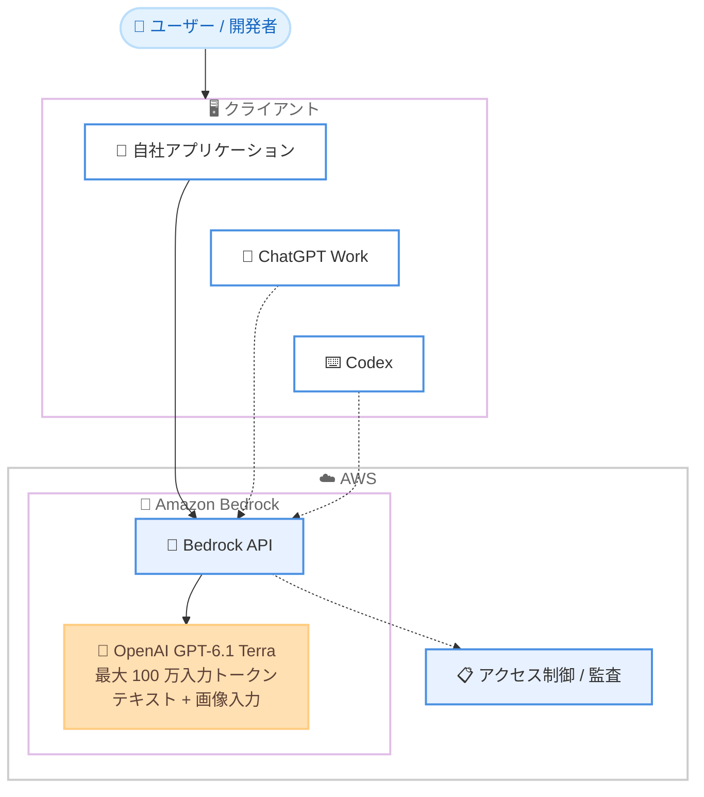

# Amazon Bedrock - OpenAI GPT-6.1 Terra の一般提供開始

**リリース日**: 2026 年 10 月 26 日
**サービス**: Amazon Bedrock
**機能**: OpenAI GPT-6.1 Terra モデルの一般提供 (GA)

📊 [このアップデートのインフォグラフィックを見る](https://takech9203.github.io/aws-news-summary/20261026-openai-gpt-6-1-terra-on-amazon-bedrock.html)

## 概要

OpenAI の GPT-6.1 Terra モデルが Amazon Bedrock で一般提供 (GA) されました。GPT-6.1 Terra は GPT-6 ファミリーに属する Terra ラインの最新モデルで、日常的なワークロードに向けて能力、速度、コスト効率のバランスを重視して設計されています。詳細な視覚的推論、正確な computer use、事実性の向上、より自然な文章作成において、前世代の GPT-5.6 Terra から強化されています。

性能面では、OpenAI の Agents' Last Exam 評価において GPT-5.6 Terra を 15 ポイント上回るスコアを記録し、上位モデルである GPT-6 Astra と同等の性能を達成しながら、タスク完了速度は GPT-6 Astra および GPT-6.1 Sol と比較して 3 倍以上高速です。さらに、入出力トークン価格は GPT-6.1 Sol および GPT-5.6 Terra より 50% 以上低価格に設定されており、コストパフォーマンスに優れたモデルとなっています。

提案書のドラフト作成、技術図面の解釈、コードベースの調査、業務システムを横断するエージェントの構築など、幅広いユースケースに対応します。Amazon Bedrock API から直接呼び出せるほか、ChatGPT Work や Codex から Bedrock 上のモデルを利用する構成も可能で、AWS のセキュリティ、アクセスガバナンス、モデル呼び出しの監査機能を活用できます。

**アップデート前の課題**

このアップデート以前は、以下の課題がありました。

- Bedrock 上の Terra ラインは GPT-5.6 Terra が最新であり、視覚的推論や computer use の精度、事実性に改善の余地があった
- GPT-6 Astra 相当の性能が必要な場合、より高価格なモデルを選択する必要があり、コストと性能のトレードオフが大きかった
- エージェントワークロードでタスク完了までの応答速度が課題となるケースがあった

**アップデート後の改善**

今回のアップデートにより、以下が可能になりました。

- GPT-6 Astra と同等の性能 (Agents' Last Exam 評価) を、3 倍以上高速なタスク完了速度で利用できるようになった
- GPT-6.1 Sol や GPT-5.6 Terra と比較して 50% 以上低い入出力トークン価格で、高性能モデルを利用できるようになった
- 最大 100 万入力トークンのコンテキストウィンドウにより、大規模なコードベースやドキュメント群を一度に処理できるようになった
- ChatGPT Work や Codex のバックエンドとして Bedrock を利用し、AWS の管理下でセキュアにモデルを利用する構成が取れるようになった

## アーキテクチャ図



自社アプリケーションから Bedrock API を直接呼び出す構成に加えて、ChatGPT Work や Codex を Bedrock 経由で利用する構成も可能です。いずれの場合も AWS 側でアクセス制御とモデル呼び出しの監査を行えます。

## サービスアップデートの詳細

### 主要機能

1. **GPT-5.6 Terra からの能力向上**
   - 詳細な視覚的推論: 技術図面や画像の解釈精度が向上
   - 正確な computer use: 画面操作を伴うエージェントタスクの精度が向上
   - 事実性の向上とより自然な文章作成

2. **高い性能と高速なタスク完了**
   - OpenAI の Agents' Last Exam 評価で GPT-5.6 Terra を 15 ポイント上回るスコア
   - GPT-6 Astra と同等の性能を達成
   - タスク完了速度は GPT-6 Astra および GPT-6.1 Sol の 3 倍以上

3. **低価格な料金設定**
   - 入出力トークン価格は GPT-6.1 Sol および GPT-5.6 Terra より 50% 以上低価格
   - 能力、速度、コスト効率のバランスを重視した日常ワークロード向けの位置づけ

4. **大規模コンテキストとマルチモーダル入力**
   - 最大 100 万入力トークンのコンテキストウィンドウ
   - テキストと画像の両方の入力に対応

5. **柔軟な利用方法**
   - Amazon Bedrock コンソールまたは API から直接利用
   - ChatGPT Work や Codex から Bedrock 上のモデルを利用する構成も可能
   - AWS のコントロールでワークロードの保護、アクセスのガバナンス、モデル呼び出しの監査が可能

## 技術仕様

### モデル仕様

| 項目 | 詳細 |
|------|------|
| モデル名 | OpenAI GPT-6.1 Terra |
| モデルファミリー | GPT-6 ファミリー (Terra ライン) |
| コンテキストウィンドウ | 最大 100 万入力トークン |
| 入力モダリティ | テキスト、画像 |
| 価格 | 入出力トークン価格が GPT-6.1 Sol / GPT-5.6 Terra 比で 50% 以上低価格 |
| 提供ステータス | 一般提供 (GA) |

### GPT-6 ファミリーにおける位置づけ

| モデル | 位置づけ |
|--------|---------|
| GPT-6 Astra | 最上位モデル。複雑な推論、コーディング、computer use、リサーチ向け |
| GPT-6.1 Sol | GPT-6 Astra に迫る性能を Sol 価格で提供。コーディングやエージェントワークフロー向け |
| GPT-6.1 Terra | 能力、速度、コスト効率のバランス型。日常ワークロード向け (今回 GA) |
| GPT-5.6 Terra | 前世代の Terra モデル |

ベンチマーク結果 (Agents' Last Exam) では、GPT-6.1 Terra は GPT-6 Astra と同等のスコアを達成しつつ、タスク完了は 3 倍以上高速です。対応リージョン、エンドポイント、API、推論プロファイル、詳細な料金は [Amazon Bedrock ドキュメント](https://docs.aws.amazon.com/bedrock/latest/userguide/model-cards-openai.html)で確認できます。

## 設定方法

### 前提条件

1. AWS アカウントを保有していること
2. Amazon Bedrock で OpenAI モデルへのアクセスが有効化されていること
3. Bedrock API を呼び出す IAM 権限が設定されていること

### 手順

#### ステップ 1: モデルアクセスの有効化

Amazon Bedrock コンソールの [モデルアクセス] から、OpenAI GPT-6.1 Terra へのアクセスをリクエストして有効化します。

#### ステップ 2: モデル情報の確認

```bash
aws bedrock list-foundation-models \
  --by-provider openai \
  --region <リージョン>
```

利用するリージョンで OpenAI の基盤モデル一覧を取得し、GPT-6.1 Terra のモデル ID と対応機能を確認します。

#### ステップ 3: モデルの呼び出し

Bedrock コンソールのプレイグラウンド、または API からモデルを呼び出します。モデル ID、対応 API、推論プロファイルの詳細は [OpenAI モデルカード](https://docs.aws.amazon.com/bedrock/latest/userguide/model-cards-openai.html)を参照してください。

また、ChatGPT Work や Codex から Bedrock 上のモデルを利用する場合は、各クライアント側で Bedrock をバックエンドとして構成します。

## メリット

### ビジネス面

- **コスト削減**: GPT-6.1 Sol / GPT-5.6 Terra 比で 50% 以上低いトークン価格により、同等以上の性能をより低コストで利用できる
- **生産性向上**: 提案書作成、技術図面の解釈、業務システム横断のエージェントなど、日常業務の幅広いタスクに適用できる
- **ガバナンス**: AWS のコントロールにより、ワークロードの保護、アクセス管理、モデル呼び出しの監査を一元的に実施できる

### 技術面

- **高速なエージェント実行**: GPT-6 Astra と同等の性能をタスク完了 3 倍以上の速度で実現し、エージェントワークフローの応答性が向上する
- **大規模コンテキスト**: 最大 100 万入力トークンにより、大規模コードベースの調査や長文ドキュメントの処理が可能
- **マルチモーダル対応**: テキストと画像の入力に対応し、視覚的推論を要するタスクに活用できる

## デメリット・制約事項

### 制限事項

- 入力モダリティはテキストと画像であり、音声や動画の入力については発表に記載がない
- 対応リージョンは発表に明記されておらず、ドキュメントでの確認が必要
- 具体的なトークン単価は発表に記載がなく、ドキュメントの料金情報で確認が必要

### 考慮すべき点

- 最高性能が必要な複雑な推論タスクでは、GPT-6 Astra などの上位モデルとの比較検証が推奨される
- 既存の GPT-5.6 Terra 利用ワークロードを移行する場合は、プロンプトや出力の互換性を事前に検証する必要がある
- ChatGPT Work や Codex から Bedrock を利用する構成では、クライアント側の設定とネットワーク構成の確認が必要

## ユースケース

### ユースケース 1: 業務システムを横断するエージェントの構築

**シナリオ**: 社内の複数の業務システムを操作し、情報収集から処理実行までを自動化するエージェントを構築する。

**実装例**:
```
1. Bedrock API で GPT-6.1 Terra を呼び出すエージェントを実装
2. computer use 機能で画面操作を伴うタスクを自動化
3. CloudTrail / Bedrock のログでモデル呼び出しを監査
```

**効果**: GPT-6 Astra 同等の性能を 3 倍以上高速かつ低コストで利用でき、エージェントの応答性と運用コストが改善します。

### ユースケース 2: 技術図面・ドキュメントの解釈と提案書作成

**シナリオ**: 技術図面や設計資料を読み取り、内容を解釈して提案書のドラフトを作成する。

**実装例**:
```
1. 図面画像とテキスト指示を Bedrock API 経由で GPT-6.1 Terra に入力
2. 視覚的推論により図面の内容を構造化して抽出
3. 抽出結果をもとに自然な文章で提案書ドラフトを生成
```

**効果**: 向上した視覚的推論と自然な文章作成能力により、資料作成業務の時間を短縮できます。

### ユースケース 3: 大規模コードベースの調査

**シナリオ**: 大規模なコードベース全体を対象に、仕様調査や影響範囲分析を行う。

**実装例**:
```
1. 対象リポジトリのコードを収集し、最大 100 万トークンのコンテキストに投入
2. GPT-6.1 Terra に調査観点を指示して分析を実行
3. Codex から Bedrock 上のモデルを利用する構成も選択可能
```

**効果**: 大規模コンテキストにより分割処理の手間が減り、コードベース全体を踏まえた精度の高い分析が可能になります。

## 料金

入出力トークン数に基づく従量課金です。GPT-6.1 Terra の入出力トークン価格は、GPT-6.1 Sol および GPT-5.6 Terra より 50% 以上低価格に設定されています。具体的な単価は [Amazon Bedrock ドキュメント](https://docs.aws.amazon.com/bedrock/latest/userguide/model-cards-openai.html)および [Amazon Bedrock 料金ページ](https://aws.amazon.com/bedrock/pricing/)で確認してください。

## 利用可能リージョン

対応リージョンは発表に明記されていません。リージョン、エンドポイント、推論プロファイルの詳細は [Amazon Bedrock ドキュメント](https://docs.aws.amazon.com/bedrock/latest/userguide/model-cards-openai.html)で確認してください。

## 関連サービス・機能

- **Amazon Bedrock**: GPT-6.1 Terra を提供するフルマネージドな基盤モデルサービス。モデルアクセス管理、ガードレール、監査機能を提供
- **ChatGPT Work / Codex**: Bedrock 上のモデルをバックエンドとして利用する構成が可能な OpenAI のクライアント
- **AWS CloudTrail**: Bedrock のモデル呼び出しを含む API 操作の監査に利用

## 参考リンク

- 📊 [インフォグラフィック](https://takech9203.github.io/aws-news-summary/20261026-openai-gpt-6-1-terra-on-amazon-bedrock.html)
- [公式発表 (What's New)](https://aws.amazon.com/about-aws/whats-new/2026/10/openai-gpt-6-1-terra-on-amazon-bedrock/)
- [ドキュメント (OpenAI モデルカード)](https://docs.aws.amazon.com/bedrock/latest/userguide/model-cards-openai.html)
- [料金ページ](https://aws.amazon.com/bedrock/pricing/)

## まとめ

OpenAI GPT-6.1 Terra の Amazon Bedrock での GA により、GPT-6 Astra 同等の性能を 3 倍以上高速かつ 50% 以上低価格で利用できるようになりました。日常的な生成 AI ワークロードやエージェント構築のコストパフォーマンスを大きく改善する選択肢であり、現在 GPT-5.6 Terra や上位モデルを利用中の場合は、ドキュメントで対応リージョンと料金を確認のうえ、移行の検証を推奨します。
