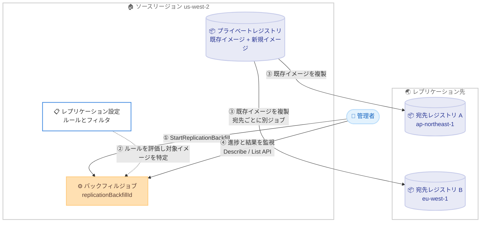

# Amazon ECR - 既存コンテナイメージのレプリケーションバックフィルサポート

**リリース日**: 2026 年 10 月 26 日
**サービス**: Amazon Elastic Container Registry (Amazon ECR)
**機能**: レプリケーションバックフィル (Replication Backfill)

📊 [このアップデートのインフォグラフィックを見る](https://takech9203.github.io/aws-news-summary/20261026-replication-backfill-amazon-ecr.html)

## 概要

Amazon ECR が、プライベートレジストリ内の既存コンテナイメージを設定済みのレプリケーション先へ複製する「レプリケーションバックフィル」をサポートしました。従来の ECR レプリケーションは、レプリケーション設定を適用した後にプッシュされたイメージのみが対象でした。今回のアップデートにより、設定前にプッシュされた既存イメージも、単一の API コールでレプリケーション先へ複製できるようになります。

バックフィルを開始すると、ECR は現在のレプリケーション設定を評価し、指定した宛先に対してルールに一致する既存イメージを特定して複製します。各バックフィルは一意の `replicationBackfillId` で識別され、新しい API を通じて進捗の監視、イメージごとの結果確認、任意のタイミングでの停止が可能です。停止しても、すでに複製されたイメージは宛先レジストリから削除されません。

新しいリージョンへの展開、ディザスタリカバリ (DR) 準備の検証、レプリケーションルール更新後のカタログ同期、コンプライアンス目的でのリージョン間カタログ整合など、コンテナイメージをマルチリージョンで運用するすべてのユーザーに有用なアップデートです。

**アップデート前の課題**

このアップデート以前は、レプリケーションの対象は設定適用後にプッシュされたイメージに限られていました。

- レプリケーション設定の有効化前にプッシュされた既存イメージは自動複製の対象外だった
- 既存イメージを複製するには、イメージを手動で再タグ付けしてレプリケーションをトリガーする必要があった
- 大量の既存イメージを持つレジストリでは、新リージョン展開や DR 構成時のカタログ同期に多大な手作業が必要だった

**アップデート後の改善**

今回のアップデートにより、以下が可能になりました。

- 単一の API コール (`StartReplicationBackfill`) で、既存イメージカタログ全体を新規または既存のレプリケーション先へ複製できるようになった
- 最大 10 個のバックフィルを同時に実行でき、複数の宛先への複製を並行して進められるようになった
- 新しい API で進捗状況とイメージごとの複製結果を監視でき、必要に応じてバックフィルを安全に停止できるようになった

## アーキテクチャ図



管理者がバックフィルを開始すると、ECR は現在のレプリケーション設定を評価して対象イメージを特定し、指定された 1 つの宛先へ既存イメージを複製します。複数の宛先へ複製する場合は、宛先ごとにバックフィルを開始します。

## サービスアップデートの詳細

### 主要機能

1. **既存イメージの一括レプリケーション**
   - `StartReplicationBackfill` API の単一コールで、既存イメージカタログをレプリケーション先へ複製
   - ECR が現在のレプリケーション設定を評価し、指定した宛先に対するルールに一致するイメージのみをバックフィル対象として特定
   - 各バックフィルは単一の宛先 (リージョン + レジストリ ID) を対象とし、複数の宛先へは宛先ごとに個別のバックフィルを開始

2. **同時実行とジョブ管理**
   - レジストリあたり最大 10 個のバックフィルを同時実行可能 (超過時は `LimitExceededException`)
   - 同一宛先リージョンに対するアクティブなバックフィルは 1 つのみ (重複時は `ReplicationBackfillInProgressException`)
   - `PREPARING` または `IN_PROGRESS` 状態のバックフィルは `StopReplicationBackfill` で停止可能
   - 停止しても複製済みイメージはロールバックされず、宛先レジストリに残る

3. **進捗監視とイメージごとの結果確認**
   - `DescribeReplicationBackfillResults` で進捗カウント (総数・完了数・失敗数) とイメージごとの結果を確認可能
   - 実行中は進捗カウントのみが返され、イメージごとの結果とページネーションは完了後に利用可能
   - `ListReplicationBackfills` でレジストリ内のすべてのバックフィルのサマリーを一覧表示
   - 終端状態 (`COMPLETE`、`FAILED`、`STOPPED`) のバックフィルは完了後 90 日間保持される
   - バックフィルが終端状態に達すると Amazon EventBridge イベントが送信される

4. **コンソールからの操作**
   - ECR コンソールのプライベートレジストリ設定にある「Backfill jobs」タブから、最大 10 個の宛先を選択してバックフィルを開始可能
   - 同じタブから進捗の監視、結果の確認、ジョブの停止が可能

### バックフィルのライフサイクル

| ステータス | 説明 |
|------|------|
| `PREPARING` | ECR がレジストリ内の対象イメージを特定中 |
| `IN_PROGRESS` | 宛先へのイメージ複製を実行中 |
| `COMPLETE` | 対象イメージすべての複製が正常に完了 |
| `FAILED` | 複製の 50% 以上が失敗すると自動的に失敗 (100 件以上処理された時点で評価) |
| `STOPPING` | 停止がリクエストされ、実行中の複製の完了を待機中 |
| `STOPPED` | 停止が完了し、実行中の複製がすべて終了 |

## 技術仕様

### 主な仕様と制限

| 項目 | 詳細 |
|------|------|
| 対象イメージ | 現在のレプリケーション設定のルールに一致する既存イメージのみ |
| 宛先の指定 | バックフィルごとに単一の宛先 (リージョン + レジストリ ID) |
| 同時実行数 | レジストリあたり最大 10 個 |
| 同一宛先リージョン | アクティブなバックフィルは 1 つのみ |
| ジョブ履歴の保持 | 終端状態から 90 日間 |
| 実行時間の目安 | 多くのレジストリは 1 時間以内に完了。大量のデータを含むレジストリでは数時間から数日かかる場合あり |
| 使用するロール | レプリケーション設定時に作成されるサービスリンクロールを使用 |
| 削除済みリポジトリ | ソースリポジトリが削除されたイメージはスキップされ、結果に `FAILED` として表示 |
| イベント通知 | 終端状態への遷移時に EventBridge イベントを送信 |

### API 変更履歴

| 日付 | サービス | 変更内容 |
|------|----------|----------|
| 2026/10/26 | [Amazon Elastic Container Registry](https://awsapichanges.com/archive/changes/8f8240-api.ecr.html) | 4 new api methods - Add support for ECR replication backfill |

**追加された API:**

| API | 用途 |
|------|------|
| `StartReplicationBackfill` | 指定した宛先へのバックフィルを開始し、`replicationBackfillId` を返す |
| `ListReplicationBackfills` | レジストリ内のバックフィルのサマリー (ステータス、進捗、開始/終了時刻) を一覧表示 |
| `DescribeReplicationBackfillResults` | 進捗カウントとイメージごとの複製結果 (リポジトリ名、イメージダイジェスト/タグ、ステータス、失敗コード) を取得 |
| `StopReplicationBackfill` | 実行中のバックフィルを停止 (複製済みイメージは保持) |

## 設定方法

### 前提条件

1. ECR プライベートレジストリでレプリケーション設定が構成済みであること
2. バックフィル先の宛先 (リージョン + レジストリ ID) がレプリケーション設定のルールに含まれていること (含まれていない場合は先にレプリケーションルールへ宛先を追加する)
3. レプリケーション用のサービスリンクロールが存在すること (レプリケーション初回設定時に自動作成)

### 手順

#### ステップ 1: バックフィルを開始する

```bash
aws ecr start-replication-backfill \
    --region us-west-2 \
    --registry-id 111122223333 \
    --destination region=ap-northeast-1,registryId=111122223333
```

ソースリージョン (us-west-2) のレジストリから、宛先 (ap-northeast-1 の同一アカウントレジストリ) へのバックフィルを開始します。レスポンスに含まれる `replicationBackfillId` を以降の監視・停止操作で使用します。クロスアカウントレプリケーションの場合は `registryId` に宛先アカウント ID を指定します。

#### ステップ 2: 進捗と結果を監視する

```bash
# すべてのバックフィルのサマリーを一覧表示
aws ecr list-replication-backfills \
    --region us-west-2 \
    --registry-id 111122223333 \
    --max-results 50

# 特定のバックフィルの進捗とイメージごとの結果を確認
aws ecr describe-replication-backfill-results \
    --region us-west-2 \
    --registry-id 111122223333 \
    --replication-backfill-id a1b2c3d4-5678-90ab-cdef-EXAMPLE11111 \
    --max-results 1000 \
    --result-status-filter FAILED
```

`list-replication-backfills` でレジストリ内のバックフィル全体のステータスと進捗カウントを確認します。`describe-replication-backfill-results` では、`--result-status-filter` で `COMPLETE` または `FAILED` のイメージに絞って結果を取得できます。実行中は進捗カウントのみが返され、イメージごとの結果は完了後に確認できます。

#### ステップ 3: 必要に応じてバックフィルを停止する

```bash
aws ecr stop-replication-backfill \
    --region us-west-2 \
    --registry-id 111122223333 \
    --replication-backfill-id a1b2c3d4-5678-90ab-cdef-EXAMPLE11111
```

`PREPARING` または `IN_PROGRESS` 状態のバックフィルを停止します。停止時点で実行中の複製は完了を待ってから `STOPPED` に遷移し、すでに複製されたイメージは宛先レジストリに保持されます。

## メリット

### ビジネス面

- **新リージョン展開の高速化**: 新しいリージョンでサービスを立ち上げる際、既存イメージカタログ全体を単一の API コールで同期でき、展開リードタイムを短縮できる
- **DR 準備とコンプライアンス対応**: DR リージョンのイメージカタログがソースと一致していることを確実にし、リージョン間のカタログ整合性に関するコンプライアンス要件に対応しやすくなる
- **運用コストの削減**: 既存イメージの手動再タグ付けという反復作業が不要になり、人為的ミスのリスクも排除できる

### 技術面

- **レプリケーション設定との一貫性**: バックフィル対象は現在のレプリケーション設定のルールで決まるため、通常のレプリケーションと同じフィルタ条件で既存イメージを複製できる
- **可観測性**: 進捗カウント、イメージごとの結果、失敗コード、EventBridge イベントにより、大規模なバックフィルでも状況を正確に把握できる
- **安全な停止**: 任意のタイミングで停止でき、複製済みイメージはロールバックされないため、段階的な実行や中断・再開の判断がしやすい

## デメリット・制約事項

### 制限事項

- バックフィル対象は現在のレプリケーション設定のルールに一致するイメージのみ。設定にない宛先へバックフィルするには、先にレプリケーションルールへ宛先を追加する必要がある
- レジストリあたりの同時実行は最大 10 個まで (超過時は `LimitExceededException`)
- 同一宛先リージョンに対して同時に実行できるアクティブなバックフィルは 1 つのみ (`ReplicationBackfillInProgressException`)
- 複製の 50% 以上が失敗するとバックフィルは自動的に `FAILED` となる (100 件以上処理された時点で評価)
- ソースリポジトリが削除されたイメージはスキップされ、結果に `FAILED` として記録される

### 考慮すべき点

- 大量のデータを含むレジストリでは、バックフィルの完了までに数時間から数日かかる場合がある
- バックフィルを停止しても複製済みイメージは宛先に残るため、不要なイメージが複製された場合は宛先側で個別に削除する必要がある
- ジョブ履歴は終端状態から 90 日間のみ保持されるため、長期の監査記録が必要な場合は EventBridge イベントや結果のエクスポートを検討する
- クロスリージョンのイメージ複製にはデータ転送と宛先リージョンでのストレージが伴うため、大規模なバックフィル実行前にコストを見積もることが望ましい

## ユースケース

### ユースケース 1: 新リージョン展開時のイメージカタログ同期

**シナリオ**: 東京リージョンで稼働中のサービスを大阪リージョンにも展開することになり、ECR の既存イメージをすべて大阪リージョンでも利用できるようにしたい。

**実装例**:
```bash
# 1. レプリケーションルールに大阪リージョンを追加 (未追加の場合)
aws ecr put-replication-configuration \
    --region ap-northeast-1 \
    --replication-configuration \
    'rules=[{destinations=[{region=ap-northeast-3,registryId=111122223333}]}]'

# 2. 既存イメージのバックフィルを開始
aws ecr start-replication-backfill \
    --region ap-northeast-1 \
    --registry-id 111122223333 \
    --destination region=ap-northeast-3,registryId=111122223333
```

**効果**: レプリケーションルール追加後の新規プッシュは自動複製され、既存イメージはバックフィルで一括複製されるため、再タグ付けスクリプトを作成・実行することなく大阪リージョンのカタログを完全な状態にできる。

### ユースケース 2: DR 準備の検証とカタログ整合性の確保

**シナリオ**: DR リージョンへのレプリケーションを以前から構成しているが、構成前にプッシュされた古いイメージが複製されておらず、フェイルオーバー時に一部のサービスがイメージを取得できないリスクがある。

**実装例**:
```bash
# バックフィルを実行して欠落イメージを補完
aws ecr start-replication-backfill \
    --region us-east-1 \
    --registry-id 111122223333 \
    --destination region=us-west-2,registryId=111122223333

# 完了後、失敗したイメージがないか確認
aws ecr describe-replication-backfill-results \
    --region us-east-1 \
    --registry-id 111122223333 \
    --replication-backfill-id <backfill-id> \
    --result-status-filter FAILED
```

**効果**: DR リージョンのカタログがソースと整合していることをイメージ単位の結果で検証でき、フェイルオーバー演習前の準備としてカタログの欠落を確実に解消できる。

### ユースケース 3: レプリケーションルール更新後の対象イメージ補完

**シナリオ**: レプリケーションルールのリポジトリフィルタを拡大し、これまで対象外だったリポジトリ群も複製対象に加えた。ルール更新後の新規プッシュは複製されるが、それらのリポジトリの既存イメージは宛先に存在しない。

**実装例**:
```bash
# ルール更新後、対象宛先へのバックフィルを開始
aws ecr start-replication-backfill \
    --region eu-west-1 \
    --registry-id 111122223333 \
    --destination region=eu-central-1,registryId=111122223333

# EventBridge ルールで完了イベントを検知して通知
# detail-type: ECR Replication Backfill の終端状態イベントを利用
```

**効果**: 更新後のレプリケーション設定に基づいて対象イメージが自動的に特定されるため、フィルタ拡大で新たに対象となったリポジトリの既存イメージのみが過不足なく複製される。

## 料金

公式発表にバックフィル固有の追加料金の記載はありません。レプリケーションによって複製されたイメージは宛先リージョンでストレージ料金の対象となり、クロスリージョンレプリケーションではデータ転送料金が適用されます。大規模なレジストリをバックフィルする場合は、事前に Amazon ECR の料金ページでストレージとデータ転送のコストを確認することを推奨します。

## 利用可能リージョン

Amazon ECR が利用可能なすべての AWS リージョンで利用できます。

## 関連サービス・機能

- **ECR クロスリージョン/クロスアカウントレプリケーション**: バックフィルの前提となる機能。バックフィル対象はこのレプリケーション設定のルールに基づいて決定される
- **Amazon EventBridge**: バックフィルが終端状態に達した際のイベント通知を受け取り、後続の検証や通知を自動化できる
- **ECR プルスルーキャッシュ**: 外部レジストリのイメージをオンデマンドでキャッシュする機能。リージョン間のイメージ配置戦略においてレプリケーションと使い分けが可能
- **IAM サービスリンクロール**: バックフィルはレプリケーション初回設定時に作成されるサービスリンクロールを使用するため、追加のロール作成は不要

## 参考リンク

- 📊 [インフォグラフィック](https://takech9203.github.io/aws-news-summary/20261026-replication-backfill-amazon-ecr.html)
- [公式発表 (What's New)](https://aws.amazon.com/about-aws/whats-new/2026/10/replication-backfill-amazon-ecr)
- [ドキュメント: Replication backfill](https://docs.aws.amazon.com/AmazonECR/latest/userguide/replication-backfill.html)
- [ドキュメント: Private image replication](https://docs.aws.amazon.com/AmazonECR/latest/userguide/replication.html)
- [API 変更履歴 (awsapichanges.com)](https://awsapichanges.com/archive/changes/8f8240-api.ecr.html)
- [料金ページ](https://aws.amazon.com/ecr/pricing/)

## まとめ

Amazon ECR のレプリケーションバックフィルにより、これまで手動の再タグ付けでしか複製できなかった既存イメージを、単一の API コールでレプリケーション先へ一括複製できるようになりました。新リージョン展開や DR 構成を予定している場合、またはレプリケーション構成前の古いイメージが宛先に欠落している可能性がある場合は、`ListReplicationBackfills` や `DescribeReplicationBackfillResults` による監視と組み合わせてバックフィルの実行を検討することを推奨します。大規模なレジストリでは実行時間とデータ転送コストを事前に見積もったうえで、計画的に実施してください。
