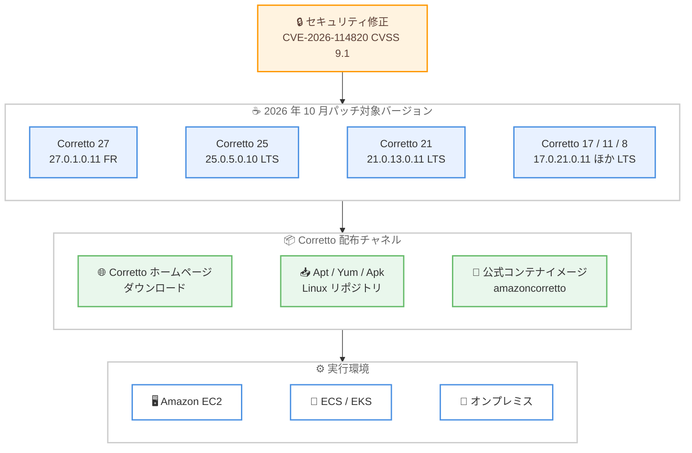

# Amazon Corretto - 2026 年 10 月パッチアップデート

**リリース日**: 2026年10月27日
**サービス**: Amazon Corretto
**機能**: LTS および Feature Release 各バージョンのパッチアップデート

📊 [このアップデートのインフォグラフィックを見る](https://takech9203.github.io/aws-news-summary/20261027-amazon-corretto-oct-2026-patch-updates.html)

## 概要

2026 年 10 月 26 日、Amazon は Amazon Corretto の Long-Term Supported (LTS) バージョンおよび Feature Release (FR) バージョンの OpenJDK に対するパッチアップデートを発表しました。Corretto 27.0.1.0.11、25.0.5.0.10、21.0.13.0.11、17.0.21.0.11、11.0.33.0.10、および 8u512 が[ダウンロード](https://aws.amazon.com/corretto)可能になりました。

Amazon Corretto は、無料で、マルチプラットフォームに対応した、本番環境対応の OpenJDK ディストリビューションです。今回のアップデートはセキュリティ修正を含むパッチリリースであり、GitHub 上の Corretto 21 のリリースノートによると、CVSS スコア 9.1 の脆弱性 CVE-2026-114820 (security-libs/java.security コンポーネント) への対処が含まれています。本番環境で Java アプリケーションを実行しているすべてのユーザーに適用が推奨されます。

**アップデート前の課題**

- 以前のバージョンには CVSS スコア 9.1 の重大なセキュリティ脆弱性 (CVE-2026-114820) が存在していた
- セキュリティ修正が適用されていない Java ランタイムを本番環境で使用し続けるリスクがあった
- コンプライアンス要件を満たすために最新のセキュリティパッチの適用が必要だった

**アップデート後の改善**

- セキュリティ脆弱性が修正され、より安全な Java 実行環境を利用できるようになった
- LTS バージョン (8、11、17、21、25) と Feature Release バージョン (27) の両方で最新パッチが提供された
- Apt、Yum、Apk リポジトリ経由で Linux システムに容易にアップデートを適用できる

## アーキテクチャ図



セキュリティ修正を含むパッチが各 Corretto バージョンに適用され、複数の配布チャネルを通じて各種実行環境に展開できることを示しています。

## サービスアップデートの詳細

### 主要機能

1. **セキュリティアップデート**
   - CVE-2026-114820 (CVSS 9.1、security-libs/java.security) を修正
   - 既知のセキュリティ脆弱性に対処し、本番環境での安全な使用をサポート
   - セキュリティコンプライアンス要件への対応を支援

2. **LTS バージョンのパッチ提供**
   - Corretto 25.0.5.0.10、21.0.13.0.11、17.0.21.0.11、11.0.33.0.10、8u512 を提供
   - 長期サポート対象バージョンへの継続的なセキュリティパッチ提供
   - 既存の本番環境を大きなバージョンアップなしで安全に維持可能

3. **Feature Release バージョンのパッチ提供**
   - 最新の Feature Release である Corretto 27 に対して 27.0.1.0.11 を提供
   - 最新 Java 機能を利用する環境でもセキュリティ修正を適用可能

4. **複数の配布チャネル**
   - Corretto ホームページからの直接ダウンロード
   - Linux システム向けの Apt、Yum、Apk リポジトリ
   - リポジトリ設定により継続的なアップデート取得が可能

## 技術仕様

### 更新されたバージョン

| バージョン | アップデート | サポート状況 |
|-----------|------------|------------|
| Corretto 27 | 27.0.1.0.11 | Feature Release |
| Corretto 25 | 25.0.5.0.10 | LTS |
| Corretto 21 | 21.0.13.0.11 | LTS |
| Corretto 17 | 17.0.21.0.11 | LTS |
| Corretto 11 | 11.0.33.0.10 | LTS |
| Corretto 8 | 8u512 | LTS |

### 修正されたセキュリティ脆弱性

Corretto 21 のリリースノート (GitHub CHANGELOG) に記載されている修正内容は以下のとおりです。

| CVE | CVSS | コンポーネント |
|------|------|------------|
| CVE-2026-114820 | 9.1 | security-libs/java.security |

### 対応プラットフォーム

Corretto 21.0.13.0.11 のビルド対象プラットフォームは以下のとおりです。

| プラットフォーム | アーキテクチャ |
|------|------|
| RPM ベース Linux (glibc 2.12 以降) | x86_64 |
| Debian ベース Linux (glibc 2.12 以降) | x86_64 |
| RPM ベース Linux (glibc 2.17 以降) | aarch64 |
| Debian ベース Linux (glibc 2.17 以降) | aarch64 |
| Alpine ベース Linux | x86_64、aarch64 |
| Windows 11 以降 | x86_64 |
| macOS 15.0 以降 | x86_64、aarch64 |

## 設定方法

### 前提条件

1. Java アプリケーションまたは開発環境
2. 適切なプラットフォーム (Linux、Windows、macOS)
3. 管理者権限 (インストールに必要)

### 手順

#### ステップ1: Corretto のダウンロード

[Corretto ホームページ](https://aws.amazon.com/corretto)から適切なバージョン (27、25、21、17、11、8) をダウンロードします。

#### ステップ2: Linux リポジトリ経由でのアップデート (推奨)

Linux システムでは、Apt、Yum、または Apk リポジトリを設定することで、継続的にアップデートを受け取ることができます。

```bash
# Apt の例 (Debian/Ubuntu)
wget -O - https://apt.corretto.aws/corretto.key | sudo gpg --dearmor -o /usr/share/keyrings/corretto-keyring.gpg
echo "deb [signed-by=/usr/share/keyrings/corretto-keyring.gpg] https://apt.corretto.aws stable main" | sudo tee /etc/apt/sources.list.d/corretto.list
sudo apt-get update
sudo apt-get install -y java-21-amazon-corretto-jdk
```

Corretto の GPG 署名キーを登録し、Apt リポジトリを追加した上で、Corretto 21 の JDK をインストールするコマンドです。既にリポジトリ設定済みの場合は `sudo apt-get update && sudo apt-get upgrade` のみでパッチが適用されます。詳細な手順は [Corretto Linux installation guide](https://docs.aws.amazon.com/corretto/latest/corretto-25-ug/generic-linux-install.html) を参照してください。

#### ステップ3: バージョンの確認

インストール後、Java バージョンが更新されていることを確認します。

```bash
java -version
```

Corretto 21 の場合、出力に `21.0.13` が含まれていればパッチ適用済みです。

#### ステップ4: コンテナイメージの更新 (コンテナ利用時)

```bash
docker pull amazoncorretto:21
```

公式の Corretto コンテナイメージを最新に更新するコマンドです。ベースイメージを更新した上でアプリケーションイメージを再ビルドしてください。

## メリット

### ビジネス面

- **無料**: ライセンス費用なしで商用利用可能なまま、継続的にセキュリティパッチを受け取れる
- **コンプライアンス対応**: 重大な脆弱性への迅速な対応により、セキュリティ監査やコンプライアンス要件への対応が容易になる
- **長期サポート**: 複数の LTS バージョンが並行してサポートされ、計画的なバージョン管理が可能

### 技術面

- **セキュリティ**: CVSS 9.1 の重大な脆弱性を含むセキュリティ修正が適用される
- **幅広いバージョンカバレッジ**: Java 8 から最新の Java 27 まで、利用中のバージョンを問わずパッチが提供される
- **マルチプラットフォーム**: Linux、Windows、macOS、Alpine、および x86_64 と aarch64 の両アーキテクチャに対応

## デメリット・制約事項

### 制限事項

- 特定の商用 Java ディストリビューションの独自機能は含まれない
- Corretto 27 は Feature Release であり、LTS バージョンと比べてサポート期間が短い

### 考慮すべき点

- パッチ適用後もアプリケーションの動作確認 (回帰テスト) が推奨される
- コンテナ環境ではベースイメージの更新とアプリケーションイメージの再ビルド・再デプロイが必要
- CVSS 9.1 の重大な脆弱性修正を含むため、適用の優先度は高く設定することが望ましい

## ユースケース

### ユースケース1: 本番環境での Java アプリケーションのパッチ適用

**シナリオ**: EC2 インスタンス上で Corretto 21 を使用して Java アプリケーションを実行しており、重大な脆弱性修正を迅速に適用したい

**実装例**:
```bash
# Yum リポジトリ設定済みの Amazon Linux での更新
sudo yum update java-21-amazon-corretto -y
java -version
```

**効果**: リポジトリ経由で最小限の手順によりセキュリティパッチを適用し、CVSS 9.1 の脆弱性リスクを排除できる

### ユースケース2: コンテナ化された Java マイクロサービスの更新

**シナリオ**: ECS / EKS 上で Corretto ベースイメージを使用した Java マイクロサービスを運用している

**実装例**:
```dockerfile
FROM amazoncorretto:21
COPY target/myapp.jar /app.jar
ENTRYPOINT ["java", "-jar", "/app.jar"]
```

**効果**: 最新の `amazoncorretto:21` イメージを pull して再ビルドするだけで、全マイクロサービスにセキュリティ修正を一括適用できる

### ユースケース3: CI/CD パイプラインでのビルド環境の更新

**シナリオ**: AWS CodeBuild などの CI/CD 環境で Corretto を使用して Java アプリケーションをビルドしている

**実装例**:
- ビルド環境の Corretto を最新パッチバージョンに更新
- ビルドおよびテストを実行して互換性を確認
- 確認後に本番環境へ段階的にロールアウト

**効果**: ビルド環境と実行環境の Java バージョンを揃えた状態で、安全にパッチを展開できる

## 料金

Amazon Corretto は完全に無料で、ライセンス費用は発生しません。パッチアップデートの適用にも追加費用はかかりません。

## 利用可能リージョン

Amazon Corretto は AWS リージョンに依存せず、AWS GovCloud (US) を含むすべての環境およびオンプレミス環境で利用可能です。

## 関連サービス・機能

- **AWS Lambda**: Java ランタイムは Corretto をベースとしており、マネージドランタイムでは自動的にパッチが適用される
- **Amazon EC2**: Java アプリケーションのホスティング環境として、リポジトリ経由でパッチを適用可能
- **Amazon ECS/EKS**: 公式 Corretto コンテナイメージを使用した Java アプリケーションの実行
- **AWS CodeBuild**: Corretto を使用した Java アプリケーションのビルド環境

## 参考リンク

- 📊 [インフォグラフィック](https://takech9203.github.io/aws-news-summary/20261027-amazon-corretto-oct-2026-patch-updates.html)
- [公式発表 (What's New)](https://aws.amazon.com/about-aws/whats-new/2026/10/amazon-corretto-oct-2026-patch-updates)
- [Corretto ホームページ](https://aws.amazon.com/corretto)
- [Corretto Linux installation guide](https://docs.aws.amazon.com/corretto/latest/corretto-25-ug/generic-linux-install.html)
- [Corretto 21.0.13.0.11 リリースノート (GitHub)](https://github.com/corretto/corretto-21/releases)
- [GitHub - Corretto](https://github.com/corretto)

## まとめ

Amazon Corretto の 2026 年 10 月パッチアップデートにより、LTS バージョン (8、11、17、21、25) と Feature Release バージョン (27) の全ラインナップで、CVSS 9.1 の重大な脆弱性 CVE-2026-114820 を含むセキュリティ修正が提供されました。本番環境で Java アプリケーションを実行している組織は、リポジトリやコンテナイメージの更新を通じて、早期にこのパッチを適用することを推奨します。
