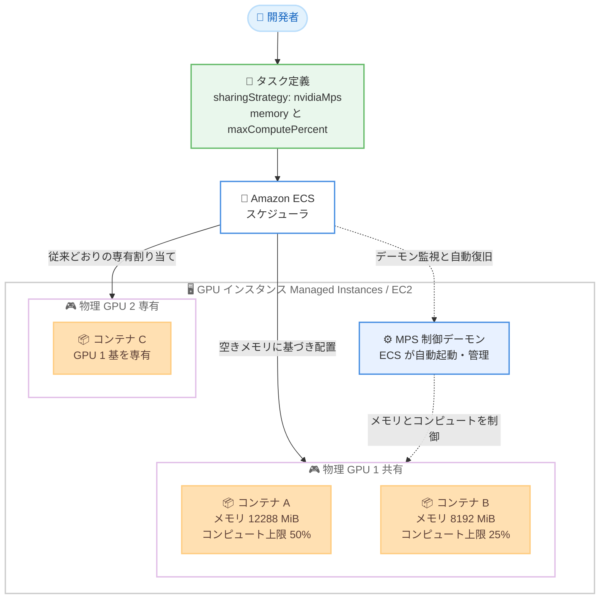

# Amazon ECS - NVIDIA Multi-Process Service (MPS) による GPU 共有のサポート

**リリース日**: 2026 年 10 月 27 日
**サービス**: Amazon Elastic Container Service (Amazon ECS)
**機能**: NVIDIA Multi-Process Service (MPS) による GPU 共有

📊 [このアップデートのインフォグラフィックを見る](https://takech9203.github.io/aws-news-summary/20261027-amazon-ecs-gpu-sharing-nvidia-mps.html)

## 概要

Amazon ECS が NVIDIA Multi-Process Service (MPS) による GPU 共有をサポートしました。これにより、複数の ECS タスクが 1 つの物理 NVIDIA GPU 上で同時に実行できるようになります。小規模モデルの推論、AV/ADAS シミュレーション、埋め込み生成など、GPU の一部の容量しか使用しないワークロードに適しており、アプリケーションコードを変更することなく、各 GPU インスタンスにより多くのワークロードを集約できます。

タスク定義のコンテナ定義で各コンテナが必要とする GPU メモリを指定し、オプションで GPU コンピュートの最大使用率も設定できます。サービスのスケールやデプロイの際には、ECS が空き容量のある GPU にタスクを自動的に配置します。本機能は Amazon ECS Managed Instances と Amazon ECS on Amazon EC2 の両方でサポートされます。

さらに Managed Instances では、ECS が MPS 制御デーモンの健全性を監視し、障害を検出した場合はインスタンスを自動的に置き換え、タスクを正常なキャパシティに移動します。GPU 使用率の向上とインフラコストの削減を実現したい ML 推論基盤の運用者にとって重要なアップデートです。

**アップデート前の課題**

このアップデート以前は、ECS における GPU 割り当てに以下の課題がありました。

- GPU リソースはコンテナに整数単位 (1 GPU 以上) でしか割り当てられず、GPU の一部しか使わない軽量ワークロードでも GPU 1 基を専有する必要があった
- 推論や埋め込み生成などの小規模ワークロードでは GPU のコンピュートとメモリの大部分がアイドル状態となり、コスト効率が悪かった
- 複数のモデルを 1 つの GPU に相乗りさせるには、独自に MPS デーモンを構成・運用するなどの複雑なカスタム実装が必要だった

**アップデート後の改善**

今回のアップデートにより、以下が可能になりました。

- タスク定義に `sharingStrategy` を指定するだけで、複数のタスク・コンテナが 1 つの物理 GPU を共有できるようになった
- コンテナごとに GPU メモリの上限 (必須) と GPU コンピュートの最大使用率 (オプション) を設定でき、ワークロード間の干渉を制御できるようになった
- MPS デーモンの起動・管理を ECS が代行し、Managed Instances ではデーモン障害時の自動復旧も提供されるため、運用負荷なく GPU 使用率を向上できるようになった

## アーキテクチャ図



タスク定義で GPU 共有を指定すると、ECS が GPU の空きメモリに基づいてタスクを配置し、MPS 制御デーモンがコンテナごとのメモリ上限とコンピュート上限を適用します。共有 GPU と専有 GPU のタスクは同じインスタンス上の別々の GPU で共存できます。

## サービスアップデートの詳細

### 主要機能

1. **MPS による GPU 共有**
   - NVIDIA CUDA の機能である MPS を利用し、複数のプロセスを同一 GPU 上で同時実行する
   - コンテキストスイッチのオーバーヘッドを削減しつつ GPU 使用率を向上させる
   - ハードウェアレベルのパーティショニングではなく、ソフトウェアレベルの共有を提供する

2. **コンテナ単位のリソース制御**
   - `memory` (必須): コンテナが使用できる GPU メモリのハード上限を MiB 単位で指定する
   - `maxComputePercent` (オプション): GPU コンピュートの最大使用率を 1〜100 の整数で指定する。未指定時は 100% まで使用可能
   - `maxComputePercent` は上限であり予約ではないため、あるコンテナがアイドル状態のとき、未使用のコンピュートは同じ GPU 上の他のコンテナが各自の上限まで利用できる

3. **ECS によるマネージドな MPS 運用**
   - ECS が GPU インスタンス上で MPS デーモンを自動的に起動・管理する
   - タスク内の全 GPU コンテナの要求メモリを合算し、十分な空きメモリを持つ 1 つの GPU に同一タスクのコンテナをまとめて配置する
   - 異なるサービスのタスクでも、空きメモリがあれば同じ物理 GPU に配置できる

4. **Managed Instances での自動復旧**
   - ECS が GPU と MPS デーモンの健全性を監視する
   - GPU ハードウェア障害や MPS デーモン障害を検出すると、インスタンスをドレインして置き換え、タスクを正常なキャパシティへ移動する

## 技術仕様

### GPU 共有の設定パラメータ

| 項目 | 詳細 |
|------|------|
| 設定場所 | タスク定義のコンテナ定義内 `resourceRequirements` の `sharingStrategy.nvidiaMps` |
| `memory` | 必須。GPU メモリ上限 (MiB)。0 より大きい値 |
| `maxComputePercent` | オプション。GPU コンピュートの上限 (1〜100 の整数)。未指定時は 100 |
| 配置基準 | GPU メモリのみに基づいて配置 (コンピュートは配置判断に使用されない) |
| 対応起動タイプ | ECS Managed Instances (`MANAGED_INSTANCES`)、ECS on EC2 (`EC2`) |
| 対応インスタンスファミリー | G4dn、G5、G6、G6e、G7、G7e、P3、P4d、P5、P5e、P5en、P6-B200 |
| EC2 での要件 | ECS コンテナエージェント 1.107.0 以降、ECS AL2023 GPU 最適化 AMI 20261019 以降 |
| 非対応 | AWS Fargate、ECS Express Mode、ECS マネージドデーモンタスク、ECS Anywhere (`EXTERNAL`) |

### 自動設定される環境変数

GPU を共有するコンテナには、ECS が以下の予約環境変数を自動設定します。コンテナ定義でこれらを設定してはいけません。

| 環境変数 | 用途 |
|----------|------|
| `CUDA_MPS_PINNED_DEVICE_MEM_LIMIT` | GPU メモリ上限の適用 |
| `CUDA_MPS_ACTIVE_THREAD_PERCENTAGE` | GPU コンピュート上限の適用 |

### API 変更履歴

| 日付 | サービス | 変更内容 |
|------|----------|----------|
| 2026/10/27 | [ecs](https://awsapichanges.com/archive/changes/5c6356-ecs.html) | 13 updated api methods - NVIDIA MPS による GPU 共有のサポートを追加。`sharingStrategy` の指定、`DescribeContainerInstances` での `gpuDevices` (共有モード・残りメモリ・コンテナ数)、`DescribeTasks` での `gpuSharingStrategy` と `gpuIds` の参照など |

### タスク定義の例

2 つの推論コンテナが 1 つの GPU を MPS で共有する例です (`{account-id}` は AWS アカウント ID に置き換えてください)。

```json
{
  "family": "mps-inference",
  "networkMode": "awsvpc",
  "executionRoleArn": "arn:aws:iam::{account-id}:role/ecsTaskExecutionRole",
  "containerDefinitions": [
    {
      "name": "model-a",
      "image": "nvidia/cuda:12.0.0-base-ubuntu22.04",
      "essential": true,
      "resourceRequirements": [
        {
          "type": "GPU",
          "sharingStrategy": {
            "nvidiaMps": {
              "memory": 12288,
              "maxComputePercent": 50
            }
          }
        }
      ]
    },
    {
      "name": "model-b",
      "image": "nvidia/cuda:12.0.0-base-ubuntu22.04",
      "essential": true,
      "resourceRequirements": [
        {
          "type": "GPU",
          "sharingStrategy": {
            "nvidiaMps": {
              "memory": 8192,
              "maxComputePercent": 25
            }
          }
        }
      ]
    }
  ],
  "requiresCompatibilities": ["MANAGED_INSTANCES"],
  "cpu": "4096",
  "memory": "8192"
}
```

## 設定方法

### 前提条件

1. NVIDIA GPU インスタンスを含むキャパシティプロバイダー (Managed Instances または EC2)
2. ECS on EC2 の場合: ECS コンテナエージェント 1.107.0 以降と ECS AL2023 GPU 最適化 AMI 20261019 以降のインスタンス
3. 対応インスタンスファミリー (G4dn、G5、G6、G6e、G7、G7e、P3、P4d、P5、P5e、P5en、P6-B200) の使用

### 手順

#### ステップ 1: キャパシティプロバイダーの作成

```bash
aws ecs create-capacity-provider \
  --name gpu-managed-instances-cp \
  --managed-instances-provider "..."
```

NVIDIA GPU インスタンスを提供するキャパシティプロバイダーを作成します。Managed Instances では ECS が GPU インスタンスの選択と管理を代行するため、タスク定義以外の追加セットアップは不要です。

#### ステップ 2: タスク定義で GPU 共有を設定

```bash
aws ecs register-task-definition \
  --cli-input-json file://mps-inference-task-def.json
```

コンテナ定義の `resourceRequirements` に `sharingStrategy.nvidiaMps` を指定したタスク定義 (前述の例) を登録します。`memory` で GPU メモリ上限を、`maxComputePercent` でコンピュート上限を設定します。

#### ステップ 3: サービスの作成

```bash
aws ecs create-service \
  --cluster my-gpu-cluster \
  --service-name mps-inference-service \
  --task-definition mps-inference \
  --desired-count 4 \
  --capacity-provider-strategy capacityProvider=gpu-managed-instances-cp,weight=1
```

GPU 対応キャパシティプロバイダーを使用するサービスを作成します。ECS が各 GPU の空きメモリに基づいてタスクを配置し、複数のタスクが同じ物理 GPU を共有します。

#### ステップ 4: 共有状態の確認

```bash
aws ecs describe-container-instances \
  --cluster my-gpu-cluster \
  --container-instances <container-instance-id> \
  --query 'containerInstances[].gpuDevices'
```

`DescribeContainerInstances` のレスポンスに含まれる `gpuDevices` フィールドで、各 GPU の共有モード (`sharingMode: NVIDIA_MPS`)、コンテナ数、残りメモリを確認できます。タスクごとの設定は `DescribeTasks` の `gpuSharingStrategy` と `gpuIds` で確認します。

## メリット

### ビジネス面

- **インフラコストの削減**: GPU の一部しか使わないワークロードを 1 つの GPU に集約することで、必要な GPU インスタンス数を削減できる
- **GPU 投資の最大活用**: アイドル状態だった GPU のコンピュートとメモリを有効活用し、GPU 使用率を向上できる
- **アプリケーション変更不要**: タスク定義の設定変更のみで導入でき、アプリケーションコードの改修コストが発生しない

### 技術面

- **宣言的なリソース制御**: コンテナごとに GPU メモリ上限とコンピュート上限を宣言的に設定でき、ワークロード間の干渉を抑制できる
- **マネージドな MPS 運用**: MPS デーモンの起動・管理を ECS が代行し、独自構築が不要になる
- **自動復旧**: Managed Instances では GPU 障害や MPS デーモン障害を検出すると、インスタンスの置き換えとタスクの再配置が自動で行われる
- **柔軟な配置**: 共有 GPU タスクと専有 GPU タスクを同じインスタンス上の別 GPU で共存させられる

## デメリット・制約事項

### 制限事項

- AWS Fargate、Amazon ECS Express Mode、ECS マネージドデーモンタスク、ECS Anywhere (`EXTERNAL` 互換性) では GPU 共有を利用できない
- GPU リソース要件では `value` (専有) と `sharingStrategy` (共有) のどちらか一方のみ指定可能で、同一タスク内の全 GPU コンテナは同じ共有戦略を使う必要がある
- `RunTask` / `StartTask` のコンテナオーバーライドでは `sharingStrategy` を指定できない (タスク定義で定義する必要がある)
- MPS 共有 GPU では、タスク/コンテナ単位の GPU 使用率・GPU メモリ関連メトリクス (`TaskGPUUtilization`、`TaskGPUMemoryUtilization` など) が出力されない (電力・温度・XID 関連とインスタンスレベルのメトリクスは利用可能)

### 考慮すべき点

- MPS はソフトウェアレベルの共有であり、同一 GPU 上の全コンテナが同じ CUDA コンテキストを共有する。あるコンテナが不正メモリアクセスなどの致命的な GPU エラーを起こすと、同じ物理 GPU を共有する他のコンテナにも影響が及ぶ可能性がある (他の GPU 上のコンテナには影響しない)
- ハードウェアレベルの分離が必要なワークロードや、GPU メモリを全量使用する大規模モデルのトレーニングには適さない
- コンテナあたり 1 つの GPU プロセスでの実行が推奨される。複数プロセスを実行する場合は合計ピークメモリに基づいて `memory` を設定しないと、設定値を超える消費によりメモリ競合が発生しうる
- タスク配置は GPU メモリのみに基づいて行われ、コンピュート使用率は考慮されない
- 同じキャパシティプロバイダーを使う異なるサービスのタスクが同一 GPU に配置されうるため、分離したい場合はキャパシティプロバイダーまたはクラスターを分ける必要がある

## ユースケース

### ユースケース 1: 複数の小規模モデルを 1 GPU で同時サービング

**シナリオ**: 複数の小規模 LLM や画像分類モデルをそれぞれ別コンテナで提供しており、各モデルは GPU メモリの 30〜50% 程度しか使用していない。

**実装例**:
```json
"resourceRequirements": [
  {
    "type": "GPU",
    "sharingStrategy": {
      "nvidiaMps": { "memory": 8192, "maxComputePercent": 40 }
    }
  }
]
```

**効果**: 従来はモデルごとに GPU 1 基を専有していたが、2〜3 個のモデルを 1 つの GPU に集約でき、GPU インスタンス数と月額コストを大幅に削減できる。

### ユースケース 2: 埋め込み生成パイプラインの高密度化

**シナリオ**: RAG システム向けの埋め込み生成サービスを複数稼働させており、個々のタスクの GPU 使用率が低い。

**実装例**:
```json
"resourceRequirements": [
  {
    "type": "GPU",
    "sharingStrategy": {
      "nvidiaMps": { "memory": 4096 }
    }
  }
]
```

**効果**: `maxComputePercent` を指定しないことで各タスクはアイドル時の余剰コンピュートを最大限利用しつつ、メモリ上限により配置の安全性を確保できる。同一インスタンスへのタスク集約度が向上する。

### ユースケース 3: AV/ADAS シミュレーションと開発・テスト環境

**シナリオ**: 自動運転のシミュレーションジョブや ML アプリケーションの開発・テスト環境で、多数の軽量 GPU ワークロードを並列実行したい。

**実装例**:
```json
"resourceRequirements": [
  {
    "type": "GPU",
    "sharingStrategy": {
      "nvidiaMps": { "memory": 2048, "maxComputePercent": 20 }
    }
  }
]
```

**効果**: 本番相当の GPU 環境を少ないインスタンス数で多数のチーム・ジョブに提供でき、開発環境の GPU コストを抑制できる。Managed Instances では MPS デーモン障害時の自動復旧により運用負荷も最小化される。

## 料金

GPU 共有機能自体に対する追加料金の記載はありません。利用する GPU インスタンス (ECS Managed Instances または Amazon EC2) の料金が通常どおり適用されます。

GPU 共有により同一インスタンスに複数のワークロードを集約できるため、同じワークロード量に対して必要な GPU インスタンス数を減らし、インフラコストを削減する効果が期待できます。CloudWatch Container Insights の `InstanceGPUUsageTotal` と `InstanceGPULimit` を比較することで、集約状況とコスト削減効果を確認できます。

## 利用可能リージョン

すべての AWS 商用リージョンおよび AWS GovCloud (US) リージョンで利用可能です。

## 関連サービス・機能

- **Amazon ECS Managed Instances**: ECS がインスタンスの選択・管理を代行する起動タイプ。GPU 共有に加え、GPU と MPS デーモンの自動監視・自動復旧を提供する
- **Amazon EC2 GPU インスタンス**: G4dn、G5、G6、G6e、G7、G7e、P3、P4d、P5、P5e、P5en、P6-B200 ファミリーが GPU 共有に対応する
- **Amazon CloudWatch Container Insights**: `InstanceGPUUsageTotal` や `instance_number_of_running_tasks` などのメトリクスで GPU 共有の効果をモニタリングできる
- **NVIDIA Multi-Process Service (MPS)**: 複数の CUDA プロセスを同一 GPU 上で同時実行する NVIDIA の機能。本アップデートの基盤技術

## 参考リンク

- 📊 [インフォグラフィック](https://takech9203.github.io/aws-news-summary/20261027-amazon-ecs-gpu-sharing-nvidia-mps.html)
- [公式発表 (What's New)](https://aws.amazon.com/about-aws/whats-new/2026/10/amazon-ecs-gpu-sharing-nvidia-mps/)
- [ドキュメント: Share GPUs on Amazon ECS](https://docs.aws.amazon.com/AmazonECS/latest/developerguide/ecs-gpu-sharing.html)
- [NVIDIA Multi-Process Service ドキュメント](https://docs.nvidia.com/deploy/mps/index.html)
- [Amazon ECS 製品ページ](https://aws.amazon.com/ecs/)

## まとめ

Amazon ECS の NVIDIA MPS による GPU 共有サポートにより、タスク定義の設定だけで複数のタスクが 1 つの GPU を安全に共有できるようになり、推論や埋め込み生成などの軽量 GPU ワークロードのコスト効率が大きく向上します。GPU 使用率が低い ECS ワークロードを運用している場合は、まず開発・テスト環境で `sharingStrategy` を試し、CloudWatch メトリクスで集約効果を確認した上で本番環境への適用を検討することを推奨します。
