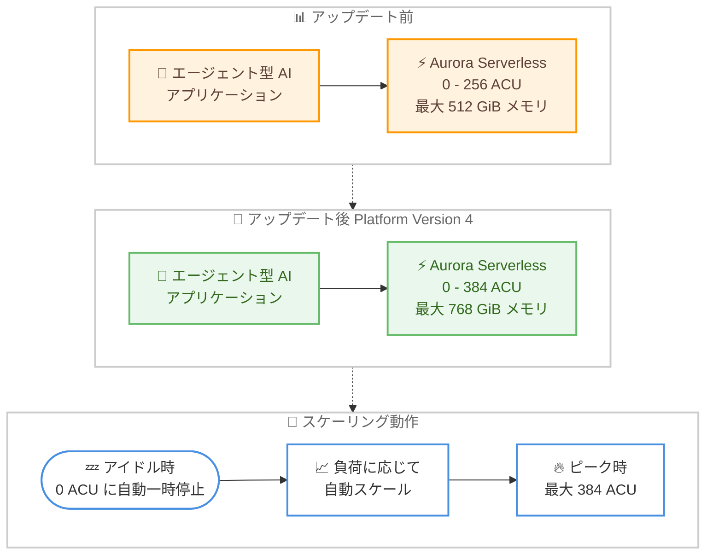

# Amazon Aurora - Aurora Serverless が最大 384 ACU をサポート

**リリース日**: 2026 年 10 月 27 日
**サービス**: Amazon Aurora (PostgreSQL 互換エディション)
**機能**: Aurora Serverless の最大容量 384 ACU への拡張

📊 [このアップデートのインフォグラフィックを見る](https://takech9203.github.io/aws-news-summary/20261027-aurora-serverless-supports-384-acu.html)

## 概要

Amazon Aurora Serverless が、Aurora PostgreSQL 互換エディションにおいて最大 384 ACU (Aurora Capacity Unit) までのスケーリングをサポートしました。従来の上限であった 256 ACU から 50% の増加となり、1 つの ACU は約 2 GiB のメモリと対応する CPU・ネットワーク帯域で構成されるため、データベースインスタンスあたり最大 768 GiB のメモリを利用できるようになります。

最大容量が拡張されても、アイドル時に 0 ACU までスケールダウンする自動一時停止 (auto-pause) 機能は引き続き利用可能です。使用した分だけ支払う課金モデルはそのままに、ピーク時にはより大きな容量まで自動スケールできるため、バースト的で予測困難なトラフィックパターンと長いアイドル期間を持つワークロード、特にエージェント型 AI アプリケーションに適していると AWS は位置付けています。

本機能は Aurora PostgreSQL 18.4 / 17.10 / 16.14 / 15.18 / 14.23 (いずれも Aurora Serverless Platform Version 4 上で稼働) で利用できます。Platform Version 4 上の既存クラスターは、ダウンタイムなしで最大容量設定を変更するだけで 384 ACU を利用できます。

**アップデート前の課題**

- Aurora Serverless の最大容量は 256 ACU (約 512 GiB メモリ) に制限されており、それ以上の容量が必要なピーク時にはプロビジョンドインスタンスへの移行や混合構成クラスターの検討が必要だった
- メモリ集約型のワークロード (大規模な結合、ベクトル検索、大量の同時接続など) では、サーバーレスの自動スケーリングの利便性と大容量の両立が難しかった
- バースト時の容量不足を避けるためにプロビジョンドの大型インスタンスを常時稼働させると、アイドル期間のコストが無駄になっていた

**アップデート後の改善**

- 最大容量が 384 ACU (最大 768 GiB メモリ) に拡張され、従来比 50% 増の処理能力までシームレスに自動スケールできるようになった
- 0 ACU へのスケールダウン (自動一時停止) と組み合わせることで、「アイドル時はゼロ、ピーク時は 768 GiB」という幅広いダイナミックレンジを単一のサーバーレス構成で実現できるようになった
- Platform Version 4 上の既存クラスターは、ダウンタイムなしの設定変更のみで新しい上限を利用できるようになった

## アーキテクチャ図



アップデート前後の最大容量の違いと、0 ACU への自動一時停止から最大 384 ACU までの自動スケーリング動作を示しています。

## サービスアップデートの詳細

### 主要機能

1. **最大容量の 384 ACU への拡張**
   - Aurora PostgreSQL 互換エディションで最大 384 ACU までスケール可能 (従来は 256 ACU)
   - 1 ACU は約 2 GiB のメモリ、対応する CPU、ネットワーク帯域で構成され、最大で 768 GiB のメモリを利用可能
   - スケーリングは最小 0.5 ACU 単位で実行され、現在の容量が大きいほど増分も大きくなり高速にスケール

2. **0 ACU へのスケールダウンの維持**
   - 最大容量が拡張されても、アイドル時に 0 ACU まで自動一時停止 (auto-pause) する機能は引き続き利用可能
   - 使用したキャパシティに対してのみ課金されるモデルはそのまま
   - バースト的なアクティビティと長いアイドル期間を持つエージェント型 AI アプリケーションに好適

3. **Platform Version 4 による提供**
   - Aurora Serverless Platform Version は、性能・スケーリング能力・機能の改善を表すクラスターレベルの属性
   - Platform Version 4 は Platform Version 3 と比較して最大 30% の性能向上を提供
   - 新規クラスター、リストア、クローンは、リージョンで利用可能な最新の Platform Version で自動的に起動

4. **既存クラスターのダウンタイムなしの移行**
   - Platform Version 4 上の既存クラスターは、最大容量設定 (必要に応じてエンジンバージョンも) を変更するだけでダウンタイムなしで 384 ACU を利用可能
   - 古い Platform Version のクラスターは、保留中のメンテナンスアクションの適用、クラスターの停止と再起動、またはブルー/グリーンデプロイにより Platform Version 4 へアップグレード可能

## 技術仕様

### 容量範囲とエンジンバージョンの対応

| 容量範囲 (ACU) | Aurora MySQL 対応バージョン | Aurora PostgreSQL 対応バージョン |
|------|------|------|
| 0.5–128 | 3.02.0 以降 | 13.6 / 14.3 / 15.2 / 16.1 以降 |
| 0.5–256 | 3.06.0 以降 | 13.13 / 14.10 / 15.5 / 16.1 以降 |
| 0–256 | 3.08.0 以降 | 13.15 / 14.12 / 15.7 / 16.3 以降 |
| 0–384 | 対応なし | 14.23 / 15.18 / 16.14 / 17.10 / 18.4 以降 |

### Platform Version ごとの特性

| Platform Version | ACU 範囲 | 性能 |
|------|------|------|
| 1 | 0–128 | ベースライン性能 |
| 2 | 0–256 | ベースライン性能 |
| 3 | 0–256 | Platform Version 2 比で最大 30% の性能向上 |
| 4 | 0–256 (Aurora MySQL)、0–384 (Aurora PostgreSQL) | Platform Version 3 比で最大 30% の性能向上 |

実際に利用できるスケーリング範囲は、エンジンバージョンと Platform Version の両方のうち、能力の低い方によって決定されます。たとえば、Platform Version 4 上でも古いエンジンバージョンでは 384 ACU を利用できません。

### 関連パラメータ

| 項目 | 詳細 |
|------|------|
| 最大容量 384 ACU 時の max_connections デフォルト値 | 5,000 (Aurora PostgreSQL、Platform Version 4) |
| Platform Version の確認方法 | マネジメントコンソールの Instance Configuration セクション、または API の `DBCluster` に含まれる `ServerlessV2PlatformVersion` フィールド |
| 容量監視メトリクス | `ServerlessDatabaseCapacity`、`ACUUtilization` (CloudWatch) |

## 設定方法

### 前提条件

1. Aurora PostgreSQL 14.23 / 15.18 / 16.14 / 17.10 / 18.4 以降のエンジンバージョンを使用していること
2. クラスターが Aurora Serverless Platform Version 4 上で稼働していること (古い Platform Version の場合はアップグレードが必要)
3. Platform Version 4 が利用可能なリージョンであること

### 手順

#### ステップ 1: 現在の Platform Version を確認する

```bash
aws rds describe-db-clusters \
  --db-cluster-identifier my-aurora-cluster \
  --query "DBClusters[0].ServerlessV2PlatformVersion"
```

クラスターの `ServerlessV2PlatformVersion` フィールドを取得し、現在稼働している Platform Version を確認します。`4` でない場合は、保留中のメンテナンスアクションの適用、クラスターの停止と再起動、またはブルー/グリーンデプロイで Platform Version 4 へアップグレードします。

#### ステップ 2: 保留中のメンテナンスアクションを確認・適用する (古い Platform Version の場合)

```bash
# 保留中のメンテナンスアクションを確認
aws rds describe-pending-maintenance-actions \
  --filters "Name=db-cluster-id,Values=arn:aws:rds:ap-northeast-1:123456789012:cluster:my-aurora-cluster"

# メンテナンスアクションを即時適用
aws rds apply-pending-maintenance-action \
  --resource-identifier arn:aws:rds:ap-northeast-1:123456789012:cluster:my-aurora-cluster \
  --apply-action system-update \
  --opt-in-type immediate
```

1 つ目のコマンドでクラスターに対する保留中のメンテナンスアクションを一覧表示し、2 つ目のコマンドで Platform Version 4 へのアップグレードを含むシステム更新を即時適用します。

#### ステップ 3: 最大容量を 384 ACU に変更する

```bash
aws rds modify-db-cluster \
  --db-cluster-identifier my-aurora-cluster \
  --serverless-v2-scaling-configuration MinCapacity=0,MaxCapacity=384 \
  --apply-immediately
```

クラスターのサーバーレススケーリング設定を変更し、最小容量 0 ACU (自動一時停止有効)、最大容量 384 ACU を設定します。Platform Version 4 上の既存クラスターでは、この変更はダウンタイムなしで適用されます。

#### ステップ 4: スケーリング動作を監視する

```bash
aws cloudwatch get-metric-statistics \
  --namespace AWS/RDS \
  --metric-name ServerlessDatabaseCapacity \
  --dimensions Name=DBClusterIdentifier,Value=my-aurora-cluster \
  --start-time 2026-10-27T00:00:00Z \
  --end-time 2026-10-28T00:00:00Z \
  --period 300 \
  --statistics Average Maximum
```

CloudWatch の `ServerlessDatabaseCapacity` メトリクスを取得し、実際に消費されている ACU の推移を確認します。`ACUUtilization` と合わせて、設定した容量範囲が適切かを判断できます。

## メリット

### ビジネス面

- **コスト効率の向上**: ピーク容量のためにプロビジョンドの大型インスタンスを常時稼働させる必要がなくなり、アイドル時は 0 ACU まで縮退することでコストを最小化できる
- **キャパシティプランニングの簡素化**: 予測困難なワークロードでも容量不足を心配せずにサーバーレス構成を採用でき、事前のサイジング作業を削減できる
- **AI アプリケーションへの適合**: バースト的なアクセスと長いアイドル時間を持つエージェント型 AI アプリケーションのデータベース基盤として、性能とコストを両立できる

### 技術面

- **50% 増の最大容量**: 最大 384 ACU (768 GiB メモリ) まで自動スケールでき、メモリ集約型クエリや大量の同時接続に対応しやすくなる
- **ダウンタイムなしの適用**: Platform Version 4 上の既存クラスターは設定変更のみで新しい上限を利用でき、アプリケーションの停止が不要
- **性能向上との組み合わせ**: Platform Version 4 自体が Platform Version 3 比で最大 30% の性能向上を提供するため、容量拡張と性能改善を同時に享受できる

## デメリット・制約事項

### 制限事項

- 384 ACU は Aurora PostgreSQL 互換エディションのみの対応で、Aurora MySQL 互換エディションの上限は引き続き 256 ACU
- Aurora PostgreSQL 14.23 / 15.18 / 16.14 / 17.10 / 18.4 以降かつ Platform Version 4 が必要で、エンジンバージョンと Platform Version のいずれか低い方の能力でスケーリング範囲が決まる
- Platform Version 4 は利用可能なリージョンが限定されている (下記「利用可能リージョン」を参照)

### 考慮すべき点

- 古い Platform Version のクラスターは、メンテナンスアクションの適用、停止と再起動、またはブルー/グリーンデプロイによる Platform Version 4 へのアップグレードが必要
- 最大容量を引き上げると、`max_connections` などの最大容量に基づいて計算されるパラメータのデフォルト値が変わる可能性があるため、パラメータグループの動作を事前に確認することが推奨される
- 最大容量までスケールした場合の ACU 時間あたりの課金額も増えるため、`ACUUtilization` の監視と適切な最大容量の設定が重要

## ユースケース

### ユースケース 1: エージェント型 AI アプリケーションのバックエンド

**シナリオ**: AI エージェントが自律的にタスクを実行するアプリケーションで、エージェントの活動に応じてデータベースアクセスが突発的に集中し、それ以外の時間はほぼアイドル状態となる。

**実装例**:
```bash
aws rds create-db-cluster \
  --db-cluster-identifier agentic-ai-db \
  --engine aurora-postgresql \
  --engine-version 17.10 \
  --serverless-v2-scaling-configuration MinCapacity=0,MaxCapacity=384
```

**効果**: アイドル時は 0 ACU まで一時停止してコストを抑えつつ、エージェントのバースト的な処理時には最大 768 GiB メモリまで自動スケールし、性能とコストを両立できる。

### ユースケース 2: メモリ集約型分析クエリを伴う SaaS アプリケーション

**シナリオ**: マルチテナント SaaS で通常時のトランザクション負荷は小さいが、月次レポート生成時に大規模な結合や集計クエリが実行され、従来の 256 ACU では処理が遅延していた。

**実装例**:
```bash
aws rds modify-db-cluster \
  --db-cluster-identifier saas-production-db \
  --serverless-v2-scaling-configuration MinCapacity=8,MaxCapacity=384 \
  --apply-immediately
```

**効果**: レポート生成時のみ 384 ACU まで自動スケールして処理時間を短縮し、通常時は小さい容量で稼働することでインフラコストを最適化できる。

### ユースケース 3: プロビジョンドからサーバーレスへの統合

**シナリオ**: ピーク容量の要件から一部をプロビジョンドの大型インスタンスで運用していた混合構成クラスターを、運用簡素化のためフルサーバーレス構成へ統合したい。

**実装例**:
```bash
# サーバーレスリーダーを追加して段階的に移行
aws rds create-db-instance \
  --db-instance-identifier serverless-reader-1 \
  --db-cluster-identifier mixed-config-cluster \
  --db-instance-class db.serverless \
  --engine aurora-postgresql
```

**効果**: 最大容量の拡張により、これまでプロビジョンドインスタンスが必要だったワークロードもサーバーレスでカバーでき、インスタンスクラスの管理やサイジング作業が不要になる。

## 料金

Aurora Serverless の料金は、消費した容量を ACU 時間単位で計測する従量課金です。最小容量 0 ACU を設定した場合、アイドル時の自動一時停止中はコンピューティング料金が発生しません (ストレージおよび I/O 料金は別途発生)。最大容量を 384 ACU に引き上げても、実際に消費した容量分のみが課金対象となります。

リージョンごとの ACU 時間あたりの単価および詳細は [Amazon Aurora 料金ページ](https://aws.amazon.com/rds/aurora/pricing/) を参照してください。

## 利用可能リージョン

本機能には Platform Version 4 が必要です。公式ドキュメントによると、Platform Version 4 は以下のリージョンで利用可能です。

米国東部 (バージニア北部)、米国東部 (オハイオ)、米国西部 (北カリフォルニア)、米国西部 (オレゴン)、アジアパシフィック (香港)、アジアパシフィック (ハイデラバード)、アジアパシフィック (ジャカルタ)、アジアパシフィック (マレーシア)、アジアパシフィック (メルボルン)、アジアパシフィック (ムンバイ)、アジアパシフィック (大阪)、アジアパシフィック (ソウル)、アジアパシフィック (シンガポール)、アジアパシフィック (シドニー)、**アジアパシフィック (東京)**、カナダ (中部)、欧州 (フランクフルト)、欧州 (アイルランド)、欧州 (ロンドン)、欧州 (パリ)、欧州 (スペイン)、欧州 (ストックホルム)、欧州 (チューリッヒ)、南米 (サンパウロ)、AWS GovCloud (US-East)、AWS GovCloud (US-West)

## 関連サービス・機能

- **Aurora Serverless 自動一時停止 (Scaling to Zero)**: 最小容量 0 ACU の設定により、アイドル時にコンピューティングを完全に停止してコストを削減する機能。本アップデート後も引き続き利用可能
- **Amazon CloudWatch**: `ServerlessDatabaseCapacity` と `ACUUtilization` メトリクスにより、容量消費の推移を監視し、容量範囲の適正化に活用できる
- **Amazon RDS ブルー/グリーンデプロイ**: 古い Platform Version から Platform Version 4 への移行手段の 1 つとして利用可能
- **Aurora Global Database**: セカンダリクラスターにサーバーレス容量を使用でき、災害対策構成でもスケールダウンによるコスト削減が可能

## 参考リンク

- 📊 [インフォグラフィック](https://takech9203.github.io/aws-news-summary/20261027-aurora-serverless-supports-384-acu.html)
- [公式発表 (What's New)](https://aws.amazon.com/about-aws/whats-new/2026/10/aurora-serverless-supports-384-acu/)
- [ドキュメント: How Aurora serverless works (容量と Platform Version)](https://docs.aws.amazon.com/AmazonRDS/latest/AuroraUserGuide/aurora-serverless-v2.how-it-works.html)
- [ドキュメント: Performance and scaling for Aurora serverless](https://docs.aws.amazon.com/AmazonRDS/latest/AuroraUserGuide/aurora-serverless-v2.setting-capacity.html)
- [Amazon Aurora Serverless 製品ページ](https://aws.amazon.com/rds/aurora/serverless/)
- [料金ページ](https://aws.amazon.com/rds/aurora/pricing/)

## まとめ

Aurora Serverless の最大容量が Aurora PostgreSQL 互換エディションで 384 ACU (最大 768 GiB メモリ) に拡張され、0 ACU への自動一時停止と組み合わせた幅広いダイナミックレンジを単一のサーバーレス構成で実現できるようになりました。バースト的なアクセスパターンを持つエージェント型 AI アプリケーションや、ピーク時のみ大容量が必要なワークロードでは、プロビジョンド構成からの移行を検討する価値があります。まずは `ServerlessV2PlatformVersion` で自クラスターの Platform Version を確認し、Platform Version 4 であればダウンタイムなしで最大容量の引き上げを試すことを推奨します。
