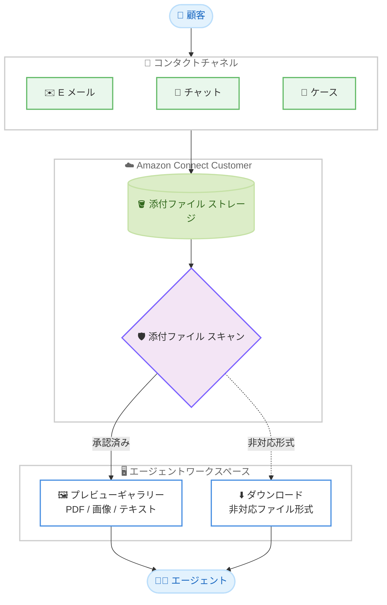

# Amazon Connect Customer - 添付ファイルのインラインプレビュー

**リリース日**: 2026 年 10 月 27 日
**サービス**: Amazon Connect Customer
**機能**: エージェントワークスペースでの添付ファイルのインラインプレビュー

📊 [このアップデートのインフォグラフィックを見る](https://takech9203.github.io/aws-news-summary/20261027-connect-attachment-previews.html)

## 概要

Amazon Connect Customer が、コンタクトセンターのエージェントがエージェントワークスペース内で添付ファイルを直接プレビューできる機能をサポートしました。エージェントは、E メール、チャット、ケースの各チャネルで顧客から共有された添付ファイルを、端末にダウンロードすることなくワークスペース内のプレビューギャラリーで閲覧できます。

プレビューギャラリーでは、複数の添付ファイル間の移動や、複数ページの PDF ドキュメントのスクロール閲覧が可能です。会話画面から離れずにファイルの内容を確認できるため、コンタクト処理時間の短縮と、機密性の高い顧客情報をエージェント端末へダウンロードする必要性の低減につながります。

**アップデート前の課題**

- 以前は、添付ファイルの内容を確認するためにファイルをエージェントの端末へダウンロードし、別のアプリケーションで開く必要があった
- ダウンロードにより、機密性の高い顧客情報がエージェントの端末に残るセキュリティリスクがあった
- ファイルを開くたびにワークスペースから離れるため、コンタクト処理時間が長くなっていた

**アップデート後の改善**

- 今回のアップデートにより、PDF、画像、テキストファイルをエージェントワークスペース内でそのままプレビューできるようになった
- 顧客ファイルをエージェント端末に保存せずに内容を確認できるため、情報漏えいリスクが低減された
- 複数の添付ファイル間の移動や複数ページドキュメントの閲覧がワークスペース内で完結し、対応が高速化された

## アーキテクチャ図

顧客が E メール、チャット、ケース経由で共有した添付ファイルは、スキャン承認後にエージェントワークスペースのプレビューギャラリーでインライン表示されます。非対応形式のファイルはダウンロードボタンが表示されます。

## サービスアップデートの詳細

### 主要機能

1. **プレビューギャラリーによるインライン表示**
   - エージェントはコンタクト画面の添付ファイル一覧からファイルを選択するか、[すべて表示] を選択してギャラリーを開くことができる
   - 対応ファイル形式はワークスペース内でそのままレンダリングされ、端末へのダウンロードが不要
   - ギャラリーはエージェントワークスペースが対応するすべての言語にローカライズされている

2. **複数添付ファイル間のナビゲーション**
   - [前の添付ファイル] / [次の添付ファイル] ボタン、またはサムネイルストリップで添付ファイル間を移動できる
   - サムネイルストリップは添付ファイルが 2 つ以上ある場合に表示される
   - 複数ページの PDF はギャラリー内でスクロールして閲覧できる

3. **別ウィンドウでの拡大表示**
   - [新しいウィンドウで開く] を選択すると、別のブラウザウィンドウで添付ファイルを大きく表示できる
   - 細かい文字を含む画像や複数ページの PDF の確認に有用
   - エージェントワークスペースは開いたまま維持され、ウィンドウを閉じれば元の画面に戻れる

4. **非対応ファイルのフォールバック表示**
   - プレビューできないファイルは、ファイル名とサイズ、および [ダウンロード] ボタンが表示される
   - プレビュー対応形式であっても、従来どおりダウンロードすることも可能

## 技術仕様

### プレビュー対応ファイル形式

| プレビュータイプ | ファイル拡張子 |
|------|------|
| ドキュメント | .pdf |
| 画像 | .jpg、.jpeg、.jfif、.png、.gif、.webp、.bmp |
| テキスト | .txt、.log、.csv、.json、.xml |

### プレビューできないケース

| ケース | 動作 |
|------|------|
| 非対応のファイル形式 (.docx、.xlsx、.zip、.eml など) | ファイル詳細と [ダウンロード] ボタンを表示 |
| .svg および .html ファイル | 悪意のあるスクリプトを埋め込める形式のため、セキュリティ上の理由でプレビューをブロック |
| サイズが大きすぎるファイル | インラインレンダリングされず、ファイル詳細と [ダウンロード] ボタンを表示 |
| 長いファイル | 内容の一部のみプレビュー表示。全体はダウンロードして確認 |
| スキャン未承認のファイル | 添付ファイルスキャンが有効な場合、承認されるまでプレビュー不可 |

## 設定方法

### 前提条件

1. Amazon Connect インスタンスで添付ファイル機能が有効化されていること
2. 添付ファイルスキャンを設定している場合は、スキャンで承認されたファイルのみプレビュー可能 (スキャンで拒否されたファイルはプレビューもダウンロードも不可)
3. エージェントがエージェントワークスペースを使用していること (Streams API で構築したカスタムエージェントアプリケーションではプレビューは利用不可)

### 手順

#### ステップ 1: 添付ファイル機能の有効化

Amazon Connect 管理コンソールで対象インスタンスを選択し、CCP (Contact Control Panel) の添付ファイル共有機能を有効化します。これにより、顧客とエージェントがファイルを共有できるようになります。

#### ステップ 2: 添付ファイルスキャンの設定 (推奨)

セキュリティ要件に応じて添付ファイルスキャンを設定します。スキャンを設定した場合、承認されたファイルのみがプレビューおよびダウンロードの対象になります。

#### ステップ 3: エージェントによるプレビューの利用

1. エージェントワークスペースで E メールコンタクト、チャットコンタクト、またはケースを開く
2. 添付ファイル一覧から対象ファイルを選択するか、[すべて表示] でギャラリーを開く
3. ギャラリー内で添付ファイル間の移動、PDF のスクロール、別ウィンドウ表示、ダウンロードを実行
4. [プレビューを閉じる] でコンタクト画面に戻る

追加の設定作業は不要で、前提条件を満たしていればエージェントワークスペースで自動的に利用できます。

## メリット

### ビジネス面

- **コンタクト処理時間の短縮**: ファイルのダウンロードと別アプリケーションでの展開が不要になり、エージェントの対応が高速化される
- **セキュリティリスクの低減**: 機密性の高い顧客情報をエージェント端末へダウンロードする必要性が減り、情報漏えいリスクを抑制できる
- **エージェント体験の向上**: 会話画面から離れずにファイル内容を確認でき、文脈を保ったまま対応を継続できる

### 技術面

- **追加開発不要**: エージェントワークスペースの標準機能として提供され、追加の実装なしで利用できる
- **スキャン連携**: 添付ファイルスキャンと統合されており、承認済みファイルのみがプレビュー対象になる
- **安全なレンダリング**: スクリプトを埋め込める .svg や .html のプレビューをブロックし、セキュリティリスクを軽減する設計

## デメリット・制約事項

### 制限事項

- プレビュー対応形式は PDF、画像、テキストファイルに限定され、.docx、.xlsx、.zip、.eml などは対象外
- .svg および .html ファイルはセキュリティ上の理由でプレビュー不可
- サイズが大きいファイルはインラインレンダリングされず、長いファイルは一部のみの表示となる
- Streams API で構築したカスタムエージェントアプリケーションでは利用できない

### 考慮すべき点

- 添付ファイルスキャンが有効な場合、スキャン承認が完了するまでプレビューできないため、スキャン処理時間を考慮した運用設計が必要
- プレビューは閲覧用であり、ファイルを編集・加工する場合は従来どおりダウンロードが必要

## ユースケース

### ユースケース 1: 保険金請求のドキュメント確認

**シナリオ**: 保険会社のコンタクトセンターで、顧客が事故証明書や見積書を PDF でメール添付して送付する。

**効果**: エージェントは複数ページの PDF をワークスペース内でスクロールして確認でき、ダウンロードせずにそのまま請求内容を把握して対応できる。処理時間が短縮され、個人情報が端末に残らない。

### ユースケース 2: テクニカルサポートでのログファイル確認

**シナリオ**: サポート窓口で、顧客がチャット経由でエラーログ (.log や .txt、.json) を共有する。

**効果**: エージェントはログファイルをインラインで即座に確認し、会話を継続しながらトラブルシューティングを進められる。別アプリケーションを開く手間がなくなり、初回解決率の向上が期待できる。

### ユースケース 3: EC サイトの返品対応での商品画像確認

**シナリオ**: 返品・交換窓口で、顧客が破損した商品の写真 (.jpg や .png) をケースに添付する。

**効果**: エージェントはサムネイルストリップで複数の画像を素早く切り替えて確認し、細部は [新しいウィンドウで開く] で拡大表示できる。状況把握が迅速になり、返品判断までの時間が短縮される。

## 料金

公式発表では、この機能に関する追加料金の記載はありません。Amazon Connect の既存の料金体系 (チャネルごとの従量課金) の範囲内で利用できます。詳細は [Amazon Connect 料金ページ](https://aws.amazon.com/connect/pricing/) を参照してください。

## 利用可能リージョン

以下の 10 リージョンで利用可能です。

- 米国東部 (バージニア北部)
- 米国西部 (オレゴン)
- アフリカ (ケープタウン)
- アジアパシフィック (ソウル)
- アジアパシフィック (シンガポール)
- アジアパシフィック (シドニー)
- アジアパシフィック (東京)
- カナダ (中部)
- 欧州 (フランクフルト)
- 欧州 (ロンドン)

## 関連サービス・機能

- **Amazon Connect 添付ファイル機能**: CCP での顧客・エージェント間のファイル共有機能。本プレビュー機能の前提となる
- **Amazon Connect 添付ファイルスキャン**: 共有ファイルのマルウェアスキャン。スキャン承認済みファイルのみがプレビュー対象
- **Amazon Connect エージェントワークスペース**: E メール、チャット、ケースを統合的に扱うエージェント向け UI。本機能はこのワークスペース上で動作する

## 参考リンク

- 📊 [インフォグラフィック](https://takech9203.github.io/aws-news-summary/20261027-connect-attachment-previews.html)
- [公式発表 (What's New)](https://aws.amazon.com/about-aws/whats-new/2026/10/connect-attachment-previews/)
- [ドキュメント: Preview attachments in the agent workspace](https://docs.aws.amazon.com/connect/latest/adminguide/preview-attachments.html)
- [Amazon Connect 製品ページ](https://aws.amazon.com/connect/)
- [料金ページ](https://aws.amazon.com/connect/pricing/)

## まとめ

Amazon Connect Customer の添付ファイルインラインプレビューにより、エージェントは E メール、チャット、ケースの添付ファイルをダウンロードせずにワークスペース内で確認できるようになりました。コンタクト処理時間の短縮とセキュリティリスク低減の両方に寄与するアップデートであり、添付ファイル機能を利用中のコンタクトセンターは、前提条件 (添付ファイル有効化とスキャン設定) を確認のうえ、エージェントへの周知を進めることを推奨します。
