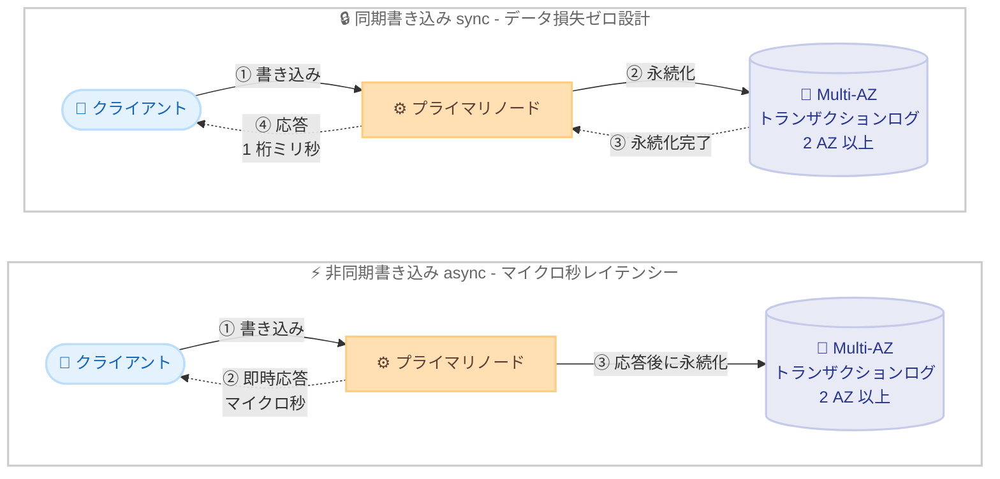

# Amazon ElastiCache - 既存クラスターでの耐久性設定変更サポート

**リリース日**: 2026 年 10 月 27 日
**サービス**: Amazon ElastiCache for Valkey
**機能**: 既存ノードベースクラスターにおける耐久性 (durability) 設定の変更

📊 [このアップデートのインフォグラフィックを見る](https://takech9203.github.io/aws-news-summary/20261027-elasticache-changing-durability.html)

## 概要

Amazon ElastiCache for Valkey で、既存のノードベースクラスターの耐久性 (durability) 設定を、クラスターを再作成することなく有効化または無効化できるようになりました。耐久性の変更はライブクラスターに対して適用され、変更中もクラスターはトラフィックを処理し続けます。

ElastiCache for Valkey の耐久性機能は、Multi-AZ トランザクションログによるデータ保護を提供します。耐久性には 2 つのオプションがあります。同期書き込み (sync) では、クライアントに応答する前にデータを少なくとも 2 つのアベイラビリティーゾーンに永続化するため、データ損失ゼロを目指した設計でありながら 1 桁ミリ秒の書き込みレイテンシーを実現します。非同期書き込み (async) では、クライアントへの応答後にデータを永続化するため、マイクロ秒の書き込みレイテンシーを追加コストなしで維持できますが、障害発生時には最大 10 秒間の未コミットデータが失われる可能性があります。どちらのオプションでも読み取りはマイクロ秒レイテンシーを維持します。

今回のアップデートにより、ElastiCache をキャッシュとして使い始めたワークロードを、要件の変化に応じて永続的なデータストアへと進化させることが容易になりました。AI エージェントの長期メモリやワークフロー状態、RAG アプリケーションのナレッジベース、決済トークン化、リアルタイム在庫管理など、データ損失が許容されないユースケースへの適用が広がります。

**アップデート前の課題**

このアップデート以前は、耐久性設定はクラスター作成時にのみ指定可能でした。

- 既存クラスターの耐久性設定を後から変更できず、変更するには新しいクラスターを作成してデータを移行する必要があった
- キャッシュ用途から永続的なデータストア用途への移行時に、クラスター再作成に伴う移行作業とダウンタイム計画が必要だった
- ワークロードの要件変化 (耐久性の強化、またはコスト・性能優先への切り替え) に柔軟に対応できなかった

**アップデート後の改善**

今回のアップデートにより、以下が可能になりました。

- 既存のノードベースクラスターで、`sync`、`async`、`disabled` の 3 つの耐久性モードをクラスター再作成なしで切り替え可能になった
- 変更はライブクラスターに適用され、トラフィックを処理しながら耐久性設定を移行できるようになった
- アプリケーションのライフサイクルの任意の時点で、書き込み性能とデータ耐久性のバランスを見直せるようになった

## アーキテクチャ図



同期書き込みではトランザクションログへの永続化完了後にクライアントへ応答し、非同期書き込みでは応答後にバックグラウンドで永続化します。今回のアップデートで、この 2 つのモードと無効化 (disabled) を既存クラスター上で相互に切り替えられるようになりました。

## サービスアップデートの詳細

### 主要機能

1. **既存クラスターでの耐久性モード変更**
   - `sync`、`async`、`disabled` の 3 モード間を、クラスターを再作成せずに切り替え可能
   - AWS Management Console、AWS CLI、AWS SDK から変更可能 (CLI では `modify-replication-group` の `--durability` パラメータを使用)
   - 変更はライブクラスターに適用され、クラスターはトラフィックを処理し続ける
   - 耐久性の変更は単独の変更操作として実行する必要があり、他の変更と同時にリクエストすると拒否される

2. **同期書き込み (sync)**
   - クライアントへの応答前に、少なくとも 2 つの AZ にまたがる Multi-AZ トランザクションログへデータを永続化
   - データ損失ゼロを目指した設計で、書き込みレイテンシーは 1 桁ミリ秒
   - データ損失を一切許容できないアプリケーションに推奨

3. **非同期書き込み (async)**
   - クライアントへの応答後に Multi-AZ トランザクションログへ永続化
   - マイクロ秒の書き込みレイテンシーを追加コストなしで維持
   - まれな障害発生時には、最大 10 秒間の確認応答済み書き込みが失われる可能性がある
   - プライマリノードが 10 秒を超えてトランザクションログへ永続化できない場合、永続化が回復するまで書き込みコマンドを拒否する

4. **保存時の暗号化の自動有効化**
   - `disabled` から `sync` または `async` に変更すると、スナップショットと Multi-AZ トランザクションログ内のデータを含め、保存時の暗号化が自動的に有効化される
   - クラスターがすでにカスタマーマネージド AWS KMS キーを使用している場合はそのキーが維持される
   - 後から耐久性を `disabled` に戻しても、保存時の暗号化は無効化されない

5. **変更状況のモニタリング**
   - `describe-replication-groups` で `Durability` (リクエストしたモード) と `EffectiveDurability` (実効モード) を確認可能
   - `replication-group-available` ウェイターで変更完了まで待機可能
   - 耐久性クラスター向けの CloudWatch メトリクス `DurabilityLag`、`DurabilityBufferExceededErrorCount` が利用可能

## 技術仕様

### 耐久性モードの比較

| 項目 | 同期書き込み sync | 非同期書き込み async |
|------|------------------|---------------------|
| 永続化のタイミング | クライアント応答前 | クライアント応答後 |
| 書き込みレイテンシー | 1 桁ミリ秒 | マイクロ秒 |
| 読み取りレイテンシー | マイクロ秒 | マイクロ秒 |
| 障害時のデータ損失 | ゼロを目指した設計 | 最大 10 秒の未コミットデータ損失の可能性 |
| 追加コスト | 料金ページを参照 | 追加コストなし |
| 推奨ユースケース | データ損失を許容できないワークロード | 書き込み性能を優先するワークロード |

### 既存クラスターで耐久性を変更するための要件

| 要件 | 詳細 |
|------|------|
| エンジンバージョン | Valkey 9.0 以降 |
| Multi-AZ | 有効化が必須で、シャードごとに少なくとも 1 つのレプリカが必要 |
| 転送時の暗号化 | TLS の有効化が必須 |
| クラスターモード | Cluster Mode Enabled (CME) のみ |
| デプロイ形態 | ノードベースのみ (ElastiCache Serverless は非対応) |
| Global Datastore | Global Datastore に属するクラスターは非対応 |

### 変更時の動作

- 耐久性モードの変更にはノード置き換えが伴い、各シャードで短時間のプライマリノード変更または自動フェイルオーバーが発生する
- クライアントは一時的な接続中断を経験する可能性があり、クラスタートポロジの再取得が必要になる場合がある
- クライアント側では再接続と、指数バックオフによる書き込みリトライの設定が推奨される
- 計画されたメンテナンスウィンドウでの変更実施が推奨される

## 設定方法

### 前提条件

1. Valkey 9.0 以降を実行するノードベースの ElastiCache クラスター (Cluster Mode Enabled)
2. Multi-AZ が有効で、シャードごとに少なくとも 1 つのレプリカが存在すること
3. 転送時の暗号化 (TLS) が有効であること

### 手順

#### ステップ 1: 耐久性モードを変更する

```bash
aws elasticache modify-replication-group \
  --replication-group-id my-valkey-cluster \
  --durability sync \
  --region us-east-1
```

`modify-replication-group` の `--durability` パラメータに `sync`、`async`、`disabled` のいずれかを指定して、既存クラスターの耐久性モードを変更します。耐久性の変更は単独の変更として実行し、他の設定変更と同時にリクエストしないでください。

#### ステップ 2: 変更の進行状況を確認する

```bash
aws elasticache describe-replication-groups \
  --replication-group-id my-valkey-cluster \
  --query "ReplicationGroups[0].{Id:ReplicationGroupId,Status:Status,Durability:Durability,EffectiveDurability:EffectiveDurability}" \
  --region us-east-1
```

レプリケーショングループのステータスと、リクエストした耐久性モード (`Durability`)、実際に適用されているモード (`EffectiveDurability`) を確認します。

#### ステップ 3: 変更完了まで待機し、結果を検証する

```bash
aws elasticache wait replication-group-available \
  --replication-group-id my-valkey-cluster \
  --region us-east-1
```

`replication-group-available` ウェイターでクラスターのステータスが `available` になるまで待機します。変更が失敗するとロールバックされる場合があるため、完了後に `EffectiveDurability` がリクエストしたモードと一致することを確認してください。一致しない場合は、ElastiCache イベントで原因を確認します。

## メリット

### ビジネス面

- **移行作業の削減**: キャッシュから永続データストアへの用途変更時に、クラスター再作成とデータ移行の計画・作業が不要になり、運用コストを削減できる
- **ユースケースの拡大**: AI エージェントのメモリ、決済トークン化、在庫管理など、データ損失が許容されないミッションクリティカルな用途に ElastiCache を適用できる
- **コスト最適化の柔軟性**: 耐久性が不要になったワークロードでは `async` や `disabled` に切り替えることで、性能とコストのバランスを継続的に見直せる

### 技術面

- **無停止に近い変更**: 変更はライブクラスターに適用され、トラフィックを処理しながら耐久性設定を移行できる (各シャードで短時間のフェイルオーバーは発生)
- **データ損失ゼロ設計の選択肢**: 同期書き込みにより、少なくとも 2 AZ への永続化を応答前に保証しつつ、1 桁ミリ秒の書き込みとマイクロ秒の読み取りを実現できる
- **運用の可視性**: `EffectiveDurability` フィールドや `DurabilityLag` などの CloudWatch メトリクスにより、変更状況と耐久性の健全性を監視できる

## デメリット・制約事項

### 制限事項

- Valkey 9.0 以降でのみサポートされる
- サポートされるインスタンスタイプファミリーは R8g、R7g、R6g、M8g、M7g、M6g、C8gn、C7gn
- ElastiCache Serverless では利用できない
- Global Datastore、Outposts、Local Zones、データ階層化 (data tiering) とは併用できない
- Cluster Mode Disabled (CMD) クラスターでは利用できない
- 耐久性を有効化したクラスターの書き込みスループットは、プライマリノードあたり最大 100 MiBps
- セルフホストの Valkey / Redis OSS から耐久性有効クラスターへのオンライン移行はサポートされない
- 耐久性を有効化し、かつ検索インデックスを構成している場合、インデックス対象キーへの書き込みコマンドがスロットリングされる可能性がある

### 考慮すべき点

- 耐久性モードの変更時には各シャードでプライマリノードの変更または自動フェイルオーバーが発生するため、クライアントの再接続・リトライ設定を事前に確認し、計画された運用ウィンドウでの実施が望ましい
- `sync` または `async` を有効化すると保存時の暗号化が自動的に有効化され、後から耐久性を `disabled` に戻しても暗号化は無効化されない
- `async` では障害時に最大 10 秒の確認応答済み書き込みが失われる可能性があるため、データ損失を許容できない場合は `sync` を選択する必要がある
- 同期書き込みでは書き込みレイテンシーがマイクロ秒から 1 桁ミリ秒に増加するため、書き込みレイテンシーに敏感なワークロードでは影響を評価する必要がある

## ユースケース

### ユースケース 1: AI エージェントの長期メモリとワークフロー状態の永続化

**シナリオ**: AI エージェントアプリケーションで、ElastiCache をセッションキャッシュとして利用していたが、エージェントの長期メモリやワークフロー状態を失うことなく保持する要件が発生した。

**実装例**:
```bash
# 既存のキャッシュクラスターを同期書き込みモードに変更
aws elasticache modify-replication-group \
  --replication-group-id agent-memory-cluster \
  --durability sync
```

**効果**: クラスターを再作成せずに、エージェントのメモリストアをデータ損失ゼロ設計の永続ストアへ移行できる。読み取りはマイクロ秒レイテンシーを維持するため、エージェントの応答性能への影響を最小限に抑えられる。

### ユースケース 2: 決済トークン化ストアの耐久性強化

**シナリオ**: 決済システムでトークンと決済情報のマッピングを ElastiCache に保持しており、障害時のトークン消失が決済失敗に直結するため、耐久性の保証が必要になった。

**実装例**:
```bash
# 同期書き込みに変更し、変更完了後に実効モードを検証
aws elasticache modify-replication-group \
  --replication-group-id payment-token-cluster \
  --durability sync

aws elasticache wait replication-group-available \
  --replication-group-id payment-token-cluster

aws elasticache describe-replication-groups \
  --replication-group-id payment-token-cluster \
  --query "ReplicationGroups[0].EffectiveDurability"
```

**効果**: 応答前に少なくとも 2 AZ へ永続化されるため、障害発生時もトークンデータの損失を回避でき、コンプライアンス要件にも対応しやすくなる。

### ユースケース 3: リアルタイム在庫管理での性能と耐久性のバランス調整

**シナリオ**: EC サイトのリアルタイム在庫カウンターで、通常期はマイクロ秒の書き込み性能を優先しつつ障害時の復旧を高速化したいが、大規模セール期間は在庫数の正確性を最優先したい。

**実装例**:
```bash
# 通常期: 非同期書き込みで性能を優先
aws elasticache modify-replication-group \
  --replication-group-id inventory-cluster \
  --durability async

# セール前: 同期書き込みに切り替えてデータ損失リスクを排除
aws elasticache modify-replication-group \
  --replication-group-id inventory-cluster \
  --durability sync
```

**効果**: ワークロードの性質に応じて耐久性モードを運用の中で切り替えられ、性能要件と整合性要件の両立が可能になる。切り替えは計画された運用ウィンドウで実施する。

## 料金

非同期書き込み (async) は追加コストなしで利用できます。同期書き込み (sync) を含む耐久性機能の料金詳細は、Amazon ElastiCache の料金ページを参照してください。また、耐久性を有効化すると保存時の暗号化が自動的に有効化されるため、カスタマーマネージド KMS キーを使用する場合は AWS KMS の料金が別途発生します。

## 利用可能リージョン

ElastiCache for Valkey 9.0 以降が利用可能なすべての AWS リージョンで利用できます。

## 関連サービス・機能

- **Amazon MemoryDB**: Multi-AZ トランザクションログによる耐久性を備えたインメモリデータベース。ElastiCache の耐久性機能により、両サービスのユースケースの重なりが広がっており、要件に応じた選択が可能
- **AWS KMS**: 耐久性有効化時に自動で有効になる保存時の暗号化で、カスタマーマネージドキーを利用可能
- **Amazon CloudWatch**: `DurabilityLag` や `DurabilityBufferExceededErrorCount` などのメトリクスで耐久性の状態を監視可能
- **ElastiCache Serverless**: 本機能の対象外。耐久性が必要な場合はノードベースクラスターを選択する必要がある

## 参考リンク

- 📊 [インフォグラフィック](https://takech9203.github.io/aws-news-summary/20261027-elasticache-changing-durability.html)
- [公式発表 (What's New)](https://aws.amazon.com/about-aws/whats-new/2026/10/elasticache-changing-durability/)
- [ドキュメント: Durability in ElastiCache](https://docs.aws.amazon.com/AmazonElastiCache/latest/dg/durability.html)
- [ドキュメント: Changing durability on an existing cluster](https://docs.aws.amazon.com/AmazonElastiCache/latest/dg/Durability.ChangingDurability.html)
- [ドキュメント: Limitations](https://docs.aws.amazon.com/AmazonElastiCache/latest/dg/Durability.Limitations.html)
- [料金ページ](https://aws.amazon.com/elasticache/pricing/)

## まとめ

ElastiCache for Valkey の既存クラスターで耐久性設定を変更できるようになり、キャッシュから永続データストアへの移行がクラスター再作成なしで実現可能になりました。AI エージェントのメモリや決済トークン化など、データ損失が許容されないユースケースへの採用を検討している場合は、Valkey 9.0 以降へのアップグレードと、Multi-AZ・TLS・Cluster Mode Enabled といった前提条件の確認から始めることを推奨します。変更時には各シャードで短時間のフェイルオーバーが発生するため、クライアントのリトライ設定を確認のうえ、計画された運用ウィンドウでの実施が安全です。
