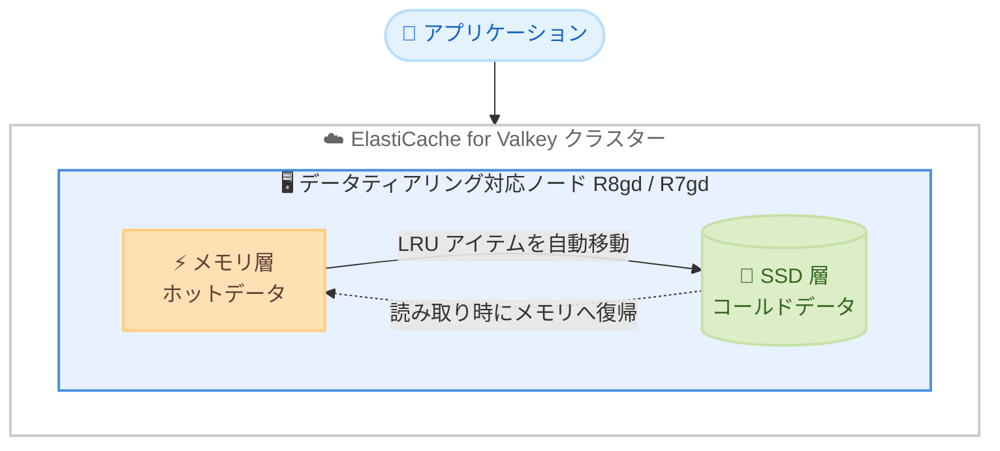

# Amazon ElastiCache - データティアリングが R8gd / R7gd ノードで欧州 (スペイン) とアジアパシフィック (ハイデラバード) に拡大

**リリース日**: 2026 年 10 月 27 日
**サービス**: Amazon ElastiCache
**機能**: データティアリング対応ノード (R8gd / R7gd) のリージョン拡大

📊 [このアップデートのインフォグラフィックを見る](https://takech9203.github.io/aws-news-summary/20261027-elasticache-data-tiering-spain.html)

## 概要

Amazon ElastiCache for Valkey のデータティアリングが、新たに欧州 (スペイン) リージョンで Graviton4 ベースの R8gd ノードと Graviton3 ベースの R7gd ノードに、アジアパシフィック (ハイデラバード) リージョンで R7gd ノードに対応しました。データティアリングは、各ノードのメモリと SSD (ソリッドステートドライブ) を組み合わせることで、数百テラバイト規模までクラスターをコスト効率よくスケールできる機能です。

データティアリングでは、メモリが満杯になると、最も長くアクセスされていないアイテム (LRU: Least Recently Used) を自動的に SSD へ移動し、SSD 上のアイテムが読み取られると自動的にメモリへ戻します。データセット全体のうち定期的にアクセスするのが最大 20% 程度のワークロードや、SSD アクセスによるわずかな読み取りレイテンシー増加を許容できるアプリケーションに適しています。

今回の拡大により、欧州 (スペイン) およびアジアパシフィック (ハイデラバード) のユーザーも、最新世代 Graviton プロセッサの性能向上とデータティアリングによるコスト削減を両立できるようになりました。

**アップデート前の課題**

これらのリージョンでは、データティアリング対応の最新世代ノードを利用できませんでした。

- 欧州 (スペイン) では R8gd / R7gd ノードによるデータティアリングを利用できなかった
- アジアパシフィック (ハイデラバード) では R7gd ノードによるデータティアリングを利用できなかった
- 大容量データセットをすべてメモリに保持する場合、ノードコストが高額になりやすかった

**アップデート後の改善**

今回のアップデートにより、以下が可能になりました。

- 欧州 (スペイン) で R8gd / R7gd ノード、アジアパシフィック (ハイデラバード) で R7gd ノードを使用したデータティアリングが利用可能になった
- R8gd ノード (Graviton4) は、同等サイズの Graviton3 ベースノードと比較して最大 47% 高いスループット、最大 43% 低い P99 レイテンシー、最大 31% 優れた価格性能比を実現
- R7gd ノード (Graviton3) は、Graviton2 ベースノードと比較して最大 28% 高いスループット、最大 21% 優れた P99 レイテンシー、25% 多いネットワーク帯域幅を実現

## アーキテクチャ図



データティアリングでは、メモリが満杯になると最も長くアクセスされていないアイテムを SSD へ自動的に移動し、SSD 上のアイテムへの読み取りが発生すると自動的にメモリへ戻します。アプリケーション側の変更は不要です。

## サービスアップデートの詳細

### 主要機能

1. **データティアリングによる大容量・低コストのスケーリング**
   - 各ノードのメモリと SSD を組み合わせて利用
   - 数百テラバイト規模のデータセットまでコスト効率よくスケール可能
   - メモリのみのノードと比較して、大容量ワークロードの総コストを削減

2. **R8gd ノード (AWS Graviton4 ベース)**
   - 同等サイズの Graviton3 ベースノードと比較して最大 47% 高いスループット
   - 最大 43% 低い P99 レイテンシー
   - 最大 31% 優れた価格性能比
   - 性能向上の実際の値はノードサイズとワークロード特性に依存

3. **R7gd ノード (AWS Graviton3 ベース)**
   - Graviton2 ベースノードと比較して最大 28% 高いスループット
   - 最大 21% 優れた P99 レイテンシー
   - 25% 多いネットワーク帯域幅

## 技術仕様

### データティアリングの動作

| 項目 | 詳細 |
|------|------|
| 対象エンジン | Valkey 7.2 以降 |
| ティアリング方式 | メモリ満杯時に LRU (最も長くアクセスされていないアイテム) を SSD へ移動 |
| データの復帰 | SSD 上のアイテムが読み取られると自動的にメモリへ移動 |
| 適したワークロード | データセットの最大 20% 程度へ定期的にアクセスするワークロード |
| レイテンシー特性 | SSD アクセス時にわずかな読み取りレイテンシー増加が発生 |
| 利用開始方法 | AWS マネジメントコンソール、AWS CLI、SDK で新規クラスター作成または既存クラスターのアップグレード |

### 今回追加されたノードタイプとリージョン

| リージョン | R8gd (Graviton4) | R7gd (Graviton3) |
|------------|------------------|------------------|
| 欧州 (スペイン) | ✓ 新規対応 | ✓ 新規対応 |
| アジアパシフィック (ハイデラバード) | - | ✓ 新規対応 |

## 設定方法

### 前提条件

1. AWS アカウントを保有していること
2. 対象リージョン (欧州 (スペイン) またはアジアパシフィック (ハイデラバード)) を利用すること
3. Valkey 7.2 以降のエンジンバージョンを使用すること

### 手順

#### ステップ 1: データティアリング対応クラスターの作成

```bash
aws elasticache create-replication-group \
    --replication-group-id my-valkey-cluster \
    --replication-group-description "Valkey cluster with data tiering" \
    --engine valkey \
    --engine-version 7.2 \
    --cache-node-type cache.r8gd.xlarge \
    --data-tiering-enabled \
    --num-node-groups 2 \
    --replicas-per-node-group 1 \
    --region eu-south-2
```

欧州 (スペイン) リージョン (eu-south-2) に、R8gd ノードを使用したデータティアリング有効の Valkey クラスターを作成します。`--data-tiering-enabled` フラグでデータティアリングを有効化し、`--cache-node-type` でデータティアリング対応ノードタイプを指定します。

#### ステップ 2: 既存クラスターのノードタイプ変更

```bash
aws elasticache modify-replication-group \
    --replication-group-id my-valkey-cluster \
    --cache-node-type cache.r7gd.xlarge \
    --apply-immediately \
    --region ap-south-2
```

アジアパシフィック (ハイデラバード) リージョン (ap-south-2) の既存クラスターのノードタイプを R7gd に変更します。`--apply-immediately` を指定すると変更が即時適用されます。

#### ステップ 3: クラスターの状態確認

```bash
aws elasticache describe-replication-groups \
    --replication-group-id my-valkey-cluster \
    --query "ReplicationGroups[0].{Status:Status,NodeType:CacheNodeType,DataTiering:DataTiering}"
```

クラスターのステータス、ノードタイプ、データティアリングの有効化状態を確認します。

## メリット

### ビジネス面

- **コスト削減**: 大容量データセットをすべてメモリに保持する代わりに SSD を併用することで、キャッシュ層の総コストを削減できる
- **価格性能比の向上**: R8gd ノードは Graviton3 ベースノードと比較して最大 31% 優れた価格性能比を提供する
- **リージョン選択肢の拡大**: 欧州 (スペイン) とアジアパシフィック (ハイデラバード) のユーザーがデータ主権やレイテンシー要件を満たしつつ最新ノードを利用できる

### 技術面

- **大規模スケーラビリティ**: 数百テラバイト規模のデータセットまでクラスターをスケール可能
- **透過的なティアリング**: LRU ベースの自動的なデータ移動により、アプリケーション側の変更が不要
- **性能向上**: R8gd は最大 47% 高いスループットと最大 43% 低い P99 レイテンシーを実現

## デメリット・制約事項

### 制限事項

- Valkey 7.2 以降のエンジンバージョンが必要
- データティアリングは R8gd / R7gd などのデータティアリング対応ノードタイプでのみ利用可能
- アジアパシフィック (ハイデラバード) で今回対応したのは R7gd のみ (R8gd は対象外)

### 考慮すべき点

- SSD に移動したアイテムへのアクセスには、メモリアクセスと比較してわずかな読み取りレイテンシー増加が発生する
- データセットの大部分へ頻繁にアクセスするワークロードには、メモリのみのノードタイプの方が適する場合がある
- 性能向上の実際の値はノードサイズとワークロード特性に依存する

## ユースケース

### ユースケース 1: 大規模セッションストアのコスト最適化

**シナリオ**: 欧州 (スペイン) で数十テラバイト規模のセッションデータを保持する Web アプリケーションで、アクティブユーザーのセッションは全体の 20% 程度に限られる。

**実装例**:
```bash
aws elasticache create-replication-group \
    --replication-group-id session-store \
    --engine valkey \
    --engine-version 7.2 \
    --cache-node-type cache.r8gd.4xlarge \
    --data-tiering-enabled \
    --num-node-groups 4 \
    --replicas-per-node-group 1 \
    --region eu-south-2
```

**効果**: アクティブセッションはメモリに保持しつつ、非アクティブセッションを SSD に移動することで、メモリのみの構成と比較してコストを削減できる。

### ユースケース 2: ハイデラバードでの大容量キャッシュのレイテンシー要件対応

**シナリオ**: インド国内のユーザー向けサービスで、データ主権と低レイテンシーの要件から、アジアパシフィック (ハイデラバード) リージョン内に大容量キャッシュ層を構築したい。

**実装例**:
```bash
aws elasticache create-replication-group \
    --replication-group-id in-cache \
    --engine valkey \
    --engine-version 7.2 \
    --cache-node-type cache.r7gd.2xlarge \
    --data-tiering-enabled \
    --num-node-groups 3 \
    --replicas-per-node-group 2 \
    --region ap-south-2
```

**効果**: ハイデラバードリージョン内で R7gd ノードのデータティアリングを利用し、データ主権要件を満たしつつ大容量キャッシュをコスト効率よく運用できる。

### ユースケース 3: 既存クラスターの最新世代ノードへのアップグレード

**シナリオ**: 欧州 (スペイン) で旧世代ノードを使用している Valkey クラスターを、性能と価格性能比に優れた R8gd ノードへ移行したい。

**実装例**:
```bash
aws elasticache modify-replication-group \
    --replication-group-id existing-cluster \
    --cache-node-type cache.r8gd.xlarge \
    --apply-immediately \
    --region eu-south-2
```

**効果**: Graviton4 ベースの R8gd ノードにより、最大 47% 高いスループットと最大 43% 低い P99 レイテンシーを得られ、価格性能比も最大 31% 向上する。

## 料金

データティアリング対応ノード (R8gd / R7gd) の料金は、リージョンおよびノードサイズごとに設定されています。詳細は [Amazon ElastiCache 料金ページ](https://aws.amazon.com/elasticache/pricing/) を参照してください。

## 利用可能リージョン

今回のアップデートで追加されたリージョンは以下のとおりです。

- **欧州 (スペイン)**: R8gd および R7gd ノード
- **アジアパシフィック (ハイデラバード)**: R7gd ノード

各ノードタイプが利用可能なリージョンの全体像は、[サポートされているノードタイプのドキュメント](https://docs.aws.amazon.com/AmazonElastiCache/latest/dg/CacheNodes.SupportedTypes.html) を参照してください。

## 関連サービス・機能

- **Amazon ElastiCache for Valkey**: 本アップデートの対象となるオープンソース互換のインメモリキャッシュサービス
- **AWS Graviton プロセッサ**: R8gd (Graviton4) / R7gd (Graviton3) ノードの基盤となる Arm ベースプロセッサで、高い価格性能比を提供
- **Amazon MemoryDB**: 永続性を備えた Valkey / Redis OSS 互換のインメモリデータベース。耐久性が必要な場合の選択肢

## 参考リンク

- 📊 [インフォグラフィック](https://takech9203.github.io/aws-news-summary/20261027-elasticache-data-tiering-spain.html)
- [公式発表 (What's New)](https://aws.amazon.com/about-aws/whats-new/2026/09/elasticache-data-tiering-spain/)
- [ドキュメント: データティアリング](https://docs.aws.amazon.com/AmazonElastiCache/latest/dg/data-tiering.html)
- [ドキュメント: サポートされているノードタイプ](https://docs.aws.amazon.com/AmazonElastiCache/latest/dg/CacheNodes.SupportedTypes.html)
- [料金ページ](https://aws.amazon.com/elasticache/pricing/)

## まとめ

Amazon ElastiCache for Valkey のデータティアリングが、欧州 (スペイン) の R8gd / R7gd ノードとアジアパシフィック (ハイデラバード) の R7gd ノードに拡大されました。これらのリージョンで大容量キャッシュを運用するユーザーは、最新世代 Graviton プロセッサの性能向上とメモリ + SSD 構成によるコスト削減を両立できます。データセットの一部のみへ定期的にアクセスする大規模ワークロードを運用している場合は、データティアリング対応ノードへの移行を検討することを推奨します。
