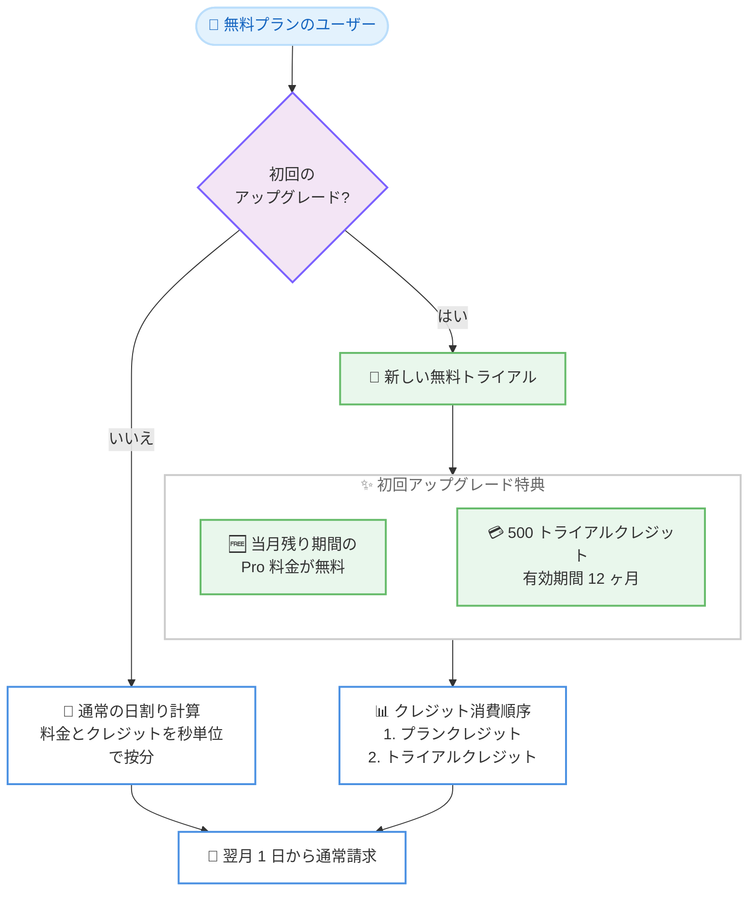

# Kiro - 新しい無料トライアルで 500 クレジットを追加提供

**リリース日**: 2026 年 10 月 27 日 (新トライアルの適用開始は 2026 年 11 月 1 日)
**サービス**: Kiro (AWS が提供する AI 搭載 IDE)
**機能**: 無料トライアルの刷新 (初回アップグレード時の初月無料 + 500 トライアルクレジット、秒単位の日割り計算)

📊 [このアップデートのインフォグラフィックを見る](https://takech9203.github.io/aws-news-summary/20261027-kiro-kiros-new-free-trial-gives-you-500-extra-credits.html)

## 概要

Kiro は 2026 年 11 月 1 日から、無料トライアルの仕組みを刷新すると発表しました。無料プランから初めて Pro プランにアップグレードしたユーザーは、その月の残り期間が無料になり、さらに 12 ヶ月間有効な 500 トライアルクレジットを受け取れます。たとえば月の 15 日にアップグレードした場合、翌月 1 日まで支払いは発生せず、約半月分の Pro プランクレジットに加えて 500 クレジットを利用できます。

あわせて、プラン料金とクレジットの両方が日割り (秒単位のプロレーション) で計算されるようになります。月の途中でアップグレードした場合、1 ヶ月分のクレジットではなく、残り日数に応じたクレジットが付与されます。初回アップグレードの対象は Pro プランに限らず、Pro+、Pro Max、Power から開始することも可能で、その場合も Pro プラン 1 ヶ月分の無料枠が適用され、差額のみを支払う仕組みです。

この変更は、課金の公平性を高めるとともに、月のどのタイミングでサインアップしても良い初回体験を提供することを目的としています。月末近くにサインアップしたユーザーでも、月をまたいで失効しない 500 トライアルクレジットにより、実際のプロジェクトで Kiro をじっくり試すことができます。

**アップデート前の課題**

従来の無料トライアルには、以下の課題がありました。

- 初回アップグレード特典は 20 ドルの割引であり、月の途中でアップグレードしても料金やクレジットが日割りされず、タイミングによって得られる価値に差があった
- 月末近くにサインアップしたユーザーは、その月のうちに十分な評価期間を確保しにくかった
- アップグレードのタイミングによって初回体験が左右され、課金の公平性に欠ける面があった

**アップデート後の改善**

今回のアップデートにより、以下が改善されます。

- 初回アップグレード時は当月の残り期間が無料になり、初回請求は翌月 1 日に発生する
- 12 ヶ月間有効な 500 トライアルクレジットが付与され、月をまたいでも失効しないため、自分のペースで評価できる
- プラン料金とクレジットが秒単位で日割り計算され、アップグレードのタイミングにかかわらず公平な課金となる
- Pro+、Pro Max、Power などの上位プランから開始しても、Pro プラン 1 ヶ月分の無料枠が差額計算に適用される

## アーキテクチャ図



初回アップグレード時の特典適用フローとクレジット消費順序を示しています。初回のみ当月無料と 500 トライアルクレジットが付与され、2 回目以降は通常の日割り計算が適用されます。

## サービスアップデートの詳細

### 主要機能

1. **初回アップグレードの初月無料**
   - 無料プランから初めて Pro プランにアップグレードすると、その月の残り期間の料金が無料になる
   - 初回の請求は翌月 1 日に発生する
   - 無料期間中もアップグレード時点からの日割り分のプランクレジットを受け取れる

2. **500 トライアルクレジットの付与**
   - 初回アップグレード時に 500 トライアルクレジットを付与
   - 有効期間は 12 ヶ月で、月末に失効しない
   - トライアルクレジットはプランクレジットを使い切った後に消費される

3. **秒単位の日割り計算 (プロレーション)**
   - 2026 年 11 月 1 日から、プラン料金とクレジットの両方が秒単位で日割り計算される
   - 月の途中でアップグレードした場合、残り期間に応じた料金とクレジットが適用される
   - 計算式: 日割り料金 = (残り秒数 / 当月の総秒数) × 月額プラン料金、日割りクレジット = (残り秒数 / 当月の総秒数) × 月間プランクレジット

4. **上位プランからの開始に対応**
   - Pro の代わりに Pro+、Pro Max、Power から開始することも可能
   - その場合も Pro プラン 1 ヶ月分の無料枠が適用され、選択プランの日割り価格と Pro の日割り価格の差額のみを支払う

5. **ダウングレード時のクレジット引き継ぎ**
   - 無料プランに戻した場合、未使用のトライアルクレジットは引き継がれる
   - ただし無料プランでは、トライアルクレジットは無料プラン対象モデルにのみ使用できる
   - 無料トライアルは初回アップグレード時のみ適用され、再アップグレード時は通常の日割り計算となる (2 回目の無料月はなし)

## 技術仕様

### 日割り計算の仕組み

| 項目 | 詳細 |
|------|------|
| 計算単位 | 秒単位 (アップグレードした正確な時刻に基づく) |
| 日割り料金 | (請求サイクルの残り秒数 / 当月の総秒数) × 月額プラン料金 |
| 日割りクレジット | (請求サイクルの残り秒数 / 当月の総秒数) × 月間プランクレジット |
| トライアルクレジットの消費順序 | プランクレジットを使い切った後に消費 |
| トライアルクレジットの有効期間 | 12 ヶ月 |
| 適用開始日 | 2026 年 11 月 1 日 |

### 計算例: 30 日の月の 15 日目 00:00 UTC にアップグレードした場合

Pro プラン (月額 20 ドル、月間 1,000 クレジット) を例にすると、30 日の月 (2,592,000 秒) の 15 日目 00:00 UTC にアップグレードした場合、残りは 16 日 (1,382,400 秒) です。

- 日割り料金: (1,382,400 / 2,592,000) × 20 ドル = 10.67 ドル
- 日割りクレジット: (1,382,400 / 2,592,000) × 1,000 = 533 クレジット
- 初月は無料のため、支払いは 0 ドルで、533 プランクレジットと 500 トライアルクレジットを受け取れる

なお、同じ日でも 14:30 UTC など遅い時刻にアップグレードすると残り秒数が減るため、日割り料金とクレジットはその分少なくなります。

## メリット

### ビジネス面

- **公平な課金**: 秒単位の日割り計算により、アップグレードのタイミングによる損得がなくなる
- **低リスクな評価**: 初月無料と 12 ヶ月有効な 500 トライアルクレジットにより、コストをかけずに実プロジェクトで Kiro を評価できる
- **サインアップ時期の自由度**: 月末近くのサインアップでも十分な評価期間を確保できる

### 技術面

- **クレジット消費の透明性**: プランクレジット消費後にトライアルクレジットを消費する明確な順序が定義されている
- **上位プランの柔軟な選択**: 評価段階から Pro+、Pro Max、Power を選択でき、差額のみの支払いで済む
- **ダウングレード時の資産保全**: 無料プランに戻しても未使用トライアルクレジットが引き継がれる

## デメリット・制約事項

### 制限事項

- 無料トライアル (初月無料 + 500 クレジット) は初回アップグレード時のみ適用され、再アップグレード時には適用されない
- トライアルクレジットの有効期間は 12 ヶ月で、期限後は失効する
- 無料プランにダウングレードした場合、トライアルクレジットは無料プラン対象モデルにのみ使用できる

### 考慮すべき点

- 2026 年 11 月 1 日より前にアップグレードした場合は従来の 20 ドル割引が適用され、未使用クレジットも維持されるが、同日以降は新トライアルに置き換わる
- 日割りクレジットは残り期間に比例するため、月の後半にアップグレードすると当月に受け取るプランクレジットは少なくなる (その分トライアルクレジットで補完できる)
- アップグレード時刻 (秒単位) によって日割り額が変わるため、計算例と実際の金額は異なる場合がある

## ユースケース

### ユースケース 1: 月末サインアップのユーザーによる本格評価

**シナリオ**: 月の 28 日に Kiro にサインアップした開発者が、実際のプロジェクトで Kiro の能力を評価したい。

**実装例**:
```
1. 無料プランでサインアップし、基本機能を確認
2. Pro プランにアップグレード (初回のため当月残りは無料)
3. 残り日数分の日割りプランクレジット + 500 トライアルクレジットを受領
4. 月をまたいでトライアルクレジットを使い、実プロジェクトで評価を継続
```

**効果**: 月末のサインアップでも、失効しない 500 トライアルクレジットにより十分な評価期間を確保できる。

### ユースケース 2: チーム導入前の上位プラン検証

**シナリオ**: チームでの導入を検討しており、最初から大きなクレジット枠を持つ Pro Max プランで検証したい。

**実装例**:
```
1. 初回アップグレードで Pro Max を選択 (30 日の月の 15 日目 00:00 UTC の場合)
2. Pro Max の日割り料金 53.33 ドルから Pro の無料枠 10.67 ドルを差し引いた 42.67 ドルを支払う
3. 2,667 プランクレジット + 500 トライアルクレジット = 3,167 クレジットで検証
```

**効果**: 初回から上位プランを選択しつつ、Pro 1 ヶ月分の無料枠を差額計算に活用できる。

### ユースケース 3: 評価後の一時的なダウングレード

**シナリオ**: 評価後にいったん無料プランに戻し、次のプロジェクト開始時に再度有料プランを利用したい。

**実装例**:
```
1. 有料プランから無料プランにダウングレード (未使用トライアルクレジットは引き継ぎ)
2. 無料プランではトライアルクレジットを無料プラン対象モデルに使用
3. 次のプロジェクト開始時に再アップグレード (日割り計算が適用、2 回目の無料月はなし)
```

**効果**: 未使用クレジットを無駄にせず、利用状況に応じた柔軟なプラン変更ができる。

## 料金

2026 年 11 月 1 日以降、プラン料金とクレジットは秒単位で日割り計算されます。初回アップグレード時は当月残りの Pro 料金が無料になり、500 トライアルクレジットが付与されます。上位プランを選択した場合は、選択プランの日割り価格と Pro の日割り価格の差額のみを支払います。

### 料金例: 30 日の月の 15 日目 00:00 UTC にアップグレードした場合 (残り 16 日)

| プラン | 日割り料金 | 支払額 | プランクレジット | トライアルクレジット | 合計クレジット |
|--------|-----------|--------|------------------|----------------------|----------------|
| Pro | $10.67 | $0 | 533 | 500 | 1,033 |
| Pro+ | $21.33 | $10.67 | 1,067 | 500 | 1,567 |
| Pro Max | $53.33 | $42.67 | 2,667 | 500 | 3,167 |
| Power | $106.67 | $96.00 | 5,333 | 500 | 5,833 |

なお、2026 年 11 月 1 日より前のアップグレードには従来どおり 20 ドルの割引が適用され、未使用クレジットも維持されます。

## 利用可能リージョン

グローバル (Kiro はグローバルに提供されるサービスです)

## 関連サービス・機能

- **Kiro Pro / Pro+ / Pro Max / Power プラン**: 今回の無料トライアルと日割り計算の対象となる有料プラン
- **Kiro 無料プラン**: トライアルの起点となるプラン。ダウングレード時はトライアルクレジットを無料プラン対象モデルに使用可能
- **Kiro のクレジットシステム**: AI モデルの利用量を管理する仕組みで、プランクレジットとトライアルクレジットの 2 種類が存在

## 参考リンク

- 📊 [インフォグラフィック](https://takech9203.github.io/aws-news-summary/20261027-kiro-kiros-new-free-trial-gives-you-500-extra-credits.html)
- [公式発表 (Kiro Blog)](https://kiro.dev/blog/kiros-new-free-trial-gives-you-500-extra-credits/)
- [Kiro 料金ページ](https://kiro.dev/pricing/)
- [Kiro ドキュメント](https://kiro.dev/docs/)

## まとめ

Kiro の新しい無料トライアルは、初回アップグレード時の初月無料と 12 ヶ月有効な 500 トライアルクレジットにより、サインアップのタイミングを問わず公平で十分な評価機会を提供します。秒単位の日割り計算の導入により課金の透明性も向上しており、Kiro の導入を検討しているユーザーは 2026 年 11 月 1 日以降の新トライアルを活用した評価をおすすめします。なお、11 月 1 日より前のアップグレードには従来の 20 ドル割引が適用されるため、移行時期に応じた特典の違いに留意してください。
